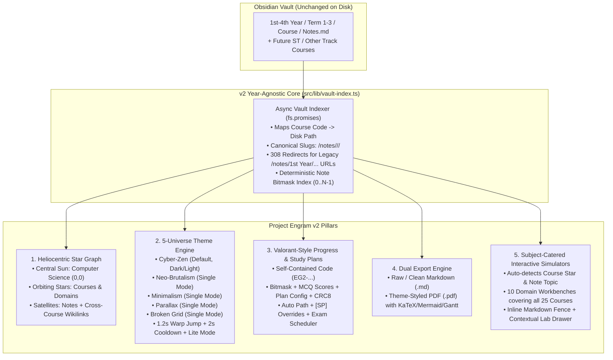
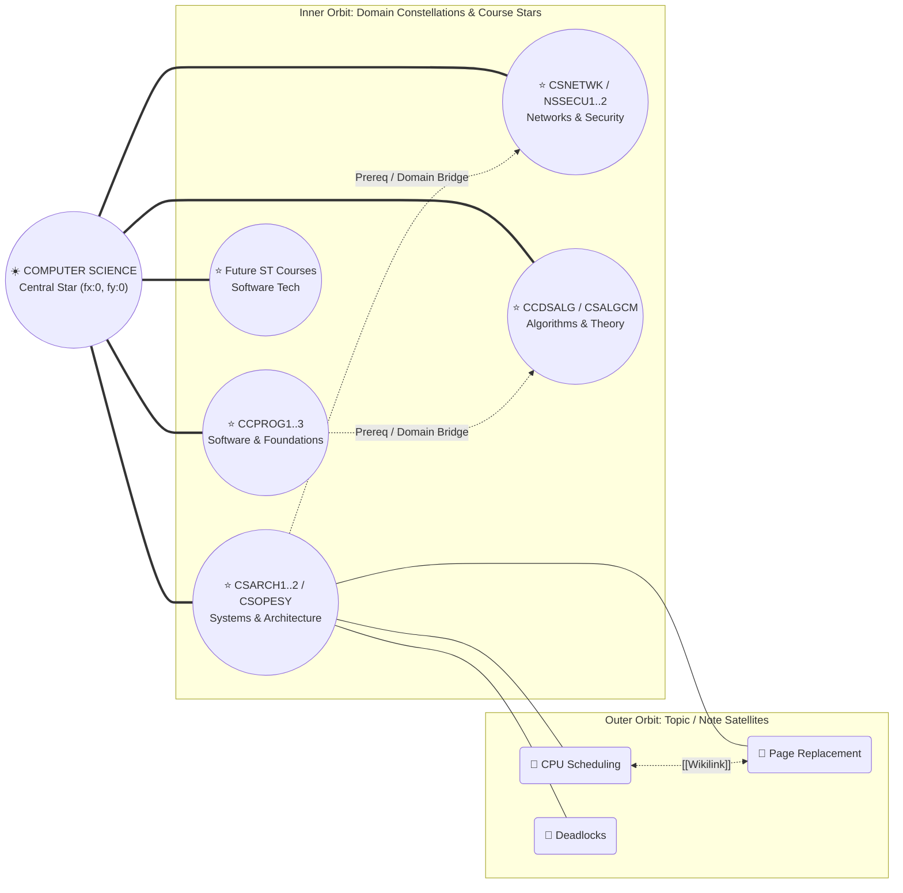
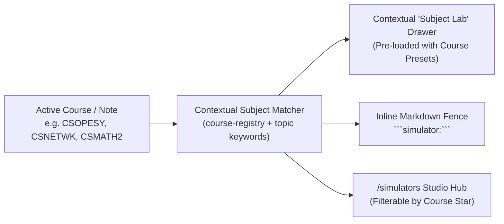

# Project Engram v2 — Master Architecture & Implementation Plan

> [!IMPORTANT]
> **Branch & PR Strategy (`v2` Integration Branch)**
> All work for Project Engram v2 will be developed on a dedicated `v2` branch created from `main` using the repository's local Git identity (`2ru17 <neilgutangjr@gmail.com>`). Each phase below represents a clean, verifiable milestone committed to `v2`, culminating in a Pull Request (`v2 -> main`) once all verification checks pass.

---

## 1. Architectural Vision & Core Decisions

Based on our design alignment, **Project Engram v2** evolves the platform from a fixed 4-year NIS curriculum viewer into a track-agnostic, interactive Computer Science knowledge universe:



---

## 2. Skill & Custom Subagent Orchestration Strategy

To keep memory usage low on your Fedora workstation while maximizing code and design quality, we will pair specialized workspace skills with lightweight, scoped subagents (one active heavy subagent at a time, writing drafts to scratch/workspace and verified in the main thread):

| Phase / Domain | Activated Skills | Subagent Role & Responsibility |
| :--- | :--- | :--- |
| **Phase 1: Star System Graph & Routing** | `redesign-existing-projects`, `full-output-enforcement` | **Graph & Taxonomy Architect (`self`)**: Builds `vault-index.ts`, updates `/api/graph`, and upgrades `ObsidianGraph.tsx` with radial D3 orbital physics. |
| **Phase 2: 5-Universe Theme Engine** | `industrial-brutalist-ui` (Neo-Brutalism), `minimalist-ui` (Minimalism), `gpt-taste` (Parallax), `design-taste-frontend` (Broken Grid), `high-end-visual-design` | **Theme Universe Engineer (`self`)**: Authors CSS token matrices, layout variants, and the `WarpJumpOverlay.tsx` transition engine. |
| **Phase 3: Valorant Code & Study Plans** | `full-output-enforcement`, `engram-note-maker` | **Codec & Scheduler Engineer (`self`)**: Implements the binary bit-packer + LZ/Base62 codec (`EG2-...`) with unit tests and the 3-tier Study Plan UI. |
| **Phase 4: Export Pipeline (`.md` & `.pdf`)** | `high-end-visual-design` | **Export Pipeline Specialist (`self`)**: Builds the Markdown serializer and theme-aware PDF print/canvas pipeline. |
| **Phase 5: Subject-Catered CS Simulators** | `design-taste-frontend`, `full-output-enforcement` | **CS Simulator Builder (`self`)**: Builds the 10 subject-catered interactive workbenches, auto-topic matcher, and ` ```simulator:... ` directive. |

---

## 3. Phase-by-Phase Implementation Blueprint

### Phase 1: Year-Agnostic Taxonomy & Heliocentric "Star System" Force Graph

#### 1.1 Physical Vault vs. Canonical URL Decoupling
- **Zero disruption to Obsidian**: Your vault keeps `1st Year/Term 1/CCPROG1/...` on disk so your `rsync` workflow remains 100% identical.
- **Canonical URLs**: Every note resolves at `/notes/<COURSE>/<Module>/<Note>` (e.g., `/notes/CSOPESY/Process%20Management/CPU%20Scheduling`).
- **Legacy URL Backward Compatibility**: Visiting `/notes/1st%20Year/Term%201/CCPROG1/...` or `/notes/3rd%20Year/Term%201/CSOPESY/...` is automatically detected and redirected (`308 Permanent Redirect`) to `/notes/CCPROG1/...` or `/notes/CSOPESY/...`.
- **Track-Agnostic Extensibility**: Adding future courses from **Software Technology (ST)** or any other program only requires placing the folder anywhere in `Main Notes/` with `course: <CODE>` in frontmatter and an entry in [course-registry.ts](file:///home/2ru17/Documents/Coding-Stuff/Pers-Projs/Notes-Website-Engram/Project-Engram/src/lib/course-registry.ts).

#### 1.2 Heliocentric Star System Graph (`ObsidianGraph.tsx` & `/api/graph/route.ts`)


- **Graph Node Tiers**:
  - `tier: "sun"` — **Computer Science** pinned at `(0, 0)` with custom canvas solar corona shader/rings.
  - `tier: "star"` — **Course Stars** (e.g., `CSOPESY`, `CCDSALG`, `NSSECU2`) positioned via `d3.forceRadial(220, 0, 0)` and linked both to the central Sun and to related courses via a **Course Constellation Graph** (curriculum/conceptual adjacency matrix in `course-registry.ts`, independent of year/term).
  - `tier: "satellite"` — **Individual Notes** orbiting their parent Course Star (`d3.forceRadial(420, 0, 0)`) and connected across courses via `[[wikilinks]]`.
- **Files to Create / Modify**:
  - `[NEW]` `src/lib/vault-index.ts` — Async (`fs.promises`) singleton cache indexing all markdown files by `courseCode`, `canonicalSlug`, `legacySlug`, `deterministicBitIndex`, word count, and MCQ count.
  - `[MODIFY]` [course-registry.ts](file:///home/2ru17/Documents/Coding-Stuff/Pers-Projs/Notes-Website-Engram/Project-Engram/src/lib/course-registry.ts) — Remove `year` and `term` as primary grouping keys; add `domain` (`"Systems & Architecture"`, `"Algorithms & Theory"`, `"Networks & Cybersecurity"`, `"Software Engineering & Web"`, `"Mathematics & Modeling"`), `relatedCourses: string[]` constellation links, and `defaultSimulators: SimulatorId[]`.
  - `[MODIFY]` [route.ts](file:///home/2ru17/Documents/Coding-Stuff/Pers-Projs/Notes-Website-Engram/Project-Engram/src/app/api/graph/route.ts) — Emit `sun`, `star`, and `satellite` nodes + `solar`, `constellation`, `orbital`, and `wikilink` edges.
  - `[MODIFY]` [ObsidianGraph.tsx](file:///home/2ru17/Documents/Coding-Stuff/Pers-Projs/Notes-Website-Engram/Project-Engram/src/components/ObsidianGraph.tsx) — Add radial orbital forces, custom canvas rendering for the Central Sun (`☀️ Computer Science`), Course Stars with orbital rings, and theme-reactive color palettes.
  - `[MODIFY]` [page.tsx](file:///home/2ru17/Documents/Coding-Stuff/Pers-Projs/Notes-Website-Engram/Project-Engram/src/app/notes/[...slug]/page.tsx), [DirectoryView.tsx](file:///home/2ru17/Documents/Coding-Stuff/Pers-Projs/Notes-Website-Engram/Project-Engram/src/components/DirectoryView.tsx), [page.tsx](file:///home/2ru17/Documents/Coding-Stuff/Pers-Projs/Notes-Website-Engram/Project-Engram/src/app/page.tsx), [sitemap.ts](file:///home/2ru17/Documents/Coding-Stuff/Pers-Projs/Notes-Website-Engram/Project-Engram/src/app/sitemap.ts) — Switch all links, breadcrumbs, sidebar trees, and home page course explorer from `1st–4th Year` tabs to **Star Domains / Course Stars**.

---

### Phase 2: 5-Universe Theme Engine & "Warp Jump" Choreography

#### 2.1 Theme Token & Layout Matrix
We will update [GEMINI.md](file:///home/2ru17/Documents/Coding-Stuff/Pers-Projs/Notes-Website-Engram/GEMINI.md) so the original Cyber-Zen tokens remain the default invariant while formally documenting the 4 new single-mode universes:

| Universe ID | Reference Aesthetic | Color & Surface Architecture | Typography & Borders | Layout & Motion Signature |
| :--- | :--- | :--- | :--- | :--- |
| **`cyber-zen`** *(Default)* | Current Project Engram | Supports **Dark** (`#0d1017` + `#00E5FF` cyan) & **Light** (`#f8fafc` + `#0284c7`) | `Cinzel` headings + clean sans body (`max-w-3xl`, `1.65` lh) | Tech-noir easing `[0.16, 1, 0.3, 1]`, subtle glassmorphism |
| **`neo-brutalism`** *(Single Mode)* | [neubrutalism.com](https://neubrutalism.com/) | Warm Cream canvas `#FFFDF7`, punchy cards (`#FFDE59`, `#FF6B6B`, `#4ECDC4`, `#A388EE`), pure ink `#111111` | Bold grotesque (`Space Grotesk` / `Syne`) + `JetBrains Mono` badges; `3px solid #111` borders; `5px 5px 0px #111` hard shadows | Snappy mechanical button press (`translate(3px, 3px)` on active), exposed ticker tapes & sticker tags |
| **`minimalism`** *(Single Mode)* | [kickpush.co](https://kickpush.co/) | Warm editorial paper `#F6F5F0`, pure charcoal `#161615`, muted stone `#78756E`, subtle accent `#D94E34` | Editorial serif/sans (`Instrument Serif` / `Inter`), `1px solid #E2E0D8` hairlines, **zero** drop shadows or gradients | Whisper-quiet opacity/mask reveals, generous studio whitespace, numbered index rows |
| **`parallax`** *(Single Mode)* | [beargrylls.com](http://www.beargrylls.com/) | Deep expedition slate `#0A0E14`, horizon gold `#E5A93C`, atmospheric mist gradients & topographic SVG contours | High-impact condensed display (`Oswald` / `Cinzel`) + crisp sans | Multi-plane Z-axis scroll parallax on landing/course hub, depth-of-field floating cards |
| **`broken-grid`** *(Single Mode)* | [dau.lt](https://dau.lt/) | Architectural off-white `#EFECE6` with exposed `1px dashed #C8C3B8` structural column lines and high-contrast `#0F0F0F` blocks | Swiss neo-grotesque + oversized marginalia coordinates (`01 // SYS`) | Intentionally asymmetric overlapping cards (`-mt-6`, offset column spans), editorial side-notes |

#### 2.2 "Warp Jump" Transition & Cooldown Engine
- **Component**: `[NEW] src/components/WarpJumpOverlay.tsx`
- **Choreography (~1.2s total)**:
  1. **0–400ms (Implosion)**: Current viewport scales toward the center (`scale(0.92)` + radial blur) as star streaks converge into the central CS Sun.
  2. **400–650ms (Singularity Swap)**: HTML attributes `data-universe="<target>"` and theme CSS variables flip at peak flash while the target Universe badge & coordinates render at center screen.
  3. **650–1200ms (Universe Arrival)**: Unfolds using the target theme's signature entrance (hard-cut stamp for `neo-brutalism`, calm curtain fade for `minimalism`, Z-depth zoom for `parallax`, grid-line assembly for `broken-grid`, cyan scanline for `cyber-zen`).
- **Anti-Spam Cooldown**: `ThemeProvider` enforces a `2000ms` lock (`cooldownUntil` timestamp) with a circular SVG countdown indicator around the Universe Switcher button in `TopNav.tsx`.
- **Lite Mode (`data-perf="lite"`)**: Completely bypasses canvas star streaks and scale transforms, executing a clean 200ms opacity fade with zero GPU spike.

---

### Phase 3: Valorant Crosshair-Style Progress Code (`EG2-...`) & 3-Tier Study Plans

#### 3.1 Self-Contained Progress Code Specification (`src/lib/progress-codec.ts`)
Just like Valorant crosshair profiles (`0;P;c;5;o;1...`), the Engram v2 code requires **zero accounts and zero backend storage**:

```
EG2-1-<CourseFilterTag>-<Base62CompressedPayload>-<CRC8>
```

- **Binary Payload Structure (before compression)**:
  - `Header (2 bytes)`: Codec version (`0x02`), active Universe ID (`0..4`), Lite mode flag (`0..1`), active Study Plan mode (`0..2`).
  - `Study Plan Config (8 bytes)`: Target exam Unix day offset (`uint16`), daily study minutes (`uint16`), selected course bitmask (`uint32` covering up to 32 courses).
  - `Completion Bitfield (⌈N / 8⌉ bytes, ~68 bytes for 539 notes)`: `1` bit per note in deterministic `(courseCode, relativePath)` order.
  - `Sparse MCQ High Scores`: Run-length / sparse pairs `(noteIndex: uint16, scorePercent: uint8)` for completed quizzes.
- **Compression & Encoding**:
  - Compressed via native browser `CompressionStream('deflate-raw')` (with a lightweight pure-TS LZ/RLE fallback for synchronous calls) and encoded in URL-safe Base62/Base64URL.
  - Typical code length: **`~55 to 110 characters`**—easily pasted into Discord, Obsidian, or sticky notes when switching between desktop and laptop.
  - Validated on import using an 8-bit CRC checksum (`CRC8`) with clear error feedback if a character is mistyped.

#### 3.2 3-Tier Study Plan Engine (`src/app/study-plan/page.tsx` & Course Drawer)
1. **Tier 1 — Auto-Generated Course Roadmap**:
   - Automatically sequences every course's modules and notes by following folder prefixes and `## References & Navigation` (`[[Previous Topic]]` -> `[[Next Topic]]`) chains.
   - Displays estimated reading time (`⌈words / 200⌉ min`) + MCQ practice time (`mcqs × 1.5 min`) and completion checkboxes that immediately update your `EG2-...` code.
2. **Tier 2 — Vault `[SP]` Markdown Overrides**:
   - Detects any `[SP] <Course>.md` file in the vault and renders custom milestones/checklists alongside the auto-generated graph.
3. **Tier 3 — Interactive Exam-Date Scheduler**:
   - Select 1 or more Course Stars (e.g., `CSOPESY` + `NSSECU2`), pick your target exam date, and set your daily study budget (`1–6 hrs/day`).
   - Generates a day-by-day study calendar distributing notes and `[REV]`/`[QZ]` files evenly with a buffer day before the exam.

---

### Phase 4: Dual Export Engine (Markdown & Theme-Styled PDF)

- **Component**: `[NEW] src/components/ExportMenu.tsx` mounted in the Note Header (`ClientNoteLayout.tsx`) and Study Plan page.
- **Option A — Export Markdown (`.md`)**:
  - Instant client-side Blob download of the note's raw markdown, with a toggle to **Include / Strip YAML Frontmatter & Answer Keys** (helpful when students want a clean self-test sheet).
- **Option B — Export Theme-Styled PDF (`.pdf`)**:
  - Opens a dedicated, high-precision print/PDF pipeline (`?export=pdf` view + `@media print` universe rules) that preserves:
    - The **active Universe's visual design** (e.g., Neo-Brutalist thick borders & yellow callouts, Minimalist editorial serif layout, or Cyber-Zen obsidian/light styling) via `print-color-adjust: exact`.
    - Pre-rendered **KaTeX math equations**, **Mermaid SVG diagrams**, **Cyber-Zen Gantt charts**, and syntax-highlighted code blocks with `break-inside: avoid` so diagrams and tables never slice awkwardly across pages.

---

### Phase 5: Subject-Catered Interactive CS Simulators & Workbenches

Rather than generic, disconnected widgets, **Project Engram v2** includes a **Subject-Catered Interactive Engine (`src/lib/simulator-registry.ts` + `src/components/simulators/`)** that automatically tailors interactive tools to the exact **Course Star** and **Note Topic** the user is studying!



#### 5.1 Complete Subject-to-Simulator Matrix (All 25 Courses Catered)

| Domain Cluster | Courses Covered | Catered Interactive Workbench / Simulator | Key Interactive Features & Presets |
| :--- | :--- | :--- | :--- |
| **1. OS & Kernel Systems** | `CSOPESY` | **CPU Scheduler & Virtual Memory Paging Lab** (`cpu-scheduler`, `page-replacement`) | • Live Gantt builder for **FCFS, SJF, SRTF, Priority, Round Robin** with $TAT / WT / RT$ table<br>• **FIFO, LRU, Optimal** page frame matrix with hit/fault telemetry |
| **2. Computer Architecture & Digital Logic** | `CSARCH1`, `CSARCH2`, `LBYARCH`, `CCICOMP` | **5-Stage Pipeline, Cache Mapper & Logic/IEEE-754 Workbench** (`pipeline-cache`, `digital-logic`) | • `IF-ID-EX-MEM-WB` cycle grid with **RAW hazard detection, stalls & forwarding**<br>• Direct / Set-Associative **Cache Tag-Index-Offset** calculator<br>• **Binary / Two's Complement / IEEE-754** bit flipper + Boolean Truth Table & K-Map solver |
| **3. Data Structures, Algorithms & AI** | `CCDSALG`, `CSALGCM`, `CSINTSY` | **Graph, Pathfinding, Sorting & DP Matrix Playground** (`algo-visualizer`) | • Step-by-step **BFS, DFS, Dijkstra, A* Search, Minimax $\alpha$-$\beta$**, & **Merge/Quick Sort**<br>• Interactive **0/1 Knapsack & LCS Dynamic Programming** table filler |
| **4. Discrete Math & Formal Logic** | `CCDSTRU` | **Propositional Logic Truth-Table & Relation Matrix Analyzer** (`discrete-logic`) | • Parses expressions like `(p /\ q) -> ~r`, checks **Tautology/Contradiction**, and tests **Reflexive / Symmetric / Transitive** relation matrices |
| **5. Computer Networks & Comms** | `CSNETWK`, `NSCOM01`, `NSCOM02`, `NSCOM03` | **IPv4 CIDR/VLSM Subnetter, Routing & Physical Layer Waveform Sim** (`network-lab`) | • Interactive 32-bit **CIDR & VLSM subnet splitter** (Network, Broadcast, Usable hosts)<br>• **Line Coding Waveform plotter** (NRZ-L, NRZ-I, Manchester, Diff-Manchester) + **CRC polynomial division** checker |
| **6. Cybersecurity & Offensive VAPT** | `NSSECU1`, `NSSECU2` | **Cryptography Cipher Box & CVSS v3.1 / Recon Builder** (`security-lab`) | • Interactive **RSA / Diffie-Hellman key exchange & AES/Vigenère** step inspector (`NSSECU1`)<br>• **CVSS v3.1 Base Score calculator** + interactive **Nmap command flag synthesizer** (`NSSECU2`) |
| **7. Calculus & Linear Algebra** | `CSMATH1`, `CSMATH2` | **Matrix Transformation & Calculus Riemann/Derivative Plotter** (`math-visualizer`) | • Interactive 2D vector basis & $2\times2$ / $3\times3$ **Matrix Determinant, Inverse & Eigenvector** canvas<br>• Function **Derivative tangent & Riemann sum** integral slider (`Left`, `Right`, `Midpoint`, `Trapezoidal`) |
| **8. Probability, Stats & Stochastic Modeling** | `STT101A`, `CSMODEL` | **Distribution $p$-Value Explorer & Monte Carlo / $M/M/1$ Queue Sim** (`stats-modeling`) | • Interactive **Normal ($Z$), Student-$t$, Binomial** distribution curve shade & critical-value finder<br>• Live **Monte Carlo $\pi$ estimator** & **$M/M/1$ Queuing System** arrival/service ($\lambda / \mu$) telemetry |
| **9. Programming & Memory Architecture** | `CCPROG1`, `CCPROG2`, `CCPROG3`, `CSADPRG` | **Stack/Heap Pointer & Activation Record Visualizer** (`memory-model`) | • Interactive C pointer dereference (`*p`, `&x`, `malloc`/`free`), recursion call-stack frames, and Java OOP object reference graph |
| **10. Databases & Web Systems** *(+ Future `ST` Courses)* | `CCINFOM`, `CCAPDEV` | **SQL Join / BCNF Normalizer & REST Pipeline Inspector** (`db-web-lab`) | • Interactive **SQL Join Venn & sample table merger** (`INNER`, `LEFT`, `RIGHT`, `FULL`) + Functional Dependency ($X \rightarrow Y$) key checker<br>• **HTTP Request / Express Middleware / JWT Auth** flow tracer |

#### 5.2 How Subject Catering Works in Practice
1. **Automatic Contextual Detection on Note Pages (`CourseSimulatorDock.tsx`)**:
   - Every note page inspects its `course` code and `topic` / title keywords.
   - Example: Opening `CSOPESY/Process Management/CPU Scheduling` displays a glowing **"Launch CPU Scheduler Lab (Preset: SJF vs RR)"** pill in the note header and before the MCQ section.
   - Opening `CSNETWK/.../IPv4 Addressing` displays **"Launch CIDR / VLSM Subnet Workbench"**.
   - Opening `NSSECU2/.../Vulnerability Assessment` displays **"Launch CVSS v3.1 & Nmap Recon Workbench"**.
2. **Course Hub Integration**:
   - Visiting any Course Star directory page (e.g., `/notes/CSARCH2` or `/notes/STT101A`) shows that course's dedicated interactive workbench right alongside its Study Plan and note tree.
3. **Lite Mode Compliance**:
   - When `Lite` mode (`data-perf="lite"`) is active, all simulators use discrete step-by-step state updates rather than continuous 60fps loops.

---

## 4. Complete File Modification & Creation Manifest

| File Path | Action | Responsibility |
| :--- | :--- | :--- |
| `GEMINI.md` | `[MODIFY]` | Scope Cyber-Zen rules as Default Universe and codify the 4 new Universe design specs & v2 URL/Progress standards. |
| `artifacts/implementation_plan.md` | `[NEW]` | Local workspace copy of this master implementation plan inside the repository's `artifacts/` directory. |
| `src/lib/course-registry.ts` | `[MODIFY]` | Add `domain`, `relatedCourses`, `defaultSimulators`, and track-agnostic support (`NIS`, `ST`, etc.); remove strict 4-year grouping dependencies. |
| `src/lib/vault-index.ts` | `[NEW]` | Async `fs.promises` vault indexer: canonical `/notes/<COURSE>/...` resolution, legacy Year/Term redirect lookup, and deterministic note bitmask index. |
| `src/lib/progress-codec.ts` | `[NEW]` | Valorant-style `EG2-...` binary packer, deflate/LZ compressor, Base62 encoder/decoder, and `CRC8` verifier. |
| `src/lib/study-plan-engine.ts` | `[NEW]` | Auto-path builder (module + prev/next link traversal), `[SP]` parser, and Exam-Date daily scheduler. |
| `src/lib/simulator-registry.ts` | `[NEW]` | Maps all 25 courses + note topic keywords to their catered Subject Workbenches and course-specific problem presets. |
| `src/app/api/graph/route.ts` | `[MODIFY]` | Output Heliocentric Star System graph (`sun` at `0,0`, `star` courses with domain/prereq bridges, `satellite` notes). |
| `src/app/api/study-plan/route.ts` | `[NEW]` | Server endpoint returning course note sequences, word/MCQ time estimates, and `[SP]` metadata. |
| `src/components/ObsidianGraph.tsx` | `[MODIFY]` | Add radial D3 forces (`forceRadial`), Central CS Sun rendering, Course Star rings, and Universe-aware canvas palettes. |
| `src/components/ThemeProvider.tsx` | `[MODIFY]` | Manage `universe` (`5` modes), `colorMode` (Cyber-Zen dark/light), `isTransitioning`, and `2000ms` anti-spam cooldown timer. |
| `src/components/WarpJumpOverlay.tsx` | `[NEW]` | 1.2s "Warp Jump" theme-switch animation with per-universe arrival choreography and `Lite` mode 200ms fallback. |
| `src/components/TopNav.tsx` | `[MODIFY]` | Add Universe Selector with 2s cooldown ring, Progress Code (`EG2-...`) quick-sync modal button, and links to `/study-plan` & `/simulators`. |
| `src/app/globals.css` | `[MODIFY]` | Define CSS variable matrices and structural rules for `cyber-zen`, `neo-brutalism`, `minimalism`, `parallax`, `broken-grid`, plus `@media print` PDF styles. |
| `src/app/page.tsx` | `[MODIFY]` | Replace 1st–4th Year tabs with the Heliocentric Star System Explorer & Universe-adaptive landing layouts (including Parallax & Broken Grid variants). |
| `src/app/notes/[...slug]/page.tsx` | `[MODIFY]` | Resolve canonical `/notes/<COURSE>/...` slugs via `vault-index.ts` and `permanentRedirect` legacy `/notes/1st Year/...` paths. |
| `src/components/ClientNoteLayout.tsx` | `[MODIFY]` | Integrate Note Completion toggle (syncs with `EG2-...`), `ExportMenu`, contextual `CourseSimulatorDock`, and Universe-adaptive reading chrome (`max-w-3xl` preserved). |
| `src/components/ExportMenu.tsx` | `[NEW]` | `.md` download (raw or clean self-test) and Theme-Styled `.pdf` export trigger. |
| `src/components/ProgressCodeModal.tsx` | `[NEW]` | Valorant-style crosshair code manager: copy `EG2-...` code, paste/import code with live CRC8 validation, and view telemetry summary. |
| `src/app/study-plan/page.tsx` | `[NEW]` | Interactive 3-tier Study Plan hub (Course Roadmaps, `[SP]` overrides, and Exam-Date Scheduler) synced with `EG2-...` code. |
| `src/components/MarkdownRender.tsx` | `[MODIFY]` | Intercept ` ```simulator:<type> ` blocks to mount interactive CS simulators directly inside study notes. |
| `src/components/simulators/*` | `[NEW]` | `SimulatorShell.tsx`, `CourseSimulatorDock.tsx`, and the 10 domain workbenches catering to all 25 courses. |
| `src/app/simulators/page.tsx` | `[NEW]` | Dedicated CS Interactive Lab studio filterable by Course Star and Domain Cluster, pre-loaded with DLSU coursework presets. |

---

## 5. Verification & QA Plan

1. **Git Branch & Identity Check**:
   - Verify `git config --local user.name` (`2ru17`) and `user.email` (`neilgutangjr@gmail.com`) before branching `v2`.
2. **Routing & Redirect Verification**:
   - Confirm `/notes/CSOPESY/...` and `/notes/CCPROG1/...` render cleanly and legacy `/notes/1st%20Year/Term%201/CCPROG1/...` returns a `308` redirect to `/notes/CCPROG1/...`.
3. **Codec Determinism Test**:
   - Run a unit verification script encoding arbitrary note completion sets + MCQ scores + exam schedules into `EG2-...` strings and verifying 100% lossless round-trip decoding and CRC8 tamper detection.
4. **Subject Simulator Catering Check**:
   - Verify that every course in `COURSE_REGISTRY` resolves to its tailored Interactive Workbench in both `/simulators` and `CourseSimulatorDock.tsx`.
5. **Production Build & Type Safety**:
   - Run `npm run build` to verify Next.js 16 static/dynamic route generation, TypeScript strictness, and zero synchronous `fs` imports.
6. **Pull Request Creation**:
   - Push `v2` to `origin/v2` and open the PR against `main` via `gh pr create` with a complete architectural changelog.
