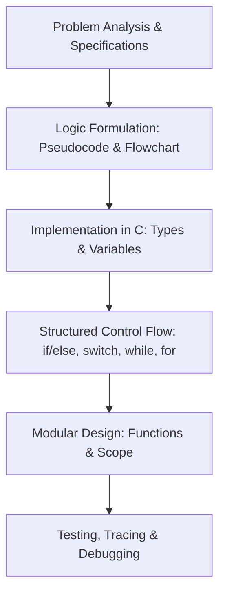

> [!info] Document Metadata
> - **Course:** `=this.course`
> - **Topic:** `=this.topic`
> - **Status:** `=this.status`

**Tags:** #[[Computer Science]] #[[CCPROG1]] #[[C Programming]] #[[Reviewer]] #[[Finals]]

---

# CCPROG1 Comprehensive Finals Reviewer

## Overview

This reviewer consolidates the fundamental programming curriculum in C from CCPROG1: Logic Formulation and Introductory Programming. It spans the complete software development lifecycle, algorithmic logic formulation, flowcharts, variable typing, operators and expressions, modular decomposition with functions, control structures (selection and iteration), testing/debugging methodologies, and coding standards.



---

## 1. Core Syntax & Data Representation Matrix

| Concept | Specifier / Syntax | Size (x86-64) | Range / Behavior |
| :--- | :--- | :--- | :--- |
| **`char`** | `%c` | 1 byte | $-128$ to $127$ (ASCII code) |
| **`int`** | `%d` or `%i` | 4 bytes | $-2^{31}$ to $2^{31}-1$ (approx $\pm 2.14 \times 10^9$) |
| **`float`** | `%f` | 4 bytes | 6-7 decimal digits precision |
| **`double`** | `%lf` | 8 bytes | 15-17 decimal digits precision |
| **Division `/`** | `int / int` vs `float / int` | N/A | Integer division truncates towards zero ($7/2 = 3$). Float division yields $3.5$. |
| **Modulo `%`** | `a % b` | N/A | Remainder of integer division; operands must be integral. |

### Operator Precedence Hierarchy (Highest to Lowest)
1. Parentheses: `()`
2. Postfix / Unary: `++`, `--`, `+`, `-`, `!`
3. Multiplicative: `*`, `/`, `%`
4. Additive: `+`, `-`
5. Relational: `<`, `<=`, `>`, `>=`
6. Equality: `==`, `!=`
7. Logical AND: `&&` (Short-circuiting: evaluates right only if left is true)
8. Logical OR: `||` (Short-circuiting: evaluates right only if left is false)
9. Assignment: `=`, `+=`, `-=`, etc.

---

## 2. Modular Decomposition & Functions

In C, functions enforce encapsulation and procedural abstraction.
- **Pass-by-Value**: C passes all primitive parameters by value. A local copy is allocated on the activation frame (call stack). Modifications to the formal parameter inside the callee do not affect the caller's actual arguments.
- **Scope & Storage Duration**:
  - **Block scope**: Visible only within enclosing `{}`.
  - **Function prototype**: Declares return type and signature before `main()` so the compiler can perform type checking.

```mermaid
sequenceDiagram
    participant Main as main() Stack Frame
    participant Callee as square(int x) Stack Frame
    Main->>Callee: Pass value of a (e.g. 5) copied to x
    Note over Callee: Local x = 5; calculates 5 * 5 = 25
    Callee-->>Main: Return 25 to caller
    Note over Main: Stack frame of square() destroyed
```

---

## 3. Control Flow Architecture

### Selection Structures
- **`if ... else if ... else`**: Evaluates sequential boolean conditions.
- **`switch(expr)`**: Evaluates integral expressions against constant labels. Requires explicit `break;` to prevent fallthrough.

### Iterative Structures
- **`while(condition)`**: Pre-test loop. Executes 0 or more times.
- **`for(init; condition; update)`**: Deterministic count-controlled loop.
- **`do ... while(condition);`**: Post-test loop. Guarantees execution at least once.

---

## 4. High-Yield Exam Checklist

- [ ] Does integer division discard decimal portions? ($5 / 2 = 2$).
- [ ] Does `scanf("%d", &val)` require an address-of operator `&`?
- [ ] Did you avoid placing a semicolon after `if(...)` or `while(...)` loops?
- [ ] Are loop boundary conditions checked for off-by-one errors ($<$ vs $\le$)?
- [ ] Are all accumulator variables (`sum`, `count`) initialized to zero before loops?
- [ ] Does `switch` use integral types (`int`, `char`) and include `default:`?

---

## 5. Comprehensive Practice Exam

1. What is the output of `printf("%d", 14 / 4 * 4 + 14 % 4);` in C?
   - A) 14
   - B) 12
   - C) 16
   - D) 14.5

2. Given `int x = 5, y = 10;`, what is the value of `x` after `if (x > 3 || ++y < 12)` executes?
   - A) 5, and y is 10
   - B) 5, and y is 11
   - C) 6, and y is 10
   - D) 6, and y is 11

3. What happens if a non-void function in C finishes execution without an explicit `return` statement?
   - A) The program will always crash immediately at runtime.
   - B) The function returns undefined garbage data to the caller.
   - C) The compiler replaces it with `return 0;`.
   - D) The function implicitly restarts from line 1.

4. Which loop structure is guaranteed to execute its loop body at least once?
   - A) `for` loop
   - B) `while` loop
   - C) `do-while` loop
   - D) Nested `while` loop

5. In C, what is the effect of writing `while (x = 0)` instead of `while (x == 0)`?
   - A) The loop executes infinitely because 0 is assigned.
   - B) The assignment yields 0, which evaluates to false, terminating immediately.
   - C) A syntax error is raised by the compiler.
   - D) It checks if `x` is non-zero.

---

### Answer Key & Explanations

1. **A) 14** — Operator precedence is left-to-right for `*`, `/`, `%`. `14 / 4 = 3` (integer division). Then `3 * 4 = 12`. Then `14 % 4 = 2`. Finally `12 + 2 = 14`.
2. **A) 5, and y is 10** — Due to short-circuit evaluation in logical OR (`||`), because `x > 3` (5 > 3) is true, the right-hand operand `++y < 12` is never evaluated. Thus, `y` remains 10.
3. **B) The function returns undefined garbage data to the caller** — Flowing off the end of a non-void function in C leads to undefined behavior; the caller reads whatever residual bits happen to remain in the return register (e.g., `EAX/RAX`).
4. **C) `do-while` loop** — The test expression is evaluated at the bottom of the loop body, guaranteeing at least one execution pass.
5. **B) The assignment yields 0, which evaluates to false, terminating immediately** — In C, `=` is an assignment operator. The expression `x = 0` assigns 0 to `x` and evaluates to the value `0`. In C conditionals, 0 is false, so the loop never executes its body.


---

## References & Navigation

- **Previous Topic:** None
- **Next Topic:** [[CCPROG2]]
- **Prerequisites:** [[CCPROG1]] Foundations, C Language Syntax
- **Cross-Curricular Connections:** [[CCDSTRU]]
