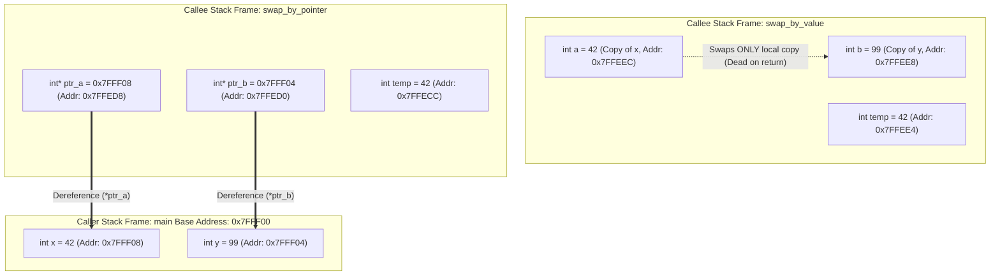

> [!info] Document Metadata
> - **Course:** `=this.course`
> - **Topic:** `=this.topic`
> - **Status:** `=this.status`

**Tags:** #[[Computer Science]] #[[CCPROG1]] #[[Code Snippets]] #[[Functions]] #[[C]] #[[M4]]

---

## Overview
While predefined functions cover standard operations like mathematical calculations and I/O, they cannot solve domain-specific problems unique to a programmer's application. User-defined functions are custom blocks of code crafted by the developer to perform specific, tailored tasks. Creating these functions promotes extreme modularity, making complex programs significantly easier to read, test, and maintain over time.

## Key Definitions
- **Function Prototype:** A forward declaration situated before `main()`. It informs the compiler of a function's existence, detailing its name, return type, and required parameters before the actual implementation is seen.
- **Function Definition:** The comprehensive block of code containing the function's actual logic and execution instructions.
- **Function Call:** The explicit instruction within a program (often inside `main()`) that temporarily shifts execution control to the function.
- **Parameters / Arguments:** The data variables passed into a function when it is called. Parameters act as local variables within the function.
- **Return Value:** The computed result that the function sends back to the exact location where it was called.

## Theoretical Framework / Core Concepts

### The Anatomy of a User-Defined Function
A function definition consists of a header and a body:
```c
return_type function_name(parameter_type parameter_name) {
    // Body containing logic
    return value;
}
```
- **Return Type:** Dictates what kind of data (e.g., `int`, `float`) the function hands back. If it hands nothing back, the type is `void`.
- **Parameters:** A comma-separated list defining what data the function expects to receive from the caller. C utilizes **pass-by-value**, meaning the function receives a *copy* of the data, so modifying the parameter inside the function does not change the original variable.

### Prototypes vs. Definitions
Because C compilers process code sequentially from top to bottom, if a function is called in `main()` before it is defined, the compiler will generate a warning or error. Prototypes solve this by acting as a "promise" to the compiler that the function's full definition will appear later in the code.

## Worked Examples / Protocol Walkthroughs / Calculations

**Scenario: A Custom Addition Function**
```c
#include <stdio.h>

// 1. Function Prototype
int addNumbers(int a, int b);

int main() {
    int num1 = 5;
    int num2 = 10;
    
    // 2. Function Call (Passing Arguments)
    int sum = addNumbers(num1, num2);
    
    printf("The calculated sum is %d\n", sum);
    
    return 0;
}

// 3. Function Definition
int addNumbers(int a, int b) {
    // a and b are local copies of num1 and num2
    int result = a + b;
    return result; // 4. Return Value sent back to main
}
```
**Execution Trace:**
1. Program begins at `main()`.
2. `num1` and `num2` are initialized.
3. `addNumbers(5, 10)` is called. Control jumps to the definition.
4. Inside `addNumbers`, `a` becomes 5, `b` becomes 10. `result` becomes 15.
5. `return 15;` executes. Control returns to `main()`.
6. The variable `sum` is assigned the value 15.
7. `printf` displays the result.

## Advanced Systems Deep-Dive: Memory Semantics & Parameter Passing

In C, **all parameter passing is strictly pass-by-value**. Understanding how the system manages call stack frames is essential to predicting program behavior and avoiding common pointer pitfalls.

### Call Stack Architecture: Pass-by-Value vs. Pass-by-Reference (Pointers)

When a function is called, the CPU pushes a new **Activation Record (Stack Frame)** onto the runtime call stack containing:
1. Return address back to the caller.
2. Callee's parameter variables (initialized with copies of argument expressions).
3. Callee's local variables.

#### Stack Frame Memory Trace



### Complete Implementation: Pass-by-Value vs. Pass-by-Pointer

```c
#include <stdio.h>

// Forward declarations (Prototypes)
void swap_by_value(int a, int b);
void swap_by_pointer(int *ptr_a, int *ptr_b);
int divide_with_remainder(int dividend, int divisor, int *quotient, int *remainder);

int main(void) {
    int x = 42;
    int y = 99;

    printf("=== Initial State in main ===\n");
    printf("x = %d (Addr: %p), y = %d (Addr: %p)\n\n", x, (void*)&x, y, (void*)&y);

    // 1. Attempting swap via Pass-by-Value (Fails to modify caller)
    printf("--- Calling swap_by_value(x, y) ---\n");
    swap_by_value(x, y);
    printf("After swap_by_value in main: x = %d, y = %d (Unchanged!)\n\n", x, y);

    // 2. Swapping via Pass-by-Pointer (Simulated Pass-by-Reference)
    printf("--- Calling swap_by_pointer(&x, &y) ---\n");
    swap_by_pointer(&x, &y);
    printf("After swap_by_pointer in main: x = %d, y = %d (Successfully swapped!)\n\n", x, y);

    // 3. Returning Multiple Values via Output Parameters
    int dividend = 29, divisor = 6;
    int q = 0, r = 0;
    if (divide_with_remainder(dividend, divisor, &q, &r) == 0) {
        printf("Division: %d / %d = %d with remainder %d\n", dividend, divisor, q, r);
    }

    return 0;
}

/**
 * Fails to modify arguments in main because 'a' and 'b' are local copies
 * residing strictly within swap_by_value's stack frame.
 */
void swap_by_value(int a, int b) {
    int temp = a;
    a = b;
    b = temp;
    printf("  [Inside swap_by_value] a = %d (Addr: %p), b = %d (Addr: %p)\n",
           a, (void*)&a, b, (void*)&b);
    // Stack frame destroyed here; copies 'a' and 'b' vanish.
}

/**
 * Succeeds because pointers store the memory addresses of variables in main.
 * Dereferencing (*ptr) reads and writes directly into main's stack frame.
 */
void swap_by_pointer(int *ptr_a, int *ptr_b) {
    if (ptr_a == NULL || ptr_b == NULL) {
        return; // Guard clause against null pointer dereference
    }

    printf("  [Inside swap_by_pointer] ptr_a points to %p, ptr_b points to %p\n",
           (void*)ptr_a, (void*)ptr_b);

    int temp = *ptr_a; // Read value at address ptr_a (x in main)
    *ptr_a = *ptr_b;   // Write value at address ptr_b into address ptr_a
    *ptr_b = temp;     // Write temp into address ptr_b (y in main)
}

/**
 * Idiomatic C pattern: Returning status via return code,
 * and returning multiple computed values via pointer output parameters.
 */
int divide_with_remainder(int dividend, int divisor, int *quotient, int *remainder) {
    if (divisor == 0 || quotient == NULL || remainder == NULL) {
        return -1; // Error code for division by zero or invalid pointers
    }

    *quotient = dividend / divisor;
    *remainder = dividend % divisor;
    return 0; // Success
}
```

### Parameter Passing Comparison Table

| Feature | Pass-by-Value | Pass-by-Pointer (Simulated Reference) |
| :--- | :--- | :--- |
| **Mechanics** | Parameter receives a binary copy of the caller's value | Parameter receives a copy of the caller's memory address (`&var`) |
| **Memory Allocation** | Allocates full size of type on callee stack | Allocates pointer width (8 bytes on 64-bit systems) |
| **Caller Mutation** | Caller variable is completely immutable to callee | Callee can mutate caller variable via dereference (`*ptr`) |
| **Overhead** | Large structs induce expensive stack copy overhead | Extremely fast; copies only 64-bit address regardless of struct size |
| **Safety / Risks** | Completely safe; zero memory hazards | Requires `NULL` checks and defensive programming against dangling pointers |

## Summary & Key Takeaways
- User-defined functions allow programmers to create custom, reusable logic blocks.
- A complete function requires a prototype, a call, and a definition.
- Prototypes satisfy the compiler's need to know about a function before it is used.
- C passes parameters by value, meaning original variables are protected from modification inside the called function.

## Multiple Choice Questions

1. What is a user-defined function?
- **A)** A built-in function like `printf()`
- **B)** A customized block of code created by the programmer to perform a specific task
- **C)** A hardware-level instruction
- **D)** A function that never returns a value

2. What does a function prototype provide to the compiler?
- **A)** The actual logic of the function
- **B)** The name, return type, and parameters of the function before it is called
- **C)** The memory address of the variables
- **D)** The output of the function

3. Which term describes the actual values passed to a function when it is called?
- **A)** Prototypes
- **B)** Definitions
- **C)** Arguments
- **D)** Return types

4. In C, what happens if you modify a parameter's value inside a standard function?
- **A)** The original variable passed by the caller is also changed
- **B)** A compilation error occurs
- **C)** The original variable remains unchanged because C uses pass-by-value
- **D)** The program crashes

5. What keyword is used to send a value back from a function to its caller?
- **A)** `send`
- **B)** `output`
- **C)** `export`
- **D)** `return`

6. If a function does not need to return a value, what should its return type be?
- **A)** `int`
- **B)** `null`
- **C)** `void`
- **D)** `empty`

7. What is a function definition?
- **A)** Just the name of the function
- **B)** The block containing the actual code and logic to be executed
- **C)** The values passed to the function
- **D)** A library containing multiple functions

8. Where should a function prototype typically be placed in a C program?
- **A)** At the very end of the file
- **B)** Inside the `main()` function
- **C)** Near the top, after preprocessor directives and before `main()`
- **D)** Inside the function definition

9. In `int calculateArea(int width, int height);`, what are `int width` and `int height`?
- **A)** Return values
- **B)** Prototypes
- **C)** Parameters
- **D)** Local calls

10. What is a common pitfall when writing user-defined functions?
- **A)** Defining the prototype before `main()`
- **B)** Using the `return` keyword
- **C)** Expecting a function to modify original variables when passing by value
- **D)** Reusing the function multiple times

### Answer Key & Explanations
1. **B** - They are written by the developer for specific, non-standard tasks.
2. **B** - Prototypes act as advance notice to the compiler regarding the function's signature.
3. **C** - The terms "arguments" and "parameters" are often used interchangeably, but arguments specifically refer to the actual data values passed during the call.
4. **C** - Pass-by-value creates a local copy; modifying the copy does not affect the original variable in the calling function.
5. **D** - The `return` statement exits the function and delivers a specific value back to the call origin.
6. **C** - `void` signifies the absence of a return value.
7. **B** - The definition includes the function header and the curly braces containing the executable code.
8. **C** - Placing prototypes at the top ensures the compiler reads them before scanning `main()`, preventing undeclared function errors.
9. **C** - They define the parameters (type and name) that the function expects to receive upon being called.
10. **C** - New programmers often mistakenly believe that changing a parameter inside the function alters the original variable in `main()`.

## References & Navigation

- **Previous Topic:** [[Predefined Functions]]
- **Next Topic:** [[Conditional Statements]]
- **Related Notes:** [[Functions and Programs]], [[Subprograms]]
