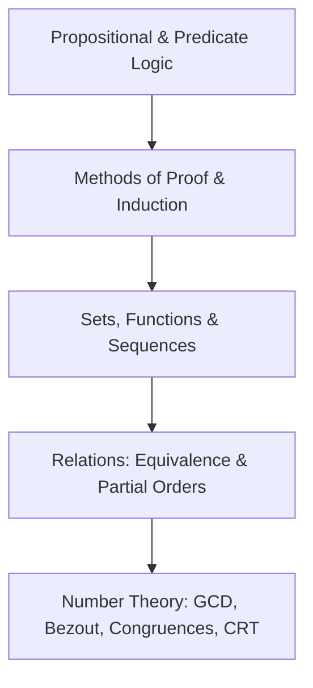
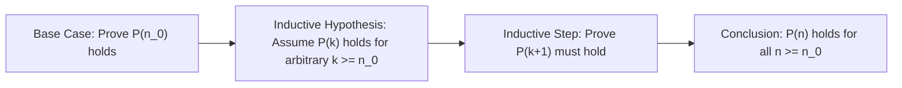

> [!info] Document Metadata
> - **Course:** `=this.course`
> - **Topic:** `=this.topic`
> - **Status:** `=this.status`

**Tags:** #[[Computer Science]] #[[CCDSTRU]] #[[Discrete Mathematics]] #[[Reviewer]] #[[Finals]]

---

# CCDSTRU Comprehensive Finals Reviewer

## Overview

This reviewer synthesizes Discrete Structures (CCDSTRU), establishing the rigorous foundations of mathematical logic, set theory, relations and functions, mathematical induction (weak and strong), elementary number theory (Euclidean algorithm, modular arithmetic, Chinese Remainder Theorem), and combinatorics.

---

## 1. Core Logic & Equivalence Laws

| Law Name | Equivalence Form | Notes |
| :--- | :--- | :--- |
| **Implication Law** | $p \to q \equiv \neg p \lor q$ | Fundamental for contrapositive and deduction proofs |
| **Contrapositive** | $p \to q \equiv \neg q \to \neg p$ | Equivalent truth value; converse $q \to p$ is NOT equivalent |
| **De Morgan's Laws** | $\neg(p \land q) \equiv \neg p \lor \neg q$   $\neg(p \lor q) \equiv \neg p \land \neg q$ | Swaps conjunction and disjunction under negation |
| **Biconditional Law** | $p \leftrightarrow q \equiv (p \to q) \land (q \to p)$ | Proven by showing both directions hold |
| **Distributive Laws** | $p \land (q \lor r) \equiv (p \land q) \lor (p \land r)$ | Boolean algebra analog to arithmetic multiplication |

---

## 2. Relations & Properties

Given a relation $R$ on a set $A$:
- **Reflexive**: $\forall x \in A, (x, x) \in R$.
- **Symmetric**: $\forall x, y \in A, (x, y) \in R \implies (y, x) \in R$.
- **Antisymmetric**: $\forall x, y \in A, ((x, y) \in R \land (y, x) \in R) \implies x = y$.
- **Transitive**: $\forall x, y, z \in A, ((x, y) \in R \land (y, z) \in R) \implies (x, z) \in R$.

### Relational Classifications
- **Equivalence Relation**: Reflexive, Symmetric, and Transitive. Partitions $A$ into disjoint equivalence classes $[x]$.
- **Partial Order (Poset)**: Reflexive, Antisymmetric, and Transitive (e.g., $(\mathbb{Z}, \le)$, $(\mathcal{P}(S), \subseteq)$).

---

## 3. Mathematical Induction Framework

- **Weak Induction**: Assume $P(k)$ holds to prove $P(k+1)$.
- **Strong Induction**: Assume $P(i)$ holds for all $n_0 \le i \le k$ to prove $P(k+1)$ (essential for prime factorization, game theory, recurrence).

---

## 4. Number Theory & Modular Arithmetic Matrix

| Concept | Definition / Formula | Algorithmic Tool |
| :--- | :--- | :--- |
| **Divisibility** | $a \mid b \iff \exists k \in \mathbb{Z}, b = ak$ | Division Algorithm: $a = dq + r, 0 \le r < d$ |
| **GCD & Bézout's Identity** | $\gcd(a, b) = sa + tb$ for $s, t \in \mathbb{Z}$ | **Extended Euclidean Algorithm** |
| **Modular Inverse** | $ax \equiv 1 \pmod m \iff \gcd(a, m) = 1$ | Solve $as + mt = 1 \implies a^{-1} \equiv s \pmod m$ |
| **Linear Congruence** | $ax \equiv b \pmod m$ | Has solutions $\iff \gcd(a, m) \mid b$ |
| **Chinese Remainder Theorem** | $x \equiv a_i \pmod{m_i}$ where $\gcd(m_i, m_j) = 1$ | Unique solution modulo $M = \prod m_i$ |

---

## 5. High-Yield Exam Checklist

- [ ] Does converse ($q \to p$) equal the original conditional ($p \to q$)? **NO**.
- [ ] For strong induction, did you verify enough base cases for the recurrence depth?
- [ ] Does a modular inverse exist if $\gcd(a, m) \ne 1$? **NO**.
- [ ] Did you remember that an equivalence relation requires **symmetry**, whereas a partial order requires **antisymmetry**?
- [ ] Is a relation antisymmetric if it has no pairs with $x \ne y$? **YES** (vacuously true).

---

## Multiple Choice Questions

1. What is the negation of the quantified statement $\forall x \in \mathbb{R}, (x > 0 \implies \exists y \in \mathbb{R}, y^2 = x)$?
    - **A)** $\exists x \in \mathbb{R}, (x \le 0 \implies \forall y \in \mathbb{R}, y^2 \ne x)$
    - **B)** $\exists x \in \mathbb{R}, (x > 0 \land \forall y \in \mathbb{R}, y^2 \ne x)$
    - **C)** $\forall x \in \mathbb{R}, (x > 0 \land \exists y \in \mathbb{R}, y^2 \ne x)$
    - **D)** $\exists x \in \mathbb{R}, (x \le 0 \land \forall y \in \mathbb{R}, y^2 = x)$

2. Let $R = \{(1, 1), (2, 2), (3, 3), (1, 2), (2, 1)\}$ on the set $A = \{1, 2, 3\}$. What type of relation is $R$?
    - **A)** Equivalence relation
    - **B)** Partial order
    - **C)** Total order
    - **D)** Not reflexive

3. Using the Extended Euclidean Algorithm, what is the modular inverse of $7 \pmod{26}$?
    - **A)** 11
    - **B)** 15
    - **C)** 19
    - **D)** No inverse exists

4. In mathematical induction, what is the inductive hypothesis in proving that $1 + 2 + \dots + n = \frac{n(n+1)}{2}$?
    - **A)** Proving that $1 = \frac{1(2)}{2}$
    - **B)** Assuming that $1 + 2 + \dots + k = \frac{k(k+1)}{2}$ for an arbitrary integer $k \ge 1$
    - **C)** Proving that $1 + 2 + \dots + (k+1) = \frac{(k+1)(k+2)}{2}$
    - **D)** Showing that the formula holds for all real numbers $n$

5. Find the unique solution modulo 15 for the system: $x \equiv 2 \pmod 3$ and $x \equiv 3 \pmod 5$.
    - **A)** 8
    - **B)** 11
    - **C)** 13
    - **D)** 14

### Answer Key & Explanations

1. **B**. The negation of $\forall x, P(x)$ is $\exists x, \neg P(x)$. Here $P(x)$ is $A \to B \equiv \neg A \lor B$. The negation $\neg(A \to B)$ is $A \land \neg B$. Hence $x > 0 \land \forall y, y^2 \ne x$.
2. **A**. $R$ contains $(1,1), (2,2), (3,3)$ (Reflexive). $(1,2) \in R$ and $(2,1) \in R$ (Symmetric). Since $(1,2)$ and $(2,1)$ chain to $(1,1) \in R$ and $(2,1)$ and $(1,2)$ chain to $(2,2) \in R$, it is Transitive. Thus it is an equivalence relation.
3. **B**. By Euclidean algorithm: $26 = 3(7) + 5$, then $7 = 1(5) + 2$, then $5 = 2(2) + 1$. Back-substituting: $1 = 5 - 2(2) = 5 - 2(7 - 5) = 3(5) - 2(7) = 3(26 - 3(7)) - 2(7) = 3(26) - 11(7)$. Modulo 26: $-11 \cdot 7 \equiv 1 \pmod{26}$. Since $-11 \equiv 15 \pmod{26}$, the modular inverse is 15 ($15 \times 7 = 105 = 4 \times 26 + 1$).
4. **B**. The inductive hypothesis is the formal assumption that the predicate $P(k)$ is true for an arbitrary step $k$.
5. **A**. Checking $x \in \{3, 8, 13\}$ (values $\equiv 3 \pmod 5$): $8 \bmod 3 = 2$, matching $x \equiv 2 \pmod 3$. Thus $x \equiv 8 \pmod{15}$.

## References & Navigation

- **Previous Topic:** [[CCPROG1]]
- **Next Topic:** [[CCDSALG]]
- **Prerequisites:** [[Discrete Mathematics]], Logic, Set Theory
- **Cross-Curricular Connections:** [[CSMATH1]], [[CSALGCM]]
