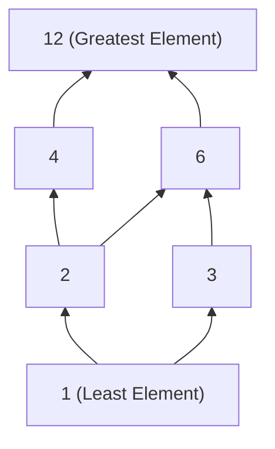
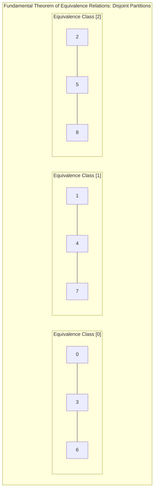

# Relations and Their Properties

> [!info] Document Metadata
> - **Course:** `=this.course`
> - **Topic:** `=this.topic`
> - **Status:** `=this.status`

**Tags:** #[[Problem Solving]] #[[Relations]] #[[Discrete Math]] #[[CCDSTRU]] #[[M7]]

---

## Important Formulas & Concepts
 **Binary Relation:** A binary relation from set $A$ to set $B$ is a subset of the Cartesian product $A \times B$. **Relation on a Set:** A relation on a set $A$ is a relation from $A$ to $A$ (subset of $A \times A$). **Number of Relations:** For a set $A$ with $n$ elements, the number of possible relations on $A$ is $2^{n^2}$.

### Properties of a Relation on Set A

1. **Reflexive:**
$\forall a \in A, \; (a, a) \in R$
*Check:* Ensure every element $a \in A$ has a corresponding self-loop pair $(a, a)$ in the relation.

2. **Symmetric:**
$\forall a, b \in A, \; ((a, b) \in R \rightarrow (b, a) \in R)$
*Check:* For every pair $(a, b)$ in $R$, the reversed pair $(b, a)$ must also be in $R$ (bidirectional directed graph edges).

3. **Antisymmetric:**
$\forall a, b \in A, \; (((a, b) \in R \land (b, a) \in R) \rightarrow a = b)$
*Check:* Ensure there are no pairs $(a, b)$ and $(b, a)$ present simultaneously in $R$ when $a \neq b$.

4. **Transitive:**
$\forall a, b, c \in A, \; (((a, b) \in R \land (b, c) \in R) \rightarrow (a, c) \in R)$
*Check:* For every chained pair $(a, b)$ and $(b, c)$ in $R$, the direct composite pair $(a, c)$ must also exist in $R$.

### Advanced Structural Classes

- **Equivalence Relation:** Reflexive, Symmetric, and Transitive. Partitions the underlying set $A$ into mutually disjoint **Equivalence Classes** $[a] = \{s \in A \mid (a, s) \in R\}$.
- **Partially Ordered Set (Poset):** Reflexive, Antisymmetric, and Transitive (denoted $(S, \le)$). Visualized concisely using a **Hasse Diagram** by omitting self-loops (reflexivity) and shortcut arrows (transitivity).

## Theoretical Framework: Visual Models for Posets & Partitions

### 1. Hasse Diagram of Divisibility Poset $(\{1, 2, 3, 4, 6, 12\}, \mid)$
In a Hasse diagram, element $a$ is drawn below $b$ with an upward line if $a \mid b$ and there is no intermediate element $c$ such that $a \mid c \mid b$.

### 2. Equivalence Class Partition Model ($a \equiv b \pmod 3$)

## Worked Examples

**Example 1: Analyzing Properties from a Set of Pairs**
Let $A = \{a, b, c\}$. $R_1 = \{(a, a), (a, c), (b, b), (c, a)\}$
**Reflexive:** No. $(c, c) \notin R_1$.
**Symmetric:** Yes. $(a, c)$ implies $(c, a)$, both are in $R_1$.
**Antisymmetric:** No. $(a, c)$ and $(c, a)$ are in $R_1$, but $a \neq c$.
**Transitive:** No. $(c, a) \in R_1$ and $(a, c) \in R_1$, which requires $(c, c) \in R_1$ for transitivity, but it is missing.

**Example 2: Relations on Integers**
Let $R$ be a relation on $\mathbb{Z}$ defined by $R = \{(a, b) \mid a \text{ divides } b\}$ **Reflexive:** Yes. For all $a$, $a$ divides $a$. **Symmetric:** No. Counterexample: 2 divides 4, but 4 does not divide 2. **Antisymmetric:** Yes. (Assuming positive integers; if over all integers, $a$ divides $-a$ and $-a$ divides $a$, which breaks antisymmetry). **Transitive:** Yes. If $a$ divides $b$ and $b$ divides $c$, then $a$ divides $c$.

## Multiple Choice Questions

1. How many distinct binary relations exist on a set $A$ with $n = 3$ elements?
    - **A)** 6
    - **B)** 9
    - **C)** 512
    - **D)** 64

2. Which property defines an **antisymmetric** relation $R$ on a set $A$?
    - **A)** No two distinct elements a ≠ b can have both (a, b) ∈ R and (b, a) ∈ R
    - **B)** For every pair (a, b) ∈ R, the reversed pair (b, a) is also in R
    - **C)** No element a ∈ A can satisfy (a, a) ∈ R
    - **D)** Whenever (a, b) ∈ R and (b, c) ∈ R, the pair (a, c) is also in R

3. Which three properties define a **Partially Ordered Set (Poset)** $(S, \le)$?
    - **A)** Reflexive, Symmetric, and Transitive
    - **B)** Irreflexive, Antisymmetric, and Transitive
    - **C)** Symmetric, Antisymmetric, and Reflexive
    - **D)** Reflexive, Antisymmetric, and Transitive

4. Let $A = \{a, b, c\}$ and $R_1 = \{(a, a), (a, c), (b, b), (c, a)\}$. Which combination of properties holds for $R_1$?
    - **A)** Reflexive and Transitive, but not Symmetric
    - **B)** Symmetric only; it is not Reflexive, not Antisymmetric, and not Transitive
    - **C)** Reflexive and Symmetric, but not Antisymmetric
    - **D)** Antisymmetric and Transitive, but not Reflexive

5. When drawing a **Hasse diagram** for a poset, which elements of the relation graph are omitted for conciseness?
    - **A)** Only edges connecting prime elements
    - **B)** Only edges originating from the least element
    - **C)** Self-loops (reflexivity) and shortcut arrows implied by transitivity
    - **D)** All edges connected to the greatest element

6. In the Hasse diagram of $(\{1, 2, 3, 4, 6, 12\}, \mid)$, why is there no direct line drawn from $1$ to $6$ or from $2$ to $12$?
    - **A)** Intermediate elements exist (1 | 2 | 6 and 2 | 4 | 12), so those shortcut edges are omitted by transitivity
    - **B)** 1 does not divide 6 and 2 does not divide 12
    - **C)** Hasse diagrams only draw edges between consecutive integers
    - **D)** Divisibility fails antisymmetry on composite numbers

7. In the equivalence class partition model for $a \equiv b \pmod 3$ on $\{0, 1, \dots, 8\}$, how do the equivalence classes $[0]$, $[1]$, and $[2]$ relate to the underlying set?
    - **A)** They overlap at 0 and 3
    - **B)** Only elements in [0] satisfy reflexivity
    - **C)** Their union excludes integers greater than 3
    - **D)** They partition the set into mutually disjoint subsets

8. Why does the "divides" relation ($a$ divides $b$) fail antisymmetry over all integers $\mathbb{Z}$, even though it is antisymmetric over positive integers $\mathbb{Z}^+$?
    - **A)** Because 0 divides 0
    - **B)** Because for nonzero a, a divides -a and -a divides a even though a ≠ -a
    - **C)** Because 2 divides 4 and 4 divides 2
    - **D)** Because negative integers fail reflexivity

9. For $R_1 = \{(a, a), (a, c), (b, b), (c, a)\}$ on $A = \{a, b, c\}$, which pairs demonstrate that $R_1$ is NOT transitive?
    - **A)** (a, a) ∈ R₁ and (b, b) ∈ R₁ require (a, b) ∈ R₁
    - **B)** (a, c) ∈ R₁ requires (c, a) ∈ R₁
    - **C)** (c, a) ∈ R₁ and (a, c) ∈ R₁ require (c, c) ∈ R₁, which is missing
    - **D)** (b, b) ∈ R₁ requires (b, c) ∈ R₁

10. Can a relation $R$ on a non-empty set $A$ be both **symmetric** and **antisymmetric** simultaneously?
    - **A)** Yes, whenever R contains no pairs (a, b) with a ≠ b
    - **B)** No, symmetry and antisymmetry can never hold together on a non-empty set
    - **C)** Only when R contains every pair in A × A
    - **D)** Yes, as long as R is not reflexive

### Answer Key & Explanations

1. **C)** For a set $A$ with $n$ elements, there are $n^2$ pairs in $A \times A$ and therefore $2^{n^2}$ possible subsets (relations). With $n = 3$, this equals $2^{3^2} = 2^9 = 512$.
2. **A)** Antisymmetry requires $((a, b) \in R \land (b, a) \in R) \rightarrow a = b$, meaning distinct elements $a \neq b$ cannot appear in both $(a, b)$ and $(b, a)$ simultaneously.
3. **D)** A Partially Ordered Set (Poset) $(S, \le)$ is defined as a relation that is reflexive, antisymmetric, and transitive.
4. **B)** In Worked Example 1, $R_1$ is symmetric because $(a, c)$ and $(c, a)$ are both present, but fails reflexivity ($(c, c) \notin R_1$), antisymmetry ($(a, c), (c, a) \in R_1$ with $a \neq c$), and transitivity ($(c, a), (a, c) \in R_1$ without $(c, c)$).
5. **C)** Hasse diagrams streamline poset visualization by omitting self-loops (implied by reflexivity) and shortcut arrows (implied by transitivity).
6. **A)** In a Hasse diagram, an upward edge connects $a$ to $b$ only when $a \mid b$ and no intermediate $c$ satisfies $a \mid c \mid b$; since $1 \mid 2 \mid 6$ and $2 \mid 4 \mid 12$, direct lines $1 \to 6$ and $2 \to 12$ are omitted.
7. **D)** By the Fundamental Theorem of Equivalence Relations, equivalence classes partition the underlying set into mutually disjoint subsets such as $[0]$, $[1]$, and $[2]$.
8. **B)** Over all integers $\mathbb{Z}$, a nonzero integer $a$ and its negation $-a$ divide each other even though $a \neq -a$, violating antisymmetry; restricting to positive integers removes this counterexample.
9. **C)** Transitivity requires that whenever $(c, a) \in R_1$ and $(a, c) \in R_1$, the composite pair $(c, c)$ must also belong to $R_1$, which is absent.
10. **A)** A relation containing only diagonal pairs $(a, a)$ (no pairs with $a \neq b$) vacuously satisfies both symmetry and antisymmetry, because neither property encounters a pair $(a, b)$ with $a \neq b$.

## References & Navigation

- **Previous Topic:** [[Functions]]
- **Next Topic:** [[Matrices Detailed]]
- **Related Notes:** [[Sets]], [[Matrices Detailed]]
