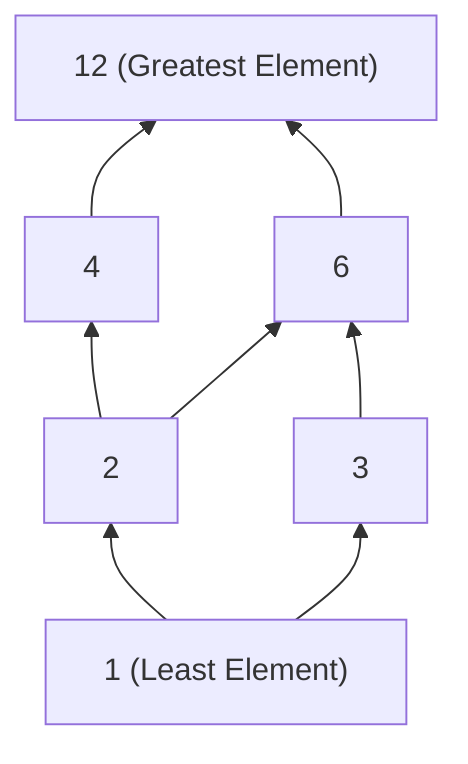
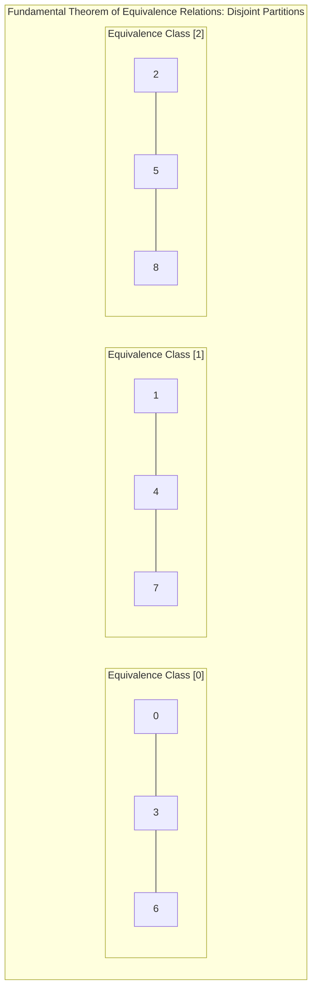

# Relations and Their Properties

> [!info] Document Metadata
> - **Course:** `=this.course`
> - **Topic:** `=this.topic`
> - **Status:** `=this.status`

**Tags:** #[[Problem Solving]] #[[Relations]] #[[Discrete Math]] #[[CCDSTRU]] #[[M7]]

---

## Important Formulas & Concepts
 **Binary Relation:** A binary relation from set $A$ to set $B$ is a subset of the Cartesian product $A \times B$. **Relation on a Set:** A relation on a set $A$ is a relation from $A$ to $A$ (subset of $A \times A$). **Number of Relations:** For a set $A$ with $n$ elements, the number of possible relations on $A$ is $2^{n^2}$.

### Properties of a Relation on Set A

1. **Reflexive:**
$\forall a \in A, \; (a, a) \in R$
*Check:* Ensure every element $a \in A$ has a corresponding self-loop pair $(a, a)$ in the relation.

2. **Symmetric:**
$\forall a, b \in A, \; ((a, b) \in R \rightarrow (b, a) \in R)$
*Check:* For every pair $(a, b)$ in $R$, the reversed pair $(b, a)$ must also be in $R$ (bidirectional directed graph edges).

3. **Antisymmetric:**
$\forall a, b \in A, \; (((a, b) \in R \land (b, a) \in R) \rightarrow a = b)$
*Check:* Ensure there are no pairs $(a, b)$ and $(b, a)$ present simultaneously in $R$ when $a \neq b$.

4. **Transitive:**
$\forall a, b, c \in A, \; (((a, b) \in R \land (b, c) \in R) \rightarrow (a, c) \in R)$
*Check:* For every chained pair $(a, b)$ and $(b, c)$ in $R$, the direct composite pair $(a, c)$ must also exist in $R$.

### Advanced Structural Classes

- **Equivalence Relation:** Reflexive, Symmetric, and Transitive. Partitions the underlying set $A$ into mutually disjoint **Equivalence Classes** $[a] = \{s \in A \mid (a, s) \in R\}$.
- **Partially Ordered Set (Poset):** Reflexive, Antisymmetric, and Transitive (denoted $(S, \le)$). Visualized concisely using a **Hasse Diagram** by omitting self-loops (reflexivity) and shortcut arrows (transitivity).

## Theoretical Framework: Visual Models for Posets & Partitions

### 1. Hasse Diagram of Divisibility Poset $(\{1, 2, 3, 4, 6, 12\}, \mid)$
In a Hasse diagram, element $a$ is drawn below $b$ with an upward line if $a \mid b$ and there is no intermediate element $c$ such that $a \mid c \mid b$.

### 2. Equivalence Class Partition Model ($a \equiv b \pmod 3$)

## Worked Examples

**Example 1: Analyzing Properties from a Set of Pairs**
Let $A = \{a, b, c\}$. $R_1 = \{(a, a), (a, c), (b, b), (c, a)\}$
**Reflexive:** No. $(c, c) \notin R_1$.
**Symmetric:** Yes. $(a, c)$ implies $(c, a)$, both are in $R_1$.
**Antisymmetric:** No. $(a, c)$ and $(c, a)$ are in $R_1$, but $a \neq c$.
**Transitive:** No. $(c, a) \in R_1$ and $(a, c) \in R_1$, which requires $(c, c) \in R_1$ for transitivity, but it is missing.

**Example 2: Relations on Integers**
Let $R$ be a relation on $\mathbb{Z}$ defined by $R = \{(a, b) \mid a \text{ divides } b\}$ **Reflexive:** Yes. For all $a$, $a$ divides $a$. **Symmetric:** No. Counterexample: 2 divides 4, but 4 does not divide 2. **Antisymmetric:** Yes. (Assuming positive integers; if over all integers, $a$ divides $-a$ and $-a$ divides $a$, which breaks antisymmetry). **Transitive:** Yes. If $a$ divides $b$ and $b$ divides $c$, then $a$ divides $c$.

## References & Navigation

- **Related Notes:** [[Relations and Matrices]]
