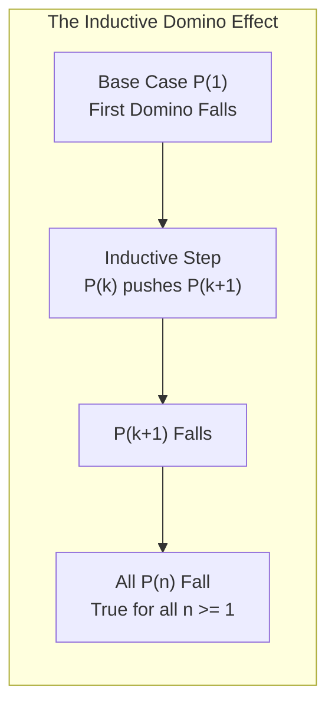

# Mathematical Induction

> [!info] Document Metadata
> - **Course:** `=this.course`
> - **Topic:** `=this.topic`
> - **Status:** `=this.status`

**Tags:** #[[Problem Solving]] #[[Proofs]] #[[Mathematical Induction]] #[[CCDSTRU]] #[[M8]] #[[Discrete Math]]

---

## Overview

Mathematical induction is a foundational proof technique in discrete mathematics and theoretical computer science. It establishes the truth of an infinite sequence of propositions $P(n)$ for all integers $n \ge n_0$ without requiring infinite verification steps. The validity of mathematical induction rests on the **Well-Ordering Property** of the positive integers (every non-empty subset of $\mathbb{Z}^+$ has a least element).

---

## Theoretical Framework & Core Axioms

### Weak Induction vs. Strong Induction

#### 1. Principle of Mathematical Induction (Weak Induction)
To prove that $P(n)$ is true for all integers $n \ge n_0$:
1. **Basis Step:** Show that $P(n_0)$ is true.
2. **Inductive Step:** Show that the conditional statement $P(k) \implies P(k+1)$ is true for all integers $k \ge n_0$.
   - **Inductive Hypothesis:** Assume that $P(k)$ is true for an arbitrary integer $k \ge n_0$.
   - **Inductive Goal:** Deduce and prove that $P(k+1)$ must consequently be true.

Formal Statement:
$$
\left[ P(n_0) \land \forall k \ge n_0 (P(k) \implies P(k+1)) \right] \implies \forall n \ge n_0 P(n)
$$

#### 2. Principle of Strong Induction (Complete Induction)
When proving $P(k+1)$ requires more than just the immediately preceding case $P(k)$, strong induction assumes that the proposition holds for **all** preceding integers from the base case up to $k$:
$$
\left[ P(n_0) \land \dots \land P(n_0 + b) \land \forall k \ge n_0 + b \left( \bigwedge_{j=n_0}^k P(j) \implies P(k+1) \right) \right] \implies \forall n \ge n_0 P(n)
$$
*(Note: Despite its name, strong induction is mathematically equivalent in deductive power to weak induction).*

---

## Stepped Mathematical Proofs

### Proof 1: Sum of Squares Identity (Summation Induction)

**Proposition:** For all integers $n \ge 1$:
$$
\sum_{i=1}^n i^2 = 1^2 + 2^2 + 3^2 + \dots + n^2 = \frac{n(n+1)(2n+1)}{6}
$$

#### Step 1: Basis Step ($n = 1$)
- Left-Hand Side (LHS): $1^2 = 1$
- Right-Hand Side (RHS): $\frac{1(1+1)(2(1)+1)}{6} = \frac{1(2)(3)}{6} = \frac{6}{6} = 1$
- Since $\text{LHS} = \text{RHS} = 1$, the proposition $P(1)$ is true.

#### Step 2: Inductive Hypothesis
Assume that $P(k)$ is true for an arbitrary integer $k \ge 1$:
$$
1^2 + 2^2 + \dots + k^2 = \frac{k(k+1)(2k+1)}{6}
$$

#### Step 3: Inductive Step ($P(k+1)$)
We must show that $P(k+1)$ holds:
$$
1^2 + 2^2 + \dots + k^2 + (k+1)^2 = \frac{(k+1)((k+1)+1)(2(k+1)+1)}{6} = \frac{(k+1)(k+2)(2k+3)}{6}
$$
Start with the LHS of $P(k+1)$:
$$
\left( 1^2 + 2^2 + \dots + k^2 \right) + (k+1)^2
$$
Substitute the Inductive Hypothesis for the sum of the first $k$ squares:
$$
= \frac{k(k+1)(2k+1)}{6} + (k+1)^2
$$
Factor out the common term $(k+1)$:
$$
= (k+1) \left[ \frac{k(2k+1)}{6} + (k+1) \right]
$$
Find a common denominator 6:
$$
= (k+1) \left[ \frac{2k^2 + k + 6k + 6}{6} \right] = (k+1) \left[ \frac{2k^2 + 7k + 6}{6} \right]
$$
Factor the quadratic numerator $2k^2 + 7k + 6 = (k+2)(2k+3)$:
$$
= \frac{(k+1)(k+2)(2k+3)}{6} = \text{RHS of } P(k+1)
$$
By the Principle of Mathematical Induction, the formula holds for all $n \ge 1$. $\blacksquare$

---

### Proof 2: Divisibility Property (Number Theoretic Induction)

**Proposition:** Prove that $n^3 + 2n$ is divisible by 3 ($3 \mid (n^3 + 2n)$) for all integers $n \ge 1$.

#### Step 1: Basis Step ($n = 1$)
$$
1^3 + 2(1) = 1 + 2 = 3 = 3(1)
$$
Since 3 is divisible by 3, $P(1)$ is true.

#### Step 2: Inductive Hypothesis
Assume $P(k)$ is true for $k \ge 1$, meaning there exists an integer $m$ such that:
$$
k^3 + 2k = 3m
$$

#### Step 3: Inductive Step ($P(k+1)$)
We must show that $(k+1)^3 + 2(k+1)$ is divisible by 3:
$$
(k+1)^3 + 2(k+1) = (k^3 + 3k^2 + 3k + 1) + (2k + 2)
$$
Regroup the terms to isolate the inductive hypothesis $(k^3 + 2k)$:
$$
= (k^3 + 2k) + (3k^2 + 3k + 3)
$$
Substitute $k^3 + 2k = 3m$:
$$
= 3m + 3(k^2 + k + 1) = 3\left( m + k^2 + k + 1 \right)
$$
Since $m, k \in \mathbb{Z}$, the quantity $M' = m + k^2 + k + 1$ is an integer. Thus, $(k+1)^3 + 2(k+1) = 3M'$, which is divisible by 3. Therefore, $P(k+1)$ is true, completing the proof. $\blacksquare$

---

### Proof 3: Exponential Growth vs. Polynomial (Inequality Induction)

**Proposition:** Prove that $2^n > n^2$ for all integers $n \ge 5$.

#### Step 1: Basis Step ($n = 5$)
- LHS: $2^5 = 32$
- RHS: $5^2 = 25$
- Since $32 > 25$, $P(5)$ is true.

#### Step 2: Inductive Hypothesis
Assume that $2^k > k^2$ for an arbitrary integer $k \ge 5$.

#### Step 3: Inductive Step ($P(k+1)$)
We must prove that $2^{k+1} > (k+1)^2$.
Starting from the LHS:
$$
2^{k+1} = 2 \cdot 2^k
$$
Apply the Inductive Hypothesis $2^k > k^2$:
$$
2^{k+1} > 2k^2 = k^2 + k^2
$$
**Lemma:** For all $k \ge 5$, $k^2 > 2k + 1$.
*Proof of Lemma:* $k^2 - 2k - 1 = (k-1)^2 - 2$. For $k \ge 5$, $(k-1)^2 \ge 16 \implies (k-1)^2 - 2 \ge 14 > 0$.
Substituting this inequality:
$$
2^{k+1} > k^2 + k^2 > k^2 + 2k + 1 = (k+1)^2
$$
Thus, $2^{k+1} > (k+1)^2$, proving the inequality for all $n \ge 5$. $\blacksquare$

---

### Proof 4: Postage Stamp Problem (Strong Induction)

**Proposition:** Every postage amount of 12 cents or more can be formed using only 4-cent and 5-cent stamps.

#### Step 1: Basis Steps
Because the recurrence step relies on looking back 4 units ($k - 3$), we must verify 4 consecutive base cases:
- $12\text{¢} = 3 \times 4\text{¢}$
- $13\text{¢} = 2 \times 4\text{¢} + 1 \times 5\text{¢}$
- $14\text{¢} = 1 \times 4\text{¢} + 2 \times 5\text{¢}$
- $15\text{¢} = 3 \times 5\text{¢}$
All four base cases $P(12), P(13), P(14), P(15)$ are true.

#### Step 2: Strong Inductive Hypothesis
Assume that postage $j$ can be formed using 4-cent and 5-cent stamps for all integers $j$ such that $12 \le j \le k$, where $k \ge 15$.

#### Step 3: Inductive Step ($P(k+1)$)
Consider the target postage $k+1$. Since $k \ge 15$, $k+1 \ge 16$, which implies:
$$
(k+1) - 4 = k - 3 \ge 12
$$
By our strong inductive hypothesis, because $12 \le k - 3 \le k$, the postage amount $k - 3$ can be formed with 4-cent and 5-cent stamps.
Adding one additional 4-cent stamp to the stamps forming $k - 3$ gives:
$$
(k - 3) + 4 = k + 1
$$
Hence, postage $k+1$ can also be formed, completing the proof by strong induction. $\blacksquare$

---

## Multiple Choice Questions

1. Which foundational axiom of the integers guarantees the mathematical validity of the Principle of Mathematical Induction?
    - **A)** The Axiom of Choice
    - **B)** The Well-Ordering Property of positive integers
    - **C)** The Continuum Hypothesis
    - **D)** The Fundamental Theorem of Arithmetic

2. In an inductive proof, why is proving the Basis Step strictly required?
    - **A)** Because without a true starting base, the implication $P(k) \implies P(k+1)$ could be vacuously true for false statements (like $n = n + 1$).
    - **B)** To determine the upper bound of the integers.
    - **C)** To ensure that the integers are countable.
    - **D)** To convert the proof into a deductive syllogism.

3. When proving the postage problem for $n \ge 12$ using 4-cent and 5-cent stamps via strong induction, why are four base cases ($12, 13, 14, 15$) required?
    - **A)** Because $4 + 5 = 9 < 12$.
    - **B)** Because the inductive step builds upon $(k+1) - 4 = k - 3$, requiring four consecutive valid cases to initiate the leap.
    - **C)** Because 15 is a multiple of 5.
    - **D)** Because strong induction always requires four times as many base cases as weak induction.

4. When proving an inequality $P(n): 2^n > n^2$, what is the smallest integer base case for which the proposition is true?
    - **A)** $n = 1$
    - **B)** $n = 2$
    - **C)** $n = 4$
    - **D)** $n = 5$

5. What is the fundamental difference between Weak Induction and Strong Induction?
    - **A)** Weak induction only applies to summations, whereas strong induction applies to inequalities.
    - **B)** Strong induction assumes $P(j)$ is true for all $n_0 \le j \le k$ to prove $P(k+1)$, whereas weak induction assumes only $P(k)$.
    - **C)** Strong induction can prove unprovable theorems.
    - **D)** Weak induction does not require a basis step.

6. In proving that $3 \mid (n^3 + 2n)$, how was $(k+1)^3 + 2(k+1)$ algebraically partitioned?
    - **A)** Into $(k^3 + 2k) + 3(k^2 + k + 1)$, isolating the inductive hypothesis.
    - **B)** By dividing the polynomial by $(k+1)$.
    - **C)** By setting $k = 0$.
    - **D)** By factoring out $k^3$.

7. If a proposition $P(n)$ is proven for $P(1)$ and $P(k) \implies P(k+2)$ is proven, for which set of integers is $P(n)$ proven true?
    - **A)** All positive integers $\mathbb{Z}^+$
    - **B)** All odd positive integers
    - **C)** All even positive integers
    - **D)** Only $n = 1$ and $n = 3$

8. In the sum of squares proof, what was the common binomial factor extracted from $\frac{k(k+1)(2k+1)}{6} + (k+1)^2$?
    - **A)** $k$
    - **B)** $2k+1$
    - **C)** $k+1$
    - **D)** $k+2$

9. What fallacy occurs if one assumes $P(k+1)$ is true at the beginning of the Inductive Step?
    - **A)** Begging the question (Circular Reasoning / Petitio Principii)
    - **B)** False dilemma
    - **C)** Straw man fallacy
    - **D)** Modus tollens violation

10. Are the Principle of Mathematical Induction and the Principle of Strong Mathematical Induction mathematically equivalent?
    - **A)** No, strong induction is strictly more powerful.
    - **B)** Yes, any statement provable by strong induction can be restructured and proven by weak induction.
    - **C)** No, weak induction can only prove finite sets.
    - **D)** Yes, but only when $n_0 = 0$.

---

### Answer Key & Explanations

1. **B** - The Well-Ordering Property states that every non-empty set of positive integers has a minimum element; if the set of counterexamples were non-empty, its least element would contradict the inductive step.
2. **A** - The implication $P(k) \implies P(k+1)$ is a conditional rule. For example, $k = k + 1 \implies k+1 = k+2$ is algebraically valid, but false for all integers because the base case $1 = 2$ fails.
3. **B** - Because the step reduces $k+1$ to $(k+1) - 4$, the hypothesis must reach back 4 steps, necessitating 4 independent anchors ($12, 13, 14, 15$).
4. **D** - For $n=1$, $2^1 > 1^2$ (holds); for $n=2$, $4 > 4$ (fails); for $n=3$, $8 > 9$ (fails); for $n=4$, $16 > 16$ (fails); for $n=5$, $32 > 25$ (holds and persists $\forall n \ge 5$).
5. **B** - Strong induction expands the inductive hypothesis to cover all preceding cases $\bigwedge_{j=n_0}^k P(j)$.
6. **A** - Regrouping directly isolates $(k^3 + 2k) = 3m$, allowing 3 to be factored out from the entire expression.
7. **B** - Starting at $P(1)$ with step size 2 proves the proposition for $1, 3, 5, 7, \dots$ (odd integers only).
8. **C** - Factoring $(k+1)$ avoids expanding cubic polynomials and yields the required $(k+1)(k+2)(2k+3)/6$ structure immediately.
9. **A** - Assuming the conclusion $P(k+1)$ to prove $P(k+1)$ is circular reasoning. The hypothesis must assume $P(k)$ only.
10. **B** - By defining a compound predicate $Q(n) = \bigwedge_{j=n_0}^n P(j)$, strong induction on $P$ maps directly to weak induction on $Q$.

---

## References & Navigation

- **Previous Topic:** [[Matrices Detailed]]
- **Next Topic:** [[[HO] Number Theory]]
- **Related Notes:** [[Rules of Inference]], [[Sums and Sequences]]
