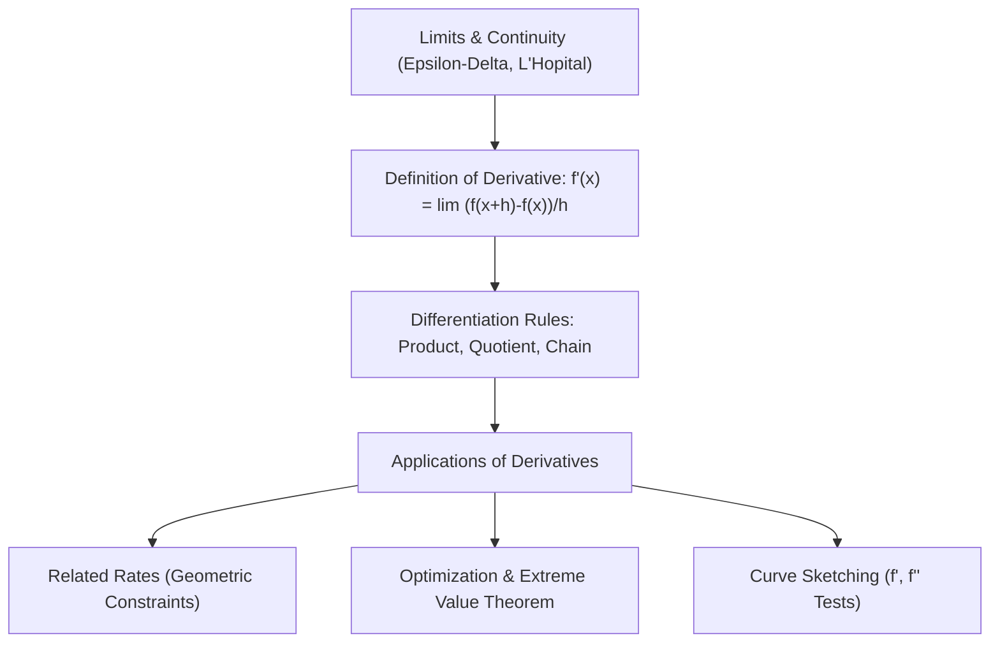
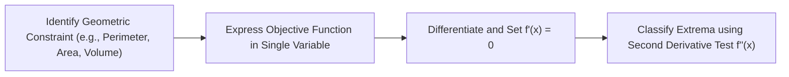

> [!info] Document Metadata
> - **Course:** `=this.course`
> - **Topic:** `=this.topic`
> - **Status:** `=this.status`

**Tags:** #[[Computer Science]] #[[CSMATH1]] #[[Differential Calculus]] #[[Reviewer]] #[[Finals]]

---

# CSMATH1 Comprehensive Finals Reviewer

## Overview

This reviewer consolidates the core concepts of Differential Calculus (CSMATH1): formal limits and continuity, differentiation rules, implicit differentiation, related rates of change, curve sketching (critical points, concavity, inflection), optimization problems, and Mean Value Theorem.

---

## 1. Fundamental Limit Theorems & Differentiation Rules

| Rule Name | Formula | Notes |
| :--- | :--- | :--- |
| **Limit of Indeterminate Forms** | $\lim_{x \to c} \frac{f(x)}{g(x)} = \lim_{x \to c} \frac{f'(x)}{g'(x)}$ | Applies ONLY when form is $\frac{0}{0}$ or $\frac{\pm \infty}{\pm \infty}$ (**L'Hôpital's Rule**) |
| **Power Rule** | $\frac{d}{dx}[x^n] = n x^{n-1}$ | Holds for all real numbers $n$ |
| **Product Rule** | $\frac{d}{dx}[u v] = u v' + v u'$ | Both functions differentiated alternately |
| **Quotient Rule** | $\frac{d}{dx}\left[\frac{u}{v}\right] = \frac{v u' - u v'}{v^2}$ | "Low d-High minus High d-Low over Low squared" |
| **Chain Rule** | $\frac{d}{dx}[f(g(x))] = f'(g(x)) \cdot g'(x)$ | Composite function inner derivative factor |
| **Implicit Differentiation** | $\frac{d}{dx}[y^n] = n y^{n-1} \frac{dy}{dx}$ | Treats $y$ as an implicit function of $x$ |

---

## 2. Curve Sketching & Derivative Tests

- **Critical Points**: Points $c$ in the domain of $f$ where $f'(c) = 0$ or $f'(c)$ does not exist.
- **First Derivative Test**:
  - $f'$ changes from $+$ to $-$ at $c \implies$ **Local Maximum**.
  - $f'$ changes from $-$ to $+$ at $c \implies$ **Local Minimum**.
- **Second Derivative Test**:
  - If $f'(c) = 0$ and $f''(c) > 0 \implies$ Concave Up $\implies$ **Local Minimum**.
  - If $f'(c) = 0$ and $f''(c) < 0 \implies$ Concave Down $\implies$ **Local Maximum**.
  - If $f''(c) = 0$, the test is inconclusive.
- **Point of Inflection**: A point where the concavity changes sign ($f''$ changes sign) and the tangent line exists.

---

## 3. High-Yield Geometric Optimization Formulas

- **Open-Top Box**: Sheet $L \times W$, cut squares of side $x$: $V(x) = x(L - 2x)(W - 2x)$.
- **Cylindrical Can (Minimal Surface Area for Fixed Volume $V$)**:
  $$A = 2\pi r^2 + 2\pi r h = 2\pi r^2 + \frac{2V}{r} \implies \frac{dA}{dr} = 4\pi r - \frac{2V}{r^2} = 0 \implies h = 2r$$
  Optimal cylinder has height equal to diameter!

---

## 4. High-Yield Exam Checklist

- [ ] Before applying L'Hôpital's Rule, did you check that it evaluates strictly to $\frac{0}{0}$ or $\frac{\infty}{\infty}$?
- [ ] For related rates, did you differentiate with respect to time $t$ using the Chain Rule (e.g. $\frac{dr}{dt}$)?
- [ ] Did you check endpoints on closed intervals $[a, b]$ for Absolute Extrema (Extreme Value Theorem)?
- [ ] For implicit differentiation, did you collect all $\frac{dy}{dx}$ terms to one side before factoring?
- [ ] Is continuity guaranteed if a function is differentiable? **YES** (Differentiability $\implies$ Continuity).

---

## 5. Comprehensive Practice Exam

1. Evaluate the limit: $\lim_{x \to 0} \frac{\sin(3x)}{5x}$.
   - A) $3/5$
   - B) 0
   - C) $5/3$
   - D) 1

2. If $x^2 + y^2 = 25$, what is $\frac{dy}{dx}$ at the point $(3, 4)$?
   - A) $3/4$
   - B) $-3/4$
   - C) $-4/3$
   - D) $4/3$

3. A 10-ft ladder rests against a vertical wall. If the bottom of the ladder slides away at $2\text{ ft/s}$, how fast is the top sliding down when the bottom is $6\text{ ft}$ from the wall?
   - A) $-1.5\text{ ft/s}$
   - B) $-2.5\text{ ft/s}$
   - C) $-1.0\text{ ft/s}$
   - D) $-0.75\text{ ft/s}$

4. What is the maximum area of a rectangle that can be enclosed with $100\text{ meters}$ of fencing?
   - A) $500\text{ m}^2$
   - B) $625\text{ m}^2$
   - C) $1000\text{ m}^2$
   - D) $2500\text{ m}^2$

5. Let $f(x) = x^3 - 3x^2 + 2$. At $x = 1$, the function has:
   - A) A local maximum
   - B) A local minimum
   - C) An inflection point
   - D) A vertical asymptote

---

### Answer Key & Explanations

1. **A) $3/5$** — $\lim_{x \to 0} \frac{\sin(3x)}{5x} = \frac{3}{5} \lim_{x \to 0} \frac{\sin(3x)}{3x} = \frac{3}{5}(1) = \frac{3}{5}$. (Or using L'Hôpital: $\lim \frac{3\cos(3x)}{5} = \frac{3}{5}$).
2. **B) $-3/4$** — Differentiating implicitly: $2x + 2y \frac{dy}{dx} = 0 \implies \frac{dy}{dx} = -\frac{x}{y}$. At $(3, 4)$, $\frac{dy}{dx} = -\frac{3}{4}$.
3. **A) $-1.5\text{ ft/s}$** — By Pythagorean theorem: $x^2 + y^2 = 10^2 = 100$. When $x = 6$, $y = \sqrt{100 - 36} = 8$. Differentiating: $2x \frac{dx}{dt} + 2y \frac{dy}{dt} = 0 \implies 6(2) + 8 \frac{dy}{dt} = 0 \implies \frac{dy}{dt} = -\frac{12}{8} = -1.5\text{ ft/s}$.
4. **B) $625\text{ m}^2$** — Perimeter $2x + 2y = 100 \implies y = 50 - x$. Area $A(x) = x(50 - x) = 50x - x^2$. $A'(x) = 50 - 2x = 0 \implies x = 25\text{ m}$. Maximum area is a square: $25 \times 25 = 625\text{ m}^2$.
5. **C) An inflection point** — $f'(x) = 3x^2 - 6x$, $f''(x) = 6x - 6$. Setting $f''(x) = 0 \implies x = 1$. For $x < 1$, $f'' < 0$ (concave down); for $x > 1$, $f'' > 0$ (concave up). Because concavity changes sign, $x = 1$ is an inflection point.

---

## References & Navigation

- **Previous Topic:** None
- **Next Topic:** [[CSMATH2]]
- **Prerequisites:** [[Differential Calculus]], Limits, Derivatives
- **Cross-Curricular Connections:** [[STT101A]]
