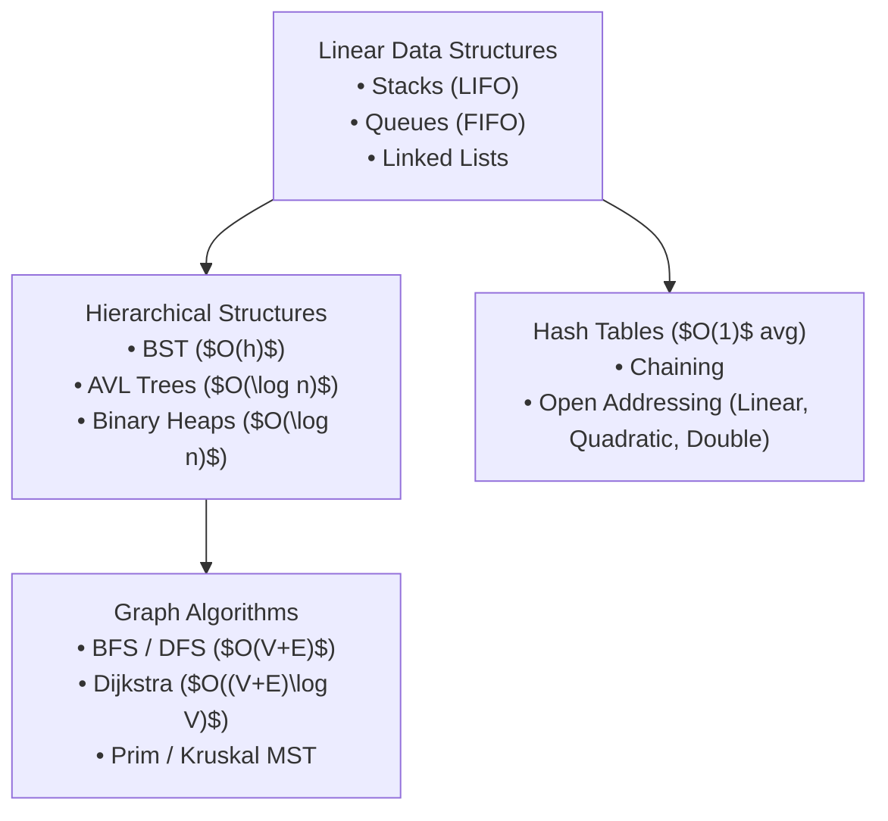
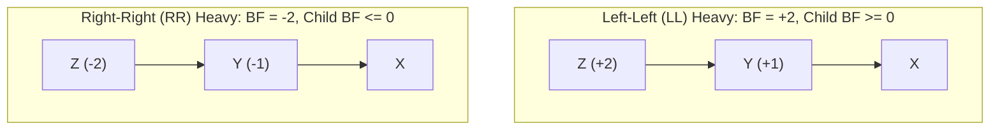

> [!info] Document Metadata
> - **Course:** `=this.course`
> - **Topic:** `=this.topic`
> - **Status:** `=this.status`

**Tags:** #[[Computer Science]] #[[CCDSALG]] #[[Data Structures]] #[[Algorithms]] #[[Reviewer]] #[[Finals]]

---

# CCDSALG Comprehensive Finals Reviewer

## Overview

This reviewer synthesizes Data Structures and Algorithms (CCDSALG). It encompasses asymptotic complexity analysis ($O, \Omega, \Theta$), linear data structures (arrays, singly/doubly linked lists, stacks, queues), nonlinear structures (trees, binary search trees, self-balancing AVL trees, binary min/max heaps), hash tables with collision resolution strategies, and graph theory algorithms (BFS, DFS, Dijkstra, Prim, Kruskal).

---

## 1. Master Asymptotic Complexity Matrix

| Data Structure / Algorithm | Access / Search | Insertion | Deletion | Space Complexity |
| :--- | :--- | :--- | :--- | :--- |
| **Array (Dynamic)** | $O(1)$ / $O(n)$ | $O(n)$ (amortized $O(1)$ at end) | $O(n)$ | $O(n)$ |
| **Singly Linked List** | $O(n)$ | $O(1)$ (at head) | $O(1)$ (if node given, else $O(n)$) | $O(n)$ |
| **Stack / Queue** | $O(n)$ | $O(1)$ (push / enqueue) | $O(1)$ (pop / dequeue) | $O(n)$ |
| **Hash Table** | $O(1)$ avg / $O(n)$ worst | $O(1)$ avg / $O(n)$ worst | $O(1)$ avg / $O(n)$ worst | $O(n)$ |
| **Binary Search Tree** | $O(h) \to O(n)$ worst | $O(h) \to O(n)$ worst | $O(h) \to O(n)$ worst | $O(n)$ |
| **AVL Tree** | $O(\log n)$ guaranteed | $O(\log n)$ guaranteed | $O(\log n)$ guaranteed | $O(n)$ |
| **Binary Heap** | $O(1)$ peek min/max | $O(\log n)$ | $O(\log n)$ extract min/max | $O(n)$ |

### Sorting Algorithms Comparison
| Algorithm | Best Time | Average Time | Worst Time | Space | Stable? |
| :--- | :--- | :--- | :--- | :--- | :--- |
| **Bubble / Insertion Sort** | $O(n)$ | $O(n^2)$ | $O(n^2)$ | $O(1)$ | Yes |
| **Merge Sort** | $O(n \log n)$ | $O(n \log n)$ | $O(n \log n)$ | $O(n)$ | Yes |
| **Quick Sort** | $O(n \log n)$ | $O(n \log n)$ | $O(n^2)$ | $O(\log n)$ | No |
| **Heap Sort** | $O(n \log n)$ | $O(n \log n)$ | $O(n \log n)$ | $O(1)$ | No |

---

## 2. AVL Tree Balance Factor & Rotations

The balance factor of a node $N$ is defined as:
$$BF(N) = \text{height}(N.\text{left}) - \text{height}(N.\text{right}) \in \{-1, 0, 1\}$$

- **LL Imbalance** $\implies$ Single **Right Rotation** on $Z$.
- **RR Imbalance** $\implies$ Single **Left Rotation** on $Z$.
- **LR Imbalance** $\implies$ Double Rotation: **Left Rotate** on child $Y$, then **Right Rotate** on $Z$.
- **RL Imbalance** $\implies$ Double Rotation: **Right Rotate** on child $Y$, then **Left Rotate** on $Z$.

---

## 3. Graph Algorithms Comparison

- **Breadth-First Search (BFS)**: Uses a **Queue**. Computes unweighted shortest paths in $O(V + E)$.
- **Depth-First Search (DFS)**: Uses a **Stack** (or recursion). Detects cycles, topological sorting, and strongly connected components in $O(V + E)$.
- **Dijkstra's Algorithm**: Greedy algorithm using a **Min-Priority Queue**. Computes single-source shortest path for non-negative weights in $O((V + E) \log V)$.
- **Kruskal's Algorithm**: Greedy MST algorithm. Sorts edges and applies **Disjoint Set Union (DSU / Union-Find)** with union-by-rank and path compression in $O(E \log E)$.
- **Prim's Algorithm**: Greedy MST algorithm growing a single tree using a min-heap in $O(E \log V)$.

---

## 4. High-Yield Exam Checklist

- [ ] Does QuickSort worst-case occur on already-sorted arrays when picking the first/last element as pivot? **YES** ($O(n^2)$).
- [ ] In Open Addressing hashing, does quadratic probing eliminate primary clustering? **YES**, but it causes secondary clustering.
- [ ] Is an AVL tree always a Binary Search Tree? **YES** (BST property + height-balanced property).
- [ ] Can Dijkstra handle negative edge weights? **NO** (Must use Bellman-Ford).
- [ ] How many edges are in a spanning tree of a connected graph with $V$ vertices? Exactly **$V - 1$ edges**.

---

## 5. Comprehensive Practice Exam

1. What is the time complexity to insert a new element into a binary max heap containing $n$ elements?
   - A) $O(1)$
   - B) $O(\log n)$
   - C) $O(n)$
   - D) $O(n \log n)$

2. In an AVL tree, after inserting a node into the left subtree of the right child of node $A$, what rotation sequence is required to restore balance?
   - A) Right rotation on $A$
   - B) Left rotation on $A$
   - C) Right-Left (RL) double rotation
   - D) Left-Right (LR) double rotation

3. Which sorting algorithm is stable and has worst-case time complexity $O(n \log n)$?
   - A) Quick Sort
   - B) Heap Sort
   - C) Merge Sort
   - D) Selection Sort

4. In a hash table with load factor $\alpha = 0.5$ using linear probing, what is the primary drawback of linear probing?
   - A) High memory overhead per node
   - B) Primary clustering where contiguous occupied slots form large blocks
   - C) Inability to delete elements
   - D) $O(n^2)$ lookup complexity

5. Which graph algorithm will correctly find the Minimum Spanning Tree of a connected weighted graph by sorting all edges in non-decreasing order?
   - A) Prim's Algorithm
   - B) Kruskal's Algorithm
   - C) Dijkstra's Algorithm
   - D) Floyd-Warshall Algorithm

---

### Answer Key & Explanations

1. **B) $O(\log n)$** — The element is appended at the next available leaf position ($O(1)$) and bubbles up along the tree height via sift-up operations, requiring at most $\lceil \log_2 n \rceil$ comparisons.
2. **C) Right-Left (RL) double rotation** — The imbalance is in the right child's left subtree (Right-Left heavy). It is resolved by a right rotation on the right child followed by a left rotation on node $A$.
3. **C) Merge Sort** — Merge Sort runs in $O(n \log n)$ time across best, average, and worst cases, and preserves the relative order of duplicate elements (stable). Quick Sort and Heap Sort are not stable.
4. **B) Primary clustering where contiguous occupied slots form large blocks** — In linear probing, collisions resolve to consecutive slots, creating long clusters that increase search times for subsequent keys.
5. **B) Kruskal's Algorithm** — Kruskal's algorithm greedily considers edges in non-decreasing order of weight, adding an edge to the forest if and only if it does not form a cycle (verified via Disjoint Set Union).

---

## References & Navigation

- **Previous Topic:** [[CCPROG2]], [[CCDSTRU]]
- **Next Topic:** [[CSALGCM]]
- **Prerequisites:** [[Data Structures]], Trees, Graphs, Sorting
- **Cross-Curricular Connections:** [[CSINTSY]]
