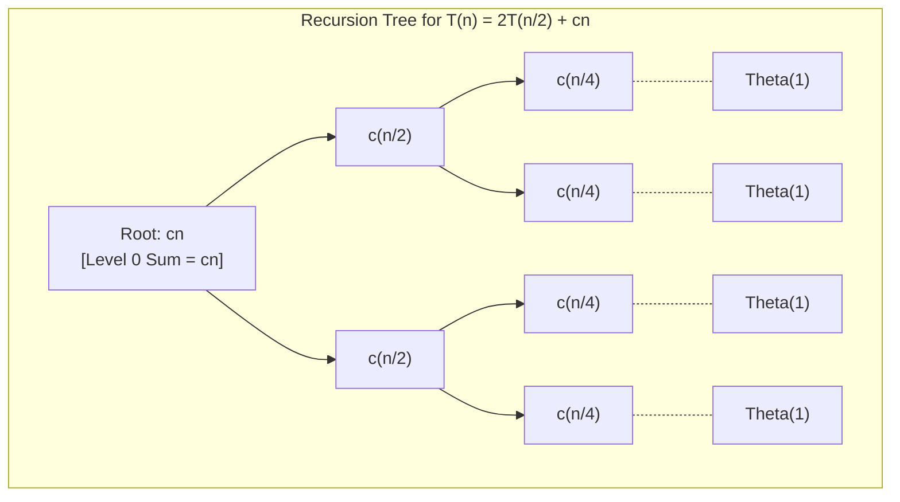
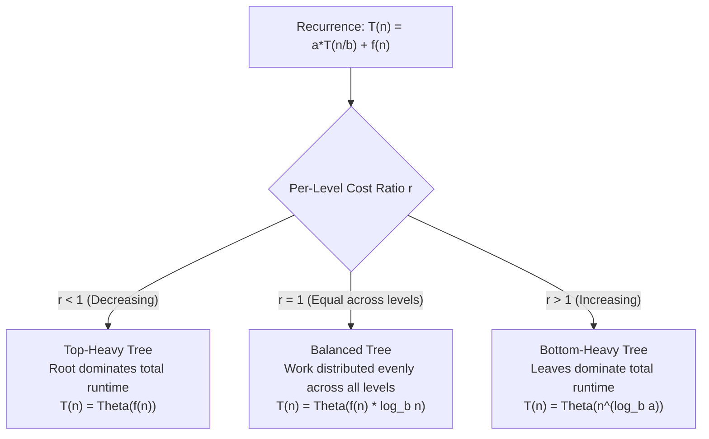

# Recursion Tree Method

> [!info] Document Metadata
> - **Course:** `=this.course`
> - **Topic:** `=this.topic`
> - **Status:** `=this.status`

**Tags:** #[[CCDSALG]] #[[Algorithms]] #[[Computer Science]] #[[Computational Complexity]] #[[Efficiency]] #[[Algorithm Design Paradigms]] #[[Recursion]] #[[Recursion and Iteration]] #[[Analysis of Algorithms]] #[[Data Structures]] #[[Time Complexity]] #[[Space Complexity]]

---

## Overview

> The Recursion Tree Method is a visual technique for solving recurrences by drawing the recursive calls as a tree and summing costs at each level.

## Key Concepts
 Visualizing recursive calls as a tree Summing costs level by level Determining tree depth and number of leaves Often used to "guess" the solution, then verify with the [[Substitution Method]]

## Details / Theory

### How It Works

1. **Draw the recursion tree** — each node represents the cost of a single recursive call (excluding its children’s costs).
2. **Determine cost per level** — sum all node costs at each depth level.
3. **Count the number of levels** — the tree has depth $\log_b n$ for a recurrence that divides by $b$.
4. **Sum across all levels** to get the total cost $T(n)$.

### Worked Example: $T(n) = 2T(n/2) + n$

**Per-Level Cost Accounting:**
- **Level 0:** 1 node with cost $cn$ $\implies$ Total = $cn$
- **Level 1:** 2 nodes, each with cost $c(n/2)$ $\implies$ Total = $cn$
- **Level 2:** 4 nodes, each with cost $c(n/4)$ $\implies$ Total = $cn$
- **Level $k$:** $2^k$ nodes, each with cost $c(n/2^k)$ $\implies$ Total = $cn$

**Depth:** The tree has $\log_2 n$ levels (since the input size halves at each recursive descent).  
**Leaves:** At level $\log_2 n$, there are $2^{\log_2 n} = n$ base-case leaves, each with cost $\Theta(1)$, contributing $\Theta(n)$.

**Total Cost Summation:**
$$T(n) = \sum_{k=0}^{\log_2 n - 1} cn + \Theta(n) = cn \log_2 n + \Theta(n) = \Theta(n \log n)$$

### Recurrence Tree Taxonomy & Behavior

### Worked Example: $T(n) = 3T(n/4) + cn^2$

- **Level 0:** cost $cn^2$
- **Level 1:** 3 nodes, each cost $c(n/4)^2 = cn^2/16$ $\implies$ Total = $\frac{3}{16} cn^2$
- **Level 2:** 9 nodes, each cost $c(n/16)^2$ $\implies$ Total = $\left(\frac{3}{16}\right)^2 cn^2$
- **Level $k$:** Total cost = $\left(\frac{3}{16}\right)^k cn^2$

This is a strictly decreasing geometric series with common ratio $r = 3/16 < 1$. Sum of infinite geometric series yields:
$$T(n) \le cn^2 \sum_{k=0}^{\infty} \left(\frac{3}{16}\right)^k = cn^2 \cdot \frac{1}{1 - 3/16} = \frac{16}{13} cn^2 = O(n^2)$$

The root level dominates (top-heavy tree) — directly consistent with Master Theorem Case 3.

### When to Use This Method
 When you want a visual/intuitive understanding of the recurrence. To generate a "guess" for the [[Substitution Method]]. When the [[Master Theorem]] doesn’t directly apply.

## Common Pitfalls
 Forgetting to account for the cost at the leaf level. Incorrectly computing the number of nodes per level (it multiplies by $a$ each level, not $b$). Not recognizing geometric series patterns when summing across levels.

## Summary

> TL;DR — The Recursion Tree Method draws out recursive calls as a tree, sums costs per level, and totals them to solve the recurrence. It’s especially useful for intuition and as a precursor to formal proofs.

## Links
 **Related:** [[Master Theorem]] — [[Substitution Method]] — [[Divide and Conquer]] — [[Asymptotic Notation]] — [[Recursion]] **Source / Reference:** Handout 03

## Multiple Choice Questions

1. What is the Recursion Tree Method used for?
    - **A)** Generating iterative loops automatically.
    - **B)** Visually solving recurrences by drawing recursive calls as a tree and summing costs per level.
    - **C)** Managing binary search trees in memory.
    - **D)** Storing output data hierarchically.

2. In a recursion tree for $T(n) = aT(n/b) + f(n)$, what does each node represent?
    - **A)** The exact Big-O notation for that step.
    - **B)** The total cost of all subproblems combined.
    - **C)** The cost of a single recursive call, excluding its children's costs.
    - **D)** The number of loops.

3. For a recurrence that divides the input by $b$ at each step, what is the total depth of the recursion tree?
    - **A)** $\log_b n$
    - **B)** $b \log n$
    - **C)** $n/b$
    - **D)** $n^b$

4. In the worked example $T(n) = 2T(n/2) + n$, what is the total cost at level 1?
    - **A)** $n/2$
    - **B)** $n$
    - **C)** $2n$
    - **D)** $n^2$

5. In the worked example $T(n) = 2T(n/2) + n$, how many leaves does the tree have at the final level?
    - **A)** $\log_2 n$
    - **B)** $n/2$
    - **C)** $n$
    - **D)** $2n$

6. In the worked example $T(n) = 3T(n/4) + cn^2$, what does the geometric series indicate about the tree?
    - **A)** The root dominates (top-heavy tree).
    - **B)** The leaves dominate (bottom-heavy tree).
    - **C)** The work is perfectly balanced across all levels.
    - **D)** The recurrence cannot be solved.

7. Which method is the Recursion Tree Method often used to help or generate a "guess" for?
    - **A)** Frequency counting
    - **B)** The Substitution Method
    - **C)** Iterative unrolling
    - **D)** The Master Theorem

8. What is a common pitfall when drawing a recursion tree?
    - **A)** Forgetting to account for the cost at the leaf level.
    - **B)** Drawing the tree upside down.
    - **C)** Assuming the tree has exactly 2 branches at every node regardless of $a$.
    - **D)** Using asymptotic notation instead of constants.

9. When computing the number of nodes per level, by what factor does it increase each time?
    - **A)** It multiplies by $b$.
    - **B)** It multiplies by $a$.
    - **C)** It adds $f(n)$.
    - **D)** It divides by $n$.

10. Why might someone choose to use the Recursion Tree Method over the Master Theorem?
    - **A)** Because the Master Theorem is mathematically unproven.
    - **B)** To get a visual/intuitive understanding of the recurrence, or when the Master Theorem doesn’t directly apply.
    - **C)** Because it provides an exact millisecond execution time.
    - **D)** Because it is the only way to analyze sorting algorithms.

### Answer Key & Explanations

1. **B**. It is a technique for modeling recursive calls hierarchically to easily sum up the work done at every level of depth.
2. **C**. A node strictly holds the non-recursive overhead $f(n)$ for that specific subproblem, ensuring work isn't double-counted when summing.
3. **A**. The problem size decreases by a factor of $b$ at each level, so it takes $\log_b n$ steps to reach the base case of size 1.
4. **B**. Level 1 has 2 nodes, each doing $n/2$ work. $2 \times (n/2) = n$.
5. **C**. The number of leaves is $a^{\text{depth}} = 2^{\log_2 n} = n$.
6. **A**. Because the ratio of the geometric series is less than 1 ($3/16$), the terms shrink rapidly, meaning the very first term (the root) holds the vast majority of the cost.
7. **B**. Finding the exact sum of a recursion tree can be algebraically messy, so it's often used to just estimate the bound (guess) and then formally prove it using substitution.
8. **A**. It is easy to sum up the internal nodes and completely forget that the massive row of base-case leaves at the very bottom also contributes $\Theta(n^{\log_b a})$ work.
9. **B**. The variable $a$ dictates the branching factor—how many child subproblems each parent spawns.
10. **B**. The Master Theorem has strict structural requirements. The tree method is flexible enough to handle bizarre recurrences and provides deep intuition about where the algorithm spends its time.

## References & Navigation

- **Previous Topic:** [[Recurrences]]
- **Next Topic:** [[Running Time]]
- **Related Notes:** [[Algorithm Analysis]], [[Core Concepts]]
