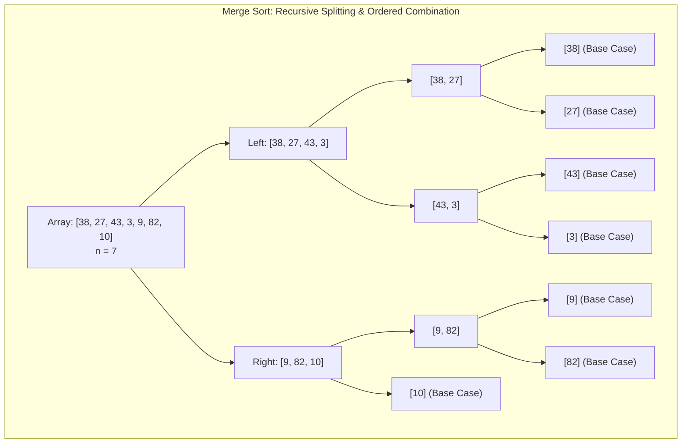
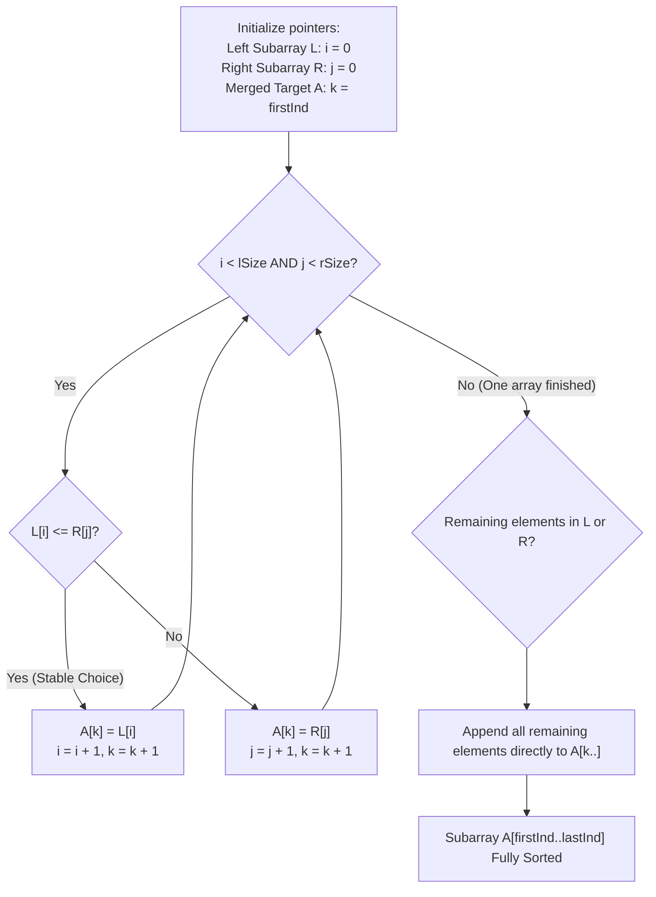

# Sorting Algorithms

> [!info] Document Metadata
> - **Course:** `=this.course`
> - **Topic:** `=this.topic`
> - **Status:** `=this.status`

**Tags:** #[[Computer Science]] #[[CCDSALG]] #[[Algorithms - Sort]] #[[Code Snippets]] #[[M2]]

---

## Overview

A sorting algorithm rearranges a sequence of $n$ numbers $(a_1, a_2, a_3, \dots, a_n)$ such that they are in non-decreasing order ($a_1' \le a_2' \le a_3' \le \dots \le a_n'$). Many of these algorithms operate **in-place**, meaning they sort the data without requiring additional array storage.

The primary algorithms discussed include:
1. **Bubble Sort**: Repeatedly steps through the list, compares adjacent elements, and swaps them if they are in the wrong order. 
2. **Insertion Sort**: Builds the final sorted array one item at a time by repeatedly taking the next element and inserting it into its correct position among the already-sorted elements.
3. **Merge Sort**: A divide-and-conquer algorithm that recursively splits the array in half until each sub-array contains a single element, and then merges the sub-arrays in sorted order.

> [!simulator] Interactive Sorting Visualizer & Comparator
> Step through QuickSort, MergeSort, HeapSort, and InsertionSort with live array bar charts and Big-O complexity counters:
> [Launch Sorting Algorithms & Complexity Studio](/simulators?id=sorting-bench)

## Theoretical Framework: Divide-and-Conquer Call Tree



### Two-Pointer Linear Merge Pipeline



## Code Implementation

### Bubble Sort
```c
void execBubbleSort(int A[], int n) {
    int j, k;
    for (j = 0; j <= n - 1; j++) {
        for (k = n - 1; k >= j + 1; k--) {
            if (A[k] < A[k - 1]) {
                swap(A[k], A[k - 1]);
            }
        }
    }
}
```

### Merge Sort (Merge Step)
```c
void merge(int A[], int firstInd, int mid, int lastInd) {
    int j, x, y, L[n], R[n];
    int lSize = mid - firstInd + 1;
    int rSize = lastInd - mid;
    
    arrayCopy(L, A, firstInd, mid);
    arrayCopy(R, A, mid + 1, lastInd);
    
    x = 0;
    y = 0;
    j = firstInd;
    
    while (x < lSize && y < rSize) {
        if (L[x] <= R[y]) {
            A[j] = L[x];
            x++;
        } else {
            A[j] = R[y];
            y++;
        }
        j++;
    }
    
    while (x < lSize) {
        A[j] = L[x];
        x++;
        j++;
    }
    
    while (y < rSize) {
        A[j] = R[y];
        y++;
        j++;
    }
}
```

## Complexity Analysis

* **Bubble Sort**: Time complexity is $O(n^2)$ due to the nested loops traversing the array. It operates in-place.
* **Insertion Sort**: Time complexity is $O(n^2)$ in the worst case (reverse sorted array) but can perform at $O(n)$ if the array is nearly sorted. Operates in-place.
* **Merge Sort**: Time complexity is $O(n \log_2 n)$ because it divides the array in half logarithmically and merges them in linear time. It is generally not in-place because the `merge` function requires auxiliary arrays (`L` and `R`).


## Multiple Choice Questions

1. What formal ordering property defines the rearranged output $(a_1', a_2', \dots, a_n')$ of a sorting algorithm?
    - **A)** Every element is less than or equal to the element that follows it (a1' <= a2' <= ... <= an')
    - **B)** Every element must be strictly less than the element that follows it with no duplicates
    - **C)** Adjacent pairs alternate between larger and smaller values
    - **D)** Only the first and last elements are guaranteed to be ordered

2. Why is Merge Sort generally NOT considered an in-place sorting algorithm, unlike Bubble Sort and Insertion Sort?
    - **A)** Because Merge Sort has O(n^2) worst-case time complexity
    - **B)** Because Merge Sort can only sort linked lists and never arrays
    - **C)** Because its merge step requires auxiliary arrays L and R to copy and merge subarrays
    - **D)** Because Merge Sort modifies elements outside indices 0 through n - 1

3. Trace `execBubbleSort` on `A = {5, 1, 4, 2}` ($n = 4$) through the end of the very first outer-loop pass (`j = 0`). What is the state of `A`?
    - **A)** {1, 2, 4, 5}
    - **B)** {1, 4, 2, 5}
    - **C)** {5, 1, 2, 4}
    - **D)** {1, 5, 2, 4}

4. Under what input condition does Insertion Sort run in $O(n)$ time rather than its $O(n^2)$ worst case?
    - **A)** When the array is strictly reverse sorted
    - **B)** When the array is already nearly sorted
    - **C)** When the array length is a prime number
    - **D)** When all elements are distinct and randomly shuffled

5. In the Merge Sort divide-and-conquer call tree diagram for `[38, 27, 43, 3, 9, 82, 10]`, why does splitting stop at nodes such as `[10]` and `[38]`?
    - **A)** They reach the single-element base case, which is trivially sorted and ready to merge
    - **B)** They are discarded from the final output because they are odd-length partitions
    - **C)** Merge Sort switches to Bubble Sort whenever a subarray has fewer than 3 elements
    - **D)** Single-element arrays cannot be indexed in C

6. In `merge(A, firstInd, mid, lastInd)`, given `firstInd = 4`, `mid = 6`, and `lastInd = 9`, what are the computed values of `lSize` and `rSize`?
    - **A)** lSize = 2 and rSize = 3
    - **B)** lSize = 3 and rSize = 4
    - **C)** lSize = 2 and rSize = 4
    - **D)** lSize = 3 and rSize = 3

7. In the `merge` function and two-pointer merge flowchart, why is the comparison `L[x] <= R[y]` (including equality) used when deciding whether to take from `L`?
    - **A)** To avoid draining the remaining elements of R afterward
    - **B)** To preserve sorting stability by choosing the left subarray element when keys are equal
    - **C)** To prevent x and y from incrementing on the same iteration
    - **D)** To eliminate the need for the auxiliary array R

8. Why does the `merge` function contain two separate trailing loops (`while (x < lSize)` and `while (y < rSize)`) after the main comparison loop?
    - **A)** To re-sort L and R in descending order before returning
    - **B)** To swap adjacent out-of-order elements left in A
    - **C)** Because one subarray finishes first, and any remaining already-sorted elements from the other subarray must be appended to A
    - **D)** Because the main while loop skips index 0 of both L and R

9. What accounts for Merge Sort's $O(n \log_2 n)$ time complexity?
    - **A)** It performs n^2 swaps during partitioning and log₂ n comparisons during merging
    - **B)** It divides the array into n single-element subarrays using a single O(n) loop
    - **C)** It sorts the array in-place using only O(log₂ n) total comparisons
    - **D)** It divides the array in half logarithmically over O(log₂ n) levels and merges across each level in O(n) linear time

10. In `execBubbleSort`, why does the inner loop bound check `k >= j + 1` instead of always scanning down to `k >= 1`?
    - **A)** Because A[0] is reserved as a sentinel value and never sorted
    - **B)** Because after j outer passes, the first j elements A[0..j-1] are already in their final sorted positions
    - **C)** Because Bubble Sort skips every odd-indexed element on even passes
    - **D)** Because comparing A[1] with A[0] would read outside the array bounds

### Answer Key & Explanations

1. **A)** The note defines sorting as rearranging a sequence into non-decreasing order: $a_1' \le a_2' \le a_3' \le \dots \le a_n'$.
2. **C)** Unlike Bubble Sort and Insertion Sort, which rearrange elements directly within the original array, Merge Sort's `merge` step allocates auxiliary arrays `L` and `R`.
3. **D)** At `j = 0`, `k` steps from `3` down to `1`: `k = 3` swaps `2` and `4` (`{5, 1, 2, 4}`); `k = 2` does not swap `2` and `1`; `k = 1` swaps `1` and `5`, leaving `{1, 5, 2, 4}`.
4. **B)** Insertion Sort hits $O(n^2)$ on reverse-sorted input, whereas nearly sorted input requires minimal shifting and achieves $O(n)$.
5. **A)** The divide phase recursively splits subarrays in half until each subarray contains a single element (the base case), after which the merge phase combines them in sorted order.
6. **D)** Applying the formulas in `merge`: `lSize = mid - firstInd + 1 = 6 - 4 + 1 = 3`, and `rSize = lastInd - mid = 9 - 6 = 3`.
7. **B)** Using `<=` in `L[i] <= R[j]` selects the left subarray's element on ties (marked "Stable Choice" in the flowchart), maintaining the relative order of equal keys.
8. **C)** The main loop stops as soon as either `x == lSize` or `y == rSize`; the two drain loops copy whichever subarray still has unmerged elements directly into `A`.
9. **D)** Merge Sort halves the problem size recursively ($\log_2 n$ levels) and performs linear-time ($O(n)$) two-pointer merging across each level, yielding $O(n \log_2 n)$.
10. **B)** Each pass of `k` from `n - 1` down to `j + 1` bubbles the smallest remaining element into `A[j]`, so elements `0` through `j - 1` are already finalized.

## References & Navigation

- **Previous Topic:** [[Algorithms - Search]]
- **Next Topic:** [[Arrays and Linked Lists]]
- **Related Notes:** [[Divide and Conquer]], [[Divide and Conquer Introduction]]
