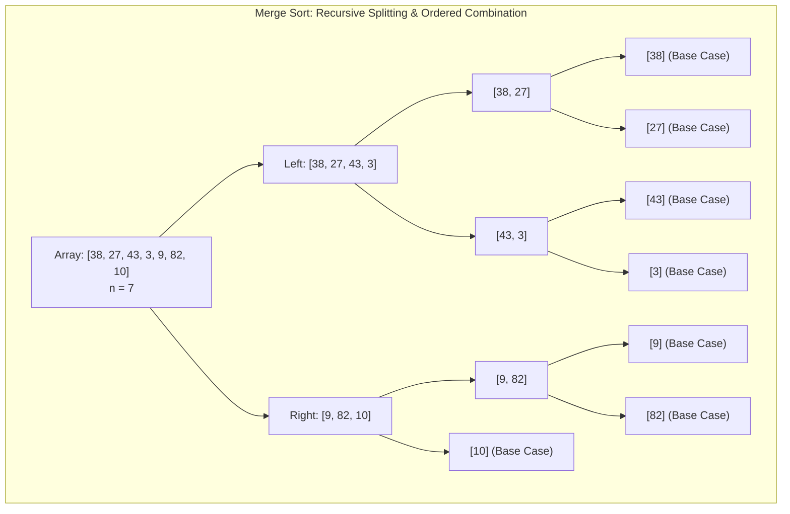
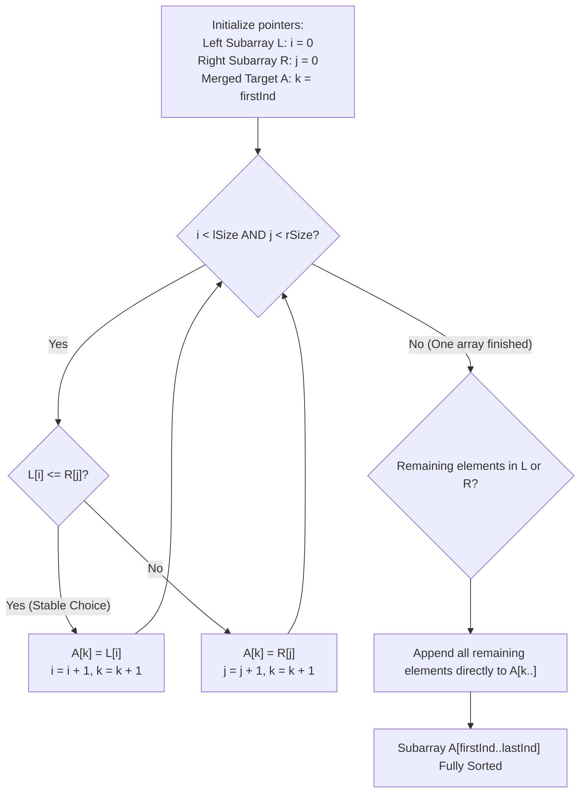

# Algorithms - Sort

> [!info] Document Metadata
> - **Course:** `=this.course`
> - **Topic:** `=this.topic`
> - **Status:** `=this.status`

**Tags:** #[[Computer Science]] #[[CCDSALG]] #[[Algorithms - Sort]] #[[Code Snippets]] #[[M2]]

---

## Overview

A sorting algorithm rearranges a sequence of $n$ numbers $(a_1, a_2, a_3, \dots, a_n)$ such that they are in non-decreasing order ($a_1' \le a_2' \le a_3' \le \dots \le a_n'$). Many of these algorithms operate **in-place**, meaning they sort the data without requiring additional array storage.

The primary algorithms discussed include:
1. **Bubble Sort**: Repeatedly steps through the list, compares adjacent elements, and swaps them if they are in the wrong order. 
2. **Insertion Sort**: Builds the final sorted array one item at a time by repeatedly taking the next element and inserting it into its correct position among the already-sorted elements.
3. **Merge Sort**: A divide-and-conquer algorithm that recursively splits the array in half until each sub-array contains a single element, and then merges the sub-arrays in sorted order.

## Theoretical Framework: Divide-and-Conquer Call Tree



### Two-Pointer Linear Merge Pipeline



## Code Implementation

### Bubble Sort
```c
void execBubbleSort(int A[], int n) {
    int j, k;
    for (j = 0; j <= n - 1; j++) {
        for (k = n - 1; k >= j + 1; k--) {
            if (A[k] < A[k - 1]) {
                swap(A[k], A[k - 1]);
            }
        }
    }
}
```

### Merge Sort (Merge Step)
```c
void merge(int A[], int firstInd, int mid, int lastInd) {
    int j, x, y, L[n], R[n];
    int lSize = mid - firstInd + 1;
    int rSize = lastInd - mid;
    
    arrayCopy(L, A, firstInd, mid);
    arrayCopy(R, A, mid + 1, lastInd);
    
    x = 0;
    y = 0;
    j = firstInd;
    
    while (x < lSize && y < rSize) {
        if (L[x] <= R[y]) {
            A[j] = L[x];
            x++;
        } else {
            A[j] = R[y];
            y++;
        }
        j++;
    }
    
    while (x < lSize) {
        A[j] = L[x];
        x++;
        j++;
    }
    
    while (y < rSize) {
        A[j] = R[y];
        y++;
        j++;
    }
}
```

## Complexity Analysis

* **Bubble Sort**: Time complexity is $O(n^2)$ due to the nested loops traversing the array. It operates in-place.
* **Insertion Sort**: Time complexity is $O(n^2)$ in the worst case (reverse sorted array) but can perform at $O(n)$ if the array is nearly sorted. Operates in-place.
* **Merge Sort**: Time complexity is $O(n \log_2 n)$ because it divides the array in half logarithmically and merges them in linear time. It is generally not in-place because the `merge` function requires auxiliary arrays (`L` and `R`).


## References & Navigation

- **Related Notes:** [[Sorting Algorithms]]
