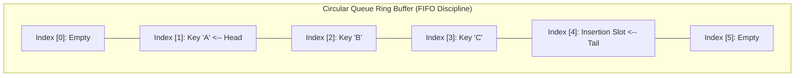
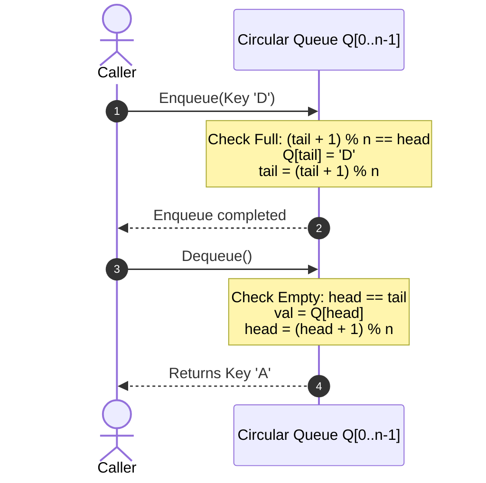

# Queues

> [!info] Document Metadata
> - **Course:** `=this.course`
> - **Topic:** `=this.topic`
> - **Status:** `=this.status`

**Tags:** #[[Computer Science]] #[[CCDSALG]] #[[Queues]] #[[Conceptual]] #[[M3]]

---

## Overview

A **queue** is a dynamic, ordered list that implements a **First-In, First-Out (FIFO)** policy. This means that the element deleted is always the one that has been in the list for the longest time. Queues can also be implemented as circular structures (circular queues) to efficiently reuse array space.

## Key Definitions

* **head**: The index of the next element to be dequeued (removed).
* **tail**: The index where the next new element will be inserted.
* **size**: The maximum capacity of the queue.

## Theoretical Framework

The behavior of a queue is governed by the following standard operations (assuming an array implementation `Q[1..n]`):

* **Create(Q)**: Creates a new, empty queue.
* **Enqueue(Q, x)**: Inserts the element `x` into the queue at the `tail` position.
* **Dequeue(Q)**: Deletes the first element from the queue (at the `head` position) and returns that element.
* **QueueHead(Q)**: Returns the element (not the index) at the head of the queue without removing it.
* **QueueTail(Q)**: Returns the element (not the index) at the tail of the queue without removing it.
* **QueueEmpty(Q)**: Returns `true` when the queue is empty (typically when `head == tail`), and `false` otherwise.
* **QueueFull(Q)**: Returns `true` when the queue is full. For a circular array of size $n$, this is typically checked using `head == (tail + 1) % n`. Returns `false` otherwise.

### Enqueue & Dequeue Ring Buffer Transitions

## Multiple Choice Questions

1. Under the First-In, First-Out (FIFO) policy of a queue, which element is always removed next by `Dequeue(Q)`?
    - **A)** The element most recently added to the queue
    - **B)** The element with the smallest numeric key
    - **C)** The element that has been in the queue for the longest time
    - **D)** The element located at the tail index

2. In the queue definitions provided in the note, what do the `head` and `tail` indices identify?
    - **A)** head is the index of the next element to be dequeued, and tail is the index where the next new element will be inserted
    - **B)** head is always fixed at index 0, and tail is the total array capacity
    - **C)** head is the index where new elements are inserted, and tail is where elements are deleted
    - **D)** head and tail both store element values rather than array indices

3. Why are queues often implemented as circular queues (ring buffers) when backed by an array?
    - **A)** To switch the access discipline from FIFO to LIFO
    - **B)** To allow O(1) arbitrary deletions from the middle of the array
    - **C)** To eliminate the need for head and tail tracking variables
    - **D)** To reuse array positions freed by Dequeue operations without shifting remaining elements

4. Under the standard circular array implementation, when does `QueueEmpty(Q)` return `true`?
    - **A)** When head == (tail + 1) % n
    - **B)** When head == tail
    - **C)** When tail == size - 1
    - **D)** When head == 0 and tail > 0

5. In the Circular Queue Ring Buffer diagram (`n = 6`, indices `0..5`, `head = 1` at `'A'`, `tail = 4`), after running `Enqueue(Key 'D')` followed by `Dequeue()` as shown in the sequence diagram, what are the updated values of `head`, `tail`, and the returned key?
    - **A)** head = 1, tail = 5, returns 'D'
    - **B)** head = 2, tail = 4, returns 'A'
    - **C)** head = 2, tail = 5, returns 'A'
    - **D)** head = 0, tail = 5, returns 'B'

6. Starting from the Circular Queue Ring Buffer diagram (`n = 6`, `head = 1` at `'A'`, `tail = 4`), suppose `'D'` is enqueued and then `'E'` is enqueued. What is `tail` afterward, and what happens if `'F'` is then enqueued?
    - **A)** tail wraps to 0 after 'E', and attempting to enqueue 'F' triggers QueueFull because (0 + 1) % 6 == head
    - **B)** tail becomes 6 after 'E', and 'F' is stored at Q[0] without error
    - **C)** tail stays 5 after 'E', and 'F' overwrites 'A' at Q[1]
    - **D)** QueueFull triggers before 'E' can be enqueued

7. According to the standard queue operations, what does `QueueHead(Q)` return?
    - **A)** The integer index value stored in head
    - **B)** The index of the tail slot minus 1
    - **C)** The head element after deleting it from the queue
    - **D)** The element stored at the head of the queue without removing it

8. In the `Enqueue & Dequeue Ring Buffer Transitions` sequence diagram, once the queue is confirmed not full, in what order do the assignments inside `Enqueue` occur?
    - **A)** Increment tail = (tail + 1) % n first, then assign Q[tail] = x
    - **B)** Assign Q[tail] = x first, then update tail = (tail + 1) % n
    - **C)** Assign Q[head] = x first, then update head = (head + 1) % n
    - **D)** Check head == tail first, then decrement tail = (tail - 1) % n

9. For a circular queue backed by an array of size $n$, which condition is used by `QueueFull(Q)` to detect that the queue is full?
    - **A)** head == tail
    - **B)** (head + 1) % n == tail
    - **C)** head == (tail + 1) % n
    - **D)** tail == n - 1

10. Starting from an empty circular queue `Q[0..4]` ($n = 5$, `head = 0`, `tail = 0`), we execute `Enqueue(1)`, `Enqueue(2)`, `Dequeue()`, `Enqueue(3)`, and `Dequeue()`. What are `head`, `tail`, and the return value of `QueueHead(Q)`?
    - **A)** head = 1, tail = 3, QueueHead(Q) = 2
    - **B)** head = 2, tail = 3, QueueHead(Q) = 3
    - **C)** head = 2, tail = 2, QueueHead(Q) = 3
    - **D)** head = 3, tail = 2, QueueHead(Q) = 1

### Answer Key & Explanations

1. **C)** A queue follows a First-In, First-Out (FIFO) discipline, meaning `Dequeue(Q)` always deletes the element that has resided in the queue the longest.
2. **A)** By definition, `head` points to the next element to be removed (`Dequeue`), and `tail` points to the slot where the next new element will be inserted (`Enqueue`).
3. **D)** Circular queues wrap `head` and `tail` around the array using modulo arithmetic so previously dequeued slots can be reused efficiently.
4. **B)** `QueueEmpty(Q)` returns `true` when `head == tail`.
5. **C)** `Enqueue('D')` writes `'D'` at `Q[4]` and advances `tail` to `(4 + 1) % 6 = 5`; `Dequeue()` then reads `Q[1] = 'A'` and advances `head` to `(1 + 1) % 6 = 2`.
6. **A)** Enqueuing `'D'` sets `Q[4] = 'D'` (`tail = 5`); enqueuing `'E'` checks `(5 + 1) % 6 = 0 != 1`, stores `Q[5] = 'E'`, and wraps `tail` to `0`. Attempting `'F'` then finds `(0 + 1) % 6 = 1 == head`, so `QueueFull` is `true`.
7. **D)** The note explicitly clarifies that `QueueHead(Q)` returns the element (not the index) at the head of the queue without removing it.
8. **B)** As shown in the sequence diagram, `Q[tail] = 'D'` stores the element at the current insertion slot before advancing `tail = (tail + 1) % n`.
9. **C)** For a circular array of size $n$, `QueueFull(Q)` checks `head == (tail + 1) % n`.
10. **B)** After `Enqueue(1)` (`tail=1`) and `Enqueue(2)` (`tail=2`), the first `Dequeue()` removes `1` (`head=1`), `Enqueue(3)` stores `3` at `Q[2]` (`tail=3`), and the second `Dequeue()` removes `2` (`head=2`), leaving `QueueHead(Q) = Q[2] = 3`.

## References & Navigation

- **Previous Topic:** [[Infix, Postfix, and Prefix Expressions]]
- **Next Topic:** [[Hash Tables]]
- **Related Notes:** [[Arrays and Linked Lists]], [[Stack Operations and Applications]]
