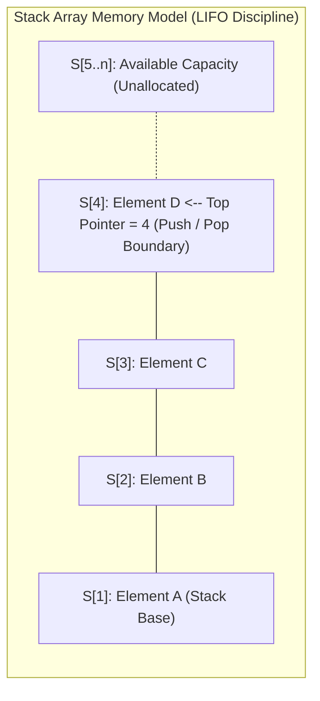
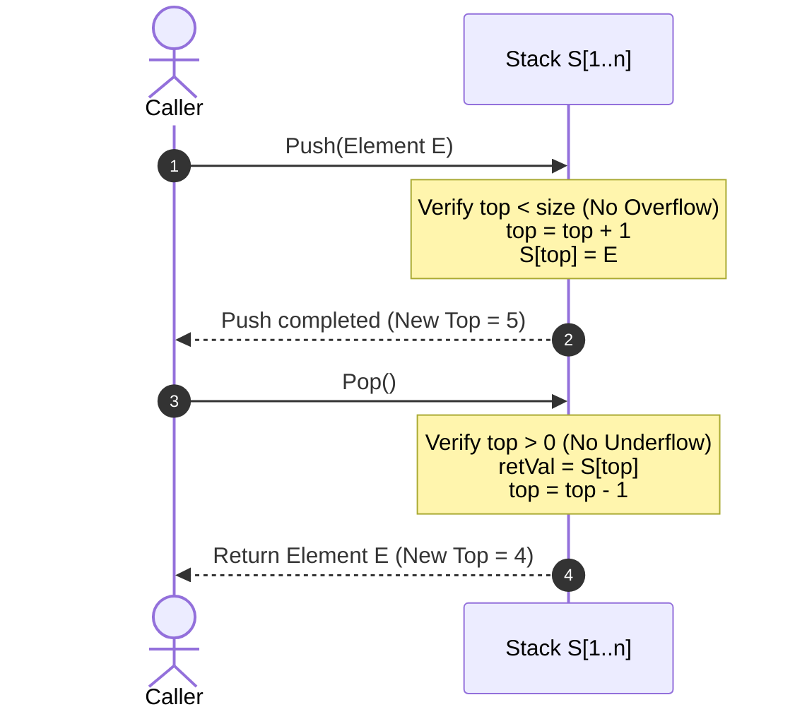

# Stack Operations and Applications

> [!info] Document Metadata
> - **Course:** `=this.course`
> - **Topic:** `=this.topic`
> - **Status:** `=this.status`

**Tags:** #[[Computer Science]] #[[CCDSALG]] #[[Stacks]] #[[Conceptual]] #[[M3]]

---

## Overview

A **stack** is a dynamic, ordered list that implements a **Last-In, First-Out (LIFO)** policy. This means that the last element added to the stack will be the first one to be removed. In a stack, insertion and deletion of elements only occur at one end, which is referred to as the **top** of the stack.

## Key Definitions

* **top**: The index of the most recently inserted element in the stack. When the stack is empty (assuming a 1-based index `S[1..n]`), `top` is `0`.
* **size**: The maximum capacity of the stack.
* **underflow**: An error that occurs when there is an attempt to pop an element from an empty stack.
* **overflow**: An error that occurs when there is an attempt to push an element onto a stack where `top` already exceeds or equals `size`.

## Theoretical Framework

The behavior of a stack is governed by the following standard operations:

* **Create(S)**: Creates a new, empty stack `S`.
* **Push(S, x)**: Inserts the element `x` into the stack at the `top` position. This operation may trigger an overflow error if the stack is already full.
* **Pop(S)**: Deletes the topmost element from the stack and returns that element. This operation may trigger an underflow error if the stack is empty.
* **Top(S)**: Returns the value of the top element of the stack without removing it (does not take an element argument).
* **StackEmpty(S)**: Returns `true` when the stack is empty (`top == 0`), and `false` otherwise.
* **StackFull(S)**: Returns `true` when the stack has reached its maximum capacity (`size`), and `false` otherwise.

### Push & Pop Lifecycle Dynamics

## Multiple Choice Questions

1. Which ordering discipline governs a stack, and where can elements be inserted or removed?
    - **A)** First-In, First-Out (FIFO), with insertion at the tail and deletion at the head
    - **B)** Last-In, First-Out (LIFO), with both insertion and deletion occurring only at the top
    - **C)** Priority-based ordering, with insertion anywhere and deletion at the base
    - **D)** Last-In, First-Out (LIFO), with insertion at the top and deletion at the base

2. Assuming a 1-based array implementation `S[1..n]`, what is the value of `top` when `StackEmpty(S)` returns `true`?
    - **A)** 0
    - **B)** 1
    - **C)** -1
    - **D)** size

3. When does a stack **underflow** error occur?
    - **A)** When Push(S, x) is called while top == size
    - **B)** When StackEmpty(S) is called on a newly created stack
    - **C)** When Top(S) is called without passing an element x
    - **D)** When Pop(S) is attempted on an empty stack

4. How does the `Top(S)` operation differ from `Pop(S)`?
    - **A)** Top(S) deletes the bottom element while Pop(S) deletes the top element
    - **B)** Top(S) returns the index top rather than the stored element value
    - **C)** Top(S) returns the value of the topmost element without removing it, whereas Pop(S) deletes and returns it
    - **D)** Top(S) requires an element argument x, whereas Pop(S) does not

5. According to the `Push & Pop Lifecycle Dynamics` sequence diagram, after confirming `top < size`, in what order are `top` and `S[top]` updated during `Push(Element E)`?
    - **A)** Assign S[top] = E first, then increment top = top + 1
    - **B)** Increment top = top + 1 first, then assign S[top] = E
    - **C)** Decrement top = top - 1 first, then assign S[top] = E
    - **D)** Check top > 0 first, then assign S[size] = E

6. According to the `Push & Pop Lifecycle Dynamics` sequence diagram, after verifying `top > 0` during `Pop()`, what steps execute?
    - **A)** Decrement top = top - 1 first, then read S[top] and return it
    - **B)** Set S[top] = 0, increment top = top + 1, and return S[1]
    - **C)** Copy S[1] to retVal and shift all elements downward
    - **D)** Read retVal = S[top], then decrement top = top - 1, and return retVal

7. Starting with an empty 1-based stack `S[1..3]` (`size = 3`, `top = 0`), we execute `Push(S, 10)`, `Push(S, 20)`, `Pop(S)`, `Push(S, 30)`, and `Push(S, 40)`. What is the resulting state of `S`?
    - **A)** top = 2 with elements 10, 40 (base to top), and StackFull(S) is false
    - **B)** An overflow error occurs on Push(S, 40)
    - **C)** top = 3 with elements 10, 30, 40 (base to top), and StackFull(S) is true
    - **D)** top = 3 with elements 20, 30, 40 (base to top), and StackFull(S) is true

8. If a 1-based stack `S[1..5]` currently has `size = 5` and `top = 5`, what happens when `Push(S, x)` is called?
    - **A)** An overflow error is triggered because top already equals size
    - **B)** Element x overwrites S[1] at the stack base
    - **C)** top becomes 6 and size automatically doubles to 10
    - **D)** An underflow error is triggered because no available slot remains

9. Suppose elements `A`, `B`, `C`, and `D` are pushed onto an initially empty stack in that order (matching the Stack Array Memory Model diagram), followed by two `Pop(S)` calls. Which elements are returned in order?
    - **A)** A first, then B
    - **B)** D first, then A
    - **C)** C first, then D
    - **D)** D first, then C

10. Which statement accurately describes `Top(S)` and `StackFull(S)` under the note's specification?
    - **A)** Top(S) takes two arguments (S, x) and increments top
    - **B)** StackFull(S) returns true whenever top == 0
    - **C)** Top(S) takes only the stack S (no element argument), and StackFull(S) returns true when top equals capacity size
    - **D)** Both Top(S) and StackFull(S) modify the contents of S

### Answer Key & Explanations

1. **B)** A stack enforces a Last-In, First-Out (LIFO) policy where both insertion (`Push`) and deletion (`Pop`) happen exclusively at the `top` end.
2. **A)** In the 1-based `S[1..n]` convention defined in the note, `top` is `0` when the stack is empty (`StackEmpty(S)` returns `true`).
3. **D)** Underflow is defined as the error caused by attempting to pop an element from an empty stack (`top == 0`).
4. **C)** `Top(S)` inspects and returns the value at `S[top]` without modifying or removing it, whereas `Pop(S)` removes and returns that element.
5. **B)** As shown in the Push sequence diagram, once `top < size` holds, `top` is incremented (`top = top + 1`) first so `S[top] = E` writes into the newly allocated top slot.
6. **D)** As shown in the Pop sequence diagram, once `top > 0` holds, `retVal = S[top]` captures the top element before `top = top - 1` lowers the pointer, and `retVal` is returned.
7. **C)** After `Push(10)` and `Push(20)` (`[10, 20]`, `top = 2`), `Pop()` removes `20` (`[10]`, `top = 1`); `Push(30)` and `Push(40)` then place `30` at `S[2]` and `40` at `S[3]`, leaving `top = 3 == size` (`StackFull(S)` is `true`).
8. **A)** Overflow occurs when attempting to push onto a stack where `top` already equals or exceeds `size` (violating `top < size`).
9. **D)** With `A` at `S[1]` (base) up to `D` at `S[4]` (top), the first `Pop(S)` returns `D` (leaving `top = 3`) and the second `Pop(S)` returns `C`.
10. **C)** The theoretical framework specifies that `Top(S)` takes no element argument and leaves the stack intact, while `StackFull(S)` returns `true` when the stack reaches capacity `size`.

## References & Navigation

- **Previous Topic:** [[Arrays and Linked Lists]]
- **Next Topic:** [[Infix, Postfix, and Prefix Expressions]]
- **Related Notes:** [[Stacks]], [[Supplement-Infix-to-Postfix]]
