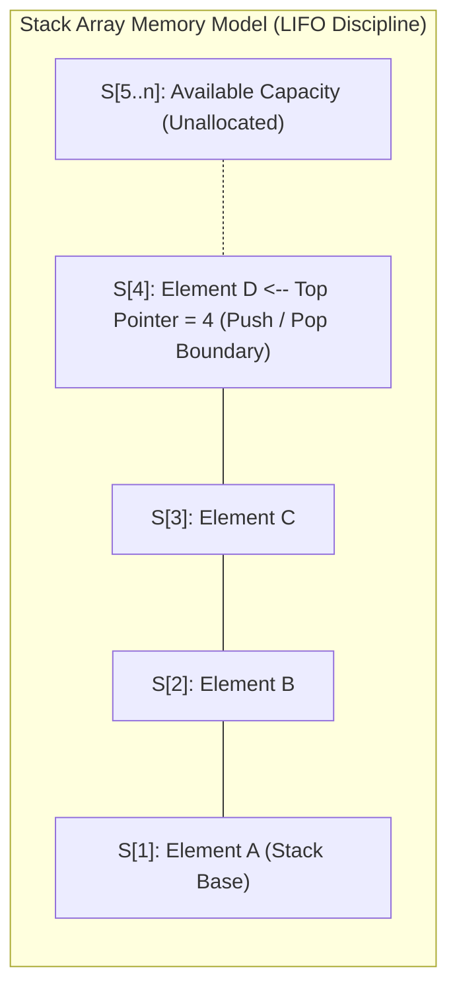
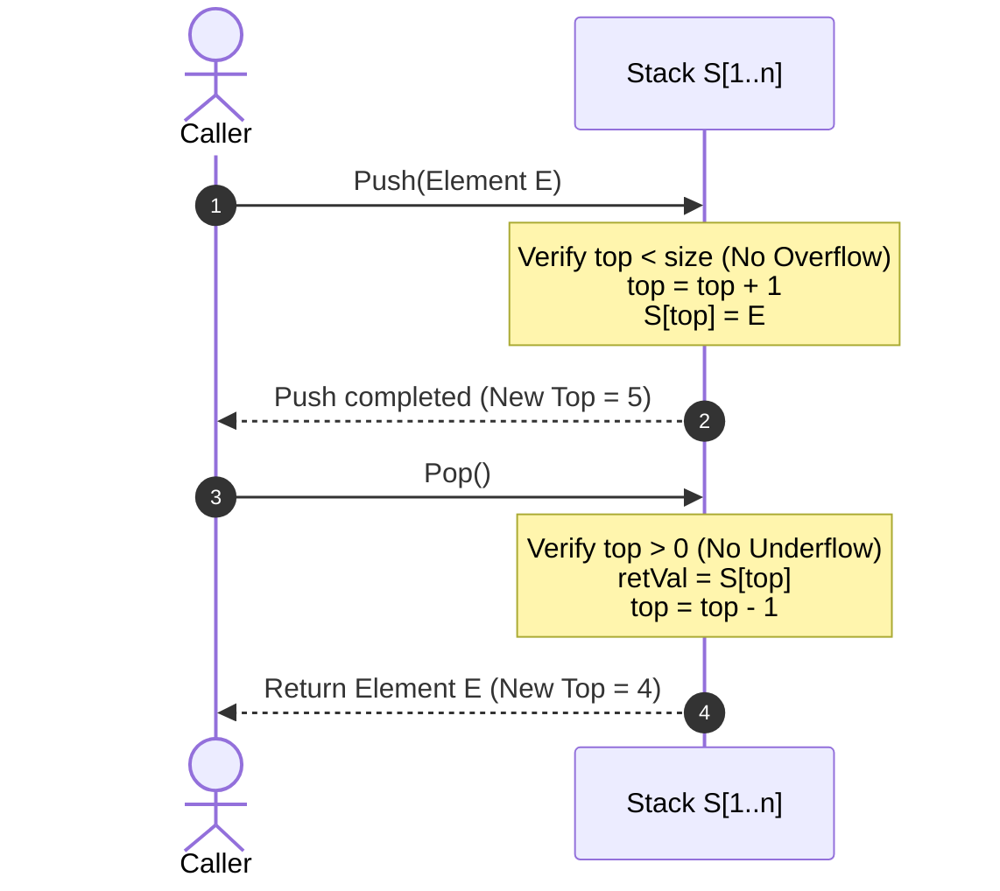

# Stacks

> [!info] Document Metadata
> - **Course:** `=this.course`
> - **Topic:** `=this.topic`
> - **Status:** `=this.status`

**Tags:** #[[Computer Science]] #[[CCDSALG]] #[[Stacks]] #[[Conceptual]] #[[M3]]

---

## Overview

A **stack** is a dynamic, ordered list that implements a **Last-In, First-Out (LIFO)** policy. This means that the last element added to the stack will be the first one to be removed. In a stack, insertion and deletion of elements only occur at one end, which is referred to as the **top** of the stack.

## Key Definitions

* **top**: The index of the most recently inserted element in the stack. When the stack is empty (assuming a 1-based index `S[1..n]`), `top` is `0`.
* **size**: The maximum capacity of the stack.
* **underflow**: An error that occurs when there is an attempt to pop an element from an empty stack.
* **overflow**: An error that occurs when there is an attempt to push an element onto a stack where `top` already exceeds or equals `size`.

## Theoretical Framework

The behavior of a stack is governed by the following standard operations:

* **Create(S)**: Creates a new, empty stack `S`.
* **Push(S, x)**: Inserts the element `x` into the stack at the `top` position. This operation may trigger an overflow error if the stack is already full.
* **Pop(S)**: Deletes the topmost element from the stack and returns that element. This operation may trigger an underflow error if the stack is empty.
* **Top(S)**: Returns the value of the top element of the stack without removing it (does not take an element argument).
* **StackEmpty(S)**: Returns `true` when the stack is empty (`top == 0`), and `false` otherwise.
* **StackFull(S)**: Returns `true` when the stack has reached its maximum capacity (`size`), and `false` otherwise.

### Push & Pop Lifecycle Dynamics

## References & Navigation

- **Related Notes:** [[Stacks]]
