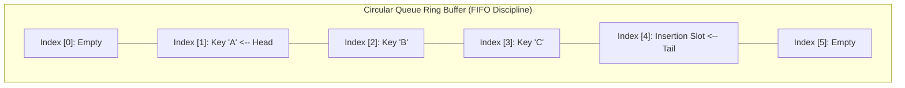
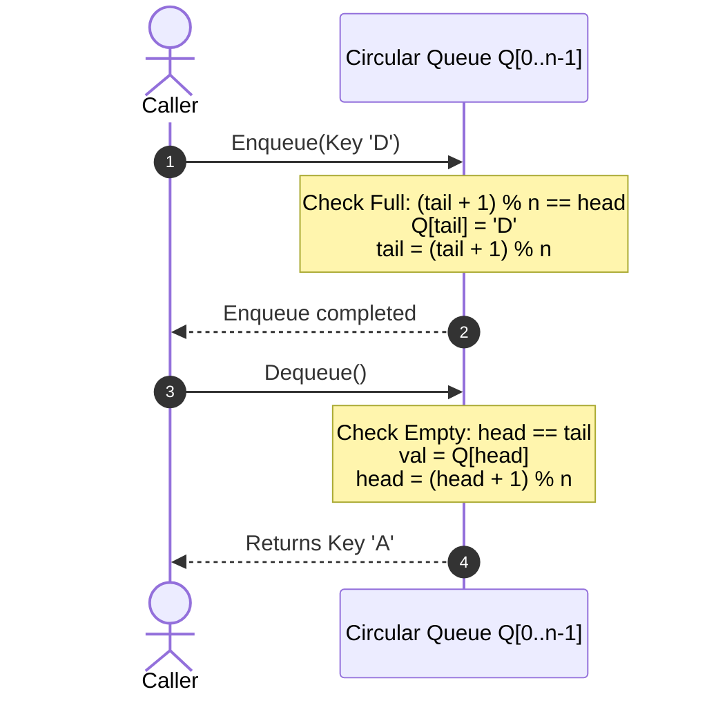

# Queues

> [!info] Document Metadata
> - **Course:** `=this.course`
> - **Topic:** `=this.topic`
> - **Status:** `=this.status`

**Tags:** #[[Computer Science]] #[[CCDSALG]] #[[Queues]] #[[Conceptual]] #[[M3]]

---

## Overview

A **queue** is a dynamic, ordered list that implements a **First-In, First-Out (FIFO)** policy. This means that the element deleted is always the one that has been in the list for the longest time. Queues can also be implemented as circular structures (circular queues) to efficiently reuse array space.

## Key Definitions

* **head**: The index of the next element to be dequeued (removed).
* **tail**: The index where the next new element will be inserted.
* **size**: The maximum capacity of the queue.

## Theoretical Framework

The behavior of a queue is governed by the following standard operations (assuming an array implementation `Q[1..n]`):

* **Create(Q)**: Creates a new, empty queue.
* **Enqueue(Q, x)**: Inserts the element `x` into the queue at the `tail` position.
* **Dequeue(Q)**: Deletes the first element from the queue (at the `head` position) and returns that element.
* **QueueHead(Q)**: Returns the element (not the index) at the head of the queue without removing it.
* **QueueTail(Q)**: Returns the element (not the index) at the tail of the queue without removing it.
* **QueueEmpty(Q)**: Returns `true` when the queue is empty (typically when `head == tail`), and `false` otherwise.
* **QueueFull(Q)**: Returns `true` when the queue is full. For a circular array of size $n$, this is typically checked using `head == (tail + 1) % n`. Returns `false` otherwise.

### Enqueue & Dequeue Ring Buffer Transitions

## References & Navigation

- **Related Notes:** [[Queues]]
