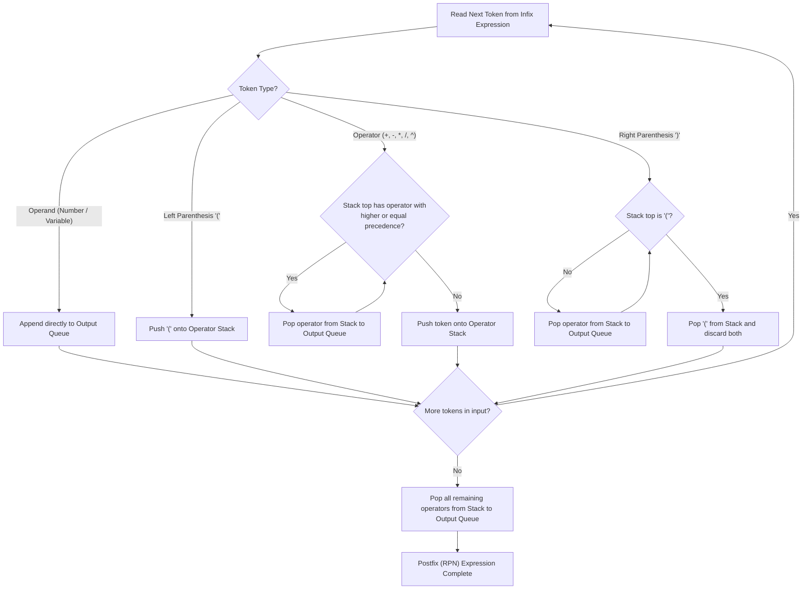
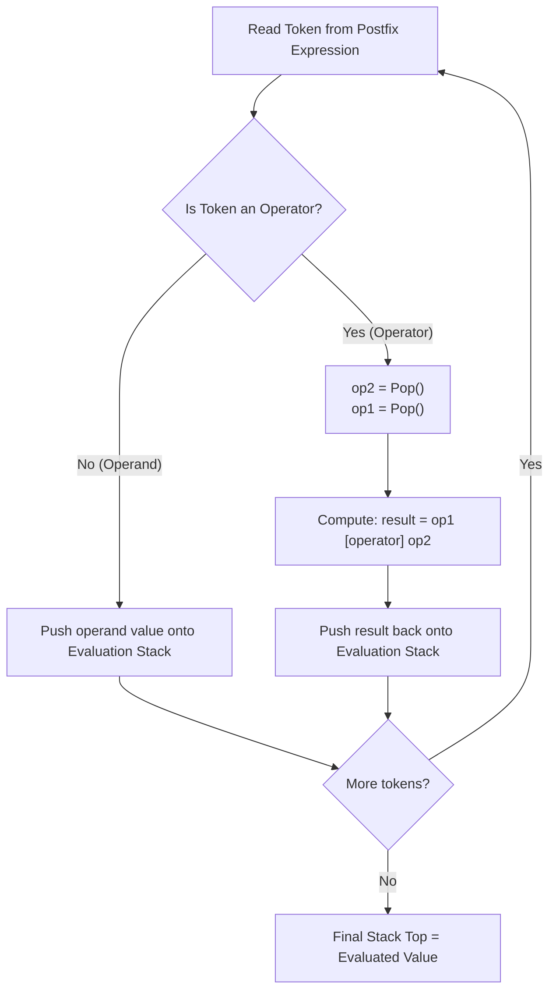

# Supplement-Infix-to-Postfix

> [!info] Document Metadata
> - **Course:** `=this.course`
> - **Topic:** `=this.topic`
> - **Status:** `=this.status`

**Tags:** #[[Computer Science]] #[[CCDSALG]] #[[Supplement-Infix-to-Postfix]] #[[Conceptual]] #[[M3]]

---

## Overview

The document discusses expression evaluation using Stack data structures. It covers the conversion of expressions from infix notation to postfix notation and the subsequent evaluation of postfix expressions using stacks. Shunting Yard algorithm by E.W. Dijkstra is mentioned as a method for this conversion.

## Important Formulas & Operator Precedence

| Operator | Associativity | Precedence Level |
|---|---|---|
| `^` (Exponentiation) | Right-to-Left | 3 (Highest) |
| `*`, `/` (Multiplication, Division) | Left-to-Right | 2 |
| `+`, `-` (Addition, Subtraction) | Left-to-Right | 1 (Lowest) |

## Theoretical Framework: Shunting Yard & Postfix Evaluation Pipelines

### 1. Dijkstra's Shunting Yard Algorithm (Infix to Postfix)

### 2. Postfix Expression Stack Evaluation Pipeline

## Worked Examples

1. **Infix:** `1 + 2` $\rightarrow$ **Postfix:** `1 2 +`
2. **Infix:** `1 + 2 - 3` $\rightarrow$ **Postfix:** `1 2 + 3 -`
3. **Infix:** `1 * 2 + 3` $\rightarrow$ **Postfix:** `1 2 * 3 +`
4. **Infix:** `(1 + 2) * 3` $\rightarrow$ **Postfix:** `1 2 + 3 *`
5. **Infix:** `(A + B) / ((C - D) ^ E * F)` $\rightarrow$ **Postfix:** `A B + C D - E ^ F * /`

## Multiple Choice Questions

1. What algorithm by E.W. Dijkstra is mentioned for converting infix to postfix notation?
    - **A)** Master Theorem
    - **B)** Shunting Yard algorithm
    - **C)** Quick Sort
    - **D)** Prim's algorithm

2. Which data structure is primarily used to evaluate postfix expressions and convert infix to postfix?
    - **A)** Queue
    - **B)** Binary Tree
    - **C)** Hash Table
    - **D)** Stack

3. What is the postfix notation for the infix expression `1 + 2 - 3`?
    - **A)** `1 2 + 3 -`
    - **B)** `1 2 3 + -`
    - **C)** `+ - 1 2 3`
    - **D)** `1 + 2 3 -`

4. What is the postfix notation for the infix expression `(1 + 2) * 3`?
    - **A)** `1 2 3 + *`
    - **B)** `1 2 + 3 *`
    - **C)** `* + 1 2 3`
    - **D)** `1 * 2 + 3`

### Answer Key & Explanations

1. **B**. The document specifically notes that Dijkstra's Shunting Yard algorithm is the established method for this conversion.
2. **D**. Stacks are perfect for holding operators and operands temporarily while waiting for precedence rules to be resolved.
3. **A**. In postfix, operators follow their operands. Since addition and subtraction have equal precedence, it evaluates left-to-right: add `1` and `2`, then subtract `3`.
4. **B**. The parentheses force the addition to happen first. So you push `1` and `2`, apply `+`, and then multiply that result by `3`.

## References & Navigation

- **Previous Topic:** [[Stacks]]
- **Next Topic:** [[Mock-Midterm-Exam-01]]
- **Related Notes:** [[Algorithm Analysis]], [[Core Concepts]]
