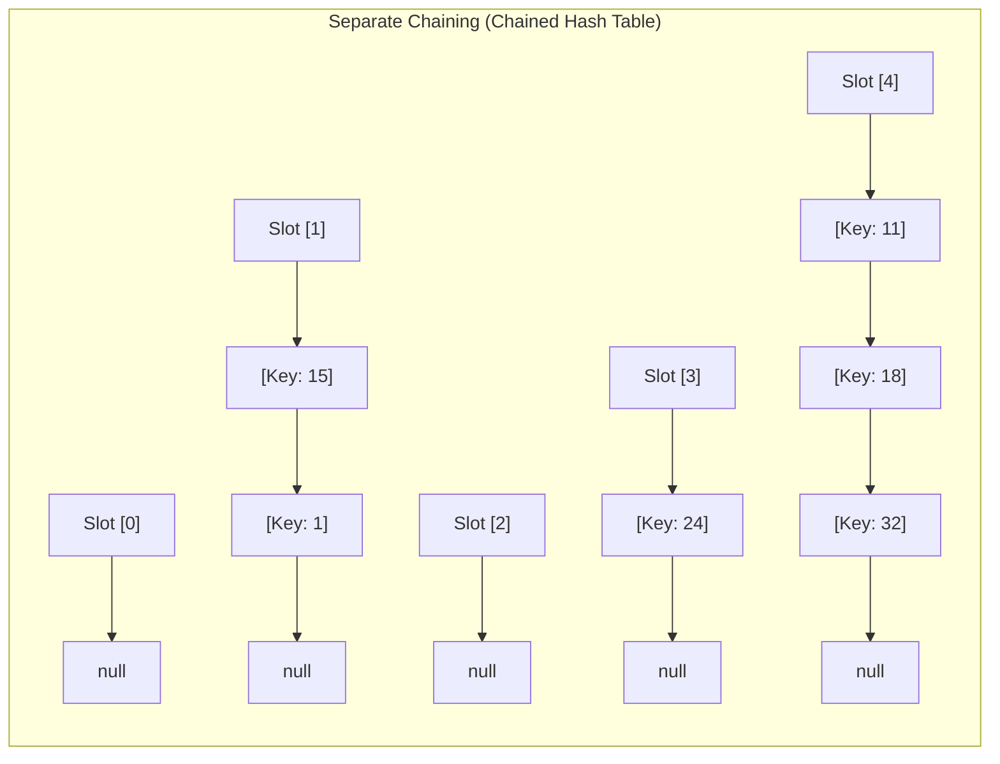
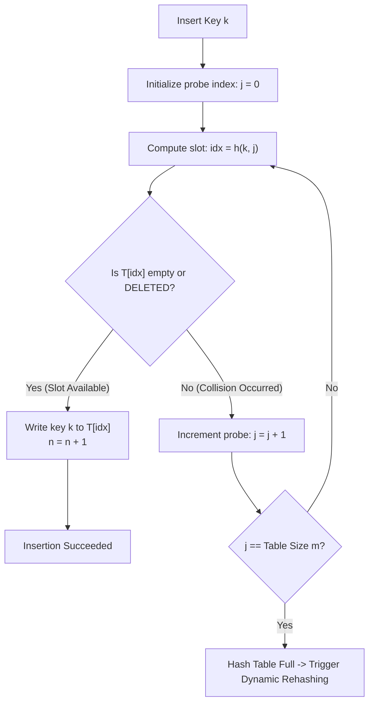

# Hash Tables

> [!info] Document Metadata
> - **Course:** `=this.course`
> - **Topic:** `=this.topic`
> - **Status:** `=this.status`

**Tags:** #[[Computer Science]] #[[CCDSALG]] #[[Hash Tables]] #[[Conceptual]] #[[M4]]

---

## Overview

Hash tables are effective data structures for implementing dictionaries, providing $O(1)$ average time complexity for searches and $\Theta(n)$ in the worst case. The document covers direct addressing, hash functions (division and multiplication methods), and collision handling techniques such as separate chaining and open addressing (linear probing, quadratic probing, double hashing). It also discusses load factors and rehashing.

## Important Formulas

**Load Factor ($\alpha$):**
$$\alpha = \frac{n}{m}$$
Where $n$ is the number of stored keys and $m$ is the number of table slots.
- For **Separate Chaining**: $\alpha$ can exceed $1$ (average chain length is $\alpha$).
- For **Open Addressing**: $\alpha \le 1$ strictly, typically rehashed when $\alpha > 0.70$.

**Hash Function Families:**
- **Division Method:** $h(k) = k \bmod m$ (where $m$ is preferably a prime number not close to powers of 2).
- **Multiplication Method:** $h(k) = \lfloor m (k A \bmod 1) \rfloor$ (Knuth recommends $A = (\sqrt{5} - 1) / 2 \approx 0.6180339887$).

**Open Addressing Probing Sequences ($j = 0, 1, \dots, m-1$):**
- **Linear Probing:** $h(k, j) = (h'(k) + j) \bmod m$ (suffers from Primary Clustering).
- **Quadratic Probing:** $h(k, j) = (h'(k) + c_1 j + c_2 j^2) \bmod m$ (suffers from Secondary Clustering).
- **Double Hashing:** $h(k, j) = (h_1(k) + j \cdot h_2(k)) \bmod m$ (where $h_2(k)$ must be relatively prime to $m$).

## Theoretical Framework: Collision Resolution Architectures

### Open Addressing Probing Pipeline

## Worked Examples

1. **Division Method Example:** Keys `13, 15, 21` with $m = 19$.
   - $h(13) = 13 \bmod 19 = 13$
   - $h(15) = 15 \bmod 19 = 15$
   - $h(21) = 21 \bmod 19 = 2$
2. **Linear Probing Example:** Insert keys `1, 3, 15, 12, 8` into table of size $m = 7$ using $h(k) = k \bmod 7$.
   - $h(1, 0) = 1 \bmod 7 = 1 \implies \text{T}[1] = 1$
   - $h(3, 0) = 3 \bmod 7 = 3 \implies \text{T}[3] = 3$
   - $h(15, 0) = 15 \bmod 7 = 1$ (Collision at index 1!)
     - Probe $j=1$: $h(15, 1) = (1 + 1) \bmod 7 = 2 \implies \text{T}[2] = 15$
   - $h(12, 0) = 12 \bmod 7 = 5 \implies \text{T}[5] = 12$
   - $h(8, 0) = 8 \bmod 7 = 1$ (Collision at 1!)
     - Probe $j=1$: $(1 + 1) \bmod 7 = 2$ (Collision at 2!)
     - Probe $j=2$: $(1 + 2) \bmod 7 = 3$ (Collision at 3!)
     - Probe $j=3$: $(1 + 3) \bmod 7 = 4 \implies \text{T}[4] = 8$

## Multiple Choice Questions

1. What are the average-case and worst-case search time complexities for a hash table implementing a dictionary?
    - **A)** O(log n) average, O(n) worst case
    - **B)** O(1) average, Θ(n) worst case
    - **C)** O(1) average, O(log n) worst case
    - **D)** Θ(n) average, O(n²) worst case

2. Why can the load factor $\alpha = n/m$ exceed $1$ in separate chaining, whereas open addressing strictly enforces $\alpha \le 1$?
    - **A)** Separate chaining dynamically doubles table slots before any collision occurs
    - **B)** Open addressing reserves half of all slots exclusively for DELETED tombstones
    - **C)** Separate chaining stores colliding keys in linked chains per slot, while open addressing places every key directly inside the m table slots
    - **D)** Open addressing hashes keys into negative indices whenever α reaches 0.70

3. When using the division method $h(k) = k \bmod m$, what property is recommended for selecting the table size $m$?
    - **A)** A prime number not close to powers of 2
    - **B)** An exact power of 2 such as 64 or 128
    - **C)** Any even composite number larger than n
    - **D)** A multiple of the golden ratio rounded down

4. In the multiplication method $h(k) = \lfloor m (k A \bmod 1) \rfloor$, what constant value of $A$ does Knuth recommend?
    - **A)** 1 / e ≈ 0.3678794412
    - **B)** (√5 - 1) / 2 ≈ 0.6180339887
    - **C)** π / 4 ≈ 0.7853981634
    - **D)** ln(2) ≈ 0.6931471806

5. Which statement accurately distinguishes the clustering behavior of linear probing from quadratic probing?
    - **A)** Linear probing eliminates clustering completely, whereas quadratic probing causes primary clustering
    - **B)** Both linear probing and quadratic probing cause identical primary clustering along contiguous slots
    - **C)** Linear probing suffers from primary clustering, while quadratic probing suffers from secondary clustering
    - **D)** Quadratic probing prevents all collisions whenever c1 and c2 are nonzero

6. In double hashing with probe sequence $h(k, j) = (h_1(k) + j \cdot h_2(k)) \bmod m$, what requirement must $h_2(k)$ satisfy?
    - **A)** h2(k) must always equal 1 for odd keys
    - **B)** h2(k) must be strictly greater than m
    - **C)** h2(k) must equal h1(k) mod 2
    - **D)** h2(k) must be relatively prime to m

7. According to the Open Addressing Probing Pipeline, when is slot `T[idx]` considered available for writing key $k$?
    - **A)** Only when T[idx] has never stored any key
    - **B)** When T[idx] is empty or marked DELETED
    - **C)** Whenever the probe index j reaches m
    - **D)** Only after dynamic rehashing resets the entire table

8. In open addressing, when is dynamic rehashing typically triggered by load factor $\alpha$, and which loop condition in the probing pipeline signals a full table?
    - **A)** Typically rehashed when α > 0.70, or when probe index j equals table size m
    - **B)** Typically rehashed when α > 1.50, or when probe index j equals 0
    - **C)** Typically rehashed when α < 0.25, or on the first collision
    - **D)** Typically rehashed only when α = 0, or when h2(k) = 0

9. In the worked linear probing example ($m = 7$, $h(k) = k \bmod 7$) inserting `1, 3, 15, 12, 8` in order, which slot receives key `8` and at which probe step $j$?
    - **A)** Slot 2 at probe j = 1
    - **B)** Slot 6 at probe j = 2
    - **C)** Slot 4 at probe j = 3
    - **D)** Slot 0 at probe j = 6

10. Which of the following is NOT true about separate chaining?
    - **A)** The average chain length across m slots is α = n / m
    - **B)** Multiple keys hashing to the same slot are stored in a linked chain at that slot
    - **C)** The load factor α is allowed to exceed 1
    - **D)** Colliding keys are resolved by computing quadratic offsets c1·j + c2·j² within the slot array

### Answer Key & Explanations

1. **B)** As stated in the Overview, hash tables provide $O(1)$ average time complexity for dictionary searches and degrade to $\Theta(n)$ in the worst case.
2. **C)** Separate chaining links multiple colliding keys in chains per slot (allowing $\alpha > 1$ where average chain length is $\alpha$), whereas open addressing stores all keys inside the $m$ slots of the table itself, strictly requiring $\alpha \le 1$.
3. **A)** Under Hash Function Families, the division method $h(k) = k \bmod m$ specifies choosing $m$ preferably as a prime number not close to powers of $2$.
4. **B)** For the multiplication method $h(k) = \lfloor m (k A \bmod 1) \rfloor$, Knuth recommends $A = (\sqrt{5} - 1) / 2 \approx 0.6180339887$.
5. **C)** In Open Addressing Probing Sequences, linear probing $h(k, j) = (h'(k) + j) \bmod m$ suffers from Primary Clustering, whereas quadratic probing $h(k, j) = (h'(k) + c_1 j + c_2 j^2) \bmod m$ suffers from Secondary Clustering.
6. **D)** The double hashing formula $h(k, j) = (h_1(k) + j \cdot h_2(k)) \bmod m$ explicitly notes that $h_2(k)$ must be relatively prime to the table size $m$.
7. **B)** In the Open Addressing Probing Pipeline flowchart, the decision node checks `Is T[idx] empty or DELETED?` and writes $k$ to `T[idx]` when true.
8. **A)** Open addressing is typically rehashed when $\alpha > 0.70$, and in the probing flowchart `j == Table Size m?` triggers dynamic rehashing because the hash table is full.
9. **C)** Prior insertions place `1` at `T[1]`, `3` at `T[3]`, `15` at `T[2]`, and `12` at `T[5]`. Key `8` hashes to `1` ($j=0$, collision), probes `2` ($j=1$, collision), probes `3` ($j=2$, collision), and lands at `T[4]` on probe $j=3$.
10. **D)** Quadratic probing offsets $c_1 j + c_2 j^2$ belong to open addressing rather than separate chaining, which resolves collisions using linked chains per slot.

## References & Navigation

- **Previous Topic:** [[Queues]]
- **Next Topic:** [[Trees]]
- **Related Notes:** [[Algorithms - Search]], [[Arrays and Linked Lists]]
