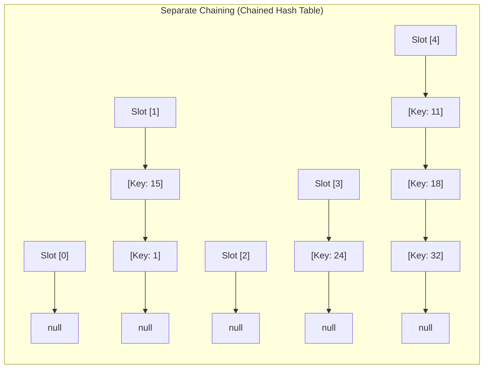
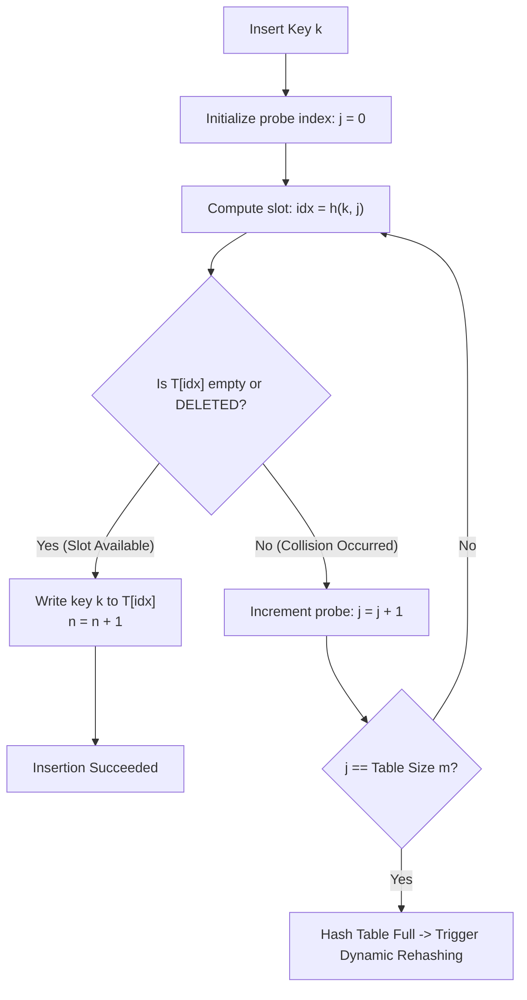

# Hash Tables

> [!info] Document Metadata
> - **Course:** `=this.course`
> - **Topic:** `=this.topic`
> - **Status:** `=this.status`

**Tags:** #[[Computer Science]] #[[CCDSALG]] #[[Hash Tables]] #[[Conceptual]] #[[M4]]

---

## Overview

Hash tables are effective data structures for implementing dictionaries, providing $O(1)$ average time complexity for searches and $\Theta(n)$ in the worst case. The document covers direct addressing, hash functions (division and multiplication methods), and collision handling techniques such as separate chaining and open addressing (linear probing, quadratic probing, double hashing). It also discusses load factors and rehashing.

## Important Formulas

**Load Factor ($\alpha$):**
$$\alpha = \frac{n}{m}$$
Where $n$ is the number of stored keys and $m$ is the number of table slots.
- For **Separate Chaining**: $\alpha$ can exceed $1$ (average chain length is $\alpha$).
- For **Open Addressing**: $\alpha \le 1$ strictly, typically rehashed when $\alpha > 0.70$.

**Hash Function Families:**
- **Division Method:** $h(k) = k \bmod m$ (where $m$ is preferably a prime number not close to powers of 2).
- **Multiplication Method:** $h(k) = \lfloor m (k A \bmod 1) \rfloor$ (Knuth recommends $A = (\sqrt{5} - 1) / 2 \approx 0.6180339887$).

**Open Addressing Probing Sequences ($j = 0, 1, \dots, m-1$):**
- **Linear Probing:** $h(k, j) = (h'(k) + j) \bmod m$ (suffers from Primary Clustering).
- **Quadratic Probing:** $h(k, j) = (h'(k) + c_1 j + c_2 j^2) \bmod m$ (suffers from Secondary Clustering).
- **Double Hashing:** $h(k, j) = (h_1(k) + j \cdot h_2(k)) \bmod m$ (where $h_2(k)$ must be relatively prime to $m$).

## Theoretical Framework: Collision Resolution Architectures

### Open Addressing Probing Pipeline

## Worked Examples

1. **Division Method Example:** Keys `13, 15, 21` with $m = 19$.
   - $h(13) = 13 \bmod 19 = 13$
   - $h(15) = 15 \bmod 19 = 15$
   - $h(21) = 21 \bmod 19 = 2$
2. **Linear Probing Example:** Insert keys `1, 3, 15, 12, 8` into table of size $m = 7$ using $h(k) = k \bmod 7$.
   - $h(1, 0) = 1 \bmod 7 = 1 \implies \text{T}[1] = 1$
   - $h(3, 0) = 3 \bmod 7 = 3 \implies \text{T}[3] = 3$
   - $h(15, 0) = 15 \bmod 7 = 1$ (Collision at index 1!)
     - Probe $j=1$: $h(15, 1) = (1 + 1) \bmod 7 = 2 \implies \text{T}[2] = 15$
   - $h(12, 0) = 12 \bmod 7 = 5 \implies \text{T}[5] = 12$
   - $h(8, 0) = 8 \bmod 7 = 1$ (Collision at 1!)
     - Probe $j=1$: $(1 + 1) \bmod 7 = 2$ (Collision at 2!)
     - Probe $j=2$: $(1 + 2) \bmod 7 = 3$ (Collision at 3!)
     - Probe $j=3$: $(1 + 3) \bmod 7 = 4 \implies \text{T}[4] = 8$

## References & Navigation

- **Related Notes:** [[Hash Tables]]
