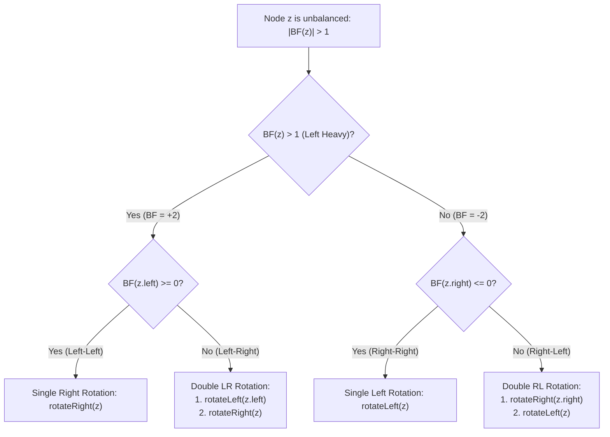
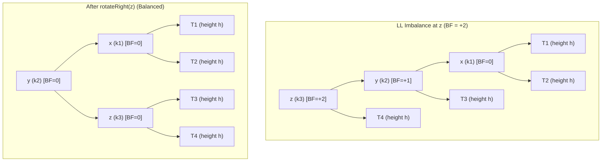
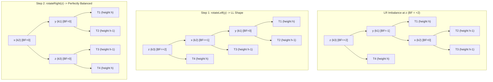

# AVL Trees

> [!info] Document Metadata
> - **Course:** `=this.course`
> - **Topic:** `=this.topic`
> - **Status:** `=this.status`

**Tags:** #[[Computer Science]] #[[CCDSALG]] #[[AVL Trees]] #[[Conceptual]] #[[M5]]

---

## Overview

AVL Trees, named after Adelson-Velskii and Landis, are height-balanced binary search trees. For every node, the heights of its left and right subtrees differ by at most 1. This balancing ensures that search, insert, and delete operations execute in $O(\log n)$ time. Insertions and deletions that violate the balance property are fixed using rotations.

## Important Formulas

**Balance Factor:**
$$BF(x) = \text{Height}(x.\text{left}) - \text{Height}(x.\text{right})$$

**AVL Invariant:**
$$\forall x \in T, \quad |BF(x)| \le 1 \iff BF(x) \in \{-1, 0, 1\}$$

**Time Complexity:**
- Search: $O(\log n)$
- Insertion: $O(\log n)$ (at most 1 single or double rotation to restore balance)
- Deletion: $O(\log n)$ (may require up to $O(\log n)$ rotations propagating to the root)

## Theoretical Framework: The Four Rotation Cases

### 1. Single Rotations (LL and RR)

#### Left-Left (LL) Case: Right Rotation on z
Triggered when a node is inserted into the left subtree of the left child.

### 2. Double Rotations (LR and RL)

#### Left-Right (LR) Case: rotateLeft(y) followed by rotateRight(z)
Triggered when a node is inserted into the right subtree of the left child.

## Worked Examples

1. **Concrete Insertion Trace: Keys [30, 20, 10, 40, 50, 25]**
   - Insert 30, 20: Tree is balanced.
   - Insert 10: Node 30 has $BF = +2$, left child 20 has $BF = +1$. **LL Case**. Single right rotation on 30 makes 20 the root with left child 10 and right child 30.
   - Insert 40: Right child of 30.
   - Insert 50: Node 30 has $BF = -2$, right child 40 has $BF = -1$. **RR Case**. Single left rotation on 30 makes 40 the parent of 30 and 50.
   - Insert 25: Node 20 has $BF = -2$, right child 40 has $BF = +1$. **RL Case**. Double rotation: right rotation on 40, followed by left rotation on 20. Middle key 30 becomes the new root.

## Multiple Choice Questions

1. How is the balance factor $BF(x)$ defined for a node $x$ in an AVL tree?
    - **A)** Height(x.right) - Height(x.left)
    - **B)** Height(x.left) - Height(x.right)
    - **C)** NodeCount(x.left) - NodeCount(x.right)
    - **D)** Height(x.left) + Height(x.right)

2. Which set of balance factors satisfies the AVL invariant $|BF(x)| \le 1$ across every node $x$ in the tree?
    - **A)** {0, 1, 2}
    - **B)** {-2, -1, 0, 1, 2}
    - **C)** {-1, 0, 1}
    - **D)** {-1, 1} only

3. How do AVL insertion and deletion compare in the number of rotations they may require to restore balance?
    - **A)** Insertion may require up to O(log n) rotations, whereas deletion needs at most 1
    - **B)** Both insertion and deletion always execute exactly 2 rotations
    - **C)** Insertion requires at most 1 single or double rotation, whereas deletion may require up to O(log n) rotations propagating to the root
    - **D)** Neither insertion nor deletion runs in O(log n) worst-case time

4. In the Four Rotation Cases flowchart, if node $z$ is left-heavy with $BF(z) = +2$, which condition on `z.left` triggers a Left-Right (LR) double rotation?
    - **A)** BF(z.left) < 0
    - **B)** BF(z.left) >= 0
    - **C)** BF(z.left) = +2
    - **D)** BF(z.left) = 0

5. In the Left-Right (LR) case where $z$ has left child $y$ and $y$ has right child $x$, which two-step rotation restores balance?
    - **A)** rotateRight(y) followed by rotateLeft(z)
    - **B)** rotateRight(z) followed by rotateLeft(y)
    - **C)** rotateLeft(z) followed by rotateRight(z)
    - **D)** rotateLeft(y) followed by rotateRight(z)

6. When an unbalanced node $z$ has $BF(z) = -2$ and its right child satisfies $BF(z.\text{right}) \le 0$, which rotation case applies and how is it resolved?
    - **A)** Right-Left (RL) case, resolved by rotateRight(z)
    - **B)** Right-Right (RR) case, resolved by a single left rotation rotateLeft(z)
    - **C)** Left-Left (LL) case, resolved by a single right rotation rotateRight(z)
    - **D)** Right-Right (RR) case, resolved by a double RL rotation

7. In the LL rotation diagram (`z(k3)` has left child `y(k2)` with right subtree `T3`), what is the tree structure after `rotateRight(z)`?
    - **A)** y(k2) becomes the subtree root, and T3 becomes the left child of z(k3)
    - **B)** x(k1) becomes the subtree root, and T3 becomes the right child of z(k3)
    - **C)** z(k3) stays the subtree root, and T3 becomes the left child of x(k1)
    - **D)** y(k2) becomes the right child of z(k3), and T3 becomes the left child of y(k2)

8. Following the worked insertion trace for keys `[30, 20, 10, 40, 50, 25]`, what occurs immediately after inserting `10`?
    - **A)** RR case at 10; 30 remains the root
    - **B)** LR case at 30; 10 becomes the root
    - **C)** LL case at 30; a single right rotation on 30 makes 20 the root with children 10 and 30
    - **D)** RL case at 20; 20 becomes the root with right child 10

9. Continuing the worked trace after `40` and `50` are inserted, why does `40` become the parent of `30` and `50`?
    - **A)** Node 30 has BF = -2 and BF(40) = -1 (RR case), triggering a single left rotation on 30
    - **B)** Node 20 has BF = +2 and BF(30) = +1 (LL case), triggering a single right rotation on 20
    - **C)** Node 30 has BF = -2 and BF(40) = +1 (RL case), triggering a double rotation on 40 and 30
    - **D)** Node 50 has BF = +2, triggering a single right rotation on 50

10. In the final step of the worked trace when `25` is inserted (giving node `20` $BF = -2$ and right child `40` $BF = +1$), which rotations execute and which key becomes the new root?
    - **A)** Single left rotation on 20; 40 becomes the new root
    - **B)** Left rotation on 40 followed by right rotation on 20; 25 becomes the new root
    - **C)** Single right rotation on 40; 20 remains the root
    - **D)** Right rotation on 40 followed by left rotation on 20 (RL case); middle key 30 becomes the new root

### Answer Key & Explanations

1. **B)** Important Formulas defines the balance factor as $BF(x) = \text{Height}(x.\text{left}) - \text{Height}(x.\text{right})$.
2. **C)** The AVL Invariant states $|BF(x)| \le 1 \iff BF(x) \in \{-1, 0, 1\}$ for every node $x$ in the tree.
3. **C)** Under Time Complexity, AVL insertion takes $O(\log n)$ with at most 1 single or double rotation, whereas deletion takes $O(\log n)$ and may require up to $O(\log n)$ rotations propagating toward the root.
4. **A)** In the Four Rotation Cases flowchart, when $BF(z) > 1$ ($BF = +2$), the branch `BF(z.left) >= 0?` selects LL on `Yes` and Left-Right (LR) on `No` (i.e., $BF(z.\text{left}) < 0$).
5. **D)** As shown in the LR double rotation diagram, Step 1 performs `rotateLeft(y)` to create an LL shape, and Step 2 performs `rotateRight(z)` to balance the subtree.
6. **B)** In the flowchart, when $BF(z) = -2$ and $BF(z.\text{right}) \le 0$, the Right-Right (RR) case applies and is fixed by `rotateLeft(z)`.
7. **A)** After `rotateRight(z)` in the LL diagram, `y (k2)` becomes the new root with `x (k1)` as left child and `z (k3)` as right child, while `T3` reattaches as the left child of `z`.
8. **C)** After inserting `30, 20, 10`, node `30` has $BF = +2$ and left child `20` has $BF = +1$ (LL case); `rotateRight(30)` promotes `20` to root with left child `10` and right child `30`.
9. **A)** Inserting `40` and `50` gives node `30` $BF = -2$ with right child `40` at $BF = -1$ (RR case); a single left rotation on `30` promotes `40` as the parent of `30` and `50`.
10. **D)** Inserting `25` causes `20` to reach $BF = -2$ while `40` has $BF = +1$ (RL case); rotating right on `40` and then left on `20` brings middle key `30` to the root.

## References & Navigation

- **Previous Topic:** [[Binary Search Trees (BST)]]
- **Next Topic:** [[Heaps]]
- **Related Notes:** [[Binary Search Trees (BST)]], [[Trees]]
