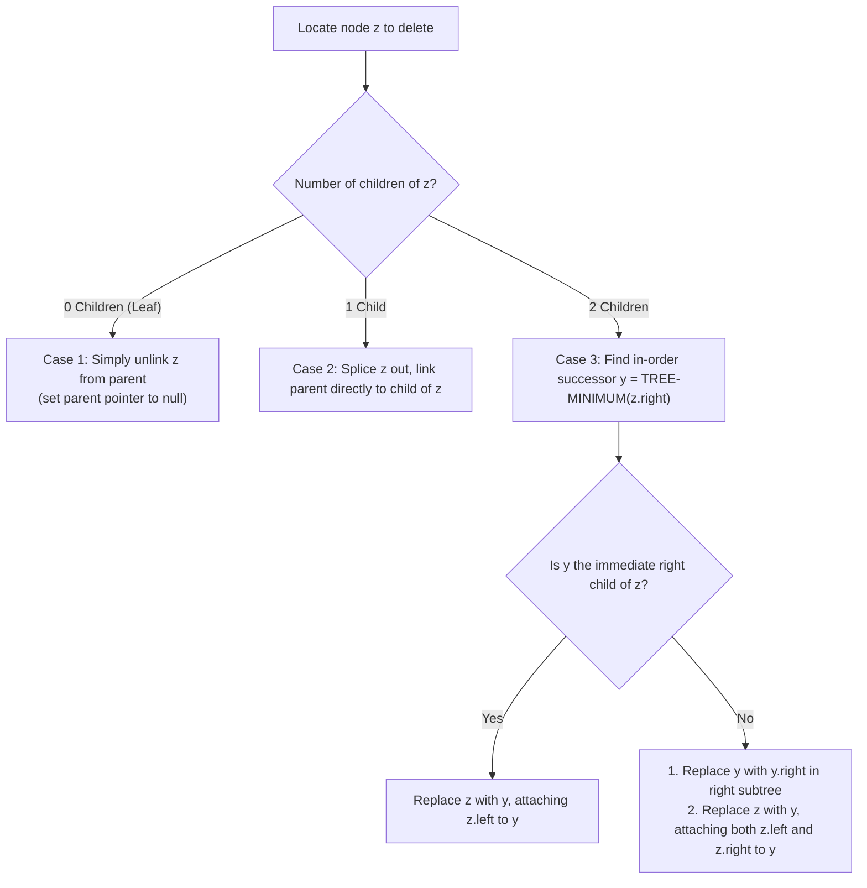
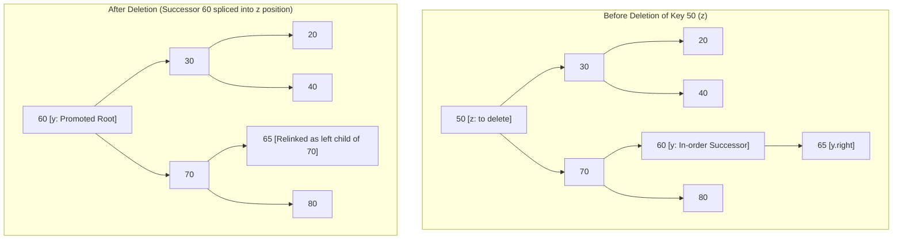

# Binary Search Trees (BST)

> [!info] Document Metadata
> - **Course:** `=this.course`
> - **Topic:** `=this.topic`
> - **Status:** `=this.status`

**Tags:** #[[Computer Science]] #[[CCDSALG]] #[[Binary Search Trees (BST)]] #[[Conceptual]] #[[M5]]

---

## Overview

Binary Search Trees (BST) are binary trees that maintain a specific property: for any node $x$, the keys in its left subtree are less than or equal to $x$'s key, and keys in its right subtree are greater than or equal to $x$'s key. The document details core BST operations including search, finding minimum/maximum, finding predecessor/successor, insertion, and deletion.

## Important Formulas

**BST Invariant:**
$$\forall y \in \text{LeftSubtree}(x), \; \text{key}(y) \le \text{key}(x) \quad \text{and} \quad \forall z \in \text{RightSubtree}(x), \; \text{key}(z) \ge \text{key}(x)$$

**Time Complexity:**
- Search / Minimum / Maximum: $O(h)$ where $h$ is tree height ($\Theta(\log n)$ balanced, $O(n)$ skewed)
- Insertion / Deletion: $O(h)$
- In-Order Traversal: $\Theta(n)$ (yields strictly monotonically increasing sorted keys)

## Theoretical Framework: BST Deletion Decision Logic

### Visual Trace: Case 3 Deletion (Two Children)

## Worked Examples

1. **Deletion Cases:**
   - **Case 1 (Leaf):** Delete node 20. Parent 30 sets its left child pointer to `null`.
   - **Case 2 (Single Child):** Delete node 70 if 80 were its only child. 50 updates its right pointer directly to 80.
   - **Case 3 (Two Children):** Delete node 50. In-order successor is the minimum node in right subtree (60). Successor 60 takes the place of 50, and 60's right child (65) is spliced to where 60 was.

## Multiple Choice Questions

1. According to the BST invariant, what relationship holds between node $x$ and any node $y$ in its left subtree or $z$ in its right subtree?
    - **A)** key(y) < key(x) strictly and key(z) > key(x) strictly
    - **B)** key(y) <= key(x) and key(z) >= key(x)
    - **C)** key(y) >= key(x) and key(z) <= key(x)
    - **D)** key(y) = key(x) and key(z) = 2 · key(x)

2. Why is the worst-case time complexity of Search, Minimum, Maximum, Insertion, and Deletion on an unbalanced BST $O(n)$ rather than $\Theta(\log n)$?
    - **A)** Because those operations run in O(h) time, and tree height h can degrade to O(n) in a skewed tree
    - **B)** Because finding the minimum node always requires scanning the entire tree with an in-order traversal
    - **C)** Because deleting any leaf node forces rotations along every ancestor up to the root
    - **D)** Because BST insertion always executes in Θ(n log n) time regardless of tree shape

3. What is the time complexity of an in-order traversal on a BST of $n$ nodes, and what output does it yield?
    - **A)** O(log n), yielding keys ordered by depth
    - **B)** O(n log n), yielding keys grouped by subtree size
    - **C)** Θ(n), yielding sorted keys in strictly monotonically increasing order
    - **D)** Θ(n²), yielding keys in reverse post-order

4. In the worked Case 1 (Leaf) deletion example, what occurs when leaf node `20` (left child of `30`) is deleted?
    - **A)** Node 40 moves into node 20's position
    - **B)** Node 30 is removed and replaced by node 20
    - **C)** Parent 30 sets its left child pointer to null
    - **D)** An in-order successor is fetched from node 50's right subtree

5. Under Case 2 (Single Child) deletion in the worked example, if node `70` had `80` as its only child, how is `70` removed?
    - **A)** Splice 70 out and update 50's right pointer directly to 80
    - **B)** Promote 80 to the root and attach 50 as its left child
    - **C)** Copy 20 into 70's slot and delete leaf 20
    - **D)** Set 50's right pointer to null and discard 80

6. When deleting a node $z$ with two children (Case 3), how is the replacement node $y$ identified in the BST Deletion Decision Logic?
    - **A)** The maximum node in the right subtree, TREE-MAXIMUM(z.right)
    - **B)** The minimum node in the left subtree, TREE-MINIMUM(z.left)
    - **C)** The immediate parent node of z
    - **D)** The in-order successor y = TREE-MINIMUM(z.right)

7. In Case 3 deletion, when the in-order successor $y$ is NOT the immediate right child of $z$, which two steps complete the deletion?
    - **A)** Swap y with z.left, then delete z.right
    - **B)** Replace y with y.right in the right subtree, then replace z with y while attaching both z.left and z.right to y
    - **C)** Replace y with y.left in the right subtree, then discard z.left
    - **D)** Delete y without preserving y.right, then attach z.left to y

8. In Case 3 deletion, what happens if the in-order successor $y = \text{TREE-MINIMUM}(z.\text{right})$ IS the immediate right child of $z$?
    - **A)** Replace z with y and attach z.left to y
    - **B)** Replace y with y.left before promoting y
    - **C)** Unlink z by setting its parent pointer to null
    - **D)** Attach z.right as a child of z.left

9. In the Case 3 visual trace deleting `50` (where `70` has left child `60`, right child `80`, and `60` has right child `65`), where does node `65` end up after deletion?
    - **A)** As the right child of 60
    - **B)** As the left child of 30
    - **C)** As the right child of 80
    - **D)** Relinked as the left child of 70

10. Why does splicing out the in-order successor $y = \text{TREE-MINIMUM}(z.\text{right})$ only need to promote $y.\text{right}$ (and never a left child of $y$)?
    - **A)** Because nodes in a right subtree cannot have left children in any BST
    - **B)** Because if y had a left child, that child would have a smaller key and would be TREE-MINIMUM(z.right) instead of y
    - **C)** Because Case 3 deletion only applies to trees of height 2
    - **D)** Because y is always a leaf with zero children

### Answer Key & Explanations

1. **B)** The BST Invariant explicitly defines $\forall y \in \text{LeftSubtree}(x), \; \text{key}(y) \le \text{key}(x)$ and $\forall z \in \text{RightSubtree}(x), \; \text{key}(z) \ge \text{key}(x)$.
2. **A)** Search, Minimum, Maximum, Insertion, and Deletion all run in $O(h)$ time; a balanced BST gives $h = \Theta(\log n)$, whereas a skewed BST gives $h = O(n)$.
3. **C)** Under Time Complexity, In-Order Traversal takes $\Theta(n)$ time and yields strictly monotonically increasing sorted keys.
4. **C)** In Case 1 (0 children / leaf), deleting `20` simply unlinks it from its parent by having `30` set its left child pointer to `null`.
5. **A)** In Case 2 (1 child), `70` is spliced out so parent `50` links its right pointer directly to `70`'s single child `80`.
6. **D)** In the BST Deletion Decision Logic flowchart, Case 3 (2 children) locates the in-order successor $y = \text{TREE-MINIMUM}(z.\text{right})$.
7. **B)** When $y$ is not `z.right`, the flowchart specifies: (1) replace $y$ with `y.right` in the right subtree, and (2) replace $z$ with $y$, attaching both `z.left` and `z.right` to $y$.
8. **A)** When $y$ is the immediate right child of $z$, the flowchart replaces $z$ with $y$ and attaches `z.left` to $y$.
9. **D)** In the visual trace, `60` is promoted to replace `50` as the root, and `60`'s right child `65` is spliced in as the left child of `70`.
10. **B)** Because $y = \text{TREE-MINIMUM}(z.\text{right})$ is the minimum key in `z.right`, it cannot have a left child (any left child would hold a smaller key), so only `y.right` can exist to replace $y$ when $y$ is spliced out.

## References & Navigation

- **Previous Topic:** [[Trees]]
- **Next Topic:** [[AVL Trees]]
- **Related Notes:** [[Trees]], [[AVL Trees]]
