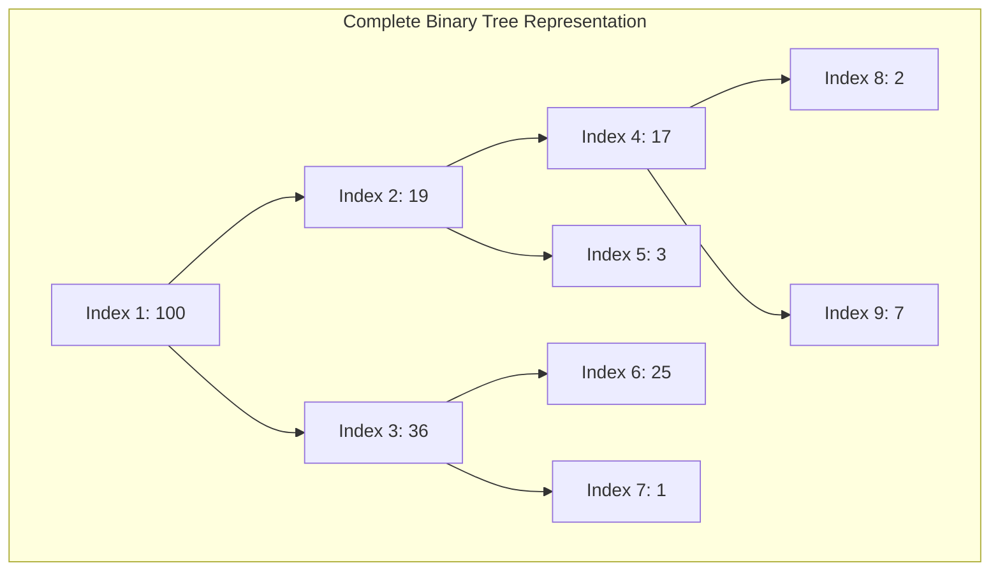
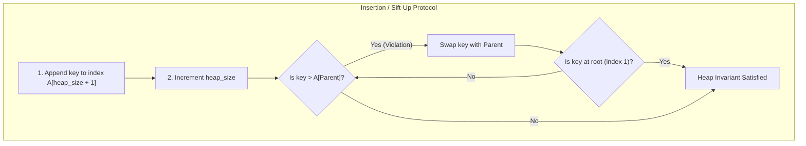
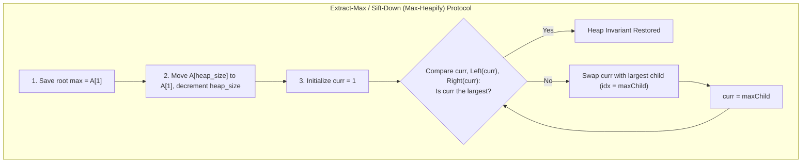

# Heaps

> [!info] Document Metadata
> - **Course:** `=this.course`
> - **Topic:** `=this.topic`
> - **Status:** `=this.status`

**Tags:** #[[Computer Science]] #[[CCDSALG]] #[[Heaps]] #[[Conceptual]] #[[M5]]

---

## Overview

A binary heap is an array that can be viewed as a nearly complete binary tree. The document details the structure of a max-heap where the parent's key is always greater than or equal to its children's keys. It introduces heap terminology, array indexing methods for traversing the tree, and the `heap-size` attribute.

## Important Formulas

**1-Based Array Indexing (Classical CLRS):**
- $\text{Parent}(i) = \lfloor i / 2 \rfloor$
- $\text{Left}(i) = 2i$
- $\text{Right}(i) = 2i + 1$

**0-Based Array Indexing (Standard Modern C/C++/Java):**
- $\text{Parent}(i) = \lfloor (i - 1) / 2 \rfloor$
- $\text{Left}(i) = 2i + 1$
- $\text{Right}(i) = 2i + 2$

**Heap Invariant:**
- **Max-Heap:** $\forall i > 1, \quad A[\text{Parent}(i)] \ge A[i]$
- **Min-Heap:** $\forall i > 1, \quad A[\text{Parent}(i)] \le A[i]$

**Time & Space Complexities:**
- Height of heap with $n$ elements: $h = \lfloor \log_2 n \rfloor$
- `Max-Heapify` / `Sift-Down`: $O(\log n)$
- `Build-Max-Heap`: $O(n)$ (asymptotically tighter than $O(n \log n)$ via summation of heights)
- `Insert` / `Sift-Up`: $O(\log n)$
- `Extract-Max`: $O(\log n)$
- `Heap-Sort`: $O(n \log n)$ in-place ($O(1)$ auxiliary space)

## Theoretical Framework: Array & Tree Duality

### Operation Lifecycles: Sift-Up vs. Sift-Down

## Worked Examples

1. **Array to Tree Mapping:** An array `[100, 19, 36, 17, 3, 25, 1, 2, 7]` is 1-indexed. The parent of node at index 4 (`17`) is index $\lfloor 4/2 \rfloor = 2$ (`19`). The left child of index 2 is index 4 (`17`), and right child is index 5 (`3`).
2. **Extract-Max Step:** Root `100` is removed. Last leaf `7` (index 9) replaces `100` at index 1. `Max-Heapify` compares `7` with children `19` and `36`. Largest is `36` (index 3). `7` swaps with `36`. Then `7` compares with children `25` and `1`. Largest is `25` (index 6). `7` swaps with `25`. Tree is restored.

## Multiple Choice Questions

1. How is a binary heap represented in memory and structurally viewed?
    - **A)** As an array that can be viewed as a nearly complete binary tree
    - **B)** As a height-balanced AVL tree stored with explicit left and right pointers
    - **C)** As a sorted linked list whose midpoint serves as the root
    - **D)** As an undirected cyclic graph partitioned into k layers

2. In **0-based** array indexing (standard modern C/C++/Java), which formulas compute `Parent(i)`, `Left(i)`, and `Right(i)`?
    - **A)** Parent(i) = floor(i / 2), Left(i) = 2i, Right(i) = 2i + 1
    - **B)** Parent(i) = floor((i - 1) / 2), Left(i) = 2i + 1, Right(i) = 2i + 2
    - **C)** Parent(i) = floor((i + 1) / 2), Left(i) = 2i - 1, Right(i) = 2i
    - **D)** Parent(i) = i - 1, Left(i) = i + 1, Right(i) = i + 2

3. Which inequality expresses the **Max-Heap** invariant for 1-based array indexing (for all $i > 1$)?
    - **A)** A[Parent(i)] <= A[i]
    - **B)** A[Left(i)] >= A[Right(i)]
    - **C)** A[Parent(i)] >= A[i]
    - **D)** A[i] >= A[1]

4. What is the height $h$ of a binary heap containing $n$ elements?
    - **A)** h = ceil(n / 2)
    - **B)** h = n - 1
    - **C)** h = floor(log2 n)
    - **D)** h = 2^n

5. Why is the tight asymptotic time complexity of `Build-Max-Heap` $O(n)$ instead of $O(n \log n)$?
    - **A)** Because Build-Max-Heap only checks the first half of the array without swapping
    - **B)** Because summing node heights across all levels yields an asymptotically tighter O(n) bound than O(n log n)
    - **C)** Because Max-Heapify always terminates in O(1) time at the root
    - **D)** Because a binary heap never exchanges elements above height 1

6. What are the time complexity and auxiliary space complexity of `Heap-Sort`?
    - **A)** O(n log n) time and O(n) auxiliary space
    - **B)** O(n) time and O(log n) auxiliary space
    - **C)** O(n²) time and O(1) auxiliary space
    - **D)** O(n log n) time and O(1) auxiliary space (in-place)

7. In the 1-indexed heap array `[100, 19, 36, 17, 3, 25, 1, 2, 7]`, which values are the left and right children of index `3` (`36`)?
    - **A)** Index 6 (25) and index 7 (1)
    - **B)** Index 4 (17) and index 5 (3)
    - **C)** Index 7 (1) and index 8 (2)
    - **D)** Index 2 (19) and index 4 (17)

8. During the `Insertion / Sift-Up` protocol on a 1-indexed max-heap, when does the upward swapping loop stop?
    - **A)** Only after checking every leaf node in the heap
    - **B)** When the inserted key reaches the root (index 1) or is no longer greater than A[Parent]
    - **C)** As soon as heap_size becomes an even integer
    - **D)** When the inserted key is smaller than both of its children

9. In the `Extract-Max / Sift-Down` protocol, after saving the root maximum `A[1]`, what operation prepares the array before running `Max-Heapify` from `curr = 1`?
    - **A)** Shift every element one index to the left
    - **B)** Promote A[2] to A[1] and move A[heap_size] to A[2]
    - **C)** Move A[heap_size] to A[1] and decrement heap_size
    - **D)** Overwrite A[1] with 0 and increment heap_size

10. In the worked `Extract-Max` trace on `[100, 19, 36, 17, 3, 25, 1, 2, 7]`, after `100` is removed and `7` is placed at index 1, which elements does `7` swap with during `Max-Heapify`?
    - **A)** First 19 (index 2), then 17 (index 4)
    - **B)** Only 36 (index 3), stopping immediately at index 3
    - **C)** First 36 (index 3), then 1 (index 7)
    - **D)** First 36 (index 3), then 25 (index 6)

### Answer Key & Explanations

1. **A)** As stated in the Overview, a binary heap is an array that can be viewed as a nearly complete binary tree.
2. **B)** Standard 0-based array indexing uses $\text{Parent}(i) = \lfloor (i - 1) / 2 \rfloor$, $\text{Left}(i) = 2i + 1$, and $\text{Right}(i) = 2i + 2$.
3. **C)** The Max-Heap invariant requires $\forall i > 1, \; A[\text{Parent}(i)] \ge A[i]$ so every parent's key is at least as large as its children's keys.
4. **C)** Under Time & Space Complexities, the height of a heap with $n$ elements is $h = \lfloor \log_2 n \rfloor$.
5. **B)** `Build-Max-Heap` runs in $O(n)$ time, which is asymptotically tighter than $O(n \log n)$ when evaluated via the summation of node heights across the heap.
6. **D)** `Heap-Sort` executes in $O(n \log n)$ time in-place with $O(1)$ auxiliary space.
7. **A)** Using 1-based indexing for index $i = 3$, $\text{Left}(3) = 2(3) = 6$ (value `25`) and $\text{Right}(3) = 2(3) + 1 = 7$ (value `1`), matching the tree diagram.
8. **B)** In the `Insertion / Sift-Up` flowchart, the loop terminates when `key > A[Parent]` is false or once the key reaches the root (index `1`).
9. **C)** Step 2 of the `Extract-Max` flowchart moves `A[heap_size]` to `A[1]` and decrements `heap_size` before initializing `curr = 1` for `Sift-Down`.
10. **D)** At index 1, `7` compares with children `19` and `36` and swaps with `36` (index 3); at index 3, `7` compares with `25` and `1` and swaps with `25` (index 6).

## References & Navigation

- **Previous Topic:** [[AVL Trees]]
- **Next Topic:** [[Graphs]]
- **Related Notes:** [[Trees]], [[Sorting Algorithms]]
