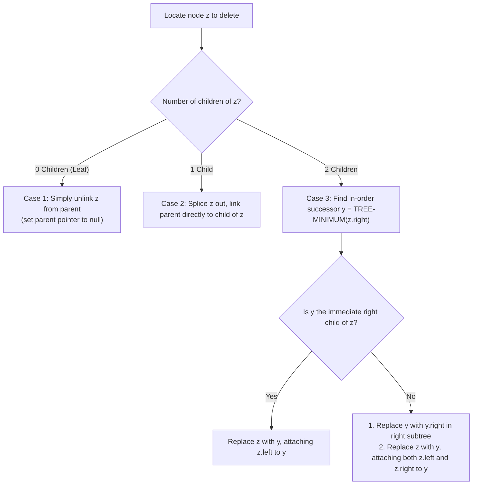
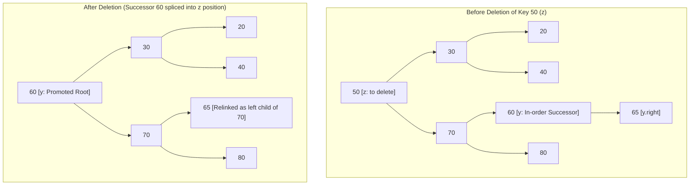

# Binary Search Trees (BST)

> [!info] Document Metadata
> - **Course:** `=this.course`
> - **Topic:** `=this.topic`
> - **Status:** `=this.status`

**Tags:** #[[Computer Science]] #[[CCDSALG]] #[[Binary Search Trees (BST)]] #[[Conceptual]] #[[M5]]

---

## Overview

Binary Search Trees (BST) are binary trees that maintain a specific property: for any node $x$, the keys in its left subtree are less than or equal to $x$'s key, and keys in its right subtree are greater than or equal to $x$'s key. The document details core BST operations including search, finding minimum/maximum, finding predecessor/successor, insertion, and deletion.

## Important Formulas

**BST Invariant:**
$$\forall y \in \text{LeftSubtree}(x), \; \text{key}(y) \le \text{key}(x) \quad \text{and} \quad \forall z \in \text{RightSubtree}(x), \; \text{key}(z) \ge \text{key}(x)$$

**Time Complexity:**
- Search / Minimum / Maximum: $O(h)$ where $h$ is tree height ($\Theta(\log n)$ balanced, $O(n)$ skewed)
- Insertion / Deletion: $O(h)$
- In-Order Traversal: $\Theta(n)$ (yields strictly monotonically increasing sorted keys)

## Theoretical Framework: BST Deletion Decision Logic

### Visual Trace: Case 3 Deletion (Two Children)

## Worked Examples

1. **Deletion Cases:**
   - **Case 1 (Leaf):** Delete node 20. Parent 30 sets its left child pointer to `null`.
   - **Case 2 (Single Child):** Delete node 70 if 80 were its only child. 50 updates its right pointer directly to 80.
   - **Case 3 (Two Children):** Delete node 50. In-order successor is the minimum node in right subtree (60). Successor 60 takes the place of 50, and 60's right child (65) is spliced to where 60 was.

## References & Navigation

- **Related Notes:** [[Binary Search Trees]]
