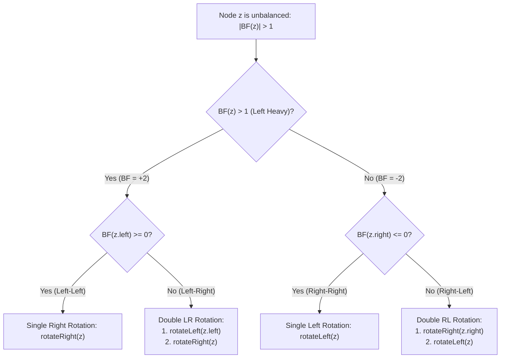
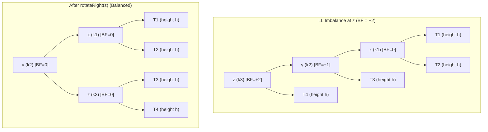
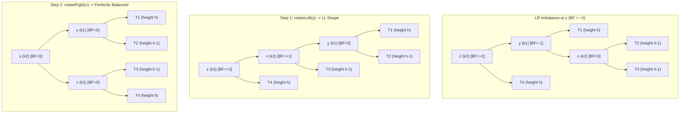

# AVL Trees

> [!info] Document Metadata
> - **Course:** `=this.course`
> - **Topic:** `=this.topic`
> - **Status:** `=this.status`

**Tags:** #[[Computer Science]] #[[CCDSALG]] #[[AVL Trees]] #[[Conceptual]] #[[M5]]

---

## Overview

AVL Trees, named after Adelson-Velskii and Landis, are height-balanced binary search trees. For every node, the heights of its left and right subtrees differ by at most 1. This balancing ensures that search, insert, and delete operations execute in $O(\log n)$ time. Insertions and deletions that violate the balance property are fixed using rotations.

## Important Formulas

**Balance Factor:**
$$BF(x) = \text{Height}(x.\text{left}) - \text{Height}(x.\text{right})$$

**AVL Invariant:**
$$\forall x \in T, \quad |BF(x)| \le 1 \iff BF(x) \in \{-1, 0, 1\}$$

**Time Complexity:**
- Search: $O(\log n)$
- Insertion: $O(\log n)$ (at most 1 single or double rotation to restore balance)
- Deletion: $O(\log n)$ (may require up to $O(\log n)$ rotations propagating to the root)

## Theoretical Framework: The Four Rotation Cases

### 1. Single Rotations (LL and RR)

#### Left-Left (LL) Case: Right Rotation on z
Triggered when a node is inserted into the left subtree of the left child.

### 2. Double Rotations (LR and RL)

#### Left-Right (LR) Case: rotateLeft(y) followed by rotateRight(z)
Triggered when a node is inserted into the right subtree of the left child.

## Worked Examples

1. **Concrete Insertion Trace: Keys [30, 20, 10, 40, 50, 25]**
   - Insert 30, 20: Tree is balanced.
   - Insert 10: Node 30 has $BF = +2$, left child 20 has $BF = +1$. **LL Case**. Single right rotation on 30 makes 20 the root with left child 10 and right child 30.
   - Insert 40: Right child of 30.
   - Insert 50: Node 30 has $BF = -2$, right child 40 has $BF = -1$. **RR Case**. Single left rotation on 30 makes 40 the parent of 30 and 50.
   - Insert 25: Node 20 has $BF = -2$, right child 40 has $BF = +1$. **RL Case**. Double rotation: right rotation on 40, followed by left rotation on 20. Middle key 30 becomes the new root.

## References & Navigation

- **Related Notes:** [[AVL Trees]]
