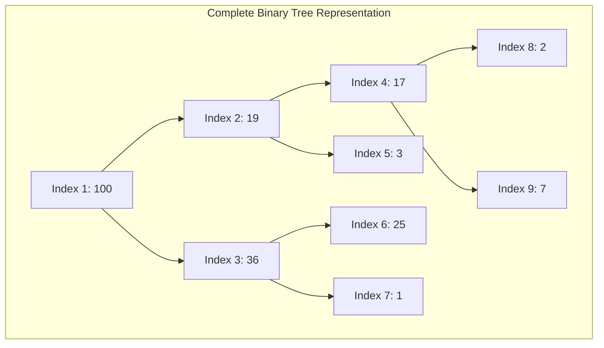
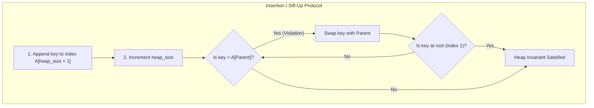
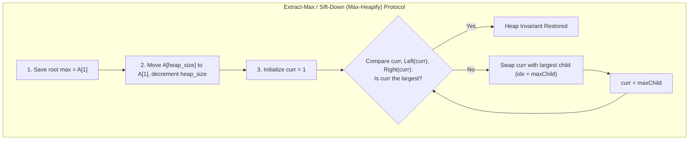

# Heaps

> [!info] Document Metadata
> - **Course:** `=this.course`
> - **Topic:** `=this.topic`
> - **Status:** `=this.status`

**Tags:** #[[Computer Science]] #[[CCDSALG]] #[[Heaps]] #[[Conceptual]] #[[M5]]

---

## Overview

A binary heap is an array that can be viewed as a nearly complete binary tree. The document details the structure of a max-heap where the parent's key is always greater than or equal to its children's keys. It introduces heap terminology, array indexing methods for traversing the tree, and the `heap-size` attribute.

## Important Formulas

**1-Based Array Indexing (Classical CLRS):**
- $\text{Parent}(i) = \lfloor i / 2 \rfloor$
- $\text{Left}(i) = 2i$
- $\text{Right}(i) = 2i + 1$

**0-Based Array Indexing (Standard Modern C/C++/Java):**
- $\text{Parent}(i) = \lfloor (i - 1) / 2 \rfloor$
- $\text{Left}(i) = 2i + 1$
- $\text{Right}(i) = 2i + 2$

**Heap Invariant:**
- **Max-Heap:** $\forall i > 1, \quad A[\text{Parent}(i)] \ge A[i]$
- **Min-Heap:** $\forall i > 1, \quad A[\text{Parent}(i)] \le A[i]$

**Time & Space Complexities:**
- Height of heap with $n$ elements: $h = \lfloor \log_2 n \rfloor$
- `Max-Heapify` / `Sift-Down`: $O(\log n)$
- `Build-Max-Heap`: $O(n)$ (asymptotically tighter than $O(n \log n)$ via summation of heights)
- `Insert` / `Sift-Up`: $O(\log n)$
- `Extract-Max`: $O(\log n)$
- `Heap-Sort`: $O(n \log n)$ in-place ($O(1)$ auxiliary space)

## Theoretical Framework: Array & Tree Duality

### Operation Lifecycles: Sift-Up vs. Sift-Down

## Worked Examples

1. **Array to Tree Mapping:** An array `[100, 19, 36, 17, 3, 25, 1, 2, 7]` is 1-indexed. The parent of node at index 4 (`17`) is index $\lfloor 4/2 \rfloor = 2$ (`19`). The left child of index 2 is index 4 (`17`), and right child is index 5 (`3`).
2. **Extract-Max Step:** Root `100` is removed. Last leaf `7` (index 9) replaces `100` at index 1. `Max-Heapify` compares `7` with children `19` and `36`. Largest is `36` (index 3). `7` swaps with `36`. Then `7` compares with children `25` and `1`. Largest is `25` (index 6). `7` swaps with `25`. Tree is restored.

## References & Navigation

- **Related Notes:** [[Heaps]]
