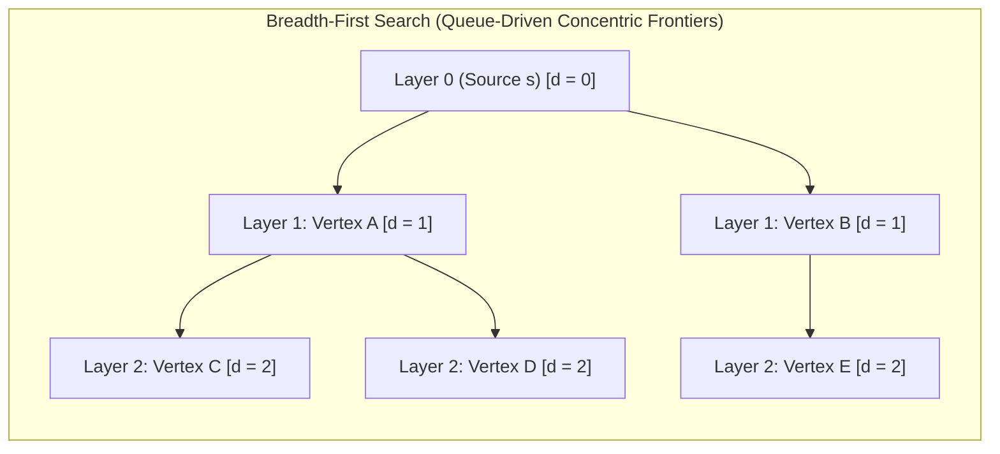
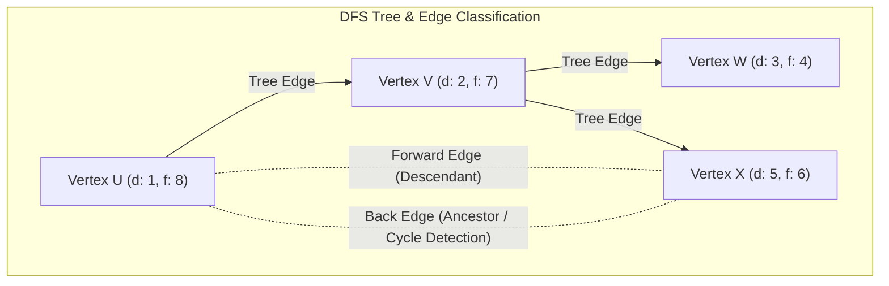
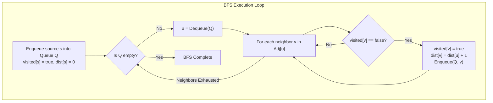

# Graphs Traversals

> [!info] Document Metadata
> - **Course:** `=this.course`
> - **Topic:** `=this.topic`
> - **Status:** `=this.status`

**Tags:** #[[Computer Science]] #[[CCDSALG]] #[[Graphs Traversals]] #[[Conceptual]] #[[M6]]

---

## Overview

This document covers basic algorithms for searching a graph: Breadth-First Search (BFS) and Depth-First Search (DFS). BFS explores edges out of a vertex systemically layer by layer and produces a breadth-first tree. DFS explores as deeply as possible along each branch before backtracking.

> [!simulator] Interactive Graph Pathfinding Studio
> Step through BFS, DFS, Dijkstra, and A* pathfinding heuristics with real-time priority queues:
> [Launch Graph Traversal & Shortest Path Studio](/simulators?id=algo-visualizer)

## Important Formulas

**Algorithmic Properties & Complexities:**
- **Adjacency List Representation:** Time complexity is $\Theta(V + E)$, Auxiliary space is $O(V)$ for visited tracking and frontier queue/recursion stack.
- **Adjacency Matrix Representation:** Time complexity is $\Theta(V^2)$.
- **BFS Shortest Path Property:** For unweighted graphs, the breadth-first tree guarantees that for every vertex $v$, the tree path from source $s$ to $v$ corresponds to a shortest path (minimum number of edges).
- **DFS Parenthesis Theorem:** For any two vertices $u$ and $v$, the intervals $[d[u], f[u]]$ and $[d[v], f[v]]$ are either completely disjoint or one is strictly contained within the other.

## Theoretical Framework: BFS vs. DFS Exploration Models

### DFS Spanning Forest & Edge Taxonomy

### Traversal Execution Pipelines

## Worked Examples

1. **BFS Traversal Trace:** Starting at vertex $A$ in graph with edges $(A, B), (A, C), (B, D), (C, E)$.
   - Init: $Q = [A]$, visited = $\{A\}$, distances: $d[A]=0$.
   - Dequeue $A$: Enqueue unvisited neighbors $B, C$. $Q = [B, C]$, $d[B]=1, d[C]=1$.
   - Dequeue $B$: Enqueue unvisited neighbor $D$. $Q = [C, D]$, $d[D]=2$.
   - Dequeue $C$: Enqueue unvisited neighbor $E$. $Q = [D, E]$, $d[E]=2$.
   - Dequeue $D, E$: No unvisited neighbors. $Q = []$. Done.
2. **DFS Cycle Detection:** A back edge encountered during DFS on a directed graph indicates a cycle. If neighbor $v$ is already marked `visited` and is currently on the recursion call stack (gray state in 3-color model), a directed cycle is confirmed.

## Multiple Choice Questions

1. What are the time and auxiliary space complexities of BFS and DFS using an Adjacency List versus an Adjacency Matrix?
    - **A)** Θ(V + E) time (O(V) auxiliary space) with Adjacency List, and Θ(V²) time with Adjacency Matrix
    - **B)** Θ(V²) time with Adjacency List, and Θ(V + E) time with Adjacency Matrix
    - **C)** O(E log V) time with Adjacency List, and O(V log V) time with Adjacency Matrix
    - **D)** O(V) time with Adjacency List, and Θ(V · E) time with Adjacency Matrix

2. What guarantee does the **BFS Shortest Path Property** provide for an unweighted graph starting from source $s$?
    - **A)** It constructs a minimum-weight spanning tree across disconnected components
    - **B)** For every reachable vertex v, the breadth-first tree path from s to v is a shortest path with the minimum number of edges
    - **C)** It discovers vertices in strict topological order even when cycles exist
    - **D)** It traverses every back edge before discovering any tree edge

3. How do the primary frontier mechanisms and exploration strategies differ between BFS and DFS?
    - **A)** BFS uses a priority queue ordered by edge weight, whereas DFS uses a hash table
    - **B)** BFS uses a LIFO recursion stack, whereas DFS uses a FIFO queue
    - **C)** BFS uses a queue to explore layer by layer, whereas DFS uses a recursion stack to explore as deeply as possible before backtracking
    - **D)** Both algorithms sort all edges before starting traversal

4. In the BFS Execution Loop flowchart, when are `visited[v] = true` and `dist[v] = dist[u] + 1` assigned?
    - **A)** Immediately upon discovering an unvisited neighbor v of u, right as v is enqueued into Q
    - **B)** Only after v is dequeued from Q and all its neighbors have been examined
    - **C)** Before the source vertex s is enqueued into Q
    - **D)** Only if v has no outgoing edges

5. According to the **DFS Parenthesis Theorem**, what holds for the discovery/finish intervals $[d[u], f[u]]$ and $[d[v], f[v]]$ of any two vertices $u$ and $v$?
    - **A)** The intervals partially overlap whenever u and v share a common neighbor
    - **B)** All intervals must have equal duration f[u] - d[u]
    - **C)** The intervals are either completely disjoint or one is strictly contained within the other
    - **D)** They satisfy d[u] < f[u] < d[v] < f[v] for every pair of connected vertices

6. In the DFS Tree & Edge Classification diagram (`U (d:1, f:8) -> V (d:2, f:7) -> X (d:5, f:6)`), how are the dashed edges `(X, U)` and `(U, X)` classified?
    - **A)** (X, U) is a Forward Edge and (U, X) is a Back Edge
    - **B)** (X, U) is a Back Edge to an ancestor and (U, X) is a Forward Edge to a descendant
    - **C)** Both (X, U) and (U, X) are Tree Edges
    - **D)** Both (X, U) and (U, X) are Cross Edges

7. During DFS on a directed graph using the 3-color model, what condition confirms a directed cycle?
    - **A)** Discovering a neighbor v that is still unvisited (white)
    - **B)** Visiting a neighbor v that has already completed exploration (black)
    - **C)** Traversing a forward edge to a descendant with a smaller interval
    - **D)** Encountering a back edge to a neighbor v that is already marked visited and currently on the recursion call stack (gray state)

8. In the worked BFS traversal trace starting at `A` on edges `(A, B), (A, C), (B, D), (C, E)`, what is the queue state and distance of `D` immediately after `B` is dequeued and its neighbor `D` is processed?
    - **A)** Q = [C, D], with d[D] = 2
    - **B)** Q = [D, E], with d[D] = 1
    - **C)** Q = [B, C], with d[D] = 1
    - **D)** Q = [A, B, C, D], with d[D] = 3

9. In that same worked BFS example (`(A, B), (A, C), (B, D), (C, E)` starting at `A`), which vertices lie at distance $d = 2$?
    - **A)** B and C
    - **B)** A and D
    - **C)** C and E
    - **D)** D and E

10. Using the DFS timestamps in the Edge Classification diagram (`U (1, 8)`, `V (2, 7)`, `W (3, 4)`, `X (5, 6)`), which statement agrees with the Parenthesis Theorem?
    - **A)** W and X overlap because both are children of V
    - **B)** V is an ancestor of U because [2, 7] encloses [1, 8]
    - **C)** W's interval [3, 4] and X's interval [5, 6] are disjoint, and both are strictly contained inside V's [2, 7]
    - **D)** U finishes before V because U is discovered at time 1

### Answer Key & Explanations

1. **A)** Important Formulas specifies $\Theta(V + E)$ time with $O(V)$ auxiliary space for an Adjacency List and $\Theta(V^2)$ time for an Adjacency Matrix.
2. **B)** Under the BFS Shortest Path Property, in unweighted graphs the breadth-first tree path from source $s$ to each reachable vertex $v$ corresponds to a shortest path with minimum edges.
3. **C)** BFS uses a queue $Q$ to explore concentric distance layers systematically, whereas DFS uses a recursion call stack to explore deeply along each branch before backtracking.
4. **A)** In the BFS Execution Loop flowchart, when `visited[v] == false`, the algorithm immediately sets `visited[v] = true` and `dist[v] = dist[u] + 1` and enqueues `v` into `Q`.
5. **C)** The DFS Parenthesis Theorem states that $[d[u], f[u]]$ and $[d[v], f[v]]$ are either completely disjoint or one is strictly contained inside the other.
6. **B)** In the DFS Tree diagram, `X` pointing up to ancestor `U` is labeled `Back Edge (Ancestor / Cycle Detection)`, and `U` pointing down to descendant `X` is labeled `Forward Edge (Descendant)`.
7. **D)** Under Worked Examples (DFS Cycle Detection), a directed cycle is confirmed when DFS encounters a back edge to a neighbor $v$ already marked `visited` and currently on the recursion call stack (the gray state in the 3-color model).
8. **A)** After dequeuing `A`, $Q = [B, C]$. Dequeuing `B` enqueues unvisited neighbor `D` with $d[D] = 2$, leaving $Q = [C, D]$.
9. **D)** From the trace, $d[A] = 0$, $d[B] = d[C] = 1$, and $d[D] = d[E] = 2$.
10. **C)** Both `[3, 4]` (W) and `[5, 6]` (X) are disjoint from each other and strictly contained within `V`'s `[2, 7]` (and `U`'s `[1, 8]`), illustrating the Parenthesis Theorem.

## References & Navigation

- **Previous Topic:** [[Graphs]]
- **Next Topic:** [[MST]]
- **Related Notes:** [[Graphs]], [[Queues]], [[Stack Operations and Applications]]
