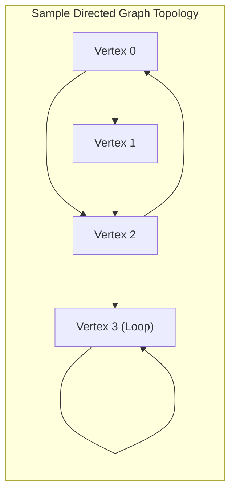
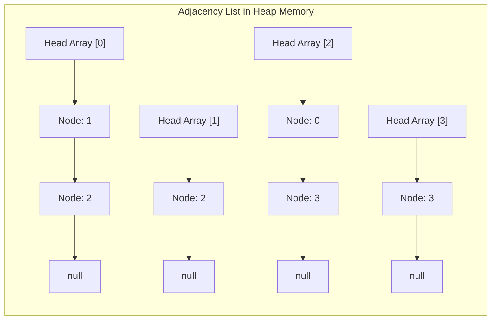

# Graphs

> [!info] Document Metadata
> - **Course:** `=this.course`
> - **Topic:** `=this.topic`
> - **Status:** `=this.status`

**Tags:** #[[Computer Science]] #[[CCDSALG]] #[[Graphs]] #[[Conceptual]] #[[M6]]

---

## Overview

Graphs consist of a set of vertices (nodes) and a set of edges that connect pairs of distinct vertices. The document differentiates between directed graphs (digraphs) and undirected graphs, noting that digraphs allow self-loops. It explains two primary methods for representing graphs in memory: adjacency lists and adjacency matrices.

## Important Formulas

**Graph Taxonomy & Handshaking Lemmas:**
- **Undirected Handshaking Lemma:**
  $$\sum_{v \in V} \text{deg}(v) = 2|E|$$
  *Corollary:* In any undirected graph, the number of vertices with odd degree is always even.
- **Directed Graph Balance:**
  $$\sum_{v \in V} \text{in-degree}(v) = \sum_{v \in V} \text{out-degree}(v) = |E|$$
- **Edge Density Bounds:**
  - Undirected Simple Graph: $0 \le |E| \le \frac{|V|(|V| - 1)}{2}$
  - Directed Graph: $0 \le |E| \le |V|(|V| - 1)$ (or $|V|^2$ if self-loops permitted)

**Representation Trade-off Matrix:**
| Operation | Adjacency Matrix | Adjacency List |
|---|---|---|
| **Space Complexity** | $\Theta(V^2)$ | $\Theta(V + E)$ |
| **Edge Existence Query $(u, v)$** | $O(1)$ | $O(\text{deg}(u))$ |
| **Iterate All Neighbors of $u$** | $\Theta(V)$ | $\Theta(\text{deg}(u))$ |
| **Add Vertex** | $O(V^2)$ (resize matrix) | $O(1)$ (amortized) |
| **Add Edge $(u, v)$** | $O(1)$ | $O(1)$ (prepend to list) |

## Theoretical Framework: Memory Representations

### Adjacency List Linked Layout

## Worked Examples

1. **Adjacency Matrix Example:** For the 4-vertex graph above:
   $$\begin{pmatrix} 0 & 1 & 1 & 0 \\ 0 & 0 & 1 & 0 \\ 1 & 0 & 0 & 1 \\ 0 & 0 & 0 & 1 \end{pmatrix}$$
2. **Dense vs. Sparse Selection:** If $|V| = 10,000$ and $|E| = 50,000$ (sparse web graph), an Adjacency Matrix requires $10^8$ entries ($\approx 100$ MB), while an Adjacency List requires $10,000 + 50,000 = 60,000$ references ($\approx 1$ MB). Adjacency lists are strongly preferred for sparse graphs.

## Multiple Choice Questions

1. How do edge density bounds differ between an undirected simple graph and a directed graph (digraph)?
    - **A)** Directed graphs permit self-loops (up to |V|² edges, or |V|(|V| - 1) without loops), whereas undirected simple graphs have at most |V|(|V| - 1)/2 edges
    - **B)** Undirected simple graphs allow self-loops while directed graphs forbid them
    - **C)** Directed graphs can never have more than |V| - 1 edges
    - **D)** Undirected simple graphs can have up to |V|² edges

2. What does the Undirected Handshaking Lemma state, and what corollary follows from it?
    - **A)** ∑ deg(v) = |E|, meaning every vertex has even degree
    - **B)** ∑ deg(v) = 2|E|, meaning the number of vertices with odd degree is always even
    - **C)** ∑ deg(v) = |V|², meaning odd-degree vertices outnumber even-degree vertices
    - **D)** ∑ deg(v) = |E| / 2, meaning |E| must always be even

3. In any directed graph $G = (V, E)$, how do the sums of all vertex in-degrees and out-degrees relate to the number of edges $|E|$?
    - **A)** ∑ in-degree(v) + ∑ out-degree(v) = |E|
    - **B)** ∑ in-degree(v) = 2|E| and ∑ out-degree(v) = |E|
    - **C)** ∑ in-degree(v) = ∑ out-degree(v) = |E|
    - **D)** ∑ out-degree(v) - ∑ in-degree(v) = |V|

4. What is the time complexity of querying whether edge $(u, v)$ exists in an Adjacency Matrix versus an Adjacency List?
    - **A)** O(V) for Adjacency Matrix and O(1) for Adjacency List
    - **B)** O(1) for both Adjacency Matrix and Adjacency List
    - **C)** O(deg(u)) for Adjacency Matrix and O(V + E) for Adjacency List
    - **D)** O(1) for Adjacency Matrix and O(deg(u)) for Adjacency List

5. Why is iterating over all neighbors of vertex $u$ faster on sparse graphs when using an Adjacency List instead of an Adjacency Matrix?
    - **A)** Adjacency List iterates in Θ(deg(u)) time, whereas Adjacency Matrix must scan an entire row in Θ(V) time
    - **B)** Adjacency Matrix requires O(V²) time to access a single vertex row
    - **C)** Adjacency List iterates all neighbors in O(1) time regardless of degree
    - **D)** Adjacency Matrix stores neighbor lists sorted in secondary storage

6. According to the Representation Trade-off Matrix, what is the complexity of adding a new vertex (`Add Vertex`) in an Adjacency Matrix versus an Adjacency List?
    - **A)** O(1) for Adjacency Matrix and O(V + E) for Adjacency List
    - **B)** O(V²) for Adjacency Matrix (resizing the matrix) and O(1) amortized for Adjacency List
    - **C)** O(V) for both Adjacency Matrix and Adjacency List
    - **D)** O(1) for both representations

7. What are the space complexities of an Adjacency Matrix and an Adjacency List?
    - **A)** Θ(V + E) for Adjacency Matrix and Θ(V²) for Adjacency List
    - **B)** Θ(E) for Adjacency Matrix and Θ(V) for Adjacency List
    - **C)** Θ(V²) for Adjacency Matrix and Θ(V + E) for Adjacency List
    - **D)** Θ(V · E) for Adjacency Matrix and Θ(E log V) for Adjacency List

8. In the 4-vertex directed graph worked example, what feature corresponds to the `1` at row `3`, column `3` (0-indexed) of the adjacency matrix?
    - **A)** An undirected edge between vertex 3 and vertex 0
    - **B)** A self-loop from Vertex 3 to Vertex 3
    - **C)** A bidirectional edge between vertex 2 and vertex 3
    - **D)** An empty head array entry in the adjacency list

9. For the sparse web graph example ($|V| = 10{,}000$, $|E| = 50{,}000$), how do the memory requirements of an Adjacency Matrix and an Adjacency List compare?
    - **A)** Adjacency Matrix requires 10^8 entries (about 100 MB), whereas Adjacency List requires 60,000 references (about 1 MB)
    - **B)** Adjacency List requires about 100 MB, whereas Adjacency Matrix requires about 1 MB
    - **C)** Both representations consume exactly 50 MB of memory
    - **D)** Adjacency Matrix stores 60,000 entries, whereas Adjacency List stores 10^8 references

10. How does an Adjacency List achieve $O(1)$ time for the `Add Edge (u, v)` operation?
    - **A)** By scanning u's entire list to maintain sorted neighbor order
    - **B)** By allocating a new V × V matrix
    - **C)** By resizing the head array to size V + E
    - **D)** By prepending the new neighbor node to u's linked list

### Answer Key & Explanations

1. **A)** Under Edge Density Bounds, an undirected simple graph has $0 \le |E| \le \frac{|V|(|V|-1)}{2}$, whereas a directed graph (which permits self-loops) has $0 \le |E| \le |V|(|V|-1)$ or $|V|^2$ with self-loops.
2. **B)** The Undirected Handshaking Lemma states $\sum_{v \in V} \text{deg}(v) = 2|E|$, yielding the corollary that the number of odd-degree vertices is always even.
3. **C)** Under Directed Graph Balance, $\sum_{v \in V} \text{in-degree}(v) = \sum_{v \in V} \text{out-degree}(v) = |E|$.
4. **D)** From the Representation Trade-off Matrix, testing edge existence $(u, v)$ takes $O(1)$ in an Adjacency Matrix and $O(\text{deg}(u))$ in an Adjacency List.
5. **A)** Iterating over all neighbors of $u$ takes $\Theta(\text{deg}(u))$ in an Adjacency List versus $\Theta(V)$ in an Adjacency Matrix.
6. **B)** Adding a vertex takes $O(V^2)$ in an Adjacency Matrix (due to resizing the $V \times V$ matrix) and $O(1)$ amortized in an Adjacency List.
7. **C)** Space complexity is $\Theta(V^2)$ for an Adjacency Matrix and $\Theta(V + E)$ for an Adjacency List.
8. **B)** In the sample directed graph topology (`V3 --> V3`), row 3 column 3 having value `1` represents the self-loop on Vertex 3 (`Head Array [3] -> Node: 3 -> null`).
9. **A)** For $|V| = 10,000$ and $|E| = 50,000$, an Adjacency Matrix needs $10^8$ entries ($\approx 100$ MB) while an Adjacency List needs $10,000 + 50,000 = 60,000$ references ($\approx 1$ MB).
10. **D)** As noted in the Trade-off Matrix, `Add Edge (u, v)` takes $O(1)$ in an Adjacency List by prepending the neighbor node to $u$'s list.

## References & Navigation

- **Previous Topic:** [[Heaps]]
- **Next Topic:** [[Graphs Traversals]]
- **Related Notes:** [[Graphs Traversals]], [[MST]]
