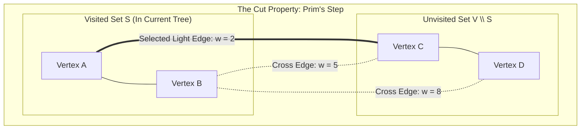
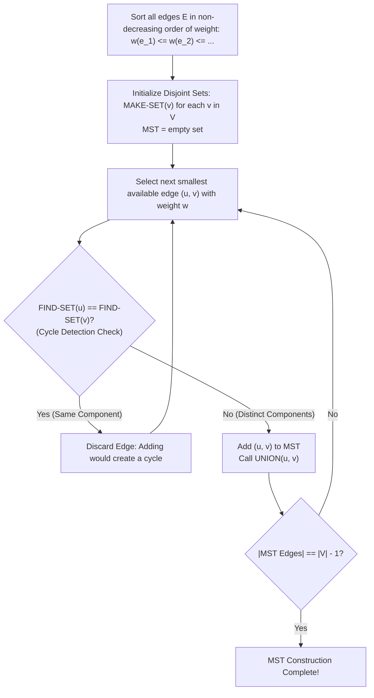

# MST

> [!info] Document Metadata
> - **Course:** `=this.course`
> - **Topic:** `=this.topic`
> - **Status:** `=this.status`

**Tags:** #[[Computer Science]] #[[CCDSALG]] #[[MST]] #[[Conceptual]] #[[M6]]

---

## Overview

A Spanning Tree is an acyclic graph that connects all the vertices of a connected graph. A Minimum Spanning Tree (MST) is a spanning tree whose total edge weight is minimized. The document introduces two greedy algorithms for finding the MST: Prim's algorithm, which grows the tree from an arbitrary root vertex, and Kruskal's algorithm.

## Important Formulas

**MST Definition:**
For a connected, undirected weighted graph $G = (V, E, w)$, find an acyclic subgraph $T \subseteq E$ connecting all vertices $V$ such that:
$$w(T) = \sum_{(u, v) \in T} w(u, v) \quad \text{is minimized.}$$
- A spanning tree for $|V|$ vertices always contains exactly $|V| - 1$ edges.

**Cut Property (Theoretical Foundation):**
Let $(S, V \setminus S)$ be any cut that respects $A \subseteq T$. If $(u, v)$ is a **light edge** crossing $(S, V \setminus S)$, then $(u, v)$ is safe for $A$.

**Algorithmic Complexities:**
| Algorithm | Strategy | Data Structure | Time Complexity | Preferred Graph Type |
|---|---|---|---|---|
| **Kruskal's** | Edge-centric (Global sort) | Disjoint-Set / Union-Find | $O(E \log E) = O(E \log V)$ | Sparse graphs ($E \ll V^2$) |
| **Prim's** | Vertex-centric (Grows single tree) | Min-Priority Queue | $O(E \log V)$ (Binary Heap) / $O(E + V \log V)$ (Fibonacci Heap) | Dense graphs ($E \approx V^2$) |

## Theoretical Framework: MST Construction Paradigms

### Kruskal's Cycle-Detection Execution Pipeline (Union-Find)

## Worked Examples

1. **Kruskal's Step-by-Step Trace:**
   - Graph with vertices $\{A, B, C, D\}$ and sorted edges: $(A, B): 1$, $(B, C): 2$, $(A, C): 3$, $(C, D): 4$, $(B, D): 5$.
   - **Pick $(A, B)$ (weight 1):** Sets are $\{A\}, \{B\}$. $A \neq B \implies$ Add $(A, B)$. Union: $\{A, B\}$.
   - **Pick $(B, C)$ (weight 2):** Set of $B$ is $\{A, B\}$, set of $C$ is $\{C\}$. Distinct $\implies$ Add $(B, C)$. Union: $\{A, B, C\}$.
   - **Pick $(A, C)$ (weight 3):** Set of $A$ is $\{A, B, C\}$, set of $C$ is $\{A, B, C\}$. **Same set!** Reject to avoid cycle $A-B-C-A$.
   - **Pick $(C, D)$ (weight 4):** Set of $C$ is $\{A, B, C\}$, set of $D$ is $\{D\}$. Distinct $\implies$ Add $(C, D)$. Union: $\{A, B, C, D\}$.
   - $|V|-1 = 3$ edges chosen. Total MST Weight: $1 + 2 + 4 = 7$.

## Multiple Choice Questions

1. What defines a spanning tree of a connected, undirected graph $G = (V, E)$, and how many edges does it contain?
    - **A)** Any subgraph containing at least |V| edges and one cycle
    - **B)** An acyclic subgraph connecting all vertices in V, containing exactly |V| - 1 edges
    - **C)** A tree connecting a proper subset of vertices with |E| / 2 edges
    - **D)** A directed acyclic graph with |V| + 1 edges

2. Under the **Cut Property**, if a cut $(S, V \setminus S)$ respects a subset $A \subseteq T$, which crossing edge is guaranteed to be safe for $A$?
    - **A)** The maximum-weight edge crossing (S, V \ S)
    - **B)** Any edge with both endpoints inside S
    - **C)** A light edge crossing (S, V \ S)
    - **D)** Any edge incident to the highest-degree vertex in V \ S

3. In the Cut Property diagram where $S = \{A, B\}$, $V \setminus S = \{C, D\}$, and crossing edges are `(A, C): 2`, `(B, C): 5`, and `(B, D): 8`, which edge does Prim's step select?
    - **A)** (A, C) with weight 2
    - **B)** (B, C) with weight 5
    - **C)** (B, D) with weight 8
    - **D)** (C, D) because both endpoints are unvisited

4. How do Kruskal's and Prim's algorithms differ in their search strategy and primary data structure?
    - **A)** Kruskal's grows a single tree from a root using a Fibonacci heap, while Prim's globally sorts all edges
    - **B)** Kruskal's uses a FIFO queue on unweighted graphs, while Prim's uses DFS finish times
    - **C)** Both algorithms use Disjoint-Set Union-Find without sorting or priority queues
    - **D)** Kruskal's is edge-centric (global sort) using Disjoint-Set / Union-Find, while Prim's is vertex-centric (grows a single tree) using a Min-Priority Queue

5. According to the Algorithmic Complexities table, which runtime bounds and preferred graph density correspond to Prim's algorithm?
    - **A)** O(E log V) with a Binary Heap or O(E + V log V) with a Fibonacci Heap, preferred for dense graphs (E ≈ V²)
    - **B)** O(V²) only, preferred exclusively for disconnected graphs
    - **C)** O(E log E) with Union-Find, preferred for sparse graphs (E << V²)
    - **D)** Θ(V + E) regardless of heap choice, preferred for sparse trees

6. In Kruskal's execution pipeline, what does `FIND-SET(u) == FIND-SET(v)` signify for candidate edge $(u, v)$?
    - **A)** Vertices u and v are in distinct components, so (u, v) should be added to the MST
    - **B)** Vertices u and v already belong to the same component, so adding (u, v) would create a cycle and the edge is discarded
    - **C)** The MST already contains |V| edges and must terminate
    - **D)** Vertex u has smaller weight than v, so UNION(u, v) must be skipped and the edge reversed

7. When does Kruskal's Union-Find pipeline terminate construction early without needing further edges?
    - **A)** As soon as the first cycle-creating edge is discarded
    - **B)** Once |MST Edges| == |V| - 1
    - **C)** Only after every edge in E has been added to the MST
    - **D)** Immediately after calling MAKE-SET(v) on each vertex

8. In Kruskal's worked trace with edges `(A, B): 1`, `(B, C): 2`, `(A, C): 3`, `(C, D): 4`, `(B, D): 5`, why is `(A, C)` of weight `3` rejected?
    - **A)** Because its weight is greater than 2
    - **B)** Because vertex C already has two incident edges in the MST
    - **C)** Because A and C are already in the same set {A, B, C}, so adding (A, C) would form cycle A-B-C-A
    - **D)** Because (B, D) must be evaluated before (A, C)

9. In that same worked trace over $\{A, B, C, D\}$, which edges form the completed MST and what is its total weight?
    - **A)** (A, B), (B, C), and (A, C) with total weight 6
    - **B)** (A, B), (B, C), and (B, D) with total weight 8
    - **C)** (B, C), (A, C), and (C, D) with total weight 9
    - **D)** (A, B), (B, C), and (C, D) with total weight 7

10. Which statement is NOT true about Prim's and Kruskal's algorithms as described in the note?
    - **A)** Prim's algorithm grows a single tree starting from an arbitrary root vertex
    - **B)** Kruskal's algorithm sorts all edges in non-decreasing order of weight before checking components with Union-Find
    - **C)** Kruskal's algorithm runs in O(E log E) = O(E log V) time and is preferred for sparse graphs
    - **D)** Kruskal's algorithm ignores edge weights and grows a single tree from a chosen root vertex

### Answer Key & Explanations

1. **B)** A spanning tree is an acyclic subgraph connecting all vertices of a connected graph, and for $|V|$ vertices it always contains exactly $|V| - 1$ edges.
2. **C)** By the Cut Property, if $(S, V \setminus S)$ respects $A \subseteq T$, any light edge crossing $(S, V \setminus S)$ is safe for $A$.
3. **A)** Among the edges crossing $(S, V \setminus S)$ in the Cut Property diagram—`(A, C)` of weight `2`, `(B, C)` of weight `5`, and `(B, D)` of weight `8`—`(A, C)` is the minimum-weight light edge.
4. **D)** As summarized in the Algorithmic Complexities table, Kruskal's uses an edge-centric global sort with Disjoint-Set / Union-Find, whereas Prim's uses a vertex-centric strategy with a Min-Priority Queue to grow a single tree.
5. **A)** Prim's runs in $O(E \log V)$ with a Binary Heap or $O(E + V \log V)$ with a Fibonacci Heap and is preferred for dense graphs ($E \approx V^2$).
6. **B)** In Kruskal's flowchart, `FIND-SET(u) == FIND-SET(v)` indicates that $u$ and $v$ are already in the same connected component, so adding $(u, v)$ would introduce a cycle and it must be discarded.
7. **B)** Once `|MST Edges| == |V| - 1`, the flowchart branches to `MST Construction Complete!`.
8. **C)** After adding `(A, B)` and `(B, C)`, both `A` and `C` belong to `{A, B, C}`; selecting `(A, C)` would form the cycle `A-B-C-A`, so it is rejected.
9. **D)** Kruskal's selects `(A, B): 1`, `(B, C): 2`, and `(C, D): 4`, giving $|V| - 1 = 3$ edges and a total MST weight of $1 + 2 + 4 = 7$.
10. **D)** Kruskal's algorithm sorts all edges in non-decreasing order of weight rather than ignoring edge weights or growing a single tree from a root vertex (which describes Prim's strategy).

## References & Navigation

- **Previous Topic:** [[Graphs Traversals]]
- **Next Topic:** [[[REV] CCDSALG Comprehensive Finals Reviewer]]
- **Related Notes:** [[Graphs]], [[Heaps]], [[Greedy Algorithms Introduction]]
