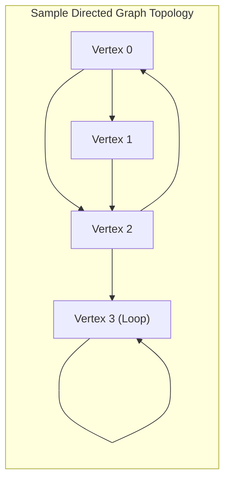
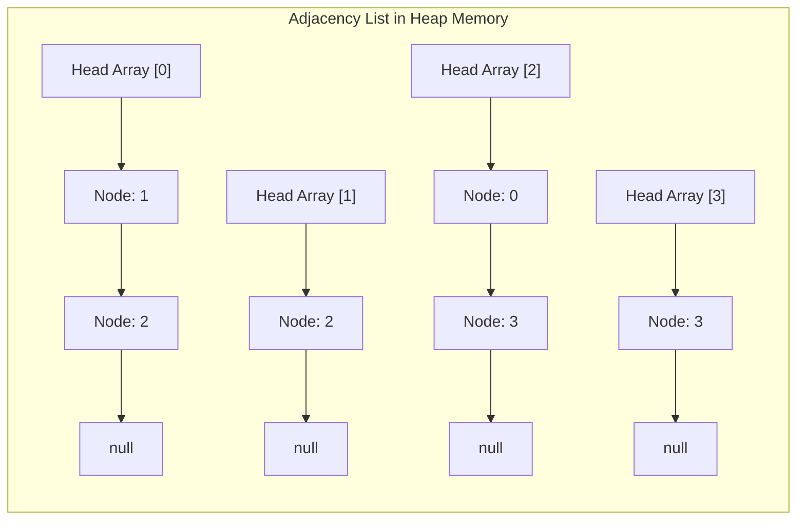

# Graphs

> [!info] Document Metadata
> - **Course:** `=this.course`
> - **Topic:** `=this.topic`
> - **Status:** `=this.status`

**Tags:** #[[Computer Science]] #[[CCDSALG]] #[[Graphs]] #[[Conceptual]] #[[M6]]

---

## Overview

Graphs consist of a set of vertices (nodes) and a set of edges that connect pairs of distinct vertices. The document differentiates between directed graphs (digraphs) and undirected graphs, noting that digraphs allow self-loops. It explains two primary methods for representing graphs in memory: adjacency lists and adjacency matrices.

## Important Formulas

**Graph Taxonomy & Handshaking Lemmas:**
- **Undirected Handshaking Lemma:**
  $$\sum_{v \in V} \text{deg}(v) = 2|E|$$
  *Corollary:* In any undirected graph, the number of vertices with odd degree is always even.
- **Directed Graph Balance:**
  $$\sum_{v \in V} \text{in-degree}(v) = \sum_{v \in V} \text{out-degree}(v) = |E|$$
- **Edge Density Bounds:**
  - Undirected Simple Graph: $0 \le |E| \le \frac{|V|(|V| - 1)}{2}$
  - Directed Graph: $0 \le |E| \le |V|(|V| - 1)$ (or $|V|^2$ if self-loops permitted)

**Representation Trade-off Matrix:**
| Operation | Adjacency Matrix | Adjacency List |
|---|---|---|
| **Space Complexity** | $\Theta(V^2)$ | $\Theta(V + E)$ |
| **Edge Existence Query $(u, v)$** | $O(1)$ | $O(\text{deg}(u))$ |
| **Iterate All Neighbors of $u$** | $\Theta(V)$ | $\Theta(\text{deg}(u))$ |
| **Add Vertex** | $O(V^2)$ (resize matrix) | $O(1)$ (amortized) |
| **Add Edge $(u, v)$** | $O(1)$ | $O(1)$ (prepend to list) |

## Theoretical Framework: Memory Representations

### Adjacency List Linked Layout

## Worked Examples

1. **Adjacency Matrix Example:** For the 4-vertex graph above:
   $$\begin{pmatrix} 0 & 1 & 1 & 0 \\ 0 & 0 & 1 & 0 \\ 1 & 0 & 0 & 1 \\ 0 & 0 & 0 & 1 \end{pmatrix}$$
2. **Dense vs. Sparse Selection:** If $|V| = 10,000$ and $|E| = 50,000$ (sparse web graph), an Adjacency Matrix requires $10^8$ entries ($\approx 100$ MB), while an Adjacency List requires $10,000 + 50,000 = 60,000$ references ($\approx 1$ MB). Adjacency lists are strongly preferred for sparse graphs.

## References & Navigation

- **Related Notes:** [[Graphs]]
