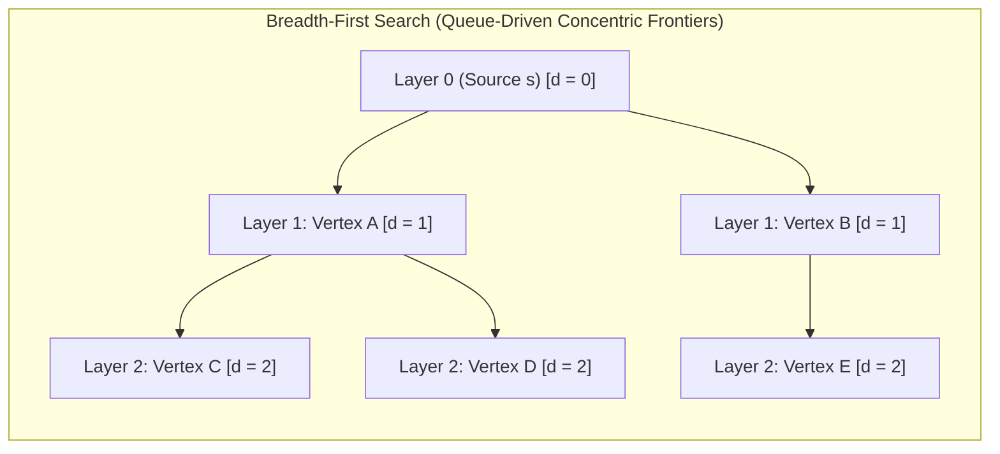
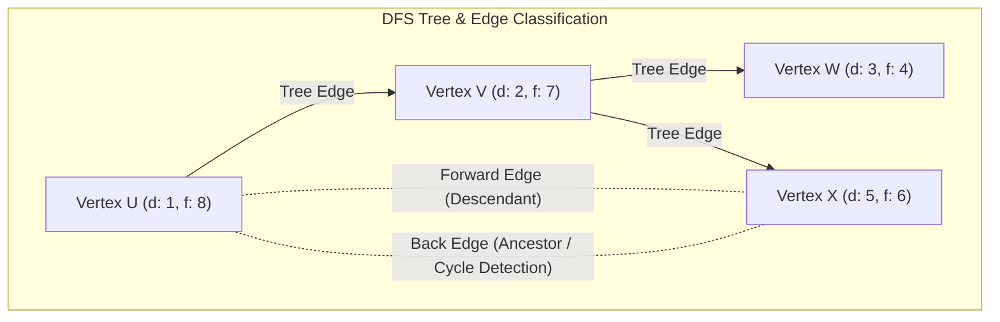
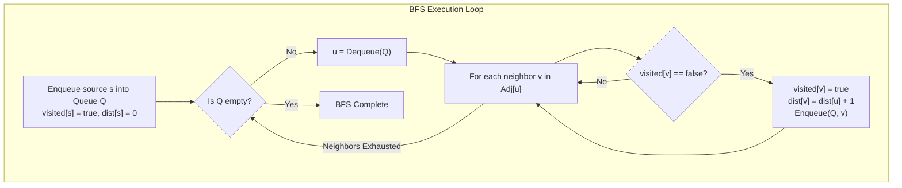

# Graphs Traversals

> [!info] Document Metadata
> - **Course:** `=this.course`
> - **Topic:** `=this.topic`
> - **Status:** `=this.status`

**Tags:** #[[Computer Science]] #[[CCDSALG]] #[[Graphs Traversals]] #[[Conceptual]] #[[M6]]

---

## Overview

This document covers basic algorithms for searching a graph: Breadth-First Search (BFS) and Depth-First Search (DFS). BFS explores edges out of a vertex systemically layer by layer and produces a breadth-first tree. DFS explores as deeply as possible along each branch before backtracking.

## Important Formulas

**Algorithmic Properties & Complexities:**
- **Adjacency List Representation:** Time complexity is $\Theta(V + E)$, Auxiliary space is $O(V)$ for visited tracking and frontier queue/recursion stack.
- **Adjacency Matrix Representation:** Time complexity is $\Theta(V^2)$.
- **BFS Shortest Path Property:** For unweighted graphs, the breadth-first tree guarantees that for every vertex $v$, the tree path from source $s$ to $v$ corresponds to a shortest path (minimum number of edges).
- **DFS Parenthesis Theorem:** For any two vertices $u$ and $v$, the intervals $[d[u], f[u]]$ and $[d[v], f[v]]$ are either completely disjoint or one is strictly contained within the other.

## Theoretical Framework: BFS vs. DFS Exploration Models

### DFS Spanning Forest & Edge Taxonomy

### Traversal Execution Pipelines

## Worked Examples

1. **BFS Traversal Trace:** Starting at vertex $A$ in graph with edges $(A, B), (A, C), (B, D), (C, E)$.
   - Init: $Q = [A]$, visited = $\{A\}$, distances: $d[A]=0$.
   - Dequeue $A$: Enqueue unvisited neighbors $B, C$. $Q = [B, C]$, $d[B]=1, d[C]=1$.
   - Dequeue $B$: Enqueue unvisited neighbor $D$. $Q = [C, D]$, $d[D]=2$.
   - Dequeue $C$: Enqueue unvisited neighbor $E$. $Q = [D, E]$, $d[E]=2$.
   - Dequeue $D, E$: No unvisited neighbors. $Q = []$. Done.
2. **DFS Cycle Detection:** A back edge encountered during DFS on a directed graph indicates a cycle. If neighbor $v$ is already marked `visited` and is currently on the recursion call stack (gray state in 3-color model), a directed cycle is confirmed.

## References & Navigation

- **Related Notes:** [[Graph Traversals]]
