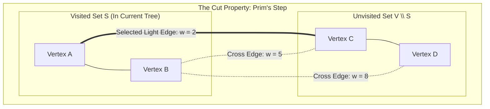
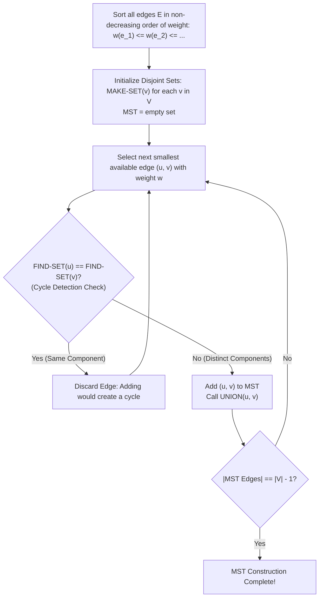

# MST

> [!info] Document Metadata
> - **Course:** `=this.course`
> - **Topic:** `=this.topic`
> - **Status:** `=this.status`

**Tags:** #[[Computer Science]] #[[CCDSALG]] #[[MST]] #[[Conceptual]] #[[M6]]

---

## Overview

A Spanning Tree is an acyclic graph that connects all the vertices of a connected graph. A Minimum Spanning Tree (MST) is a spanning tree whose total edge weight is minimized. The document introduces two greedy algorithms for finding the MST: Prim's algorithm, which grows the tree from an arbitrary root vertex, and Kruskal's algorithm.

## Important Formulas

**MST Definition:**
For a connected, undirected weighted graph $G = (V, E, w)$, find an acyclic subgraph $T \subseteq E$ connecting all vertices $V$ such that:
$$w(T) = \sum_{(u, v) \in T} w(u, v) \quad \text{is minimized.}$$
- A spanning tree for $|V|$ vertices always contains exactly $|V| - 1$ edges.

**Cut Property (Theoretical Foundation):**
Let $(S, V \setminus S)$ be any cut that respects $A \subseteq T$. If $(u, v)$ is a **light edge** crossing $(S, V \setminus S)$, then $(u, v)$ is safe for $A$.

**Algorithmic Complexities:**
| Algorithm | Strategy | Data Structure | Time Complexity | Preferred Graph Type |
|---|---|---|---|---|
| **Kruskal's** | Edge-centric (Global sort) | Disjoint-Set / Union-Find | $O(E \log E) = O(E \log V)$ | Sparse graphs ($E \ll V^2$) |
| **Prim's** | Vertex-centric (Grows single tree) | Min-Priority Queue | $O(E \log V)$ (Binary Heap) / $O(E + V \log V)$ (Fibonacci Heap) | Dense graphs ($E \approx V^2$) |

## Theoretical Framework: MST Construction Paradigms

### Kruskal's Cycle-Detection Execution Pipeline (Union-Find)

## Worked Examples

1. **Kruskal's Step-by-Step Trace:**
   - Graph with vertices $\{A, B, C, D\}$ and sorted edges: $(A, B): 1$, $(B, C): 2$, $(A, C): 3$, $(C, D): 4$, $(B, D): 5$.
   - **Pick $(A, B)$ (weight 1):** Sets are $\{A\}, \{B\}$. $A \neq B \implies$ Add $(A, B)$. Union: $\{A, B\}$.
   - **Pick $(B, C)$ (weight 2):** Set of $B$ is $\{A, B\}$, set of $C$ is $\{C\}$. Distinct $\implies$ Add $(B, C)$. Union: $\{A, B, C\}$.
   - **Pick $(A, C)$ (weight 3):** Set of $A$ is $\{A, B, C\}$, set of $C$ is $\{A, B, C\}$. **Same set!** Reject to avoid cycle $A-B-C-A$.
   - **Pick $(C, D)$ (weight 4):** Set of $C$ is $\{A, B, C\}$, set of $D$ is $\{D\}$. Distinct $\implies$ Add $(C, D)$. Union: $\{A, B, C, D\}$.
   - $|V|-1 = 3$ edges chosen. Total MST Weight: $1 + 2 + 4 = 7$.

## References & Navigation

- **Related Notes:** [[Minimum Spanning Trees]]
