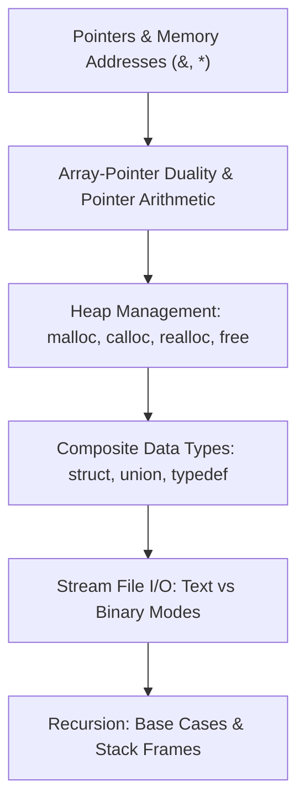
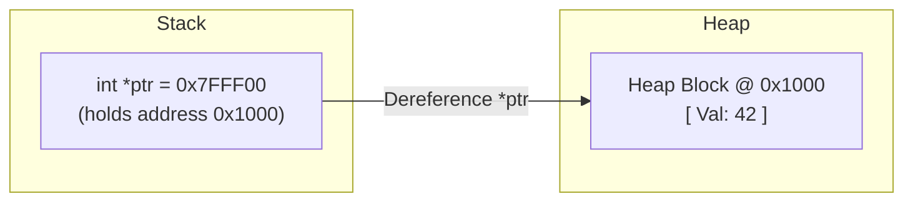

> [!info] Document Metadata
> - **Course:** `=this.course`
> - **Topic:** `=this.topic`
> - **Status:** `=this.status`

**Tags:** #[[Computer Science]] #[[CCPROG2]] #[[C Programming]] #[[Pointers]] #[[Reviewer]] #[[Finals]]

---

# CCPROG2 Comprehensive Finals Reviewer

## Overview

This reviewer consolidates Advanced C Programming (CCPROG2). Core topics include pointer arithmetic and dereferencing, multi-dimensional arrays, strings and string library functions, user-defined structures and unions, dynamic memory allocation (`malloc`, `calloc`, `realloc`, `free`), file handling (`fopen`, `fread`, `fwrite`, `fprintf`, `fscanf`), and recursion.

---

## 1. Pointers & Memory Architecture

### Pointer Operators & Equivalences
- **Address-of `&x`**: Returns the physical memory address of variable `x`.
- **Dereference `*p`**: Accesses the value stored at memory address stored in `p`.
- **Array-Pointer Identity**: For array `arr`, `arr[i] \equiv *(arr + i) \equiv *(i + arr) \equiv i[arr]`.
- **Pointer Arithmetic**: If `p` is `T*`, `p + 1` increments address by `sizeof(T)` bytes!

---

## 2. Dynamic Memory Management Functions

| Function Prototype | Description | Return on Failure |
| :--- | :--- | :--- |
| `void* malloc(size_t size);` | Allocates uninitialized heap memory of `size` bytes. | `NULL` |
| `void* calloc(size_t num, size_t size);` | Allocates and zero-initializes `num * size` bytes. | `NULL` |
| `void* realloc(void *ptr, size_t new_size);` | Resizes an allocated block; preserves existing content. | `NULL` (original block remains valid) |
| `void free(void *ptr);` | Releases allocated heap memory back to the OS. | `void` (Passing `NULL` is a safe no-op) |

> [!WARNING] Common Memory Vulnerabilities
> - **Dangling Pointer**: A pointer that points to deallocated memory after `free(p)`. (Fix: `free(p); p = NULL;`).
> - **Memory Leak**: Allocated memory on heap lost when all pointers to it go out of scope without calling `free()`.
> - **Double Free**: Calling `free()` twice on the same pointer causes heap corruption / crashes.

---

## 3. Structures & File I/O Summary

### Structure Access
- Given `struct Student s;` $\to$ Dot operator: `s.id`.
- Given `struct Student *p = &s;` $\to$ Arrow operator: `p->id` (equivalent to `(*p).id`).

### File Streams
- **Opening**: `FILE *fp = fopen("data.bin", "rb");` (Modes: `"r"`, `"w"`, `"a"`, `"rb"`, `"wb"`). Always check `if (fp == NULL)`.
- **Text I/O**: `fprintf(fp, ...)`, `fscanf(fp, ...)`, `fgets(buffer, size, fp)`.
- **Binary I/O**:
  - `size_t fwrite(const void *ptr, size_t size, size_t count, FILE *stream);`
  - `size_t fread(void *ptr, size_t size, size_t count, FILE *stream);`
- **Closing**: `fclose(fp);` flushes buffers and releases file descriptor.

---

## 4. High-Yield Exam Checklist

- [ ] Does `realloc` overwrite the original pointer immediately? Check if `void *temp = realloc(...)` to prevent leak on failure!
- [ ] In `char str[] = "Hello";`, what is `sizeof(str)`? $6$ bytes (includes null terminator `\0`).
- [ ] What is `strlen("Hello")`? $5$ (excludes `\0`).
- [ ] In `struct`, does member ordering affect memory footprint? **YES** (Structure padding and alignment).
- [ ] Did you check `feof(fp)` before or after reading? Check after read operation!

---

## 5. Comprehensive Practice Exam

1. Given `int arr[5] = {10, 20, 30, 40, 50}; int *ptr = arr + 2;`, what is the value of `*(ptr - 1)`?
   - A) 10
   - B) 20
   - C) 30
   - D) 40

2. Which memory allocation function initializes all allocated bytes to zero?
   - A) `malloc()`
   - B) `realloc()`
   - C) `calloc()`
   - D) `alloca()`

3. Given the declaration `typedef struct { char name[20]; int age; } Person; Person p, *ptr = &p;`, which expression is valid?
   - A) `ptr.age = 20;`
   - B) `(*ptr)->age = 20;`
   - C) `ptr->age = 20;`
   - D) `&ptr->age = 20;`

4. What is the return value of `fread(buf, sizeof(int), 10, fp)` if the file only has 4 integers remaining?
   - A) 0
   - B) 4
   - C) 10
   - D) -1

5. What happens when calling `free(p)` on a pointer `p` that is `NULL`?
   - A) Undefined behavior and system crash
   - B) Segmentation fault
   - C) It performs no action safely
   - D) A compiler warning is raised

---

### Answer Key & Explanations

1. **B) 20** — `arr` points to `arr[0]` (10). `ptr = arr + 2` points to `arr[2]` (30). `ptr - 1` points to `arr[1]`, whose dereferenced value is 20.
2. **C) `calloc()`** — `calloc(num, size)` allocates contiguous memory and explicitly zeros out every byte. `malloc()` leaves allocated memory uninitialized.
3. **C) `ptr->age = 20;`** — The arrow operator `->` dereferences the pointer to a structure and accesses the member `age`. Equivalent to `(*ptr).age = 20;`.
4. **B) 4** — `fread()` returns the number of complete items successfully read, which in this case is 4.
5. **C) It performs no action safely** — According to the ANSI C standard, if `ptr` is a null pointer, no action occurs.

---

## References & Navigation

- **Previous Topic:** [[CCPROG1]]
- **Next Topic:** [[CCDSALG]], [[CCPROG3]]
- **Prerequisites:** [[Advanced C]], Pointers, Dynamic Memory, Structs
- **Cross-Curricular Connections:** [[CSOPESY]]
