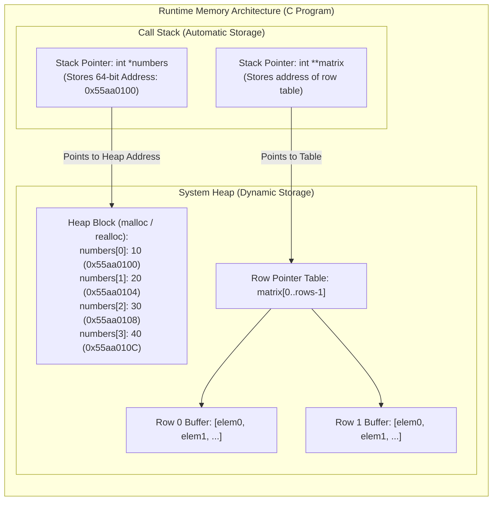

# Memory Allocation

> [!info] Document Metadata
> - **Course:** `=this.course`
> - **Topic:** `=this.topic`
> - **Status:** `=this.status`

**Tags:** #[[CCPROG2]] #[[C Programming]] #[[Programming]] #[[Computer Science]] #[[Data Structures]] #[[Data Types]] #[[Structured Programming]] #[[Memory Management]]

---

## Overview

> Arrays are assigned a contiguous block of memory.

## Key Concepts
 Dynamic allocation

## Details / Theory
 Arrays are assigned a **contiguous block of memory**. Memory is typically **statically allocated**, meaning the size is fixed at compile time. **Dynamic allocation** is possible using pointers and functions like `malloc()`.

## Code Example

### 1. 1D Dynamic Array with Dynamic Resizing (`malloc`, `realloc`, `free`)

```c
#include <stdio.h>
#include <stdlib.h>

int main(void) {
    int initial_capacity = 4;
    // 1. Allocate initial heap buffer
    int *numbers = (int *)malloc(initial_capacity * sizeof(int));
    if (numbers == NULL) {
        fprintf(stderr, "Error: Initial memory allocation failed.\n");
        return EXIT_FAILURE;
    }

    // Populate initial array
    for (int i = 0; i < initial_capacity; i++) {
        numbers[i] = (i + 1) * 10;
    }

    printf("Initial Heap Allocation (%d elements):\n", initial_capacity);
    for (int i = 0; i < initial_capacity; i++) {
        printf("  numbers[%d] = %d (Address: %p)\n", i, numbers[i], (void *)&numbers[i]);
    }

    // 2. Dynamically expand capacity using realloc
    int new_capacity = 8;
    int *temp = (int *)realloc(numbers, new_capacity * sizeof(int));
    if (temp == NULL) {
        fprintf(stderr, "Error: Reallocation failed. Preserving original buffer.\n");
        free(numbers); // Free original to prevent leak before exit
        return EXIT_FAILURE;
    }
    numbers = temp; // Safely rebind pointer

    // Populate newly allocated slots
    for (int i = initial_capacity; i < new_capacity; i++) {
        numbers[i] = (i + 1) * 10;
    }

    printf("\nExpanded Heap Allocation (%d elements):\n", new_capacity);
    for (int i = 0; i < new_capacity; i++) {
        printf("  numbers[%d] = %d (Address: %p)\n", i, numbers[i], (void *)&numbers[i]);
    }

    // 3. Deallocate memory to prevent leaks
    free(numbers);
    numbers = NULL; // Defend against dangling pointer dereferences

    return EXIT_SUCCESS;
}
```

### 2. 2D Dynamic Matrix Allocation and Clean Deallocation

```c
#include <stdio.h>
#include <stdlib.h>

int** allocate_matrix(int rows, int cols) {
    // Allocate array of row pointers
    int **matrix = (int **)malloc(rows * sizeof(int *));
    if (matrix == NULL) return NULL;

    // Allocate contiguous row data per pointer
    for (int i = 0; i < rows; i++) {
        matrix[i] = (int *)malloc(cols * sizeof(int));
        if (matrix[i] == NULL) {
            // Unwind previously allocated rows on partial failure
            for (int j = 0; j < i; j++) {
                free(matrix[j]);
            }
            free(matrix);
            return NULL;
        }
    }
    return matrix;
}

void free_matrix(int **matrix, int rows) {
    if (matrix == NULL) return;
    for (int i = 0; i < rows; i++) {
        free(matrix[i]); // Free individual row buffers
    }
    free(matrix); // Free top-level pointer array
}
```

## Theoretical Framework: Stack vs. Heap Memory Layout



## Common Pitfalls
 Forgetting that **static arrays** have a fixed size determined at compile time — you cannot resize them at runtime Not calling **`free()`** after `malloc()` — causes memory leaks in dynamic allocation Assuming `malloc()` always succeeds — always check if the returned pointer is `NULL` Confusing **contiguous memory** with sequential access — contiguous means elements are stored in adjacent memory addresses, enabling $O(1)$ index access via pointer arithmetic

## Summary

> TL;DR — Arrays occupy a **contiguous block** of memory. **Static allocation** (`int arr[N]`) is stack-based with fixed size. **Dynamic allocation** (`malloc(N * sizeof(int))`) is heap-based and resizable but requires manual `free()`. Contiguous layout enables $O(1)$ random access.

## Review Questions

_To be added._

## Links
 **Related:** **Source / Reference:**

## Multiple Choice Questions
1. How is memory allocated for a standard, fixed-size array in C?
    - **A)** It is fragmented and spread out across the disk
    - **B)** It is allocated as a single contiguous block
    - **C)** It is allocated item by item sequentially during runtime
    - **D)** It relies on a garbage collector
2. If `int` takes 4 bytes, how much total memory is allocated for `int arr[10];`?
    - **A)** 10 bytes
    - **B)** 14 bytes
    - **C)** 40 bytes
    - **D)** 20 bytes
3. Where is an array stored if it is declared locally inside a function without the `static` keyword?
    - **A)** The Heap
    - **B)** The Stack
    - **C)** The Data Segment
    - **D)** The Text Segment

### Answer Key & Explanations
1. **B)** The compiler reserves one continuous region to house all requested slots adjacently.
2. **C)** The calculation is 10 elements multiplied by 4 bytes per element, yielding 40 bytes.
3. **B)** Local function variables, including fixed arrays, are automatically pushed onto the stack.

## References & Navigation

- **Previous Topic:** [[Declaration]]
- **Next Topic:** [[Initialization]]
- **Related Notes:** [[Declaration]], [[Size]], [[Arrays and Pointers]]
