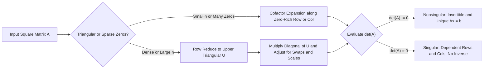

# Determinants

> [!info] Document Metadata
> - **Course:** `=this.course`
> - **Topic:** `=this.topic`
> - **Status:** `=this.status`

**Tags:** #[[Problem Solving]] #[[CSMATH2]] #[[Linear Algebra]] #[[Mathematics]]

---

## Overview

The **determinant** is a scalar function defined exclusively on square matrices $A \in \mathbb{R}^{n \times n}$ that encodes algebraic invertibility, linear independence of rows and columns, and the signed scaling factor of area or volume under the associated linear transformation $T(\mathbf{x}) = A\mathbf{x}$. While Gaussian elimination resolves linear systems iteratively, the determinant compresses the singularity status of a square system into a single invariant value $\det(A)$ (also denoted $|A|$).

---

## Key Definitions

- **Minor ($M_{ij}$):** Given an $n \times n$ matrix $A$ with $n \ge 2$, the $(i, j)$-minor $M_{ij}$ is the determinant of the $(n - 1) \times (n - 1)$ submatrix obtained by deleting row $i$ and column $j$ of $A$.
- **Cofactor ($C_{ij}$):** The signed minor defined by $C_{ij} = (-1)^{i+j} M_{ij}$. The sign factor $(-1)^{i+j}$ follows a checkerboard pattern starting with $+$ at $(1,1)$.
- **Singular vs. Nonsingular:** A square matrix $A$ is **singular** (non-invertible) if $\det(A) = 0$, and **nonsingular** (invertible) if $\det(A) \neq 0$.
- **Adjugate Matrix ($\operatorname{adj}(A)$):** Also called the classical adjoint, $\operatorname{adj}(A) = C^T$ is the transpose of the matrix of cofactors $C = [C_{ij}]$.

---

## Theoretical Framework

### 1. Recursive Definition and Cofactor (Laplace) Expansion

For base dimensions $n = 1$ and $n = 2$:
- If $A = [a_{11}]$, then $\det(A) = a_{11}$.
- If $A = \begin{bmatrix} a & b \\ c & d \end{bmatrix}$, then $\det(A) = ad - bc$.

For any $n \times n$ matrix $A$ with $n \ge 2$, **Laplace's Theorem** states that $\det(A)$ is independent of the row or column chosen for expansion:
- **Expansion along row $i$:**

$$\det(A) = \sum_{j=1}^{n} a_{ij} C_{ij} = \sum_{j=1}^{n} (-1)^{i+j} a_{ij} M_{ij}$$

- **Expansion along column $j$:**

$$\det(A) = \sum_{i=1}^{n} a_{ij} C_{ij} = \sum_{i=1}^{n} (-1)^{i+j} a_{ij} M_{ij}$$

**Strategic Optimization:** Because zero entries annihilate their corresponding terms $a_{ij} C_{ij} = 0$, always expand along the row or column containing the **maximum number of zeros**.

### 2. Triangular and Diagonal Matrix Rule

If $T \in \mathbb{R}^{n \times n}$ is upper triangular, lower triangular, or diagonal, repeated cofactor expansion along the first column (or first row) shows that its determinant equals the product of its main diagonal entries:

$$\det(T) = t_{11} t_{22} \cdots t_{nn} = \prod_{i=1}^{n} t_{ii}$$

In particular, $\det(I_n) = 1$, and a triangular matrix is invertible if and only if every main diagonal entry is nonzero.

### 3. Elementary Row Operations and Complexity

Naive recursive cofactor expansion requires $O(n!)$ operations, which is computationally intractable for large $n$. Instead, reducing $A$ to upper triangular form $U$ via Gaussian elimination and tracking how each elementary row operation scales the determinant runs in $O(n^3)$ arithmetic operations.

| Elementary Row Operation | Symbolic Form | Effect on $\det(A)$ | Equivalent Elementary Matrix Determinant |
| :--- | :--- | :--- | :--- |
| **Row Interchange** | $R_i \leftrightarrow R_j$ ($i \neq j$) | $\det(B) = -\det(A)$ | $\det(E_{\text{swap}}) = -1$ |
| **Row Scaling** | $k R_i \to R_i$ ($k \neq 0$) | $\det(B) = k \det(A)$ | $\det(E_{\text{scale}}) = k$ |
| **Row Addition** | $R_i + k R_j \to R_i$ ($i \neq j$) | $\det(B) = \det(A)$ | $\det(E_{\text{add}}) = 1$ |

Because $\det(A^T) = \det(A)$, identical rules hold for elementary column operations.

### 4. Core Algebraic Properties

For square matrices $A, B \in \mathbb{R}^{n \times n}$ and scalar $c \in \mathbb{R}$:

1. **Multiplicativity:** $\det(AB) = \det(A)\det(B)$. Notice that in general $\det(A + B) \neq \det(A) + \det(B)$.
2. **Transpose Invariance:** $\det(A^T) = \det(A)$.
3. **Scalar Homogeneity of Degree $n$:** $\det(cA) = c^n \det(A)$, since factoring $c$ out of each of the $n$ rows multiplies the determinant by $c$ a total of $n$ times.
4. **Inverse Determinant:** If $A$ is invertible, then $A A^{-1} = I_n \implies \det(A)\det(A^{-1}) = 1$, so $\det(A^{-1}) = \frac{1}{\det(A)}$.
5. **Matrix Powers and Similarity:** $\det(A^k) = (\det(A))^k$ for $k \ge 0$, and if $B = P^{-1}AP$, then $\det(B) = \det(P^{-1})\det(A)\det(P) = \det(A)$.
6. **Zero-Row / Proportional-Row Criterion:** If $A$ has an all-zero row/column, two identical rows/columns, or one row/column that is a scalar multiple of another, then $\det(A) = 0$.

### 5. Adjugate Formula and Cramer's Rule

Expanding row $i$ against cofactors of row $k$ yields $\sum_{j=1}^{n} a_{ij} C_{kj} = \det(A)\,\delta_{ik}$, which yields the fundamental adjugate identity:

$$A \operatorname{adj}(A) = \operatorname{adj}(A) A = \det(A) I_n$$

Whenever $\det(A) \neq 0$, dividing both sides by $\det(A)$ provides a closed-form expression for the inverse:

$$A^{-1} = \frac{1}{\det(A)} \operatorname{adj}(A)$$

For a $2 \times 2$ matrix $A = \begin{bmatrix} a & b \\ c & d \end{bmatrix}$ with $ad - bc \neq 0$, this simplifies to $A^{-1} = \frac{1}{ad - bc} \begin{bmatrix} d & -b \\ -c & a \end{bmatrix}$. Taking determinants of $A \operatorname{adj}(A) = \det(A) I_n$ also yields $\det(\operatorname{adj}(A)) = (\det(A))^{n-1}$ when $A$ is invertible.

**Cramer's Rule:** If $A \in \mathbb{R}^{n \times n}$ is invertible ($\det(A) \neq 0$), the unique solution $\mathbf{x} = (x_1, \dots, x_n)^T$ to $A\mathbf{x} = \mathbf{b}$ is given component-wise by:

$$x_i = \frac{\det(A_i(\mathbf{b}))}{\det(A)}, \quad i = 1, 2, \dots, n$$

where $A_i(\mathbf{b})$ is formed by replacing column $i$ of $A$ with the right-hand side column vector $\mathbf{b}$.

**Geometric Meaning:** In $\mathbb{R}^2$, $\lvert \det([\mathbf{u}\;\mathbf{v}]) \rvert$ equals the area of the parallelogram spanned by $\mathbf{u}$ and $\mathbf{v}$; in $\mathbb{R}^3$, $\lvert \det([\mathbf{u}\;\mathbf{v}\;\mathbf{w}]) \rvert$ equals the volume of the parallelepiped spanned by $\mathbf{u}, \mathbf{v}, \mathbf{w}$. The sign of $\det(A)$ indicates whether the linear map preserves ($\det(A) > 0$) or reverses ($\det(A) < 0$) spatial orientation.

---

## Worked Examples

### Example 1: $2 \times 2$ Determinant, Singularity, and Adjugate Inverse

Let $A = \begin{bmatrix} 5 & 3 \\ 2 & 4 \end{bmatrix}$ and $B(k) = \begin{bmatrix} k & 6 \\ 2 & k - 1 \end{bmatrix}$.
1. Compute $\det(A)$ and $A^{-1}$ using the adjugate formula.
2. Find all values of $k$ for which $B(k)$ is singular.

**Solution:**
1. $\det(A) = (5)(4) - (3)(2) = 20 - 6 = 14 \neq 0$, so $A$ is invertible. The adjugate swaps diagonal entries and negates off-diagonal entries:

$$\operatorname{adj}(A) = \begin{bmatrix} 4 & -3 \\ -2 & 5 \end{bmatrix}, \quad A^{-1} = \frac{1}{14}\begin{bmatrix} 4 & -3 \\ -2 & 5 \end{bmatrix}$$

2. $B(k)$ is singular when $\det(B(k)) = 0$:

$$k(k - 1) - (6)(2) = k^2 - k - 12 = (k - 4)(k + 3) = 0$$

Thus, $B(k)$ is singular for $k = 4$ and $k = -3$.

### Example 2: $3 \times 3$ Cofactor Expansion Using Zeros

Compute the determinant of:

$$C = \begin{bmatrix} 2 & 0 & -1 \\ 3 & 4 & 2 \\ 1 & 0 & 5 \end{bmatrix}$$

**Solution:**
Column 2 has two zero entries, making it optimal for Laplace expansion:

$$\det(C) = -0 \cdot M_{12} + 4 \cdot (-1)^{2+2} M_{22} - 0 \cdot M_{32} = 4 \det\begin{bmatrix} 2 & -1 \\ 1 & 5 \end{bmatrix} = 4\big((2)(5) - (-1)(1)\big) = 4(11) = 44$$

### Example 3: Evaluating a Determinant via Row Reduction

Compute $\det(D)$ using elementary row operations:

$$D = \begin{bmatrix} 0 & 2 & -4 \\ 1 & -1 & 3 \\ 2 & 4 & 1 \end{bmatrix}$$

**Solution:**
1. Swap $R_1 \leftrightarrow R_2$ to move a nonzero pivot into position $(1,1)$, introducing a factor of $-1$:

$$\det(D) = -\det\begin{bmatrix} 1 & -1 & 3 \\ 0 & 2 & -4 \\ 2 & 4 & 1 \end{bmatrix}$$

2. Perform $R_3 \leftarrow R_3 - 2R_1$ (row addition leaves the determinant unchanged):

$$\det(D) = -\det\begin{bmatrix} 1 & -1 & 3 \\ 0 & 2 & -4 \\ 0 & 6 & -5 \end{bmatrix}$$

3. Perform $R_3 \leftarrow R_3 - 3R_2$ (again unchanged):

$$\det(D) = -\det\begin{bmatrix} 1 & -1 & 3 \\ 0 & 2 & -4 \\ 0 & 0 & 7 \end{bmatrix}$$

4. Now the matrix is upper triangular, so its determinant is the product of the main diagonal entries:

$$\det(D) = -(1 \cdot 2 \cdot 7) = -14$$

### Example 4: Cramer's Rule and $3 \times 3$ Adjugate Inverse

Solve $A\mathbf{x} = \mathbf{b}$ via Cramer's Rule and verify $A^{-1} = \frac{1}{\det(A)}\operatorname{adj}(A)$ for:

$$A = \begin{bmatrix} 1 & 2 & 0 \\ 0 & 1 & 1 \\ 2 & 0 & 3 \end{bmatrix}, \quad \mathbf{b} = \begin{bmatrix} 5 \\ 3 \\ 5 \end{bmatrix}$$

**Solution:**
First, compute $\det(A)$ by expanding along Row 1:

$$\det(A) = 1(1 \cdot 3 - 1 \cdot 0) - 2(0 \cdot 3 - 1 \cdot 2) + 0 = 3 + 4 = 7 \neq 0$$

Replace each column with $\mathbf{b}$ to form $A_1(\mathbf{b}), A_2(\mathbf{b}), A_3(\mathbf{b})$:

$$\det(A_1) = \det\begin{bmatrix} 5 & 2 & 0 \\ 3 & 1 & 1 \\ 5 & 0 & 3 \end{bmatrix} = 5(3) - 2(9 - 5) = 15 - 8 = 7 \implies x_1 = \frac{7}{7} = 1$$

$$\det(A_2) = \det\begin{bmatrix} 1 & 5 & 0 \\ 0 & 3 & 1 \\ 2 & 5 & 3 \end{bmatrix} = 1(9 - 5) - 5(0 - 2) = 4 + 10 = 14 \implies x_2 = \frac{14}{7} = 2$$

$$\det(A_3) = \det\begin{bmatrix} 1 & 2 & 5 \\ 0 & 1 & 3 \\ 2 & 0 & 5 \end{bmatrix} = 1(5) - 2(-6) + 5(-2) = 5 + 12 - 10 = 7 \implies x_3 = \frac{7}{7} = 1$$

Thus $\mathbf{x} = (1, 2, 1)^T$. Computing the nine cofactors $C_{ij}$ gives $C = \begin{bmatrix} 3 & 2 & -2 \\ -6 & 3 & 4 \\ 2 & -1 & 1 \end{bmatrix}$, so transposing gives:

$$A^{-1} = \frac{1}{7}\operatorname{adj}(A) = \frac{1}{7}\begin{bmatrix} 3 & -6 & 2 \\ 2 & 3 & -1 \\ -2 & 4 & 1 \end{bmatrix}$$

Checking $A^{-1}\mathbf{b} = \frac{1}{7}(15 - 18 + 10,\; 10 + 9 - 5,\; -10 + 12 + 5)^T = \frac{1}{7}(7, 14, 7)^T = (1, 2, 1)^T$ confirms the solution.

---

## Common Pitfalls

- **Distributing $\det$ over Addition:** Never write $\det(A + B) = \det(A) + \det(B)$. For example, $\det(I_2 + I_2) = \det(2I_2) = 4 \neq 1 + 1$.
- **Forgetting the Exponent in $\det(cA)$:** For an $n \times n$ matrix, $\det(cA) = c^n \det(A)$, not $c \det(A)$.
- **Dropping Cofactor Signs:** In $\operatorname{adj}(A) = C^T$, both the checkerboard sign $(-1)^{i+j}$ and the transpose step are mandatory; omitting the transpose yields $C$, not $\operatorname{adj}(A)$.
- **Applying Row-Addition Logic to Scaling:** Adding a multiple of one row to another ($R_i + k R_j \to R_i$) leaves $\det$ unchanged, whereas scaling a single row ($k R_i \to R_i$) multiplies $\det$ by $k$.

---

## Summary

The determinant maps every square matrix $A \in \mathbb{R}^{n \times n}$ to a scalar $\det(A)$ that is nonzero if and only if $A$ is invertible. While Laplace cofactor expansion defines $\det(A)$ recursively and yields the closed-form adjugate inverse and Cramer's Rule, Gaussian elimination computes $\det(A)$ in $O(n^3)$ time by reducing $A$ to triangular form and tracking row swaps (factor $-1$) and row scalings (factor $k$).

## Multiple Choice Questions

1. Let $A = \begin{bmatrix} 3 & 0 & 2 \\ -1 & 5 & 4 \\ 0 & 0 & -2 \end{bmatrix}$. By expanding along the row with the most zeros, what is $\det(A)$?
    - **A)** -15
    - **B)** 30
    - **C)** -30
    - **D)** 10

2. Suppose $A$ is a $4 \times 4$ matrix with $\det(A) = 6$. Matrix $B$ is obtained from $A$ by swapping rows 1 and 3, multiplying row 2 by $-3$, and adding $5$ times row 4 to row 1. What is $\det(B)$?
    - **A)** -18
    - **B)** 18
    - **C)** -90
    - **D)** 90

3. Let $A$ and $B$ be $3 \times 3$ matrices with $\det(A) = 2$ and $\det(B) = -3$. What is $\det(2 A^T B^{-1})$?
    - **A)** -4/3
    - **B)** 16/3
    - **C)** -12
    - **D)** -16/3

4. For which value(s) of $k$ does the matrix $M = \begin{bmatrix} k & 3 & 1 \\ 0 & k - 2 & 5 \\ 0 & 0 & k + 1 \end{bmatrix}$ fail to be invertible?
    - **A)** k = 0, k = 2, or k = -1
    - **B)** k = 0 or k = 2 only
    - **C)** k = 2 or k = -1 only
    - **D)** Every real value of k makes M invertible

5. Which of the following statements is NOT equivalent to saying that a square matrix $A \in \mathbb{R}^{n \times n}$ is nonsingular?
    - **A)** det(A) != 0
    - **B)** Ax = b has a unique solution for every b in R^n
    - **C)** A can be reduced to the identity matrix I_n using elementary row operations
    - **D)** det(A + I_n) != 0

6. Using Cramer's Rule for the linear system $2x + 3y = 8$ and $x - y = -1$, what is the numerator determinant $\det(A_2(\mathbf{b}))$ used to compute $y$?
    - **A)** 10
    - **B)** -5
    - **C)** -10
    - **D)** 5

7. If $A$ is an invertible $4 \times 4$ matrix with $\det(A) = 5$, what is $\det(\operatorname{adj}(A))$?
    - **A)** 25
    - **B)** 125
    - **C)** 625
    - **D)** 1/5

8. Why is computing the determinant of a dense $20 \times 20$ matrix via Gaussian elimination vastly preferred over naive recursive Laplace cofactor expansion?
    - **A)** Gaussian elimination runs in O(n^3) operations, whereas naive cofactor expansion requires O(n!) operations
    - **B)** Cofactor expansion only works for symmetric matrices
    - **C)** Gaussian elimination guarantees the determinant is always positive
    - **D)** Cofactor expansion cannot detect singular matrices

9. If a linear transformation $T(\mathbf{x}) = A\mathbf{x}$ on $\mathbb{R}^3$ has $\det(A) = -4$, what does this tell us geometrically about how $T$ acts on the unit cube?
    - **A)** It collapses the unit cube onto a 2D plane
    - **B)** It shrinks volumes to 1/4 of their original size and preserves orientation
    - **C)** It scales volumes by a factor of 4 and reverses orientation
    - **D)** It translates the unit cube by 4 units along the z-axis

10. Which pair of matrices $A, B$ directly demonstrates that $\det(A + B) \neq \det(A) + \det(B)$ in general?
    - **A)** A = I_2 and B = 0_2
    - **B)** A = diag(1, 0) and B = diag(0, 0)
    - **C)** A = diag(2, 0) and B = diag(0, 0)
    - **D)** A = I_2 and B = I_2

### Answer Key & Explanations

1. **C)** Row 3 contains two zeros, so expanding along Row 3 gives $\det(A) = (-2)(-1)^{3+3} \det\begin{bmatrix} 3 & 0 \\ -1 & 5 \end{bmatrix} = -2(15 - 0) = -30$.
2. **B)** Swapping two rows multiplies the determinant by $-1$, scaling one row by $-3$ multiplies it by $-3$, and adding a multiple of one row to another leaves the determinant unchanged. Thus $\det(B) = (-1)(-3)(6) = 18$.
3. **D)** Using scalar homogeneity on a $3 \times 3$ matrix, multiplicativity, transpose invariance, and inverse determinant: $\det(2 A^T B^{-1}) = 2^3 \det(A^T)\det(B^{-1}) = 8 \cdot 2 \cdot \frac{1}{-3} = -\frac{16}{3}$.
4. **A)** Because $M$ is upper triangular, $\det(M) = k(k - 2)(k + 1)$. A matrix is non-invertible (singular) precisely when its determinant is zero, which occurs at $k = 0$, $k = 2$, or $k = -1$.
5. **D)** For $A = -I_n$, $A$ is nonsingular since $\det(-I_n) = (-1)^n \neq 0$, yet $A + I_n = 0_n$ has determinant $0$. The other three statements are standard equivalences of the Invertible Matrix Theorem.
6. **C)** The coefficient matrix is $A = \begin{bmatrix} 2 & 3 \\ 1 & -1 \end{bmatrix}$ and $\mathbf{b} = \begin{bmatrix} 8 \\ -1 \end{bmatrix}$. Replacing column 2 of $A$ with $\mathbf{b}$ forms $A_2(\mathbf{b}) = \begin{bmatrix} 2 & 8 \\ 1 & -1 \end{bmatrix}$, whose determinant is $(2)(-1) - (8)(1) = -10$ (giving $y = \frac{-10}{-5} = 2$).
7. **B)** Taking determinants of the adjugate identity $A \operatorname{adj}(A) = \det(A) I_4$ yields $\det(A)\det(\operatorname{adj}(A)) = (\det(A))^4$, so $\det(\operatorname{adj}(A)) = (\det(A))^{4-1} = 5^3 = 125$.
8. **A)** Recursive cofactor expansion without memoization branches into $n$ subproblems of size $n - 1$, yielding $O(n!)$ work, whereas row reduction to upper triangular form completes in $O(n^3)$ arithmetic operations.
9. **C)** The absolute value $\lvert \det(A) \rvert = 4$ gives the volume scaling factor of the unit cube, and the negative sign $\det(A) < 0$ indicates that the transformation reverses orientation in $\mathbb{R}^3$.
10. **D)** For $A = I_2$ and $B = I_2$, $\det(A) + \det(B) = 1 + 1 = 2$, whereas $\det(A + B) = \det(2I_2) = 2^2 = 4 \neq 2$.

## References & Navigation

- **Previous Topic:** [[The Inverse of a Matrix]]
- **Next Topic:** [[Vectors in the Plane]]
- **Related Notes:** [[Elementary Row Operation]], [[Inverse of a Matrix]], [[Triangular Matrices]], [[Nonsingular Matrix]], [[Zero Matrix]]
