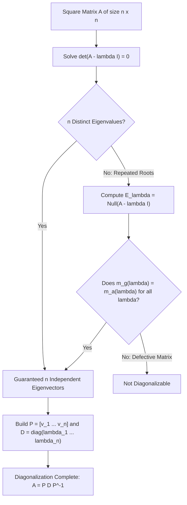

# Eigenvalues, Eigenvectors, and Diagonalization

> [!info] Document Metadata
> - **Course:** `=this.course`
> - **Topic:** `=this.topic`
> - **Status:** `=this.status`

**Tags:** #[[Problem Solving]] #[[CSMATH2]] #[[Linear Algebra]] #[[Mathematics]]

---

## Overview

Eigenvalues and eigenvectors isolate the invariant directions of a square linear operator $A \in \mathbb{R}^{n \times n}$—axes along which the action of $A$ simplifies to pure scalar stretching or reversal. When a matrix admits a complete basis of $n$ linearly independent eigenvectors, **diagonalization** decomposes $A$ into $P D P^{-1}$, transforming computationally expensive matrix powers $A^k$, coupled linear recurrences, and differential systems into decoupled scalar operations.

---

## Key Definitions

- **Eigenvalue and Eigenvector:** Given a square matrix $A \in \mathbb{R}^{n \times n}$, a scalar $\lambda$ is an **eigenvalue** of $A$ if there exists a **nonzero** vector $\mathbf{x} \neq \mathbf{0}$ such that:

$$A\mathbf{x} = \lambda \mathbf{x}$$

Any nonzero vector $\mathbf{x}$ satisfying this equation is called an **eigenvector** of $A$ corresponding to $\lambda$.
- **Characteristic Polynomial and Characteristic Equation:** Rewriting $A\mathbf{x} = \lambda \mathbf{x}$ as $(A - \lambda I_n)\mathbf{x} = \mathbf{0}$ shows that nontrivial solutions $\mathbf{x} \neq \mathbf{0}$ exist if and only if $A - \lambda I_n$ is singular. Thus $\lambda$ is an eigenvalue if and only if it solves the **characteristic equation**:

$$p(\lambda) = \det(A - \lambda I_n) = 0$$

where $p(\lambda)$ is a polynomial of degree $n$.
- **Eigenspace ($E_\lambda$):** For each eigenvalue $\lambda$, the **eigenspace** is the null space of $A - \lambda I_n$:

$$E_\lambda = \ker(A - \lambda I_n) = \{ \mathbf{x} \in \mathbb{R}^n : (A - \lambda I_n)\mathbf{x} = \mathbf{0} \}$$

$E_\lambda$ is a subspace containing $\mathbf{0}$ together with all eigenvectors belonging to $\lambda$.
- **Algebraic vs. Geometric Multiplicity:**
  - **Algebraic multiplicity ($m_a(\lambda)$):** The multiplicity of $\lambda$ as a root of the characteristic polynomial $p(\lambda)$.
  - **Geometric multiplicity ($m_g(\lambda)$):** The dimension of the eigenspace $E_\lambda$, given by $m_g(\lambda) = \dim(E_\lambda) = n - \operatorname{rank}(A - \lambda I_n)$.

---

## Theoretical Framework

### 1. Spectral Theorems, Multiplicity Bounds, and Independence

1. **Multiplicity Inequality:** For every eigenvalue $\lambda$ of $A \in \mathbb{R}^{n \times n}$:

$$1 \le m_g(\lambda) \le m_a(\lambda)$$

2. **Trace and Determinant Invariants:** Including multiplicities over $\mathbb{C}$, the eigenvalues $\lambda_1, \dots, \lambda_n$ of $A$ satisfy:

$$\operatorname{tr}(A) = \sum_{i=1}^{n} a_{ii} = \sum_{i=1}^{n} \lambda_i, \quad \det(A) = \prod_{i=1}^{n} \lambda_i$$

Consequently, $A$ is singular ($\det(A) = 0$) if and only if $\lambda = 0$ is an eigenvalue of $A$.
3. **Triangular Matrix Eigenvalues:** If $T$ is upper triangular, lower triangular, or diagonal, $\det(T - \lambda I) = \prod_{i=1}^{n}(t_{ii} - \lambda)$, so the eigenvalues of $T$ are precisely its main diagonal entries.
4. **Independence of Distinct-Eigenvalue Eigenvectors:** If $\lambda_1, \lambda_2, \dots, \lambda_k$ are pairwise distinct eigenvalues of $A$ with corresponding eigenvectors $\mathbf{v}_1, \mathbf{v}_2, \dots, \mathbf{v}_k$, then $\{\mathbf{v}_1, \dots, \mathbf{v}_k\}$ is guaranteed to be **linearly independent**.

### 2. Similarity and the Diagonalization Criterion

Two square matrices $A, B \in \mathbb{R}^{n \times n}$ are **similar** if there exists an invertible matrix $P$ such that $B = P^{-1}AP$. Similar matrices share the exact same characteristic polynomial, eigenvalues, determinant, trace, and rank.

A matrix $A$ is **diagonalizable** if it is similar to a diagonal matrix $D$, meaning there exist an invertible matrix $P$ and diagonal matrix $D = \operatorname{diag}(\lambda_1, \dots, \lambda_n)$ such that:

$$A = P D P^{-1} \quad \Longleftrightarrow \quad P^{-1} A P = D$$

Expanding $AP = PD$ column-by-column ($A\mathbf{p}_j = \lambda_j \mathbf{p}_j$) proves the **Diagonalization Theorem**:
- **Necessary & Sufficient Condition:** $A \in \mathbb{R}^{n \times n}$ is diagonalizable (over $\mathbb{R}$) if and only if $A$ possesses **$n$ linearly independent eigenvectors** (which form the columns of $P$). Equivalently, the characteristic polynomial factors completely over $\mathbb{R}$ AND $m_g(\lambda) = m_a(\lambda)$ for every eigenvalue $\lambda$.
- **Sufficient (Not Necessary) Condition:** If $A$ has $n$ **distinct** real eigenvalues, then $A$ is automatically diagonalizable. However, repeated eigenvalues can still yield a diagonalizable matrix whenever each eigenspace achieves full dimension $m_g(\lambda) = m_a(\lambda)$. Matrices where $m_g(\lambda) < m_a(\lambda)$ for some eigenvalue are called **defective** and cannot be diagonalized.

### 3. Fast Matrix Powers ($A^k$)

Once $A = P D P^{-1}$, multiplying $A$ by itself $k$ times cancels interior $P^{-1}P = I_n$ pairs:

$$A^k = (P D P^{-1})^k = P D^k P^{-1} = P \begin{bmatrix} \lambda_1^k & 0 & \cdots & 0 \\ 0 & \lambda_2^k & \cdots & 0 \\ \vdots & \vdots & \ddots & \vdots \\ 0 & 0 & \cdots & \lambda_n^k \end{bmatrix} P^{-1}$$

This reduces computing $A^k$ for large $k$ (such as Markov chain state evolutions $\mathbf{x}_k = A^k \mathbf{x}_0$) from $O(k n^3)$ matrix multiplications to a single eigen-decomposition plus $n$ scalar powers. Furthermore, if $A$ is invertible, $A^{-1} = P D^{-1} P^{-1}$, so eigenvalues of $A^{-1}$ are $1/\lambda_i$ with identical eigenvectors.

### 4. Symmetric Matrices and Orthogonal Diagonalization

Real **symmetric matrices** ($A^T = A$) obey the **Real Spectral Theorem**, guaranteeing exceptionally clean behavior:
1. All eigenvalues of a real symmetric matrix are **real** (never complex).
2. Eigenvectors corresponding to **distinct** eigenvalues of a symmetric matrix are **mutually orthogonal** ($\mathbf{v}_i \cdot \mathbf{v}_j = 0$ for $\lambda_i \neq \lambda_j$).
3. Every real symmetric matrix is **orthogonally diagonalizable**: there exists an orthogonal matrix $Q$ ($Q^{-1} = Q^T$, orthonormal columns) such that:

$$A = Q D Q^T$$

If an eigenspace has $m_g(\lambda) \ge 2$, applying Gram-Schmidt orthogonalization and normalizing within that eigenspace produces the required orthonormal basis vectors.

---

## Worked Examples

### Example 1: Diagonalizing a $2 \times 2$ Matrix and Computing $A^k$

Diagonalize $A = \begin{bmatrix} 4 & 1 \\ 2 & 3 \end{bmatrix}$ as $P D P^{-1}$ and derive a closed-form expression for $A^k$.

**Solution:**
1. **Characteristic Polynomial:**

$$\det(A - \lambda I) = \det\begin{bmatrix} 4 - \lambda & 1 \\ 2 & 3 - \lambda \end{bmatrix} = (4 - \lambda)(3 - \lambda) - 2 = \lambda^2 - 7\lambda + 10 = (\lambda - 5)(\lambda - 2) = 0$$

Eigenvalues are $\lambda_1 = 5$ and $\lambda_2 = 2$. Check: $\lambda_1 + \lambda_2 = 7 = \operatorname{tr}(A)$ and $\lambda_1 \lambda_2 = 10 = \det(A)$.
2. **Eigenspaces:**
- For $\lambda_1 = 5$: $(A - 5I)\mathbf{x} = \begin{bmatrix} -1 & 1 \\ 2 & -2 \end{bmatrix}\mathbf{x} = \mathbf{0} \implies x_1 = x_2$, yielding $\mathbf{v}_1 = \begin{bmatrix} 1 \\ 1 \end{bmatrix}$.
- For $\lambda_2 = 2$: $(A - 2I)\mathbf{x} = \begin{bmatrix} 2 & 1 \\ 2 & 1 \end{bmatrix}\mathbf{x} = \mathbf{0} \implies x_2 = -2x_1$, yielding $\mathbf{v}_2 = \begin{bmatrix} 1 \\ -2 \end{bmatrix}$.
3. **Construct $P, D, P^{-1}$:**

$$P = \begin{bmatrix} 1 & 1 \\ 1 & -2 \end{bmatrix}, \quad D = \begin{bmatrix} 5 & 0 \\ 0 & 2 \end{bmatrix}, \quad P^{-1} = \frac{1}{-3}\begin{bmatrix} -2 & -1 \\ -1 & 1 \end{bmatrix} = \frac{1}{3}\begin{bmatrix} 2 & 1 \\ 1 & -1 \end{bmatrix}$$

4. **Closed-Form Powers $A^k$:**

$$A^k = P D^k P^{-1} = \frac{1}{3}\begin{bmatrix} 1 & 1 \\ 1 & -2 \end{bmatrix}\begin{bmatrix} 5^k & 0 \\ 0 & 2^k \end{bmatrix}\begin{bmatrix} 2 & 1 \\ 1 & -1 \end{bmatrix} = \frac{1}{3}\begin{bmatrix} 2\cdot 5^k + 2^k & 5^k - 2^k \\ 2\cdot 5^k - 2\cdot 2^k & 5^k + 2\cdot 2^k \end{bmatrix}$$

Checking $k = 1$ returns $\frac{1}{3}\begin{bmatrix} 12 & 3 \\ 6 & 9 \end{bmatrix} = \begin{bmatrix} 4 & 1 \\ 2 & 3 \end{bmatrix} = A$.

### Example 2: $3 \times 3$ Repeated Eigenvalue and Orthogonal Diagonalization

Orthogonally diagonalize the symmetric matrix:

$$B = \begin{bmatrix} 2 & 1 & 1 \\ 1 & 2 & 1 \\ 1 & 1 & 2 \end{bmatrix}$$

**Solution:**
Notice each row sums to $4$, so $\mathbf{u}_3 = (1, 1, 1)^T$ satisfies $B\mathbf{u}_3 = 4\mathbf{u}_3$ ($\lambda = 4$). Moreover, $B - I_3 = \begin{bmatrix} 1 & 1 & 1 \\ 1 & 1 & 1 \\ 1 & 1 & 1 \end{bmatrix}$ has rank $1$, giving $\dim(E_1) = 3 - 1 = 2$. Thus $\lambda = 1$ has $m_a(1) = m_g(1) = 2$ (verified by $\operatorname{tr}(B) = 4 + 1 + 1 = 6$).
- A basis for $E_1$ ($x_1 + x_2 + x_3 = 0$) is $\mathbf{u}_1 = (-1, 1, 0)^T$ and $\mathbf{u}_2 = (-1, 0, 1)^T$.
- Apply Gram-Schmidt to orthogonalize within $E_1$:

$$\mathbf{q}_1 = \frac{1}{\sqrt{2}}\begin{bmatrix} -1 \\ 1 \\ 0 \end{bmatrix}, \quad \mathbf{w}_2 = \mathbf{u}_2 - (\mathbf{u}_2 \cdot \mathbf{q}_1)\mathbf{q}_1 = \begin{bmatrix} -1 \\ 0 \\ 1 \end{bmatrix} - \frac{1}{2}\begin{bmatrix} -1 \\ 1 \\ 0 \end{bmatrix} = \begin{bmatrix} -1/2 \\ -1/2 \\ 1 \end{bmatrix}$$

Normalizing $\mathbf{w}_2$ and $\mathbf{u}_3$ gives $\mathbf{q}_2 = \frac{1}{\sqrt{6}}(-1, -1, 2)^T$ and $\mathbf{q}_3 = \frac{1}{\sqrt{3}}(1, 1, 1)^T$, which is automatically orthogonal to $E_1$.
- Hence $B = Q D Q^T$ with $D = \operatorname{diag}(1, 1, 4)$ and $Q = [\mathbf{q}_1\;\mathbf{q}_2\;\mathbf{q}_3]$.

### Example 3: A Defective (Non-Diagonalizable) Matrix

Test whether $C = \begin{bmatrix} 3 & 1 \\ 0 & 3 \end{bmatrix}$ is diagonalizable.

**Solution:**
Since $C$ is upper triangular, $\det(C - \lambda I) = (3 - \lambda)^2 = 0$, giving a single eigenvalue $\lambda = 3$ with $m_a(3) = 2$. Solving $(C - 3I)\mathbf{x} = \begin{bmatrix} 0 & 1 \\ 0 & 0 \end{bmatrix}\mathbf{x} = \mathbf{0}$ yields $x_2 = 0$ and free $x_1 = t$, so:

$$E_3 = \operatorname{span}\left\{\begin{bmatrix} 1 \\ 0 \end{bmatrix}\right\} \implies m_g(3) = 1 < 2 = m_a(3)$$

Because $C$ does not have two linearly independent eigenvectors, $C$ is **defective** and not diagonalizable.

---

## Common Pitfalls

- **Treating $\mathbf{0}$ as an Eigenvector:** By definition, eigenvectors must be **nonzero** ($\mathbf{x} \neq \mathbf{0}$); while $\mathbf{0}$ belongs to the eigenspace $E_\lambda$, it is never an eigenvector.
- **Reversing $P$ and $P^{-1}$ in $A = P D P^{-1}$:** Writing $P^{-1} D P$ instead of $P D P^{-1}$ swaps the roles of change-of-basis; remember $AP = PD \implies A = P D P^{-1}$.
- **Mismatching Column Order Between $P$ and $D$:** The $j$-th diagonal entry $\lambda_j$ of $D$ must correspond to the $j$-th column eigenvector $\mathbf{v}_j$ in $P$.
- **Assuming Repeated Eigenvalues Preclude Diagonalization:** A repeated eigenvalue only prevents diagonalization if $m_g(\lambda) < m_a(\lambda)$; for instance, $I_n$ has $\lambda = 1$ repeated $n$ times and is already diagonal.

---

## Summary

Eigenvalues satisfy $\det(A - \lambda I) = 0$ and reveal the scaling factors along invariant eigenspaces $E_\lambda = \ker(A - \lambda I)$. A square matrix $A$ is diagonalizable as $P D P^{-1}$ if and only if it admits $n$ linearly independent eigenvectors ($m_g(\lambda) = m_a(\lambda)$ for every eigenvalue), enabling fast matrix exponentiation $A^k = P D^k P^{-1}$; symmetric matrices additionally guarantee real eigenvalues and orthogonal diagonalization $A = Q D Q^T$.

## Multiple Choice Questions

1. Let $A = \begin{bmatrix} 2 & 3 \\ 1 & 4 \end{bmatrix}$. Which vector $\mathbf{v}$ is an eigenvector of $A$, and what is its corresponding eigenvalue $\lambda$?
    - **A)** v = (1, -1)^T with lambda = 1
    - **B)** v = (1, 1)^T with lambda = 5
    - **C)** v = (3, 1)^T with lambda = 5
    - **D)** v = (0, 0)^T with lambda = 5

2. What are the eigenvalues of the matrix $A = \begin{bmatrix} 5 & -2 \\ 4 & -1 \end{bmatrix}$?
    - **A)** lambda = 5 and lambda = -1
    - **B)** lambda = 3 and lambda = -1
    - **C)** lambda = 4 and lambda = 0
    - **D)** lambda = 3 and lambda = 1

3. A $3 \times 3$ matrix $A$ has trace $\operatorname{tr}(A) = 9$, determinant $\det(A) = 24$, and one known eigenvalue $\lambda_1 = 2$. What are the other two eigenvalues of $A$?
    - **A)** 3 and 4
    - **B)** 2 and 5
    - **C)** 1 and 6
    - **D)** -3 and -4

4. Find a basis for the eigenspace $E_3$ corresponding to $\lambda = 3$ for the matrix $A = \begin{bmatrix} 1 & 2 & 0 \\ 2 & 1 & 0 \\ 0 & 0 & 3 \end{bmatrix}$.
    - **A)** {(1, -1, 0)^T, (0, 0, 1)^T}
    - **B)** {(1, 1, 1)^T}
    - **C)** {(1, 1, 0)^T, (0, 0, 1)^T}
    - **D)** {(1, 0, 0)^T, (0, 1, 0)^T}

5. Which condition is BOTH necessary and sufficient for an $n \times n$ matrix $A$ to be diagonalizable over $\mathbb{R}$?
    - **A)** A has n distinct real eigenvalues
    - **B)** A has n linearly independent eigenvectors in R^n
    - **C)** det(A) != 0
    - **D)** A is symmetric

6. Which of the following matrices is NOT diagonalizable (defective)?
    - **A)** [4, 0; 0, 4]
    - **B)** [2, 1; 0, 3]
    - **C)** [5, 1; 0, 5]
    - **D)** [0, 1; 1, 0]

7. Suppose $A$ is invertible and $A\mathbf{v} = 3\mathbf{v}$ for a nonzero vector $\mathbf{v}$. Which statement accurately describes $A^4 \mathbf{v}$ and $A^{-1} \mathbf{v}$?
    - **A)** A^4 v = 12 v and A^-1 v = -3 v
    - **B)** A^4 v = 81 v and A^-1 v = 3 v
    - **C)** A^4 v = 27 v and A^-1 v = (1/3) v
    - **D)** A^4 v = 81 v and A^-1 v = (1/3) v

8. If $A$ is a $4 \times 4$ matrix whose characteristic polynomial is $p(\lambda) = (\lambda - 2)^3(\lambda + 5)$, what are the possible values for the geometric multiplicity $m_g(2)$?
    - **A)** 1, 2, or 3
    - **B)** Only 3
    - **C)** 0, 1, 2, or 3
    - **D)** Only 1

9. Which property is guaranteed by the Real Spectral Theorem for any real symmetric matrix $A$ ($A^T = A$)?
    - **A)** All eigenvalues are strictly positive
    - **B)** A can be written as Q D Q^T where Q is orthogonal and D is real diagonal
    - **C)** A must have n distinct eigenvalues
    - **D)** The determinant of A is equal to 1

10. If $A = P D P^{-1}$ and $B$ is any matrix similar to $A$, which invariant is NOT necessarily shared by $A$ and $B$?
    - **A)** Characteristic polynomial
    - **B)** Trace and determinant
    - **C)** Eigenvalues
    - **D)** Eigenvectors

### Answer Key & Explanations

1. **B)** Multiplying $A\mathbf{v} = \begin{bmatrix} 2 & 3 \\ 1 & 4 \end{bmatrix}\begin{bmatrix} 1 \\ 1 \end{bmatrix} = \begin{bmatrix} 5 \\ 5 \end{bmatrix} = 5\begin{bmatrix} 1 \\ 1 \end{bmatrix}$ confirms $\mathbf{v} = (1, 1)^T$ is an eigenvector with $\lambda = 5$. Note that $(0,0)^T$ is never an eigenvector by definition.
2. **D)** The characteristic polynomial is $\det(A - \lambda I) = (5 - \lambda)(-1 - \lambda) + 8 = \lambda^2 - 4\lambda + 3 = (\lambda - 3)(\lambda - 1) = 0$, giving $\lambda = 3$ and $\lambda = 1$ (checking $\operatorname{tr}(A) = 4 = 3 + 1$ and $\det(A) = 3 = 3 \cdot 1$).
3. **A)** Since $\operatorname{tr}(A) = \lambda_1 + \lambda_2 + \lambda_3 = 9$ and $\det(A) = \lambda_1 \lambda_2 \lambda_3 = 24$ with $\lambda_1 = 2$, we have $\lambda_2 + \lambda_3 = 7$ and $\lambda_2 \lambda_3 = 12$, whose roots are $3$ and $4$.
4. **C)** Solving $(A - 3I)\mathbf{x} = \begin{bmatrix} -2 & 2 & 0 \\ 2 & -2 & 0 \\ 0 & 0 & 0 \end{bmatrix}\mathbf{x} = \mathbf{0}$ enforces $x_1 = x_2$ while $x_3$ is completely free, yielding $\operatorname{span}\{(1, 1, 0)^T, (0, 0, 1)^T\}$.
5. **B)** Diagonalizability $A = P D P^{-1}$ holds if and only if $P$ is invertible and satisfies $AP = PD$, which means the columns of $P$ form $n$ linearly independent eigenvectors of $A$. Distinct eigenvalues, symmetry, and invertibility are not necessary (e.g., $\operatorname{diag}(0, 0)$ is diagonalizable).
6. **C)** For $\begin{bmatrix} 5 & 1 \\ 0 & 5 \end{bmatrix}$, $\lambda = 5$ has algebraic multiplicity $2$, while $A - 5I = \begin{bmatrix} 0 & 1 \\ 0 & 0 \end{bmatrix}$ has nullity $m_g(5) = 1 < 2$, making it defective. By contrast, $\operatorname{diag}(4,4)$ is already diagonal, $[2,1;0,3]$ has distinct eigenvalues, and $[0,1;1,0]$ is symmetric with eigenvalues $\pm 1$.
7. **D)** By induction, $A^k \mathbf{v} = \lambda^k \mathbf{v}$ gives $A^4\mathbf{v} = 3^4 \mathbf{v} = 81\mathbf{v}$, and multiplying $A\mathbf{v} = 3\mathbf{v}$ by $A^{-1}$ gives $A^{-1}\mathbf{v} = \frac{1}{3}\mathbf{v}$.
8. **A)** Every eigenvalue satisfies the multiplicity inequality $1 \le m_g(\lambda) \le m_a(\lambda)$. Since $m_a(2) = 3$, $m_g(2)$ must be $1$, $2$, or $3$.
9. **B)** The Real Spectral Theorem guarantees that every real symmetric matrix has real eigenvalues, orthogonal eigenspaces for distinct eigenvalues, and admits an orthogonal diagonalization $A = Q D Q^T$ with $Q^T = Q^{-1}$.
10. **D)** Similar matrices share the same characteristic polynomial, eigenvalues (with multiplicities), trace, and determinant, whereas their eigenvectors generally transform via $\mathbf{v} \mapsto P^{-1}\mathbf{v}$ and need not be identical.

## References & Navigation

- **Previous Topic:** [[Linear Transformations]]
- **Next Topic:** [[[REV] CSMATH2 Comprehensive Finals Reviewer]]
- **Related Notes:** [[Determinants]], [[Diagonal Matrix]], [[Symmetric Matrix]], [[Linear Transformations]]
