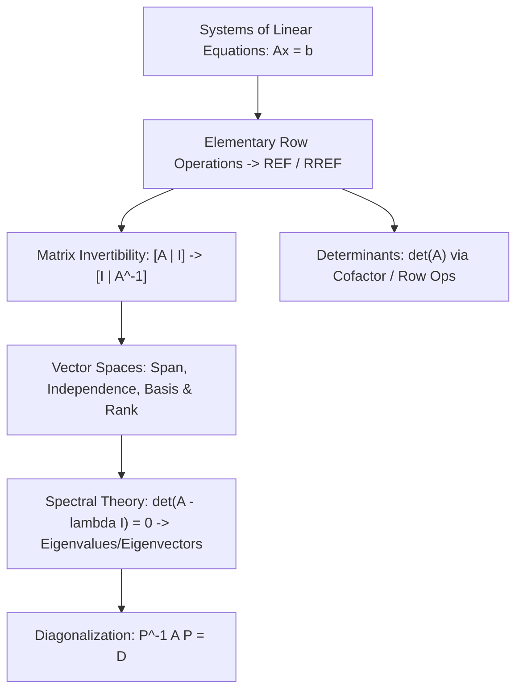
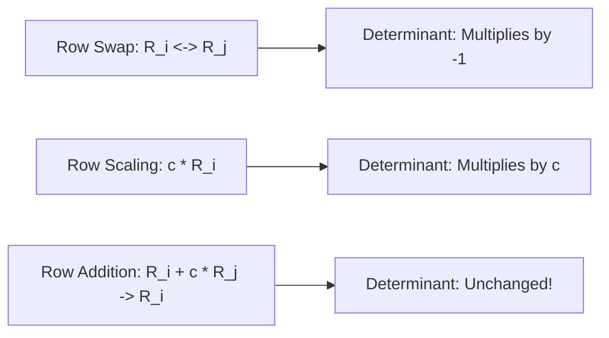

> [!info] Document Metadata
> - **Course:** `=this.course`
> - **Topic:** `=this.topic`
> - **Status:** `=this.status`

**Tags:** #[[Computer Science]] #[[CSMATH2]] #[[Linear Algebra]] #[[Reviewer]] #[[Finals]]

---

# CSMATH2 Comprehensive Finals Reviewer

## Overview

This reviewer consolidates Linear Algebra and Matrix Theory (CSMATH2). Core subjects include systems of linear equations, Gaussian elimination and Gauss-Jordan reduction to Reduced Row Echelon Form (RREF), matrix algebra and inverses, determinants, vector spaces, subspaces, linear independence, basis and dimension, linear transformations, eigenvalues, eigenvectors, and matrix diagonalization.

---

## 1. Master Matrix & Vector Theorem Matrix

| Concept / Theorem | Mathematical Formulation | Invertibility Criteria / Condition |
| :--- | :--- | :--- |
| **System Solutions** | $A \mathbf{x} = \mathbf{b}$ | Unique iff $\text{rank}(A) = \text{rank}([A \mid \mathbf{b}]) = n$; Infinitely many if rank $< n$; Inconsistent if $\text{rank}(A) < \text{rank}([A \mid \mathbf{b}])$. |
| **Matrix Invertibility** | $A A^{-1} = A^{-1} A = I_n$ | $A$ invertible $\iff \det(A) \ne 0 \iff \text{rank}(A) = n \iff \text{Nullity}(A) = 0$. |
| **Determinant Properties** | $\det(A B) = \det(A)\det(B)$ | $\det(A^T) = \det(A)$, $\det(A^{-1}) = \frac{1}{\det(A)}$, $\det(c A) = c^n \det(A)$. |
| **Rank-Nullity Theorem** | $\text{rank}(A) + \text{nullity}(A) = n$ | Where $n$ is the number of columns of $A$. |
| **Characteristic Equation** | $\det(A - \lambda I) = 0$ | Roots $\lambda$ are eigenvalues; $(A - \lambda I)\mathbf{v} = \mathbf{0}$ yields eigenvectors $\mathbf{v} \ne \mathbf{0}$. |
| **Diagonalization** | $P^{-1} A P = D$ | $A$ is diagonalizable $\iff A$ has $n$ linearly independent eigenvectors. |

---

## 2. Row Operations & Determinant Effects

---

## 3. High-Yield Exam Checklist

- [ ] Does $\det(A + B) = \det(A) + \det(B)$? **NO!** (Determinant does not distribute over addition).
- [ ] For a scalar $c$ and $n \times n$ matrix $A$, what is $\det(cA)$? **$c^n \det(A)$**.
- [ ] Is an eigenvector ever allowed to be the zero vector $\mathbf{0}$? **NO**, by definition $\mathbf{v} \ne \mathbf{0}$.
- [ ] How do you find the null space? Solve homogeneous system $A \mathbf{x} = \mathbf{0}$.
- [ ] Can a matrix with distinct eigenvalues always be diagonalized? **YES**, distinct eigenvalues guarantee linearly independent eigenvectors.

---

## 4. Comprehensive Practice Exam

1. If $A$ is a $3 \times 3$ matrix with $\det(A) = 4$, what is $\det(2A)$?
   - A) 8
   - B) 16
   - C) 32
   - D) 64

2. Let $A$ be a $4 \times 7$ matrix. If the dimension of the null space of $A$ is 4, what is the rank of $A$?
   - A) 0
   - B) 3
   - C) 4
   - D) 7

3. For which value of $k$ is the matrix $\begin{bmatrix} 2 & k \\ 4 & 6 \end{bmatrix}$ singular (non-invertible)?
   - A) 1
   - B) 2
   - C) 3
   - D) 4

4. What are the eigenvalues of the matrix $A = \begin{bmatrix} 3 & 1 \\ 0 & 2 \end{bmatrix}$?
   - A) $\lambda = 3$ and $\lambda = 2$
   - B) $\lambda = 5$ and $\lambda = 6$
   - C) $\lambda = 1$ and $\lambda = 3$
   - D) $\lambda = 0$ and $\lambda = 5$

5. Which of the following subsets of $\mathbb{R}^3$ is a valid vector subspace?
   - A) The set of vectors $(x, y, z)$ such that $x + y + z = 1$
   - B) The set of vectors $(x, y, z)$ such that $x y = 0$
   - C) The set of vectors $(x, y, z)$ such that $2x - 3y + z = 0$
   - D) The set of vectors $(x, y, z)$ such that $x^2 + y^2 + z^2 \le 1$

---

### Answer Key & Explanations

1. **C) 32** — For an $n \times n$ matrix, $\det(c A) = c^n \det(A)$. Here $n = 3$, so $\det(2A) = 2^3 \det(A) = 8 \times 4 = 32$.
2. **B) 3** — By the Rank-Nullity Theorem: $\text{rank}(A) + \text{nullity}(A) = n$ (number of columns). Thus, $\text{rank}(A) + 4 = 7 \implies \text{rank}(A) = 3$.
3. **C) 3** — A matrix is singular when its determinant equals zero: $\det(A) = 2(6) - 4(k) = 12 - 4k = 0 \implies k = 3$.
4. **A) $\lambda = 3$ and $\lambda = 2$** — $A$ is an upper triangular matrix. The eigenvalues of an upper or lower triangular matrix are strictly the entries on its main diagonal: 3 and 2.
5. **C) The set of vectors $(x, y, z)$ such that $2x - 3y + z = 0$** — A valid subspace must contain the zero vector $\mathbf{0}$ and be closed under vector addition and scalar multiplication. The homogeneous linear equation $2x - 3y + z = 0$ defines a plane passing through the origin in $\mathbb{R}^3$, satisfying all subspace axioms.

---

## References & Navigation

- **Previous Topic:** [[CSMATH1]]
- **Next Topic:** [[CSMODEL]]
- **Prerequisites:** [[Linear Algebra]], Matrices, Vector Spaces, Eigenvalues
- **Cross-Curricular Connections:** [[CSINTSY]]
