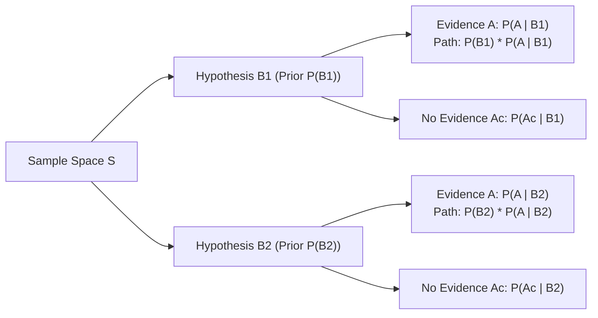

> [!info] Document Metadata
> - **Course:** `=this.course`
> - **Topic:** `=this.topic`
> - **Status:** `=this.status`

**Tags:** #[[Computer Science]] #[[STT101A]] #[[Conceptual]] #[[Bayes's Formula]] #[[Probability]] #[[Statistics]]

---

## Overview

Bayes' Formula (Bayes' Theorem) provides the mathematical mechanism for updating conditional probabilities in light of new observed evidence. It connects the **prior probability** of an underlying cause with the **posterior probability** after an observable consequence occurs, formalizing rational Bayesian inference across machine learning, cybersecurity threat detection, and statistical modeling.

## Key Definitions

- **Prior Probability ($P(B_j)$):** The initial probability of hypothesis or state $B_j$ before observing new evidence.
- **Likelihood ($P(A \mid B_j)$):** The conditional probability that evidence $A$ is observed, assuming hypothesis $B_j$ is true.
- **Marginal Probability / Evidence ($P(A)$):** The total probability of observing evidence $A$ across all mutually exclusive scenarios in the sample space.
- **Posterior Probability ($P(B_j \mid A)$):** The updated probability of hypothesis $B_j$ given that evidence $A$ has actually occurred.
- **Partition of Sample Space:** A collection of mutually exclusive and collectively exhaustive events $\{B_1, B_2, \dots, B_k\}$ such that $B_i \cap B_j = \emptyset$ for $i \ne j$, and $\bigcup_{i=1}^k B_i = S$.

---

## Theoretical Framework: Derivation & Mathematical Formulation

### The Law of Total Probability
For any event $A$ and a partition $\{B_1, B_2, \dots, B_k\}$ of sample space $S$:
$$
P(A) = \sum_{i=1}^k P(A \cap B_i) = \sum_{i=1}^k P(A \mid B_i) P(B_i)
$$

### Bayes' Theorem
By the definition of conditional probability:
$$
P(B_j \mid A) = \frac{P(B_j \cap A)}{P(A)}
$$
Substituting the multiplication rule $P(B_j \cap A) = P(A \mid B_j) P(B_j)$ into the numerator and the Law of Total Probability into the denominator yields:
$$
P(B_j \mid A) = \frac{P(A \mid B_j) P(B_j)}{\sum_{i=1}^k P(A \mid B_i) P(B_i)}
$$

### Probability Tree Model

---

## Stepped Numerical Walkthrough: The Base Rate Fallacy in Threat Detection

**Scenario:** An enterprise Intrusion Detection System (IDS) monitors encrypted network flows for a rare zero-day rootkit.
- **Base Rate (Prior Prevalence):** Only $0.5\%$ of network flows contain the rootkit: $P(R) = 0.005$, so benign traffic is $P(R^c) = 0.995$.
- **True Positive Rate (Sensitivity):** If traffic contains the rootkit, the IDS raises an alert with $99\%$ probability: $P(+ \mid R) = 0.99$.
- **False Positive Rate:** If traffic is benign, the IDS falsely triggers with $2\%$ probability: $P(+ \mid R^c) = 0.02$.

**Objective:** If an incoming packet flow triggers an IDS alarm ($+$), calculate the posterior probability that the packet actually carries the malicious rootkit ($P(R \mid +)$).

### Step 1: Compute Total Probability of an Alarm ($P(+)$)
Using the Law of Total Probability:
$$
P(+) = P(+ \mid R)P(R) + P(+ \mid R^c)P(R^c)
$$
Substitute the known values:
$$
P(+) = (0.99 \times 0.005) + (0.02 \times 0.995)
$$
$$
P(+) = 0.00495 + 0.01990 = \mathbf{0.02485}
$$
*Observation:* Notice that false alarms ($0.01990$) outnumber true alarms ($0.00495$) by a factor of 4!

### Step 2: Apply Bayes' Formula
$$
P(R \mid +) = \frac{P(+ \mid R)P(R)}{P(+)} = \frac{0.00495}{0.02485} \approx \mathbf{0.1992} \quad (19.92\%)
$$

### Step 3: Analytical Insight
Despite an impressive $99\%$ detection sensitivity and a low $2\%$ false positive rate, **an alarm only indicates a $\approx 19.92\%$ chance of an actual breach**.
This counterintuitive result is known as the **Base Rate Fallacy**: because benign traffic is overwhelmingly more common ($99.5\%$) than malicious traffic ($0.5\%$), the sheer volume of benign opportunities generates four times more false positives than true positives.

---

## Multiple Choice Questions

1. In Bayes' Theorem, what does the term $P(A \mid B)$ represent?
    - **A)** The posterior probability of $B$ given $A$.
    - **B)** The likelihood of observing evidence $A$ given that hypothesis $B$ is true.
    - **C)** The marginal prior probability of $A$.
    - **D)** The joint probability of $A$ and $B$ being independent.

2. What role does the Law of Total Probability play in Bayes' Formula?
    - **A)** It computes the prior probability of the hypothesis.
    - **B)** It computes the normalizer in the denominator (marginal probability of the evidence $P(A)$).
    - **C)** It guarantees that all events are independent.
    - **D)** It eliminates false positive errors.

3. Why does the Base Rate Fallacy occur in medical screening or intrusion detection?
    - **A)** Because the test has zero specificity.
    - **B)** Because when a condition is extremely rare in a population, even a low false positive rate produces more false alarms in absolute terms than true detections.
    - **C)** Because Bayes' Theorem is only valid when priors are uniformly distributed ($50/50$).
    - **D)** Because probabilities cannot be updated conditionally.

4. If events $B_1, B_2, B_3$ form a partition of sample space $S$, which condition must strictly hold?
    - **A)** $P(B_1) = P(B_2) = P(B_3) = 1/3$.
    - **B)** The events are pairwise disjoint ($B_i \cap B_j = \emptyset$ for $i \ne j$) and their union equals $S$ ($\sum P(B_i) = 1$).
    - **C)** $B_1 \cup B_2 \cup B_3 = \emptyset$.
    - **D)** Each event is independent of any test $A$.

5. In our IDS example, what was the probability that a randomly chosen flow triggered an alarm ($P(+)$)?
    - **A)** $0.99$
    - **B)** $0.005$
    - **C)** $0.02485$
    - **D)** $0.1992$

6. If the prior probability of hypothesis $B$ is $0.10$, likelihood $P(A \mid B) = 0.80$, and total evidence probability $P(A) = 0.20$, what is the posterior $P(B \mid A)$?
    - **A)** $0.08$
    - **B)** $0.40$
    - **C)** $0.16$
    - **D)** $0.50$

7. What happens to the posterior probability $P(B \mid A)$ if the prior probability $P(B) \to 0$ while likelihood and evidence remain non-zero?
    - **A)** The posterior probability approaches $1$.
    - **B)** The posterior probability approaches $0$.
    - **C)** The posterior probability approaches $0.5$.
    - **D)** The posterior probability becomes undefined.

8. In Bayesian statistics, how is sequential updating performed when a second independent piece of evidence $A_2$ arrives?
    - **A)** The initial prior $P(B)$ is discarded and replaced with $1$.
    - **B)** The posterior probability after $A_1$, $P(B \mid A_1)$, becomes the new prior probability for evaluating $A_2$.
    - **C)** The experiment must be restarted from scratch.
    - **D)** The probabilities are subtracted from 1.

9. What does a likelihood ratio of $P(A \mid B) / P(A \mid B^c) > 1$ indicate?
    - **A)** Evidence $A$ is more likely under hypothesis $B$ than under its negation, increasing the posterior probability of $B$ relative to its prior.
    - **B)** Hypothesis $B$ is impossible.
    - **C)** The evidence decreases confidence in hypothesis $B$.
    - **D)** The test is completely uninformative.

10. Which branch of artificial intelligence directly implements Bayes' Formula with conditional independence assumptions between features?
    - **A)** Convolutional Neural Networks
    - **B)** Naïve Bayes Classifier
    - **C)** K-Means Clustering
    - **D)** Breadth-First Search

---

### Answer Key & Explanations

1. **B** - $P(A \mid B)$ is the likelihood function: the probability of generating data $A$ given parameter state $B$.
2. **B** - The denominator $\sum P(A \mid B_i)P(B_i)$ sums all disjoint paths leading to evidence $A$, serving as the normalizing constant.
3. **B** - Low base rates mean the non-target group is vast; multiplying a small false-positive rate by a massive population yields an absolute count that dominates true positives.
4. **B** - A partition divides the sample space into non-overlapping subsets whose probabilities sum to 1.
5. **C** - Total probability of an alarm: $P(+) = (0.99)(0.005) + (0.02)(0.995) = 0.00495 + 0.01990 = 0.02485$.
6. **B** - $P(B \mid A) = \frac{P(A \mid B)P(B)}{P(A)} = \frac{0.80 \times 0.10}{0.20} = \frac{0.08}{0.20} = 0.40$.
7. **B** - When prior belief is virtually impossible ($P(B) \to 0$), extraordinarily strong evidence is required to lift the posterior above zero.
8. **B** - In Bayesian filtering and tracking (e.g., Kalman filters, spam classifiers), today's posterior is tomorrow's prior.
9. **A** - A likelihood ratio greater than 1 means the observed outcome is characteristic of hypothesis $B$, boosting its posterior credibility.
10. **B** - The Naïve Bayes algorithm applies Bayes' theorem under the simplifying assumption that feature dimensions are conditionally independent given the class label.

---

## References & Navigation

- **Previous Topic:** [[Hypothesis Testing]]
- **Next Topic:** [[Random Variable]]
- **Related Notes:** [[Total Probability Rule]], [[Conditional Probability and Multiplicative Rules]]
