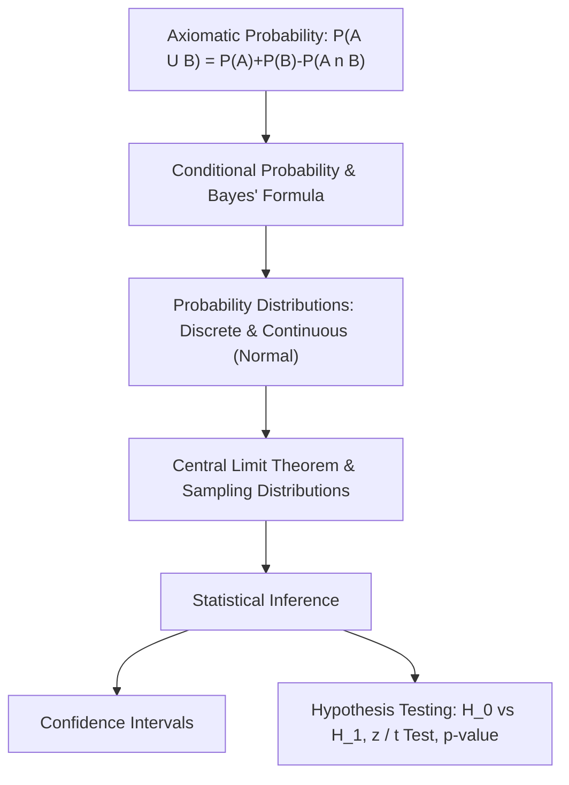
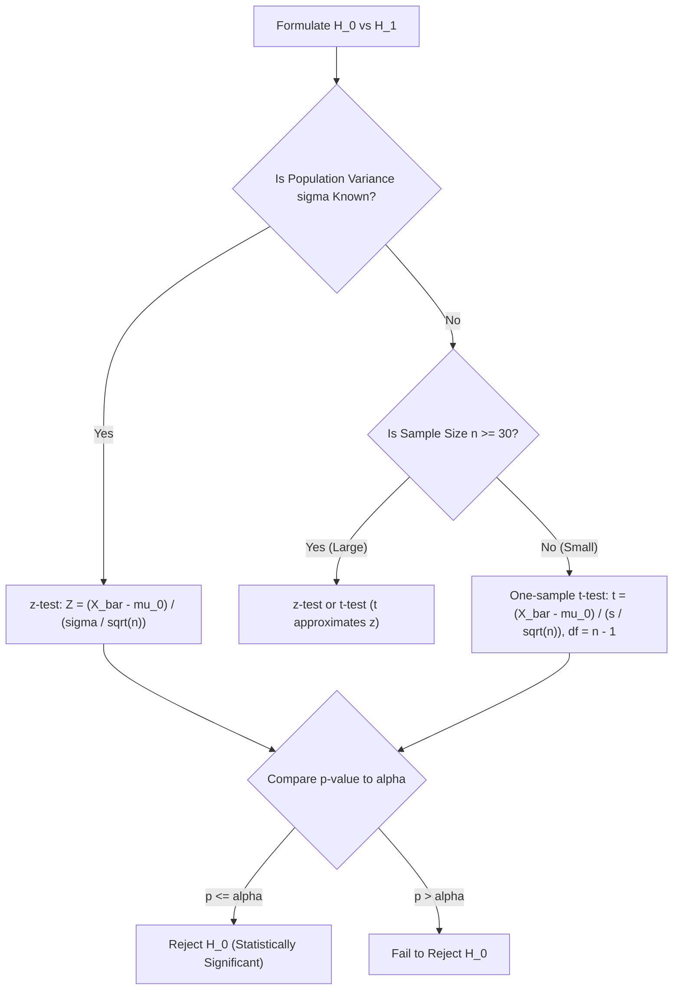

> [!info] Document Metadata
> - **Course:** `=this.course`
> - **Topic:** `=this.topic`
> - **Status:** `=this.status`

**Tags:** #[[Computer Science]] #[[STT101A]] #[[Probability and Statistics]] #[[Reviewer]] #[[Finals]]

---

# STT101A Comprehensive Finals Reviewer

## Overview

This reviewer consolidates Foundations of Probability and Statistical Inference (STT101A). Core areas include sample spaces, combinatorial counting, probability axioms, conditional probability, Law of Total Probability, Bayes' Formula, discrete random variables (Binomial, Poisson, Geometric), continuous random variables (Normal, Exponential), Central Limit Theorem, confidence intervals, and hypothesis testing ($z$-test vs $t$-test, Type I and II errors, $p$-values).

---

## 1. Master Formula & Distribution Matrix

| Distribution / Formula | PDF / PMF $P(X = x)$ | Mean $E[X]$ | Variance $\text{Var}(X)$ | Notes / Conditions |
| :--- | :--- | :--- | :--- | :--- |
| **Binomial** $B(n, p)$ | $\binom{n}{x} p^x (1-p)^{n-x}$ | $n p$ | $n p (1-p)$ | $n$ independent Bernoulli trials with probability $p$ |
| **Poisson** $\text{Pois}(\lambda)$ | $\frac{e^{-\lambda} \lambda^x}{x!}$ | $\lambda$ | $\lambda$ | Rare events in continuous interval |
| **Normal** $N(\mu, \sigma^2)$ | $\frac{1}{\sigma\sqrt{2\pi}} e^{-\frac{(x-\mu)^2}{2\sigma^2}}$ | $\mu$ | $\sigma^2$ | Standard normal $Z = \frac{X - \mu}{\sigma} \sim N(0, 1)$ |
| **Bayes' Formula** | $P(A_i \mid B) = \frac{P(B \mid A_i) P(A_i)}{\sum_{j} P(B \mid A_j) P(A_j)}$ | N/A | N/A | Updates prior $P(A_i)$ to posterior $P(A_i \mid B)$ |
| **Sample Mean Distribution** | $\bar{X} \sim N\left(\mu, \frac{\sigma^2}{n}\right)$ | $\mu$ | $\frac{\sigma^2}{n}$ | Standard Error $SE = \frac{\sigma}{\sqrt{n}}$ (Central Limit Theorem) |

---

## 2. Hypothesis Testing Decision Matrix

### Type I vs Type II Errors
- **Type I Error ($\alpha$)**: Rejecting $H_0$ when $H_0$ is actually true (False Positive).
- **Type II Error ($\beta$)**: Failing to reject $H_0$ when $H_0$ is false (False Negative).
- **Statistical Power**: $1 - \beta$ (Probability of correctly rejecting a false null hypothesis).

---

## 3. High-Yield Exam Checklist

- [ ] When using $t$-test, did you use degrees of freedom $df = n - 1$?
- [ ] For a two-tailed test at significance level $\alpha = 0.05$, is the critical region in each tail $\alpha / 2 = 0.025$? **YES** ($Z_{crit} = \pm 1.96$).
- [ ] Did you remember: If $p$-value $\le \alpha$, reject $H_0$ ("If $p$ is low, $H_0$ must go")?
- [ ] Does independent events imply mutually exclusive events? **NO!** If $P(A) > 0, P(B) > 0$, independent events can never be mutually exclusive.

---

## Multiple Choice Questions

1. A bag contains 4 red and 6 black marbles. If two marbles are drawn without replacement, what is the probability that both are red?
    - **A)** $4/25$
    - **B)** $2/15$
    - **C)** $4/15$
    - **D)** $1/3$

2. Suppose $P(A) = 0.3, P(B) = 0.4$, and $A$ and $B$ are independent events. What is $P(A \cup B)$?
    - **A)** 0.70
    - **B)** 0.58
    - **C)** 0.12
    - **D)** 0.82

3. An intrusion detection system flags true attacks 95% of the time ($P(T \mid A) = 0.95$), but has a 2% false alarm rate ($P(T \mid A^c) = 0.02$). If true attacks represent 1% of all traffic ($P(A) = 0.01$), what is the probability that a flagged packet is an actual attack $P(A \mid T)$?
    - **A)** 95.0%
    - **B)** 32.4%
    - **C)** 50.0%
    - **D)** 67.8%

4. A random sample of $n = 64$ items has sample mean $\bar{x} = 52$. If the population standard deviation is $\sigma = 16$, what is the 95% confidence interval for the population mean $\mu$ ($Z_{0.025} = 1.96$)?
    - **A)** $52 \pm 3.92$
    - **B)** $52 \pm 1.96$
    - **C)** $52 \pm 0.49$
    - **D)** $52 \pm 7.84$

5. In hypothesis testing, what is the probability of committing a Type I error?
    - **A)** $\beta$
    - **B)** $1 - \beta$
    - **C)** $\alpha$
    - **D)** $1 - \alpha$

### Answer Key & Explanations

1. **B**. $P(R_1) = 4/10 = 2/5$. Given the first is red, 3 red remain out of 9: $P(R_2 \mid R_1) = 3/9 = 1/3$. $P(R_1 \cap R_2) = (2/5) \times (1/3) = 2/15$.
2. **B**. For independent events, $P(A \cap B) = P(A)P(B) = 0.3 \times 0.4 = 0.12$. By the additive rule: $P(A \cup B) = P(A) + P(B) - P(A \cap B) = 0.3 + 0.4 - 0.12 = 0.58$.
3. **B**. By Bayes' Theorem: $P(A \mid T) = \frac{P(T \mid A) P(A)}{P(T \mid A) P(A) + P(T \mid A^c) P(A^c)} = \frac{0.95 \times 0.01}{(0.95 \times 0.01) + (0.02 \times 0.99)} = \frac{0.0095}{0.0095 + 0.0198} = \frac{0.0095}{0.0293} \approx 0.3242$ (32.4%). (The Base Rate Fallacy!).
4. **A**. Margin of error is $Z_{\alpha/2} \frac{\sigma}{\sqrt{n}} = 1.96 \times \frac{16}{\sqrt{64}} = 1.96 \times 2 = 3.92$. Interval is $[48.08, 55.92]$.
5. **C**. The significance level $\alpha$ is by definition the maximum allowable probability of committing a Type I error (rejecting a true $H_0$).

## References & Navigation

- **Previous Topic:** [[CSMATH1]]
- **Next Topic:** [[CSMODEL]]
- **Prerequisites:** [[Probability and Statistics]], Bayes, Distributions, Hypothesis Testing
- **Cross-Curricular Connections:** [[CSINTSY]]
