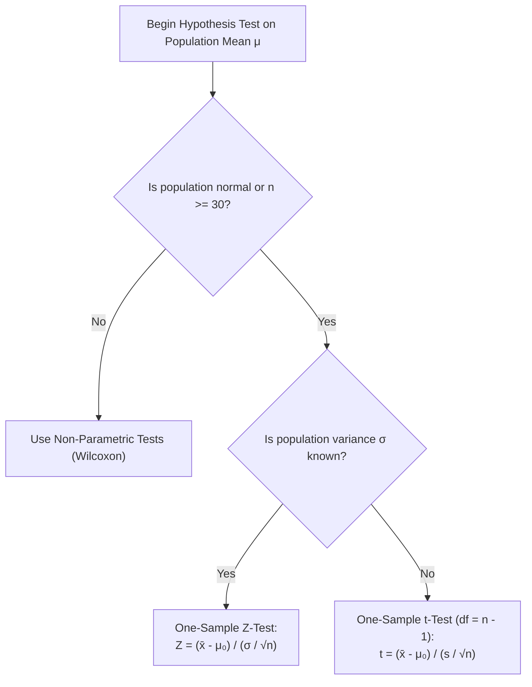

> [!info] Document Metadata
> - **Course:** `=this.course`
> - **Topic:** `=this.topic`
> - **Status:** `=this.status`

**Tags:** #[[Computer Science]] #[[STT101A]] #[[Conceptual]] #[[Hypothesis Testing]] #[[Statistics]] #[[Probability]]

---

## Overview

Hypothesis testing is the cornerstone of inferential statistics. It provides a formal, objective mathematical framework for determining whether experimental or sample data provides sufficient empirical evidence to reject a baseline assertion (the null hypothesis) in favor of a competing claim (the alternative hypothesis).

## Key Definitions

- **Null Hypothesis ($H_0$):** The default presumption of no effect, no difference, or status quo: $H_0: \theta = \theta_0$.
- **Alternative Hypothesis ($H_1$ or $H_a$):** The research claim or hypothesis indicating that an effect, disparity, or change exists:
  - Two-tailed: $H_a: \theta \ne \theta_0$
  - Right-tailed (upper): $H_a: \theta > \theta_0$
  - Left-tailed (lower): $H_a: \theta < \theta_0$
- **Test Statistic:** A sample-derived standardized random variable ($Z$, $t$, $\chi^2$, or $F$) quantifying the discrepancy between the sample observation and the null hypothesis parameter.
- **Significance Level ($\alpha$):** The maximum permissible threshold probability of committing a **Type I error**: $\alpha = P(\text{Reject } H_0 \mid H_0 \text{ is true})$. Typically set to $0.05$, $0.01$, or $0.001$.
- **$p$-Value (Probability Value):** The exact probability, computed assuming $H_0$ is true, of obtaining a test statistic at least as extreme as the observed sample value.
  - Decision Rule: If $p \le \alpha$, reject $H_0$ (statistically significant).
  - If $p > \alpha$, fail to reject $H_0$ (insufficient evidence).
- **Critical Region (Rejection Region):** The set of test statistic values for which the null hypothesis is rejected.
- **Statistical Power ($1 - \beta$):** The probability of correctly rejecting a false null hypothesis: $P(\text{Reject } H_0 \mid H_0 \text{ is false})$.

---

## Theoretical Framework: Error Classification Matrix

In any statistical hypothesis test, two distinct error states can occur:

| Statistical Decision \ Truth of Nature | $H_0$ is Actually True | $H_0$ is Actually False |
| :--- | :--- | :--- |
| **Reject $H_0$** | **Type I Error ($\alpha$)** *(False Alarm / Producer's Risk)* | **Correct Decision ($1 - \beta$)** *(Statistical Power)* |
| **Fail to Reject $H_0$** | **Correct Decision ($1 - \alpha$)** *(Confidence Level)* | **Type II Error ($\beta$)** *(Miss / Consumer's Risk)* |

### Test Statistic Selection Heuristic

---

## Stepped Numerical Walkthrough: Two-Tailed $Z$-Test

**Scenario:** A cloud infrastructure engineer tests the round-trip latency of a modified database cluster. Under the default configuration, latency has a mean of $\mu_0 = 250\text{ ms}$ with a known population standard deviation $\sigma = 32\text{ ms}$. A random sample of $n = 64$ query responses under heavy load yields a sample mean latency of $\bar{x} = 258\text{ ms}$. Test at the $\alpha = 0.05$ significance level whether the true mean latency has changed.

### Step 1: Formulate Hypotheses
$$
H_0: \mu = 250\text{ ms} \quad (\text{No change in latency})
$$
$$
H_a: \mu \ne 250\text{ ms} \quad (\text{Two-tailed test: latency differs})
$$

### Step 2: Establish Significance Level & Critical Values
Given $\alpha = 0.05$ for a two-tailed test, the significance area is split equally into both tails: $\alpha / 2 = 0.025$.
From the standard normal cumulative table ($Z \sim \mathcal{N}(0, 1)$):
$$
z_{\alpha/2} = z_{0.025} = 1.960
$$
Rejection Region: Reject $H_0$ if $Z_{\text{calc}} > 1.960$ or $Z_{\text{calc}} < -1.960$ (i.e., $|Z_{\text{calc}}| > 1.960$).

### Step 3: Compute Standard Error & Test Statistic
Standard Error of the Mean:
$$
\sigma_{\bar{x}} = \frac{\sigma}{\sqrt{n}} = \frac{32}{\sqrt{64}} = \frac{32}{8} = 4.0\text{ ms}
$$
Standardized Test Statistic ($Z_{\text{calc}}$):
$$
Z_{\text{calc}} = \frac{\bar{x} - \mu_0}{\sigma_{\bar{x}}} = \frac{258 - 250}{4.0} = \frac{8}{4.0} = \mathbf{+2.00}
$$

### Step 4: Compute the Exact $p$-Value
For a two-tailed test:
$$
p = 2 \cdot P(Z \ge |Z_{\text{calc}}|) = 2 \cdot P(Z \ge 2.00)
$$
Using the standard normal CDF: $P(Z < 2.00) = 0.97725$, so $P(Z \ge 2.00) = 1 - 0.97725 = 0.02275$.
$$
p = 2 \times 0.02275 = \mathbf{0.0455}
$$

### Step 5: Statistical & Practical Conclusion
- **Comparison:** $p = 0.0455 \le \alpha = 0.05$, and $|Z_{\text{calc}}| = 2.00 > 1.960$.
- **Formal Decision:** **Reject $H_0$** at the $5\%$ significance level.
- **Engineering Conclusion:** There is sufficient empirical evidence to conclude that the database modification resulted in a statistically significant change in mean query response time.

---

## Multiple Choice Questions

1. Which probability represents a Type I error ($\alpha$)?
- **A)** The probability of failing to reject $H_0$ when $H_0$ is true.
- **B)** The probability of rejecting $H_0$ when $H_0$ is true.
- **C)** The probability of rejecting $H_0$ when $H_0$ is false.
- **D)** The probability of failing to reject $H_0$ when $H_0$ is false.

2. What is the statistical power of a hypothesis test?
- **A)** $1 - \alpha$
- **B)** $\alpha / \beta$
- **C)** $1 - \beta$
- **D)** $\beta$

3. If a test produces a $p$-value of $0.018$ and the chosen significance level is $\alpha = 0.05$, what is the correct statistical decision?
- **A)** Fail to reject $H_0$ because $p < \alpha$.
- **B)** Reject $H_0$ because $p \le \alpha$.
- **C)** Accept $H_0$ as definitively proven.
- **D)** Change $\alpha$ to $0.01$ to force non-rejection.

4. What distinguishes a $t$-test from a $z$-test when testing a single population mean?
- **A)** A $t$-test is used when population standard deviation $\sigma$ is unknown and estimated by sample standard deviation $s$.
- **B)** A $z$-test requires $n < 30$, whereas a $t$-test requires $n \ge 100$.
- **C)** A $t$-test can only be one-tailed.
- **D)** A $t$-test assumes a uniform distribution.

5. When performing a two-tailed test with $\alpha = 0.01$, what is the tail probability in each rejection region?
- **A)** $0.01$
- **B)** $0.02$
- **C)** $0.005$
- **D)** $0.05$

6. Why do statisticians state "fail to reject $H_0$" rather than "accept $H_0$"?
- **A)** Because sample data can fail to disprove the null, but cannot definitively prove the absence of an effect.
- **B)** Because $H_0$ is always false in practice.
- **C)** Because the test statistic is always positive.
- **D)** Because Type I errors cannot be quantified.

7. How does increasing the sample size $n$ affect the standard error and test sensitivity, holding variance constant?
- **A)** Increases standard error, decreasing statistical power.
- **B)** Decreases standard error ($\sigma / \sqrt{n}$), increasing statistical power ($1 - \beta$).
- **C)** Increases $\alpha$, leading to more Type I errors.
- **D)** Has no effect on test sensitivity.

8. In our worked latency example with $Z = 2.00$, what would the conclusion have been if the test had been set at $\alpha = 0.01$ ($z_{\text{crit}} = \pm 2.576$)?
- **A)** Reject $H_0$ because $2.00 > 0.01$.
- **B)** Fail to reject $H_0$ because $Z_{\text{calc}} = 2.00 < 2.576$ (and $p = 0.0455 > 0.01$).
- **C)** The test becomes invalid.
- **D)** The sample mean becomes negative.

9. What is the degrees of freedom ($df$) for a single-sample $t$-test with sample size $n = 25$?
- **A)** $25$
- **B)** $24$
- **C)** $23$
- **D)** $26$

10. If the null hypothesis is rejected at $\alpha = 0.01$, what is guaranteed about its outcome at $\alpha = 0.05$?
- **A)** It will also be rejected at $\alpha = 0.05$, because any $p \le 0.01$ is strictly less than $0.05$.
- **B)** It will fail to be rejected at $\alpha = 0.05$.
- **C)** The test is inconclusive at $\alpha = 0.05$.
- **D)** The power of the test drops to zero.

---

### Answer Key & Explanations

1. **B** - A Type I error occurs when a true null hypothesis is erroneously rejected (a false alarm).
2. **C** - Statistical power is $1 - \beta$, denoting the test's ability to detect an effect when one genuinely exists.
3. **B** - The standard decision rule is: when $p \le \alpha$, reject $H_0$.
4. **A** - The Student's $t$-distribution accounts for the additional sampling uncertainty introduced by estimating $\sigma$ using $s$.
5. **C** - In a two-tailed test, the total error budget $\alpha$ is divided equally between the two tails ($\alpha / 2 = 0.01 / 2 = 0.005$).
6. **A** - Absence of sufficient evidence to reject does not establish proof of the null hypothesis; it merely indicates consistency with the null.
7. **B** - Because $\sigma_{\bar{x}} = \sigma / \sqrt{n}$, larger sample sizes narrow the standard error, decreasing $\beta$ and increasing test power.
8. **B** - At $\alpha = 0.01$, the critical boundary is $\pm 2.576$; since $2.00 < 2.576$, the data is not significant at the $1\%$ level.
9. **B** - For a single-sample mean $t$-test, $df = n - 1 = 25 - 1 = 24$.
10. **A** - Since $p \le 0.01 \implies p < 0.05$, any test rejected at a stricter significance level is automatically rejected at a more lenient one.

---

## References & Navigation

- **Previous Topic:** [[Normal Distribution]]
- **Next Topic:** [[Bayes's Formula]]
- **Related Notes:** [[Discrete Probability Distribution]], [[Random Variables]]
