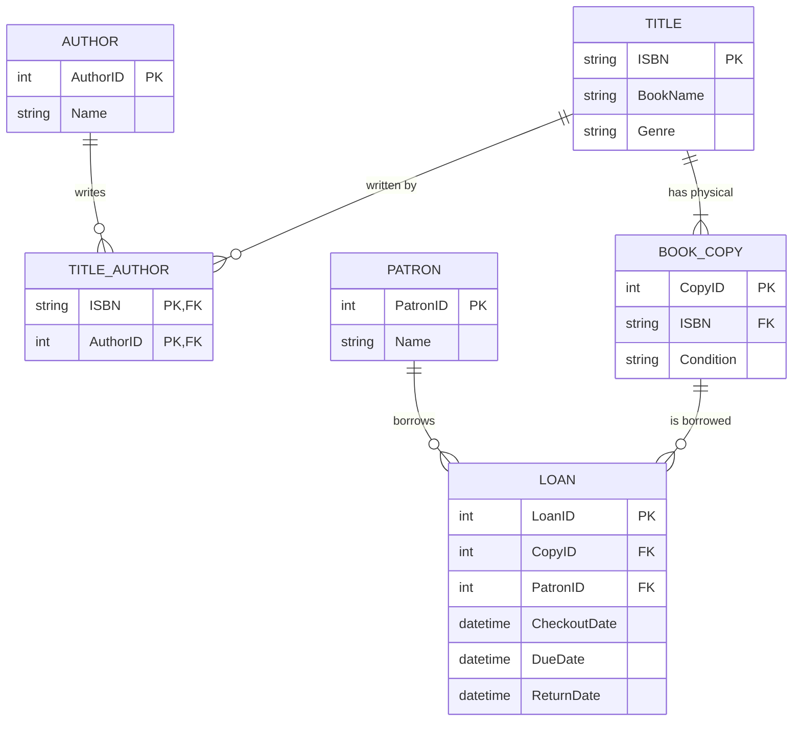
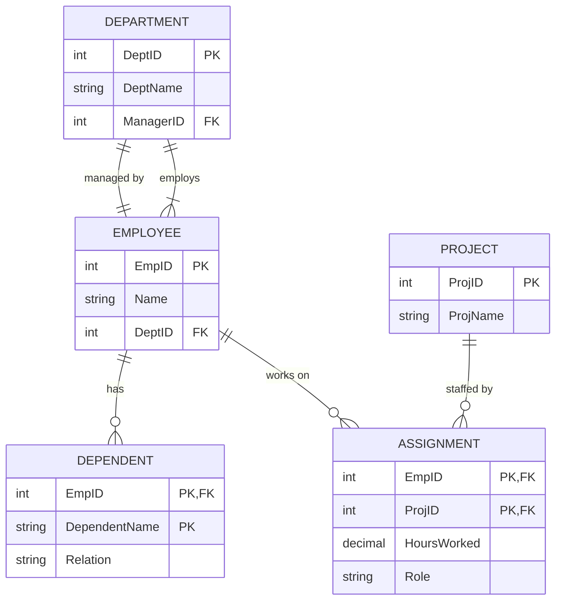
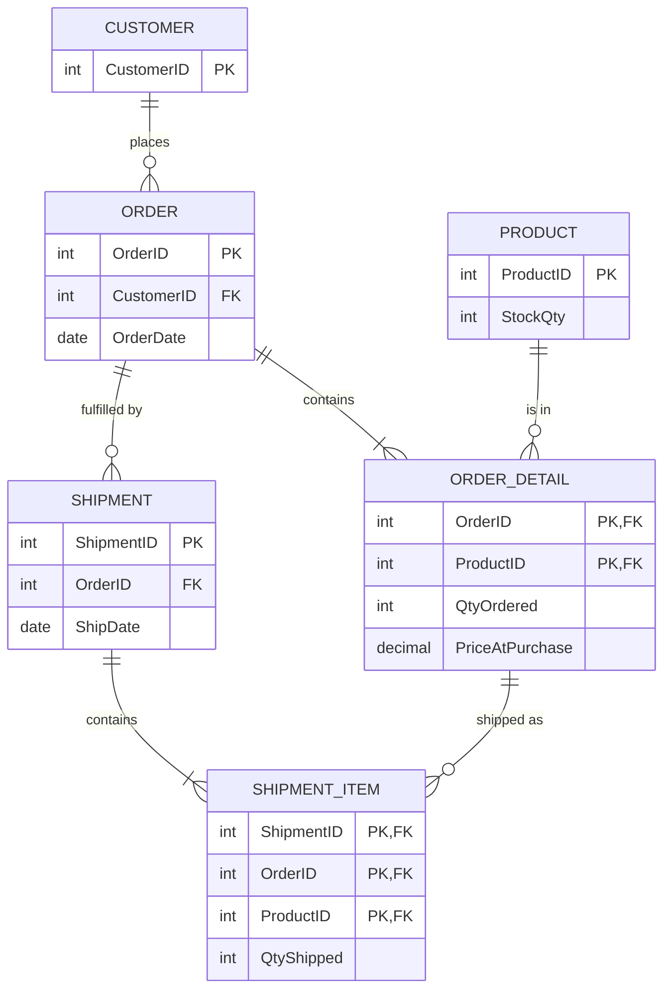
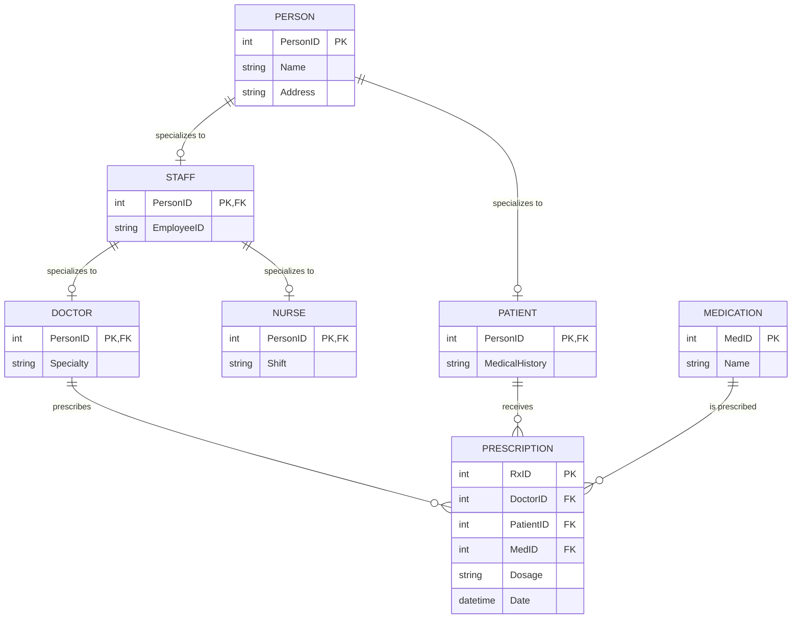

# DB-Design-Finals-Answers

> [!info] Document Metadata
> - **Course:** `=this.course`
> - **Topic:** `=this.topic`
> - **Status:** `=this.status`

**Tags:** #[[CCINFOM]] #[[Data Modeling]] #[[Information Structures]] #[[Computer Science]] #[[Databases]] #[[SQL]]

---

## Overview

> Subject: Relational Database Design & ERD Modeling

## Details / Theory

# DB Design Finals Mock Exam - ANSWERS

**Subject:** Relational Database Design & ERD Modeling

> Visual ERDs are rendered natively below using interactive Mermaid entity-relationship diagrams.

---

## Answer 1: The Public Library

**Logic:**
 **Title vs. Copy:** This is a classic design pattern. `Title` holds the metadata (Name, ISBN). `Copy` holds the physical item data (Barcode, Condition). One Title has Many Copies. **Authors:** M:N relationship with Titles. Requires `Title_Author` junction table. **Loans:** A Patron borrows a _Copy_, not a Title. This is a M:N relationship between Patron and Copy. Since we need history, we keep all records.

**Entity-Relationship Diagram:**

---

## Answer 2: Employee Project Management

**Logic:**
 **Department Manager:** This is a 1:1 relationship between Employee and Department (one employee manages one dept). But also a 1:M (one dept has many employees). These are _two separate relationships_ between the same two tables. **Dependents:** A **Weak Entity**. It relies on `Employee` for existence. Its PK is usually `(EmpID, DependentName)`. **Assignments:** M:N between Employee and Project. The `HoursWorked` and `Role` are attributes of this relationship.

**Entity-Relationship Diagram:**

---

## Answer 3: E-Commerce with Split Shipments

**Logic:**
 **The Trap:** You might try to link `Shipment` directly to `Product`. But you need to know _which specific order line_ is being shipped to track if an order is fully fulfilled. **The Solution:** `Shipment` is a child of `Order`. `ShipmentItem` is a child of `Shipment` AND links to `Product` (or `OrderDetail`). **Best Practice:** Link `ShipmentItem` to `OrderDetail`. This ensures you can't ship an item that wasn't ordered.

**Entity-Relationship Diagram:**

---

## Answer 4: University Hospital System (Expert)

**Logic:**
 **Inheritance (Supertype/Subtype):** `Person` is the Supertype. `Staff` and `Patient` are Subtypes. `Staff` is also a Supertype for `Doctor` and `Nurse`.
 **Implementation:** The Subtypes share the same Primary Key as the Supertype (1:1 relationship).
 **Ternary Relationship:** A prescription involves a Doctor, a Patient, and a Drug. We model this as an **Associative Entity** (`Prescription`) with three Foreign Keys.

**Entity-Relationship Diagram:**

## Common Pitfalls
 Comparing your ERD structure without checking cardinality and participation constraints. Overlooking the Title vs. Copy distinction in the library scenario — one Title can have many Copies. Forgetting ShipmentItem as a junction entity in the e-commerce split-shipment design.

## Summary

> TL;DR — PlantUML ERD solutions for the four DB-Design mock problems, showing correct entity identification, junction tables, cardinality/participation, and EER inheritance patterns.

## References & Navigation

- **Related Notes:** [[Modeling Data]], [[Enhanced ER Model and Transformation]], [[Relational Model and Normalization]]
