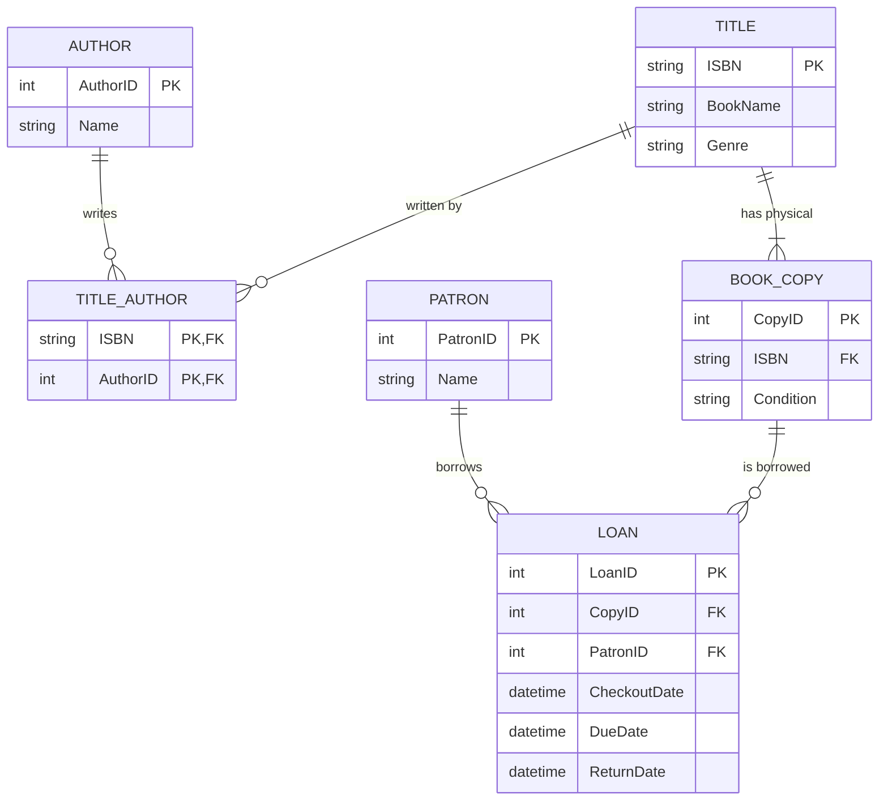
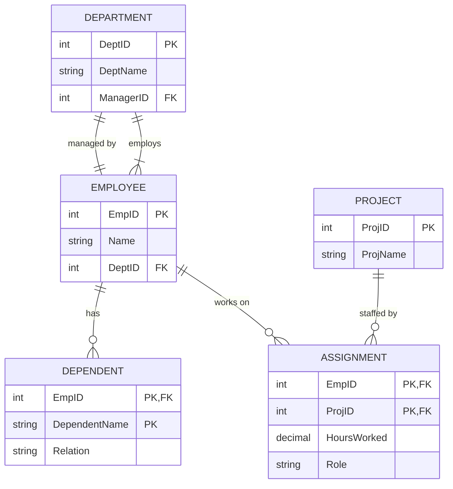
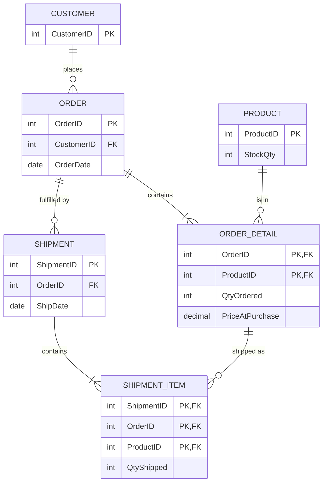
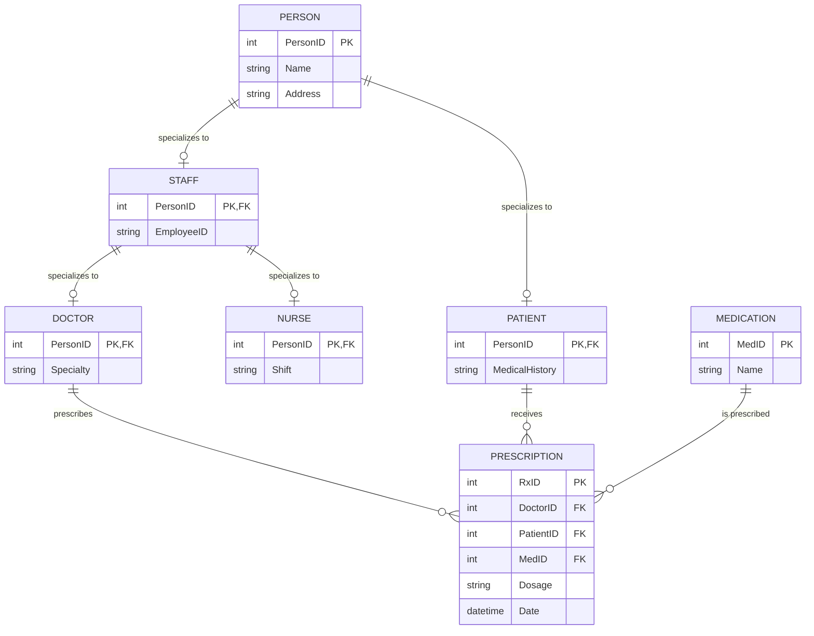

# DB-Design-Finals-Answers

> [!info] Document Metadata
> - **Course:** `=this.course`
> - **Topic:** `=this.topic`
> - **Status:** `=this.status`

**Tags:** #[[CCINFOM]] #[[Data Modeling]] #[[Information Structures]] #[[Computer Science]] #[[Databases]] #[[SQL]]

---

## Overview

> Subject: Relational Database Design & ERD Modeling

## Details / Theory

# DB Design Finals Mock Exam - ANSWERS

**Subject:** Relational Database Design & ERD Modeling

> Visual ERDs are rendered natively below using interactive Mermaid entity-relationship diagrams.

---

## Answer 1: The Public Library

**Logic:**
 **Title vs. Copy:** This is a classic design pattern. `Title` holds the metadata (Name, ISBN). `Copy` holds the physical item data (Barcode, Condition). One Title has Many Copies. **Authors:** M:N relationship with Titles. Requires `Title_Author` junction table. **Loans:** A Patron borrows a _Copy_, not a Title. This is a M:N relationship between Patron and Copy. Since we need history, we keep all records.

**Entity-Relationship Diagram:**

---

## Answer 2: Employee Project Management

**Logic:**
 **Department Manager:** This is a 1:1 relationship between Employee and Department (one employee manages one dept). But also a 1:M (one dept has many employees). These are _two separate relationships_ between the same two tables. **Dependents:** A **Weak Entity**. It relies on `Employee` for existence. Its PK is usually `(EmpID, DependentName)`. **Assignments:** M:N between Employee and Project. The `HoursWorked` and `Role` are attributes of this relationship.

**Entity-Relationship Diagram:**

---

## Answer 3: E-Commerce with Split Shipments

**Logic:**
 **The Trap:** You might try to link `Shipment` directly to `Product`. But you need to know _which specific order line_ is being shipped to track if an order is fully fulfilled. **The Solution:** `Shipment` is a child of `Order`. `ShipmentItem` is a child of `Shipment` AND links to `Product` (or `OrderDetail`). **Best Practice:** Link `ShipmentItem` to `OrderDetail`. This ensures you can't ship an item that wasn't ordered.

**Entity-Relationship Diagram:**

---

## Answer 4: University Hospital System (Expert)

**Logic:**
 **Inheritance (Supertype/Subtype):** `Person` is the Supertype. `Staff` and `Patient` are Subtypes. `Staff` is also a Supertype for `Doctor` and `Nurse`.
 **Implementation:** The Subtypes share the same Primary Key as the Supertype (1:1 relationship).
 **Ternary Relationship:** A prescription involves a Doctor, a Patient, and a Drug. We model this as an **Associative Entity** (`Prescription`) with three Foreign Keys.

**Entity-Relationship Diagram:**

## Common Pitfalls
 Comparing your ERD structure without checking cardinality and participation constraints. Overlooking the Title vs. Copy distinction in the library scenario — one Title can have many Copies. Forgetting ShipmentItem as a junction entity in the e-commerce split-shipment design.

## Summary

> TL;DR — PlantUML ERD solutions for the four DB-Design mock problems, showing correct entity identification, junction tables, cardinality/participation, and EER inheritance patterns.

## Multiple Choice Questions

1. In the library database design scenario, why is it critical to model `Title` and `Copy` as separate entities rather than storing copies as an integer quantity column inside `Title`?
    - **A)** Because SQL databases do not permit integer arithmetic on inventory counts.
    - **B)** Because individual copies possess distinct physical attributes (e.g., unique barcode, physical wear/condition, individual loan histories) that cannot be modeled as an aggregate count without losing transactional fidelity.
    - **C)** Because a title cannot have a Many-to-Many relationship with authors if it stores physical copies.
    - **D)** Because normalizing to Third Normal Form (3NF) requires all numeric quantities to be stored in child tables.

2. When modeling an e-commerce order fulfillment system that allows split shipments across multiple dates, which entity relationship structure correctly resolves the fulfillment tracking?
    - **A)** A `ShipmentItem` bridge entity acting as a junction between `Shipment` and `OrderItem`, storing the quantity fulfilled per parcel.
    - **B)** A direct Many-to-Many relationship between `Customer` and `TrackingNumber`.
    - **C)** A 1:1 relationship between `Order` and `Shipment`.
    - **D)** An embedded array column of shipment IDs within each `Product` record.

3. In the hospital prescription model linking `Doctor`, `Patient`, and `Medication`, why is `Prescription` represented as a ternary association rather than two independent binary relationships (`Doctor-Patient` and `Patient-Medication`)?
    - **A)** Because a doctor cannot write a prescription without a nurse present.
    - **B)** Because relational databases forbid foreign keys from referencing more than two parent tables.
    - **C)** Because independent binary relationships cannot capture the unique semantic fact that Doctor $D$ prescribed Medication $M$ specifically to Patient $P$ during a single clinical encounter.
    - **D)** Because ternary relationships automatically eliminate all transitive dependencies required for BCNF.

4. In Extended Entity-Relationship (EER) modeling, what is the meaning of a disjointness constraint ($d$) applied to the specialization of `Person` into `Staff` and `Patient`?
    - **A)** An instance of `Person` must belong to both subclasses simultaneously.
    - **B)** Every `Staff` member must supervise at least one `Patient`.
    - **C)** The primary key of `Person` must differ from the primary keys of its subclasses.
    - **D)** An instance of `Person` may belong to at most one of the subclasses (`Staff` or `Patient`), precluding overlapping membership.

5. In database normalization, if a composite primary key $(StudentID, CourseCode)$ determines $Grade$, but $CourseCode$ independently determines $DepartmentName$, what normal form violation exists and how is it resolved?
    - **A)** 1NF violation; resolved by removing repeating groups.
    - **B)** 2NF violation (partial dependency); resolved by decomposing $CourseCode \rightarrow DepartmentName$ into a distinct `Course` relation.
    - **C)** 3NF violation (transitive dependency); resolved by adding a surrogate key.
    - **D)** BCNF violation; resolved by merging all attributes into a single denormalized table.

### Answer Key & Explanations

1. **B**. Each physical copy is a unique asset with its own identity (barcode, location shelf, damage state) and participates independently in `Loan` transactions. (A) is false as SQL easily handles integers, and (D) is a common misconception about 3NF.
2. **A**. A single order item (e.g., 5 units of RAM) may be split across multiple parcels, and a single shipment may combine multiple order items. `ShipmentItem` is the junction entity that records `(ShipmentID, OrderItemID, QuantityShipped)`.
3. **C**. Two binary relationships would record that Dr. Smith treats Patient Alice, and Alice takes Penicillin, but fails to assert whether Dr. Smith (rather than another physician) authorized that specific medication. The ternary relationship preserves the exact clinical triad.
4. **D**. The disjoint constraint ($d$) enforces mutual exclusivity among subclasses. The alternative—overlapping ($o$)—would allow a person to be simultaneously a hospital employee and a patient receiving treatment.
5. **B**. Second Normal Form (2NF) requires that no non-prime attribute ($DepartmentName$) be partially functionally dependent on a subset of any candidate key ($CourseCode$). Decomposing this into `StudentGrade(StudentID, CourseCode, Grade)` and `Course(CourseCode, DepartmentName)` satisfies 2NF.

## References & Navigation

- **Related Notes:** [[Database Design]]
