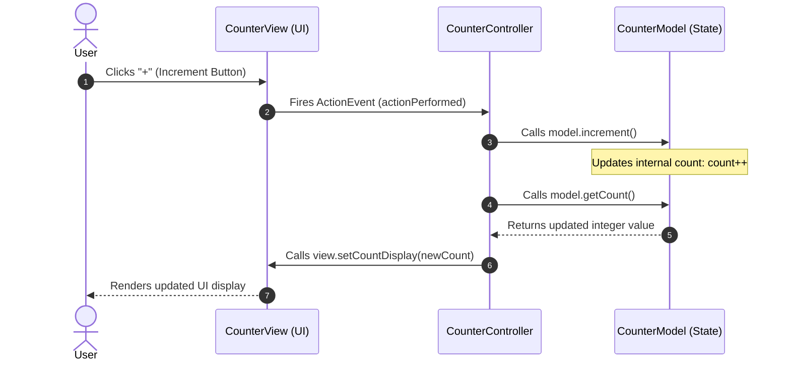
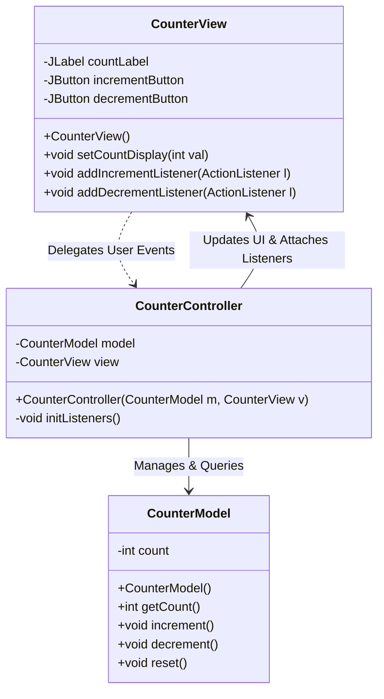

# Model-View-Controller

> [!info] Document Metadata
> - **Course:** `=this.course`
> - **Topic:** `=this.topic`
> - **Status:** `=this.status`

**Tags:** #[[Computer Science]] #[[CCPROG3]] #[[Model-View-Controller]] #[[Conceptual]] #[[M7]]

---
## Key Definitions

> **Model-View-Controller (MVC)** is a software architectural pattern that separates an application into three main logical components: Model, View, and Controller.

## Theoretical Framework

1. **Model:** Represents the underlying, logical structure of data in a software application and the high-level class associated with it. It manages data, logic, and rules.
2. **View:** Represents the UI of the application. It displays the data (the model) to the user and sends user commands to the controller.
3. **Controller:** Handles the user request. Typically, the user interacts with the View, which in turn raises appropriate URL requests, this request will be handled by a controller. The controller renders the appropriate view with the model data as a response.

## Important Formulas

**The MVC Flow:**
User Action -> View -> Controller -> Updates -> Model -> Notifies -> View -> Updated UI

## Theoretical Framework: Architectural Diagrams

### 1. Component Interaction Sequence



### 2. MVC Class Dependency Structure



## Code Implementation: Production Java Swing MVC Suite

### 1. `CounterModel.java` (Business Logic & Data State)
```java
package mvc;

public class CounterModel {
    private int count;

    public CounterModel() {
        this.count = 0;
    }

    public int getCount() {
        return this.count;
    }

    public void increment() {
        this.count++;
    }

    public void decrement() {
        if (this.count > 0) { // Business rule: non-negative counter
            this.count--;
        }
    }

    public void reset() {
        this.count = 0;
    }
}
```

### 2. `CounterView.java` (Graphical Interface & User Event Hooks)
```java
package mvc;

import javax.swing.*;
import java.awt.*;
import java.awt.event.ActionListener;

public class CounterView extends JFrame {
    private final JLabel countLabel = new JLabel("0", SwingConstants.CENTER);
    private final JButton incrementBtn = new JButton("+");
    private final JButton decrementBtn = new JButton("-");

    public CounterView() {
        super("MVC Counter Application");
        this.setDefaultCloseOperation(JFrame.EXIT_ON_CLOSE);
        this.setSize(300, 200);
        this.setLayout(new BorderLayout(10, 10));

        countLabel.setFont(new Font("Monospaced", Font.BOLD, 48));
        this.add(countLabel, BorderLayout.CENTER);

        JPanel buttonPanel = new JPanel(new GridLayout(1, 2, 10, 0));
        buttonPanel.add(decrementBtn);
        buttonPanel.add(incrementBtn);
        this.add(buttonPanel, BorderLayout.SOUTH);

        this.setLocationRelativeTo(null);
    }

    public void setCountDisplay(int value) {
        this.countLabel.setText(String.valueOf(value));
    }

    // Decoupled listener registration (View knows nothing about controller logic)
    public void addIncrementListener(ActionListener listener) {
        this.incrementBtn.addActionListener(listener);
    }

    public void addDecrementListener(ActionListener listener) {
        this.decrementBtn.addActionListener(listener);
    }
}
```

### 3. `CounterController.java` (Mediator & Event Coordinator)
```java
package mvc;

import java.awt.event.ActionEvent;
import java.awt.event.ActionListener;

public class CounterController {
    private final CounterModel model;
    private final CounterView view;

    public CounterController(CounterModel model, CounterView view) {
        this.model = model;
        this.view = view;
        this.initController();
    }

    private void initController() {
        // Register ActionListeners on the View
        this.view.addIncrementListener(new ActionListener() {
            @Override
            public void actionPerformed(ActionEvent e) {
                model.increment();
                view.setCountDisplay(model.getCount());
            }
        });

        this.view.addDecrementListener(e -> {
            model.decrement();
            view.setCountDisplay(model.getCount());
        });
    }
}
```

### 4. `MainApp.java` (Application Entry Point)
```java
package mvc;

import javax.swing.SwingUtilities;

public class MainApp {
    public static void main(String[] args) {
        SwingUtilities.invokeLater(() -> {
            CounterModel model = new CounterModel();
            CounterView view = new CounterView();
            new CounterController(model, view);
            view.setVisible(true);
        });
    }
}
```

## Multiple Choice Questions

1. What is the Model-View-Controller (MVC) pattern?
    - **A)** A network protocol for transferring data.
    - **B)** A software architectural pattern that separates an application into three main logical components.
    - **C)** A specific Java framework for database management.
    - **D)** A design principle focused solely on object instantiation.

2. In the MVC architecture, what is the primary responsibility of the Model?
    - **A)** To handle user requests and route them appropriately.
    - **B)** To display data to the user through the UI.
    - **C)** To represent the underlying, logical structure of data and manage rules.
    - **D)** To define the graphical layout of the application.

3. Which component directly receives user commands and raises appropriate URL requests?
    - **A)** The Model
    - **B)** The View
    - **C)** The Controller
    - **D)** The Database

4. In a Simple Counter App using MVC, what does the Controller do when the '+' button is clicked?
    - **A)** It directly draws the new number on the screen.
    - **B)** It creates a new instance of the Model.
    - **C)** It calls `model.increment()` and updates the view.
    - **D)** It ignores the click unless the Model requests it.

5. What is the typical flow of data in the MVC pattern after a user action?
    - **A)** User Action -> Model -> Controller -> View -> Updated UI
    - **B)** User Action -> View -> Controller -> Updates Model -> Notifies View -> Updated UI
    - **C)** User Action -> Controller -> View -> Updates Model -> Updated UI
    - **D)** User Action -> Model -> View -> Controller -> Updated UI

### Answer Key & Explanations
1. **B)** MVC is a structural blueprint that decouples data management, interface rendering, and user input handling into distinct components.
2. **C)** The Model isolates the core business logic, maintaining data integrity and enforcing application rules independently of the interface.
3. **B)** The View acts as the initial interaction point, capturing user input before forwarding it to the Controller for processing.
4. **C)** The Controller acts as the middleman, processing the click event by mutating the Model's state and subsequently commanding the View to reflect the new state.
5. **B)** The flow starts at the View (action), routes through the Controller (logic), alters the Model (data), and finally reflects back on the View.

## References & Navigation

- **Previous Topic:** [[Graphical User Interfaces and Event Handling]]
- **Next Topic:** [[Abstract Classes and Interfaces]]
- **Related Notes:** [[Overview of Programming Languages]]
