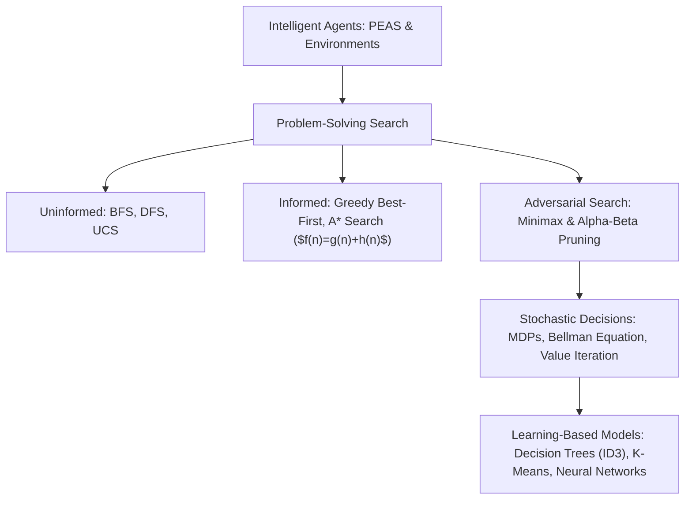
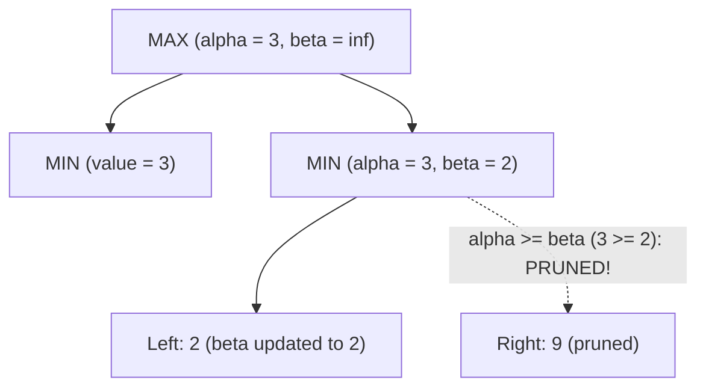

> [!info] Document Metadata
> - **Course:** `=this.course`
> - **Topic:** `=this.topic`
> - **Status:** `=this.status`

**Tags:** #[[Computer Science]] #[[CSINTSY]] #[[Artificial Intelligence]] #[[Machine Learning]] #[[Reviewer]] #[[Finals]]

---

# CSINTSY Comprehensive Finals Reviewer

## Overview

This reviewer consolidates Introduction to Artificial Intelligence (CSINTSY). Core subjects encompass intelligent agents (PEAS, agent environments), uninformed search (BFS, DFS, Uniform Cost Search), informed search (Greedy Best-First, A* Search, heuristic admissibility and consistency), adversarial game search (Minimax, Alpha-Beta pruning), Markov Decision Processes (MDPs, Value Iteration), and machine learning models (Decision Trees with ID3/Entropy/Information Gain, K-Means Clustering, Neural Networks).

---

## 1. Search Algorithms Master Matrix

| Algorithm | Frontier / Queue | Completeness | Time Complexity | Space Complexity | Optimality |
| :--- | :--- | :--- | :--- | :--- | :--- |
| **BFS** | FIFO Queue | Yes (if $b < \infty$) | $O(b^d)$ | $O(b^d)$ (memory-bound) | Yes (if step cost $c=1$) |
| **DFS** | LIFO Stack | No (in infinite spaces) | $O(b^m)$ | $O(b m)$ (space-efficient) | No |
| **Uniform Cost (UCS)** | Priority Queue by $g(n)$ | Yes (if step cost $\ge \epsilon > 0$) | $O(b^{1 + \lfloor C^* / \epsilon \rfloor})$ | $O(b^{1 + \lfloor C^* / \epsilon \rfloor})$ | Yes (lowest cost path) |
| **Greedy Best-First** | Priority Queue by $h(n)$ | No (can get stuck in loops) | $O(b^m)$ | $O(b^m)$ | No |
| **A* Search** | Priority Queue by $f(n) = g(n) + h(n)$ | Yes | $O(b^d)$ | $O(b^d)$ | **Yes** (if $h$ is admissible/consistent) |

### Heuristic Properties for A*
- **Admissibility**: $h(n) \le h^*(n)$ for all $n$ (never overestimates the true remaining cost to the goal). Guarantees optimality in tree search.
- **Consistency (Monotonicity)**: $h(n) \le c(n, a, n') + h(n')$. Satisfies triangle inequality. Guarantees optimality in graph search without re-opening closed nodes!

---

## 2. Adversarial Search: Alpha-Beta Pruning Rules

- **$\alpha$**: The value of the best (highest-value) choice found so far by **MAX** along the path. Initialized to $-\infty$.
- **$\beta$**: The value of the best (lowest-value) choice found so far by **MIN** along the path. Initialized to $+\infty$.
- **Pruning Condition**: Prune the remaining sub-branches whenever:
  $$\alpha \ge \beta$$

---

## 3. Decision Tree Learning (ID3 Algorithm)

- **Entropy $H(S)$**: Measures impurity of set $S$:
  $$H(S) = - \sum_{i=1}^c p_i \log_2(p_i)$$
- **Information Gain $IG(S, A)$**: Expected entropy reduction from partitioning on attribute $A$:
  $$IG(S, A) = H(S) - \sum_{v \in \text{Values}(A)} \frac{|S_v|}{|S|} H(S_v)$$
  ID3 greedily splits on the attribute with the **highest Information Gain**!

---

## 4. High-Yield Exam Checklist

- [ ] Is an admissible heuristic allowed to overestimate the cost to the goal? **NO**, never ($h(n) \le h^*(n)$).
- [ ] In Minimax, whose turn updates $\alpha$? **MAX** updates $\alpha$; **MIN** updates $\beta$.
- [ ] What is the entropy of a completely pure dataset (all positive or all negative)? Exactly **0**.
- [ ] What is the entropy of an evenly split binary dataset (50% positive, 50% negative)? Exactly **1.0**.
- [ ] Does Value Iteration guarantee convergence in discounted infinite-horizon MDPs? **YES**, by Banach Fixed-Point Theorem.

---

## 5. Comprehensive Practice Exam

1. If a heuristic function $h(n)$ satisfies $h(n) \le c(n, a, n') + h(n')$ for every node $n$ and successor $n'$, the heuristic is:
   - A) Inadmissible
   - B) Consistent (Monotonic)
   - C) Greedy
   - D) Overestimating

2. In an adversarial game tree, a MIN node evaluates a child that returns a score of 4. If the parent MAX node currently has an $\alpha$ value of 5, what should happen?
   - A) The search continues evaluating all remaining children of the MIN node.
   - B) The MIN node prunes its remaining children because $\alpha \ge \beta$ ($5 \ge 4$).
   - C) The $\alpha$ value is updated from 5 to 4.
   - D) The game terminates in a draw.

3. Given a dataset of 8 positive examples and 8 negative examples, what is the initial Entropy $H(S)$?
   - A) 0.0
   - B) 0.5
   - C) 1.0
   - D) 2.0

4. In A* graph search, what is the evaluation function $f(n)$?
   - A) $f(n) = g(n)$ (cost from start to current node)
   - B) $f(n) = h(n)$ (estimated cost to goal)
   - C) $f(n) = g(n) + h(n)$
   - D) $f(n) = g(n) - h(n)$

5. Which unsupervised algorithm iteratively assigns points to the closest centroid and recalculates centroids as the arithmetic mean of assigned points?
   - A) ID3 Decision Tree
   - B) K-Means Clustering
   - C) Minimax
   - D) Q-Learning

---

### Answer Key & Explanations

1. **B) Consistent (Monotonic)** — Consistency requires that the estimated cost from $n$ is no greater than the step cost to $n'$ plus the estimated cost from $n'$ (the triangle inequality). Every consistent heuristic is also admissible.
2. **B) The MIN node prunes its remaining children because $\alpha \ge \beta$ ($5 \ge 4$)** — At the MIN node, $\beta$ is updated to $\min(\beta, 4) = 4$. Since the ancestor MAX node already has a guaranteed move of value $\alpha = 5$, MAX will never choose this branch. Because $\alpha \ge \beta$ ($5 \ge 4$), the remaining children are pruned.
3. **C) 1.0** — $H(S) = - (0.5 \log_2 0.5 + 0.5 \log_2 0.5) = - (0.5(-1) + 0.5(-1)) = -(-1) = 1.0$.
4. **C) $f(n) = g(n) + h(n)$** — A* balances the known cost to reach the node $g(n)$ with the estimated remaining cost to the goal $h(n)$.
5. **B) K-Means Clustering** — K-Means alternates between cluster assignment based on Euclidean distance to centroids and updating centroids as the center of mass (mean) of all cluster members.

---

## References & Navigation

- **Previous Topic:** [[CCDSALG]], [[STT101A]]
- **Next Topic:** [[CSMODEL]]
- **Prerequisites:** [[Artificial Intelligence]], A* Search, Minimax, Decision Trees
- **Cross-Curricular Connections:** [[CSALGCM]]
