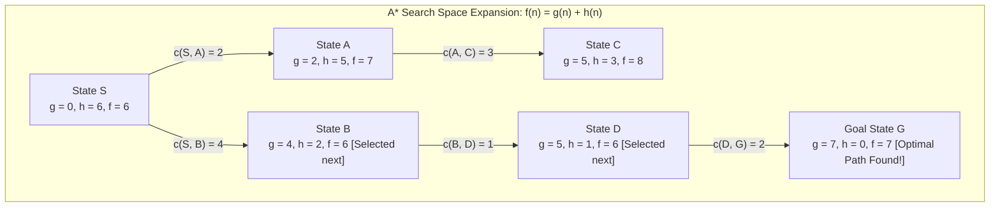
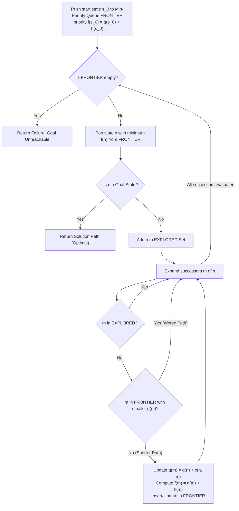

# Heuristics and A-Star Search

> [!info] Document Metadata
> - **Course:** `=this.course`
> - **Topic:** `=this.topic`
> - **Status:** `=this.status`

**Tags:** #[[Computer Science]] #[[CSINTSY]] #[[Heuristics and A-Star Search]] #[[Problem Solving]] #[[M2]]

---

## Overview

Informed search, unlike uninformed search, exploits partial knowledge about the problem to guide the exploration of the state space. This domain knowledge is often encapsulated in a **heuristic function**, $h(s)$, which estimates the cost from state $s$ to the goal.

**Greedy Best-First Search (GBFS)** Expands the node that appears closest to the goal (lowest $h(s)$). **Characteristics**: Complete if the state space is finite. Not optimal. Devolves to BFS or DFS if $h(s) = 0$.

**A* Search** Combines Uniform Cost Search and Greedy Best-First Search by considering both the accumulated path cost $g(s)$ and the estimated cost to the goal $h(s)$. **Characteristics**: Complete for finite spaces. Optimal if the heuristic is admissible. If $h(s) = 0$, A* devolves into UCS.

**Admissibility:**
A heuristic $h(s)$ is admissible if it never overestimates the true cost to reach the goal: $h(s) \leq h^*(s)$, where $h^*(s)$ is the true optimal cost.

## Important Formulas

**Heuristic Function evaluation in A* Search**
$$f(s) = g(s) + h(s)$$
Where: $g(s)$ = Cost accumulated from start node to current node $s$. $h(s)$ = Estimated cost from node $s$ to goal node.

**Admissibility Condition**
$$h(s) \leq h^*(s)$$

**Consistency (Monotonicity) Condition**
$$h(u) \leq c(u, a, v) + h(v)$$
*Theorem:* A consistent heuristic guarantees that when A* selects a state for expansion, the optimal path to that state has already been found. No re-expansion of explored states is required.

## Theoretical Framework: A* State Space Expansion & Evaluation

### A* Min-Priority Queue Execution Pipeline

## Worked Examples

**8-Puzzle Heuristics:**
1. Number of misplaced tiles: $h(s)$ = count of tiles not in their goal position.
2. Total Manhattan Distance: $h(s)$ = sum of horizontal and vertical distances of each tile from its target location.

**A* Algorithm Walkthrough:**
1. Add $s_{start}$ to FRONTIER with priority $h(s_{start})$.
2. While FRONTIER is not empty:
   - Remove state $s$ with the lowest priority $p$. Let $c$ be the cost up to $s$.
   - If $\text{IsEnd}(s)$ then return the solution.
   - Add $s$ to EXPLORED.
   - For each action $a \in \text{Actions}(s)$:
     - Get successor $s' = \text{Succ}(s, a)$
     - If $s'$ is not yet in EXPLORED, update $s'$ in FRONTIER with priority $c + \text{Cost}(s, a) + h(s')$.

## Multiple Choice Questions

1. How does informed search differ from uninformed search?
    - **A)** Informed search explicitly tests all possible paths before deciding.
    - **B)** Informed search exploits partial domain knowledge, often using a heuristic function to guide exploration.
    - **C)** Informed search relies exclusively on the accumulated path cost without estimation.
    - **D)** Informed search does not require a goal test.

2. What is the primary characteristic of Greedy Best-First Search (GBFS)?
    - **A)** It expands the node with the lowest accumulated cost $g(s)$.
    - **B)** It expands the node that appears closest to the goal based solely on $h(s)$.
    - **C)** It is always guaranteed to find the optimal path.
    - **D)** It combines Uniform Cost Search and Depth-First Search.

3. How does A* Search calculate the priority of a node to expand?
    - **A)** By finding the difference between $g(s)$ and $h(s)$.
    - **B)** By ignoring $g(s)$ and only looking at $h(s)$.
    - **C)** By taking the sum of the accumulated path cost and the estimated cost to the goal ($f(s) = g(s) + h(s)$).
    - **D)** By multiplying the step cost by the heuristic value.

4. What happens to the A* Search algorithm if the heuristic function $h(s)$ is always set to 0?
    - **A)** It devolves into a Uniform Cost Search (UCS).
    - **B)** It devolves into a standard Depth-First Search.
    - **C)** It will completely fail to find any solution.
    - **D)** It becomes a purely Greedy Best-First Search.

5. What does the Admissibility Condition $h(s) \leq h^*(s)$ ensure for a heuristic?
    - **A)** That the heuristic perfectly calculates the path without searching.
    - **B)** That the heuristic never overestimates the true optimal cost to reach the goal.
    - **C)** That the heuristic will always overestimate the cost to ensure safety.
    - **D)** That the heuristic can only be used for the 8-Puzzle problem.

### Answer Key & Explanations
1. **B)** Informed search uses a heuristic function, encapsulating problem-specific domain knowledge to estimate the cost to the goal.
2. **B)** GBFS focuses entirely on the heuristic $h(s)$, expanding the node that looks closest to the goal, which sacrifices optimality.
3. **C)** A* uses the evaluation function $f(s) = g(s) + h(s)$, combining past actual cost with future estimated cost.
4. **A)** If $h(s) = 0$, then $f(s) = g(s)$, meaning A* will expand nodes purely based on accumulated cost, exactly like UCS.
5. **B)** An admissible heuristic is optimistic; it never predicts a cost higher than the actual true optimal cost ($h^*(s)$).

## References & Navigation

- **Previous Topic:** [[Uniform Cost Search]]
- **Next Topic:** [[Adversarial Games]]
- **Related Notes:** [[Informed Search]], [[Dijkstra's Algorithm (Advanced)]]
