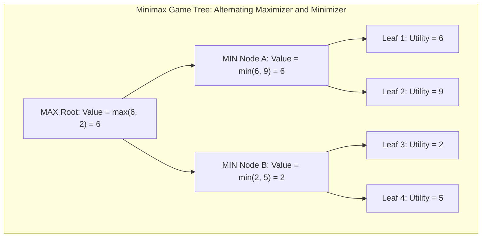
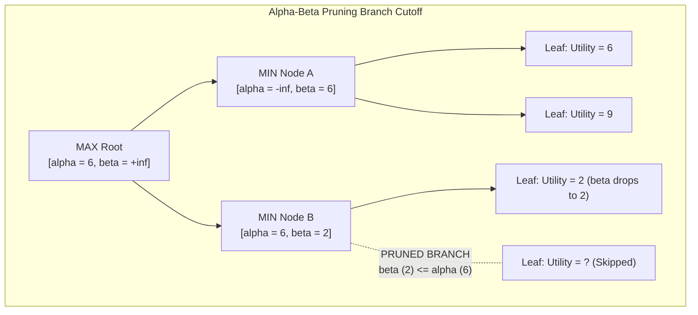
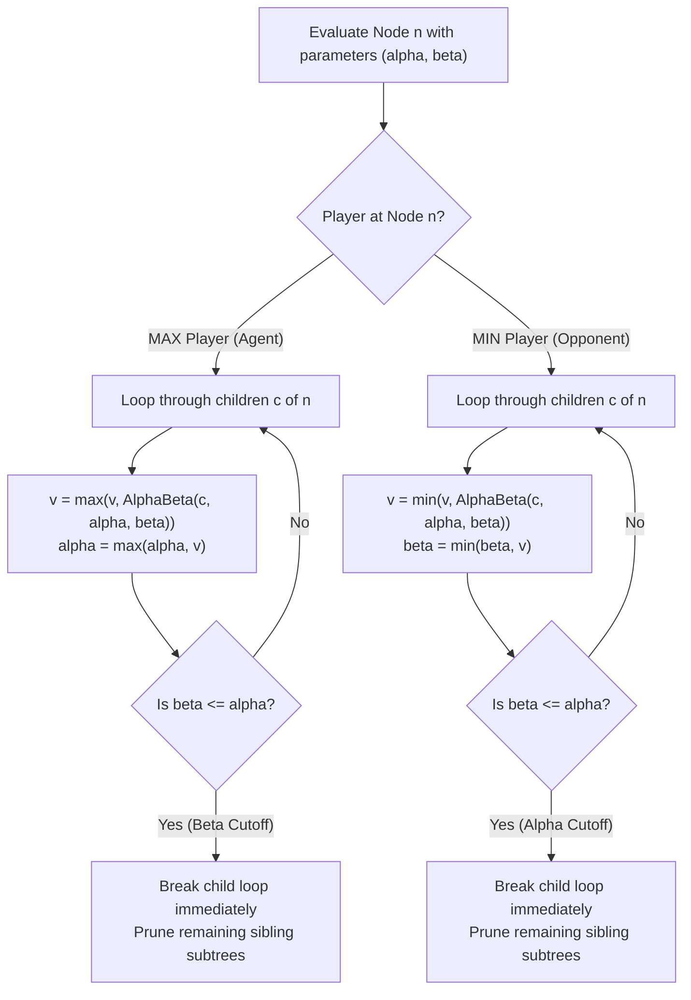

# Adversarial Games

> [!info] Document Metadata
> - **Course:** `=this.course`
> - **Topic:** `=this.topic`
> - **Status:** `=this.status`

**Tags:** #[[Computer Science]] #[[CSINTSY]] #[[Adversarial Games]] #[[Problem Solving]] #[[M3]]

---

## Overview

In real-world settings such as board games, agents face active opponents whose decisions aim to prevent the agent from reaching its goal. Adversarial Games model these multi-agent environments using game trees. We primarily focus on **2-Player Zero-Sum Games** where one player's gain is identically balanced by the other player's loss (e.g., Chess, Tic-Tac-Toe).

**Modeling the Opponent:** **"Dumb" Opponent:** Randomly selects moves with equal probability. **Stochastic Opponent:** Selects moves based on a specific probability distribution. Expected values are optimized using the **Expectimax** algorithm. **Optimally Smart Opponent:** Always selects moves that minimize the agent's expected utility. Evaluated using the **Minimax** algorithm.

**Minimax Characteristics:** Complete if the game tree is finite. Optimal (against an optimal opponent). Time Complexity: $O(b^d)$ and Space Complexity: $O(b^d)$ (with Depth-First Search). Due to high branching factors ($b$), simple Minimax is often computationally infeasible.

**Speeding Up Techniques:**
1. Prune redundant states.
2. Depth-limited search with evaluation functions.
3. $\alpha\beta$-Pruning to ignore branches that won't affect the final decision.

## Important Formulas

**Expectimax Formulation**
$$
V_{eval}(s) = \begin{cases} 
\text{Utility}(s) & \text{if IsEnd}(s) \\ 
\max_{a} V_{eval}(\text{Succ}(s, a)) & \text{if Player}(s) = \text{agent} \\ 
\sum_{a} \pi_{opp}(s, a) V_{eval}(\text{Succ}(s, a)) & \text{if Player}(s) = \text{opp} 
\end{cases}
$$

**Minimax Formulation**
$$
V_{eval}(s) = \begin{cases} 
\text{Utility}(s) & \text{if IsEnd}(s) \\ 
\max_{a} V_{eval}(\text{Succ}(s, a)) & \text{if Player}(s) = \text{agent} \\ 
\min_{a} V_{eval}(\text{Succ}(s, a)) & \text{if Player}(s) = \text{opp} 
\end{cases}
$$

## Theoretical Framework: Minimax & Alpha-Beta Pruning Trees

### 1. Classical Minimax Value Backpropagation

### 2. Alpha-Beta Pruning Execution Trace

### 3. Pruning Condition Decision Logic

## Worked Examples

**$\alpha\beta$-Pruning Mechanics:**
- **$\alpha$:** Best already explored option along path to the root for the maximizer (lower bound on root utility). Initialized to $-\infty$.
- **$\beta$:** Best already explored option along path to the root for the minimizer (upper bound on root utility). Initialized to $+\infty$.
- **Cutoff Criterion:** If at any time $\beta \le \alpha$, the current parent can never pick this branch because a better or equal alternative is already guaranteed elsewhere. The remaining children of the node can be pruned without affecting optimality.
- **Optimal Efficiency:** With perfect move ordering (evaluating best moves first), the effective branching factor is reduced to $b' = \sqrt{b}$, doubling the searchable depth in the same computational time: $O(b^{d/2})$.

## Multiple Choice Questions

1. Which algorithm is best suited for evaluating a "Stochastic Opponent" that makes moves based on a probability distribution?
    - **A)** Minimax
    - **B)** $\alpha\beta$-Pruning
    - **C)** Expectimax
    - **D)** Depth-First Search

2. In a 2-Player Zero-Sum Game, how does an "Optimally Smart Opponent" make decisions?
    - **A)** By maximizing the agent's expected utility.
    - **B)** By randomly selecting moves with equal probability.
    - **C)** By selecting moves that minimize the agent's expected utility.
    - **D)** By solely minimizing their own potential score.

3. What is the time complexity of the simple Minimax algorithm if the branching factor is $b$ and depth is $d$?
    - **A)** $O(b \times d)$
    - **B)** $O(d^b)$
    - **C)** $O(b^d)$
    - **D)** $O(b \log d)$

4. What is the primary purpose of $\alpha\beta$-Pruning in adversarial game search?
    - **A)** To convert a stochastic opponent into an optimally smart opponent.
    - **B)** To reduce the number of nodes evaluated by ignoring branches that won't affect the final decision.
    - **C)** To ensure the algorithm always expands the entire game tree.
    - **D)** To calculate the exact probability distribution of the opponent's moves.

5. During $\alpha\beta$-Pruning, under what condition can a branch be safely pruned?
    - **A)** When the known $\beta$ is greater than $\alpha$.
    - **B)** When the known $\beta$ is less than or equal to $\alpha$.
    - **C)** When $\alpha$ reaches zero.
    - **D)** When the node is identified as a stochastic variable.

### Answer Key & Explanations

1. **C**. Expectimax optimizes expected values when facing an opponent that acts according to a probability distribution rather than pure opposition.
2. **C**. In a zero-sum game, an optimal opponent perfectly understands the game and actively selects moves that minimize the agent's utility (since doing so maximizes their own).
3. **C**. The time complexity of Minimax is exponential, $O(b^d)$, making it computationally infeasible for complex games without pruning.
4. **B**. $\alpha\beta$-Pruning speeds up Minimax by skipping (pruning) branches that are provably worse than previously examined options, reducing the number of evaluated nodes.
5. **B**. Pruning occurs when $\beta \leq \alpha$, meaning the minimizing player already has a guaranteed option that is worse for the maximizer than the best option the maximizer has found elsewhere, making further exploration useless.

## References & Navigation

- **Previous Topic:** [[Heuristics and A-Star Search]]
- **Next Topic:** [[Machine Learning Models]]
- **Related Notes:** [[Machine Learning]], [[State-Based Models]]
