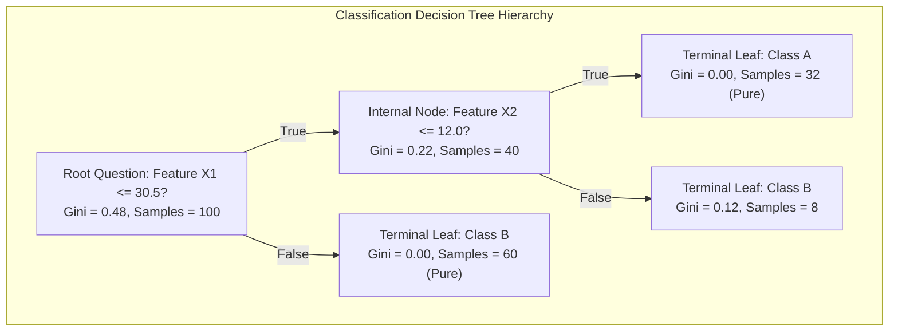
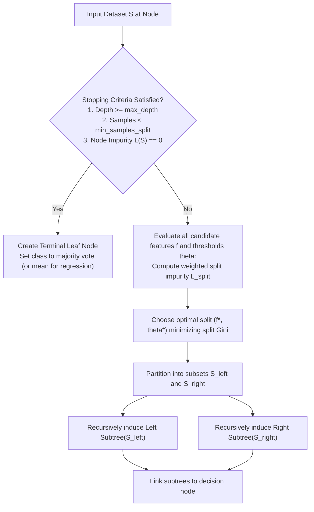

# Decision Trees

> [!info] Document Metadata
> - **Course:** `=this.course`
> - **Topic:** `=this.topic`
> - **Status:** `=this.status`

**Tags:** #[[Computer Science]] #[[CSINTSY]] #[[Decision Trees]] #[[Code Snippets]] #[[M4]]

---

## Overview

A Decision Tree is a supervised machine learning model that predicts an outcome by learning a sequence of simple yes/no questions based on the dataset's features. The model builds a tree recursively from the root node to leaf nodes.

**Building the Tree:**
At each internal node, the algorithm must pick the "best" question to split the data. The best split is the one that most successfully separates the target classes, minimizing "impurity."

**Handling Numerical Features:**
For continuous/numerical features, the tree considers all unique values as potential threshold questions (e.g., `Is weight >= 40?`).

**Stopping Criteria (Preventing Overfitting):**
To avoid overfitting, trees use stopping criteria such as:
- Minimum batch size to split a node (`min_samples_split`).
- Maximum tree depth (`max_depth`).
- Maximum number of terminal leaf nodes (`max_leaf_nodes`).
- Minimum impurity reduction threshold ($\Delta L$).

## Theoretical Framework: Decision Tree Architecture & CART Induction

### CART Recursive Splitting Pipeline

## Code Implementation
*(Algorithm relies on recursively calculating split impurity.)*

## Syntax Breakdown
*(Not applicable)*

## Complexity Analysis
**Gini Index (Impurity Measure for Classification):**
$$ L(S) = 1 - \sum_{i} \left( \frac{p_i}{|S|} \right)^2 $$
Where $p_i$ is the number of instances of class $i$ in set $S$. A Gini index of $0$ means the set is perfectly pure.

**Split Gini Calculation:**
The Gini index of a split is the weighted average of the Gini indices of the resulting subsets. The feature providing the lowest split Gini is chosen.

**Variance (Impurity Measure for Regression):**
For regression trees, variance is used instead of Gini to measure node purity:
$$ L(S) = \frac{1}{n-1} \sum (x - \mu)^2 $$
Leaf nodes then output the average value of the samples within that node.

## Multiple Choice Questions

1. In a Decision Tree model, how does the algorithm determine the "best" question to split the data at an internal node?
- **A)** By choosing the feature that most successfully separates target classes and minimizes "impurity."
- **B)** By always splitting the data exactly in half.
- **C)** By randomly selecting a feature and a threshold.
- **D)** By maximizing the Gini index for the resulting subsets.

2. How do Decision Trees typically handle continuous or numerical features during the splitting process?
- **A)** They ignore them completely and only use categorical features.
- **B)** They round all numerical values to the nearest integer.
- **C)** They consider all unique values in the feature as potential threshold questions (e.g., `>= threshold`).
- **D)** They convert numerical features into text strings before processing.

3. Which of the following is used as a stopping criterion to prevent a Decision Tree from overfitting?
- **A)** Ensuring a Gini index of exactly 1 at all leaf nodes.
- **B)** Requiring the tree to evaluate every single numerical feature.
- **C)** Setting a maximum tree depth.
- **D)** Maximizing the variance in leaf nodes.

4. What does a Gini index of $0$ indicate about a specific node?
- **A)** The node is perfectly pure, containing instances of only a single class.
- **B)** The node has exactly zero samples remaining.
- **C)** The node contains an equal, perfectly mixed distribution of all classes.
- **D)** The node represents a numerical feature rather than a categorical one.

5. For regression trees, which metric is used instead of the Gini index to measure node purity?
- **A)** Entropy
- **B)** Impurity reduction percentage
- **C)** Variance
- **D)** Cross-entropy loss

### Answer Key & Explanations
1. **A)** Decision trees recursively choose splits that decrease impurity, meaning they separate the data into the most distinct class groups possible.
2. **C)** For continuous features, the tree algorithm evaluates unique numerical values as potential `<` or `>=` thresholds to find the optimal split point.
3. **C)** Setting a maximum tree depth forces the tree to stop growing, acting as a stopping criterion that prevents it from overfitting to noise in the training data.
4. **A)** The Gini index measures impurity; an index of 0 means there is no impurity, so all instances in that node belong to the exact same class.
5. **C)** While classification trees use Gini (or entropy), regression trees use Variance to measure how spread out the continuous target values are within a node.

## References & Navigation

- **Previous Topic:** [[Machine Learning Models]]
- **Next Topic:** [[Naive Bayes]]
- **Related Notes:** [[Decision Tree]], [[Inference for Categorical Data]]
