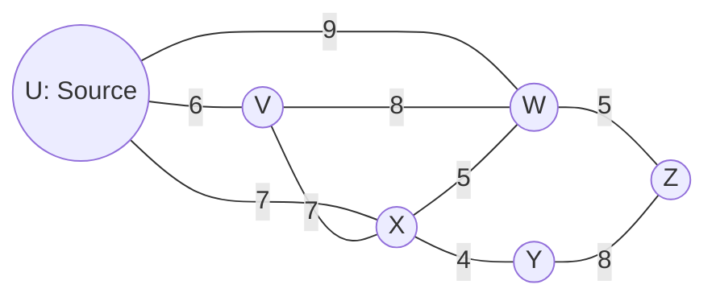
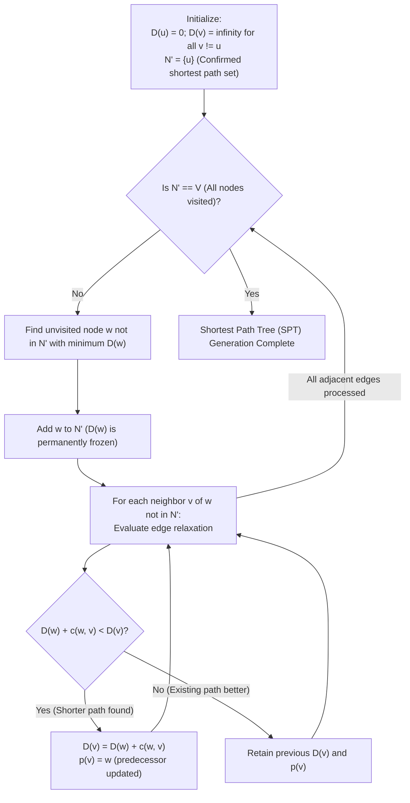
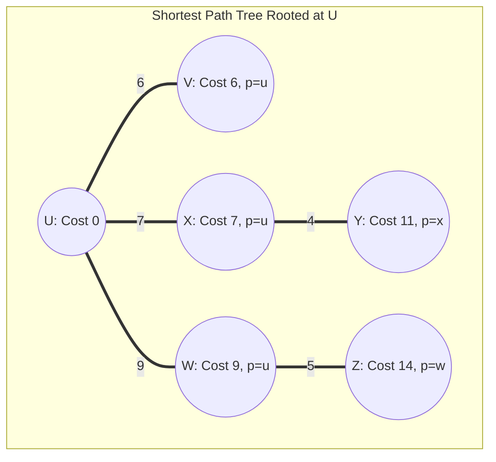

# Dijkstra's Link State Algorithm

> [!info] Document Metadata
> - **Course:** `=this.course`
> - **Topic:** `=this.topic`
> - **Status:** `=this.status`

**Tags:** #[[CSNETWK]] #[[Computer Science]] #[[Computer Networks]] #[[Networking Protocols]] #[[Graph Theory Basics]]

---

## Overview

> Dijkstra's Algorithm is a "Link State" algorithm, meaning every router has a complete map of the network (the global topology) and identical link c...

## Key Concepts
 Source Node Goal Link Costs Distance Predecessor (p)

## Details / Theory

## 1. Concept Overview: Link State (LS)

Definition

Dijkstra's Algorithm is a "Link State" algorithm, meaning every router has a complete map of the network (the global topology) and identical link cost information. It computes the least-cost path from a single source node to all other nodes in the network.

**The Logic (Iterative)**

1. **Initialization:** The router knows the cost to its direct neighbors. All non-neighbors are set to infinity ($\infty$).
2. **Selection:** Pick the unvisited node with the smallest tentative distance.
3. **Relaxation:** Check if going through this new node is cheaper than the current known path to its neighbors.
_Formula:_ $D(v) = \min(D(v), D(u) + c(u,v))$

## 2. The Network Topology

### Dijkstra Step-by-Step Edge Relaxation Execution Loop

### Resulting Shortest Path Tree (SPT) Rooted at Router U

**Scenario Link Costs Summary:**
- Direct Links from U: `u-v = 6`, `u-x = 7`, `u-w = 9`
- Cross-Domain Links: `v-w = 8`, `v-x = 7`, `x-w = 5`, `x-y = 4`
- Egress Links to Z: `w-z = 5`, `y-z = 8`

## 3. Problem Analysis

### Question 1

**What is the shortest distance to node x and what node is its predecessor? Write your answer as n,p**

**Analytical Breakdown:**

1. **Direct Path Check:** U connects directly to X with a cost of **7**.
2. **Alternative Path Check:** Can we beat 7?
Path U $\rightarrow$ V $\rightarrow$ X? (Cost: $6 + 7 = 13$). No.
Path U $\rightarrow$ V $\rightarrow$ W $\rightarrow$ X? (Cost: $6 + 8 + 5 = 19$). No.

3. **Conclusion:** The direct link is the optimal path.
**Distance:** 7
**Predecessor (p):** The node immediately before X is **u**.

**Correct Answer:** **7,u**

### Question 2

**What is the shortest distance to node v and what node is its predecessor? Write your answer as n,p**

**Analytical Breakdown:**

1. **Direct Path Check:** U connects directly to V with a cost of **6**.
2. **Alternative Path Check:** Can we beat 6?
Any other path (e.g., through X) would start with a cost of 7 (U $\rightarrow$ X), which is already higher than 6.

3. **Conclusion:** The direct link is the optimal path.
**Distance:** 6
**Predecessor (p):** The node immediately before V is **u**.

**Correct Answer:** **6,u**

### Question 3

**What is the shortest distance to node z and what node is its predecessor? Write your answer as n,p**

Analytical Breakdown:

This requires a multi-step search (Dijkstra's Loop).

1. **Step 0 (Start):** U is at 0.
2. **Step 1 (Neighbors):**
To V: 6 (via U)
To X: 7 (via U)
To W: 9 (via U - _Note: Diagram shows a curved link u-w with cost 9_)

3. **Step 2 (Expand V):** V is cheapest (6).
V $\rightarrow$ W: Cost is $6 + 8 = 14$. (Direct path 9 is better).

4. **Step 3 (Expand X):** X is next cheapest (7).
X $\rightarrow$ W: Cost is $7 + 5 = 12$. (Old cost 9 is better).
X $\rightarrow$ Y: Cost is $7 + 4 = 11$.

5. **Step 4 (Expand W):** W is next cheapest (9, via U).
W $\rightarrow$ Z: Cost is $9 + 5 = 14$.

6. **Step 5 (Expand Y):** Y is next cheapest (11, via X).
Y $\rightarrow$ Z: Cost is $11 + 8 = 19$. (Old cost 14 is better).

7. **Conclusion:** The cheapest path to Z comes from W.
**Total Cost:** 14
**Predecessor:** w

**Correct Answer:** **14,w**

## Summary of Logic (Cheat Sheet)

|                 |          |                 |              |
| --------------- | -------- | --------------- | ------------ |
| **Destination** | **Cost** | **Predecessor** | **Path**     |
| **X**           | 7        | u               | Direct (u-x) |
| **V**           | 6        | u               | Direct (u-v) |
| **Z**           | 14       | w               | u-w-z        |

**Algorithm Tip:** Always explore the node with the _lowest current cost_ first.

## Common Pitfalls
 Not always expanding the **cheapest unvisited** node next — Dijkstra is a greedy algorithm. Forgetting to update (relax) neighbors when a cheaper path is found through the newly expanded node. Assuming the algorithm works with negative edge weights — it does **not**; use Bellman-Ford instead.

## Summary

> TL;DR — Dijkstra’s algorithm computes shortest paths from a source by greedily expanding the lowest-cost unvisited node and relaxing its neighbors. It requires non-negative edge weights and runs in $O(n^2)$ or $O(n \log n)$ with a priority queue.

## Review Questions

_To be added._

## Links
 **Related:** - [[Pasted image 20251121093234.png]] **Source / Reference:**

## Multiple Choice Questions

1. Which word completes the following sentence from the text: "Forgetting to update (relax) neighbors when a cheaper _____ is found through the newly expanded node."?
- **A)** Router
- **B)** Protocol
- **C)** Network
- **D)** path

2. Which word completes the following sentence from the text: "The Network Topology  **Scenario Data** ![[Pasted image 20251121093234.png]]  **Source Node:** _____ **Goal:** Find shortest paths to X, V, and Z."?
- **A)** Protocol
- **B)** Network
- **C)** U
- **D)** Router

3. Which word completes the following sentence from the text: "It requires non-negative edge weights and runs in _____ or $O(n \log n)$ with a priority queue."?
- **A)** Router
- **B)** Network
- **C)** Protocol
- **D)** On2

4. Which word completes the following sentence from the text: "Write your answer as _____  **Analytical Breakdown:**  1."?
- **A)** Router
- **B)** Protocol
- **C)** np
- **D)** Network

5. Which word completes the following sentence from the text: "**Step 4 (Expand W):** W _____ next cheapest (9, via U)."?
- **A)** is
- **B)** Protocol
- **C)** Router
- **D)** Network

6. Which word completes the following sentence from the text: "**Total Cost:** 14 **Predecessor:** w  **Correct Answer:** **14,w**  ## Summary of Logic (Cheat Sheet)  _____                 |          |                 |              | | --------------- | -------- | --------------- | ------------ | | **Destination** | **Cost** | **Predecessor** | **Path**     | | **X**           | 7        | u               | Direct (u-x) | | **V**           | 6        | u               | Direct (u-v) | | **Z**           | 14       | w               | u-w-z        |  **Algorithm Tip:** Always explore the node with the _lowest current cost_ first."?
- **A)** Router
- **B)** Protocol
- **C)** Network
- **D)** 

7. Which word completes the following sentence from the text: "**Correct Answer:** **6,u**  ### Question 3  **What is the shortest _____ to node z and what node is its predecessor?"?
- **A)** Router
- **B)** Network
- **C)** distance
- **D)** Protocol

8. Which word completes the following sentence from the text: "**Distance:** 6 **Predecessor (p):** The _____ immediately before V is **u**."?
- **A)** Network
- **B)** node
- **C)** Router
- **D)** Protocol

9. Which word completes the following sentence from the text: "Path U _____ V $\rightarrow$ W $\rightarrow$ X?"?
- **A)** Protocol
- **B)** rightarrow
- **C)** Network
- **D)** Router

10. Which word completes the following sentence from the text: "Any other path (e.g., through X) would start with a cost _____ 7 (U $\rightarrow$ X), which is already higher than 6."?
- **A)** Protocol
- **B)** of
- **C)** Network
- **D)** Router

### Answer Key & Explanations
1. **D)** path completes the sentence: Forgetting to update (relax) neighbors when a chea...
2. **C)** U completes the sentence: The Network Topology  **Scenario Data** ![[Pasted ...
3. **D)** On2 completes the sentence: It requires non-negative edge weights and runs in ...
4. **C)** np completes the sentence: Write your answer as n,p**  **Analytical Breakdown...
5. **A)** is completes the sentence: **Step 4 (Expand W):** W is next cheapest (9, via ...
6. **D)**  completes the sentence: **Total Cost:** 14 **Predecessor:** w  **Correct A...
7. **C)** distance completes the sentence: **Correct Answer:** **6,u**  ### Question 3  **Wha...
8. **B)** node completes the sentence: **Distance:** 6 **Predecessor (p):** The node imme...
9. **B)** rightarrow completes the sentence: Path U $\rightarrow$ V $\rightarrow$ W $\rightarro...
10. **B)** of completes the sentence: Any other path (e.g., through X) would start with ...

## References & Navigation

- **Previous Topic:** [[Longest Prefix Matching]]
- **Next Topic:** [[Dijkstra's Algorithm (Advanced)]]
- **Related Notes:** [[Distance-Vector Routing and RIP]], [[Link-State Routing and OSPF]]
