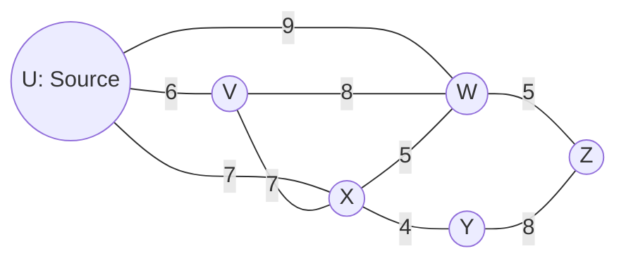
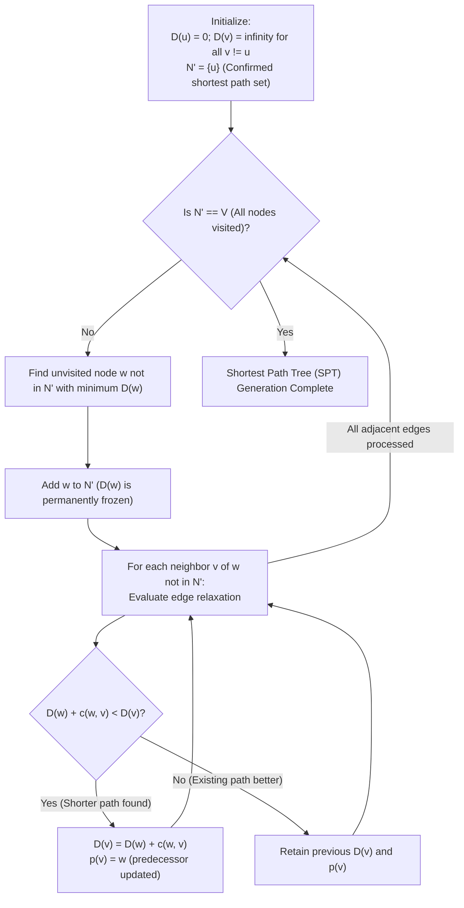
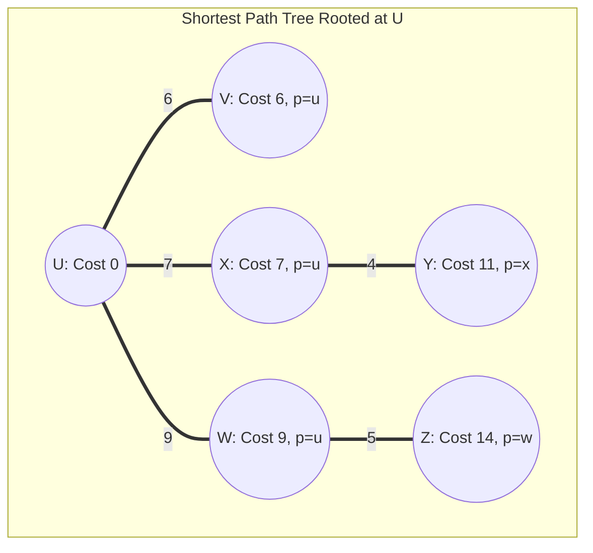

# Dijkstra's Link State Algorithm

> [!info] Document Metadata
> - **Course:** `=this.course`
> - **Topic:** `=this.topic`
> - **Status:** `=this.status`

**Tags:** #[[CSNETWK]] #[[Computer Science]] #[[Computer Networks]] #[[Networking Protocols]] #[[Graph Theory Basics]]

---

## Overview

> Dijkstra's Algorithm is a "Link State" algorithm, meaning every router has a complete map of the network (the global topology) and identical link c...

## Key Concepts
 Source Node Goal Link Costs Distance Predecessor (p)

## Details / Theory

## 1. Concept Overview: Link State (LS)

Definition

Dijkstra's Algorithm is a "Link State" algorithm, meaning every router has a complete map of the network (the global topology) and identical link cost information. It computes the least-cost path from a single source node to all other nodes in the network.

**The Logic (Iterative)**

1. **Initialization:** The router knows the cost to its direct neighbors. All non-neighbors are set to infinity ($\infty$).
2. **Selection:** Pick the unvisited node with the smallest tentative distance.
3. **Relaxation:** Check if going through this new node is cheaper than the current known path to its neighbors.
_Formula:_ $D(v) = \min(D(v), D(u) + c(u,v))$

## 2. The Network Topology

### Dijkstra Step-by-Step Edge Relaxation Execution Loop

### Resulting Shortest Path Tree (SPT) Rooted at Router U

**Scenario Link Costs Summary:**
- Direct Links from U: `u-v = 6`, `u-x = 7`, `u-w = 9`
- Cross-Domain Links: `v-w = 8`, `v-x = 7`, `x-w = 5`, `x-y = 4`
- Egress Links to Z: `w-z = 5`, `y-z = 8`

## 3. Problem Analysis

### Question 1

**What is the shortest distance to node x and what node is its predecessor? Write your answer as n,p**

**Analytical Breakdown:**

1. **Direct Path Check:** U connects directly to X with a cost of **7**.
2. **Alternative Path Check:** Can we beat 7?
Path U $\rightarrow$ V $\rightarrow$ X? (Cost: $6 + 7 = 13$). No.
Path U $\rightarrow$ V $\rightarrow$ W $\rightarrow$ X? (Cost: $6 + 8 + 5 = 19$). No.

3. **Conclusion:** The direct link is the optimal path.
**Distance:** 7
**Predecessor (p):** The node immediately before X is **u**.

**Correct Answer:** **7,u**

### Question 2

**What is the shortest distance to node v and what node is its predecessor? Write your answer as n,p**

**Analytical Breakdown:**

1. **Direct Path Check:** U connects directly to V with a cost of **6**.
2. **Alternative Path Check:** Can we beat 6?
Any other path (e.g., through X) would start with a cost of 7 (U $\rightarrow$ X), which is already higher than 6.

3. **Conclusion:** The direct link is the optimal path.
**Distance:** 6
**Predecessor (p):** The node immediately before V is **u**.

**Correct Answer:** **6,u**

### Question 3

**What is the shortest distance to node z and what node is its predecessor? Write your answer as n,p**

Analytical Breakdown:

This requires a multi-step search (Dijkstra's Loop).

1. **Step 0 (Start):** U is at 0.
2. **Step 1 (Neighbors):**
To V: 6 (via U)
To X: 7 (via U)
To W: 9 (via U - _Note: Diagram shows a curved link u-w with cost 9_)

3. **Step 2 (Expand V):** V is cheapest (6).
V $\rightarrow$ W: Cost is $6 + 8 = 14$. (Direct path 9 is better).

4. **Step 3 (Expand X):** X is next cheapest (7).
X $\rightarrow$ W: Cost is $7 + 5 = 12$. (Old cost 9 is better).
X $\rightarrow$ Y: Cost is $7 + 4 = 11$.

5. **Step 4 (Expand W):** W is next cheapest (9, via U).
W $\rightarrow$ Z: Cost is $9 + 5 = 14$.

6. **Step 5 (Expand Y):** Y is next cheapest (11, via X).
Y $\rightarrow$ Z: Cost is $11 + 8 = 19$. (Old cost 14 is better).

7. **Conclusion:** The cheapest path to Z comes from W.
**Total Cost:** 14
**Predecessor:** w

**Correct Answer:** **14,w**

## Summary of Logic (Cheat Sheet)

|                 |          |                 |              |
| --------------- | -------- | --------------- | ------------ |
| **Destination** | **Cost** | **Predecessor** | **Path**     |
| **X**           | 7        | u               | Direct (u-x) |
| **V**           | 6        | u               | Direct (u-v) |
| **Z**           | 14       | w               | u-w-z        |

**Algorithm Tip:** Always explore the node with the _lowest current cost_ first.

## Common Pitfalls
 Not always expanding the **cheapest unvisited** node next — Dijkstra is a greedy algorithm. Forgetting to update (relax) neighbors when a cheaper path is found through the newly expanded node. Assuming the algorithm works with negative edge weights — it does **not**; use Bellman-Ford instead.

## Summary

> TL;DR — Dijkstra’s algorithm computes shortest paths from a source by greedily expanding the lowest-cost unvisited node and relaxing its neighbors. It requires non-negative edge weights and runs in $O(n^2)$ or $O(n \log n)$ with a priority queue.

## Links
 **Related:** - [[Pasted image 20251121093234.png]] **Source / Reference:**

## Multiple Choice Questions

1. In a **Link-State (LS)** routing protocol such as OSPF, how do all routers in the network acquire the complete global network topology graph $G = (N, E)$ before running Dijkstra's algorithm?
    - **A)** Each router exchanges its routing table only with its immediate neighbors using Bellman-Ford.
    - **B)** Each router constructs a Link-State packet containing the identities and costs of its attached links and **broadcasts (floods)** this packet to all other routers in the network (or area).
    - **C)** Every router pings all possible IPv4 addresses on the Internet.
    - **D)** Routers query DNS for link costs.

2. In Dijkstra's algorithm initialization at source node $u$, how are the initial distance values $D(v)$ set for all other nodes $v \ne u$?
    - **A)** $D(v) = c(u, v)$ if $v$ is a direct neighbor of $u$, and $D(v) = \infty$ if $v$ is not directly connected to $u$.
    - **B)** $D(v) = 0$ for all nodes $v$.
    - **C)** $D(v) = 1$ for all neighbors and $D(v) = -1$ for non-neighbors.
    - **D)** $D(v) = \infty$ for all nodes including direct neighbors.

3. What is the worst-case time complexity of computing shortest paths from a single source across $|N| = n$ nodes using Dijkstra's algorithm: (a) with a simple linear array scan for $\min D(w)$, and (b) with a binary min-heap priority queue?
    - **A)** (a) $O(n^3)$ and (b) $O(n^2)$
    - **B)** (a) $O(\log n)$ and (b) $O(1)$
    - **C)** (a) $O(n^2)$ and (b) $O((n + |E|)\log n)$
    - **D)** (a) $O(2^n)$ and (b) $O(n!)$

4. Consider a triangle graph with nodes $A, B, C$ and undirected link costs $c(A, B) = 2$, $c(A, C) = 8$, and $c(B, C) = 3$. Running Dijkstra's algorithm from source $A$, what are the final shortest-path cost $D(C)$ and predecessor $p(C)$?
    - **A)** $D(C) = 8$, $p(C) = A$
    - **B)** $D(C) = 3$, $p(C) = A$
    - **C)** $D(C) = 10$, $p(C) = B$
    - **D)** $D(C) = 5$, $p(C) = B$

5. How many messages are transmitted across the network to broadcast a single link-state change in a network with $n = |N|$ nodes and $|E|$ links?
    - **A)** $O(1)$ messages
    - **B)** $O(n \cdot |E|)$ messages across the network to flood link states from all $n$ nodes ($O(|E|)$ per node's link-state broadcast)
    - **C)** $O(2^n)$ messages
    - **D)** Zero messages

### Answer Key & Explanations

1. **B**. Link-state routing relies on reliable **link-state flooding** (e.g., OSPF Link-State Advertisements) so every router builds an identical Link-State Database (LSDB) representing the full graph $G = (N, E)$.
2. **A**. During initialization, $N' = \{u\}$, direct neighbors $v$ receive their direct edge weight $D(v) = c(u, v)$, and non-adjacent nodes start at $D(v) = \infty$.
3. **C**. Scanning an unsorted array of $O(n)$ unvisited nodes across $n$ iterations takes $\sum_{i=1}^n i = O(n^2)$ comparisons; using a binary min-heap reduces extract-min and decrease-key operations to $O((n + |E|)\log n)$.
4. **D**. Initially $D(B) = 2, D(C) = 8$. Step 1 adds $B$ to $N'$ and relaxes edge $(B, C)$: $D(C) = \min(8, D(B) + c(B, C)) = \min(8, 2 + 3) = 5$ with predecessor $p(C) = B$.
5. **B**. Flooding one router's link state traverses each of the $|E|$ links once ($O(|E|)$); for all $n$ routers to broadcast their link states requires $O(n|E|)$ message transmissions.

## References & Navigation

- **Previous Topic:** [[Longest Prefix Matching]]
- **Next Topic:** [[Dijkstra's Algorithm (Advanced)]]
- **Related Notes:** [[Distance-Vector Routing and RIP]], [[Link-State Routing and OSPF]]
