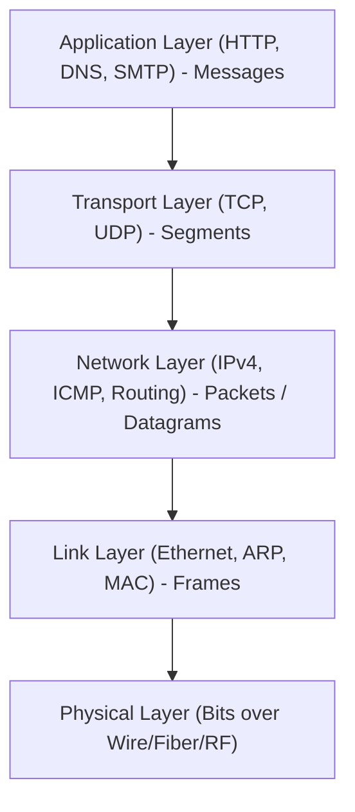
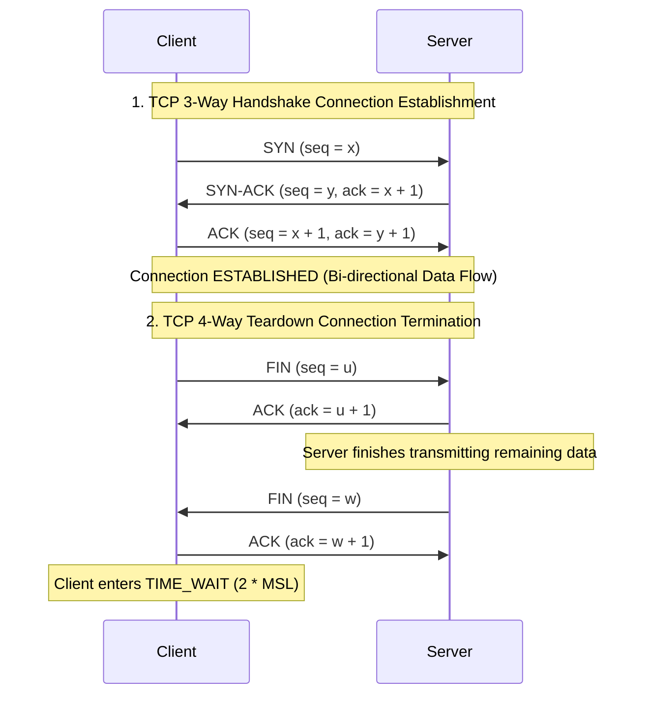

> [!info] Document Metadata
> - **Course:** `=this.course`
> - **Topic:** `=this.topic`
> - **Status:** `=this.status`

**Tags:** #[[Computer Science]] #[[CSNETWK]] #[[Networking]] #[[TCP-IP]] #[[Reviewer]] #[[Finals]]

---

# CSNETWK Comprehensive Finals Reviewer

## Overview

This reviewer consolidates Computer Networks (CSNETWK). Topics cover the OSI 7-layer and TCP/IP 5-layer models, socket programming (TCP streams vs UDP datagrams), Application Layer (HTTP/1.1 vs HTTP/2, DNS hierarchy, SMTP), Transport Layer (TCP 3-way handshake and 4-way teardown, sliding window flow control, congestion control with AIMD, Slow Start, Fast Retransmit), Network Layer (IPv4 addressing, subnetting/CIDR, NAT, routing protocols), Link Layer (Ethernet frames, ARP, MAC addresses, CSMA/CD), and Physical Layer fundamentals.

---

## 1. TCP vs UDP Protocol Comparison Matrix

| Feature | Transmission Control Protocol (TCP) | User Datagram Protocol (UDP) |
| :--- | :--- | :--- |
| **Connection State** | Connection-oriented (3-way handshake) | Connectionless (no handshake) |
| **Reliability** | Guaranteed in-order delivery; ACKs & retransmissions | Best-effort; packets can be lost, duplicated, out of order |
| **Flow Control** | Receive Window (`rwnd`) prevents buffer overrun | None |
| **Congestion Control** | Congestion Window (`cwnd`), AIMD, Slow Start | None |
| **Header Overhead** | 20–60 bytes | 8 bytes fixed |
| **Common Protocols** | HTTP/HTTPS, SSH, FTP, SMTP | DNS (queries), DHCP, VoIP (RTP), Video Streaming |

---

## 2. TCP Lifecycle Sequence Diagram

---

## 3. Subnetting & CIDR Calculation Matrix

- **IPv4 Address**: 32 bits divided into 4 octets.
- **CIDR Notation $/n$**: $n$ bits for Network ID, $32 - n$ bits for Host ID.
- **Formulas**:
  - Total Addresses in block: $2^{32 - n}$
  - Usable Host Addresses: $2^{32 - n} - 2$ (subtract Network Address all 0s, and Broadcast Address all 1s).

| CIDR Prefix | Subnet Mask | Total IPs | Usable Hosts |
| :--- | :--- | :--- | :--- |
| **/24** | 255.255.255.0 | 256 | 254 |
| **/25** | 255.255.255.128 | 128 | 126 |
| **/26** | 255.255.255.192 | 64 | 62 |
| **/28** | 255.255.255.240 | 16 | 14 |
| **/30** | 255.255.255.252 | 4 | 2 (Point-to-Point links) |

---

## 4. High-Yield Exam Checklist

- [ ] Does UDP provide flow or congestion control? **NO**, application must handle reliability if needed.
- [ ] In CIDR, why do we subtract 2 from total addresses? 1 for **Network ID** and 1 for **Broadcast Address**.
- [ ] What protocol resolves an IP address to a physical MAC address? **ARP** (Address Resolution Protocol).
- [ ] During TCP Slow Start, how does `cwnd` grow? Exponentially (doubles every RTT: $+1$ MSS per ACK).
- [ ] What is the purpose of the client `TIME_WAIT` state? Ensures final ACK was received by server and flushes old duplicate packets from network ($2 \times \text{MSL}$).

---

## 5. Comprehensive Practice Exam

1. In the TCP 3-way handshake, if the client sends a SYN packet with sequence number 500, what sequence and acknowledgment numbers will the server return in its SYN-ACK response?
   - A) `seq = 501, ack = 500`
   - B) `seq = y, ack = 501` (where $y$ is the server's initial sequence number)
   - C) `seq = 500, ack = 501`
   - D) `seq = y, ack = 500`

2. How many usable host IP addresses are available in the subnet `192.168.10.0/27`?
   - A) 27
   - B) 30
   - C) 32
   - D) 62

3. Which protocol is responsible for automatically assigning dynamic IP addresses, default gateways, and DNS servers to network hosts upon bootup?
   - A) DNS
   - B) ARP
   - C) DHCP
   - D) ICMP

4. What mechanism triggers TCP Fast Retransmit without waiting for the retransmission timer to expire?
   - A) Receipt of 3 duplicate ACKs
   - B) A single NACK packet
   - C) TCP RST flag set
   - D) Zero window advertisement

5. Which layer of the OSI model is responsible for end-to-end process-to-process communication, port multiplexing, and reliable byte streams?
   - A) Network Layer
   - B) Transport Layer
   - C) Data Link Layer
   - D) Application Layer

---

### Answer Key & Explanations

1. **B) `seq = y, ack = 501`** — The server chooses its own independent initial sequence number $y$ and sets the acknowledgment field to `client_seq + 1` ($500 + 1 = 501$) to acknowledge receipt of the client's SYN bit.
2. **B) 30** — In a $/27$ subnet, host bits $h = 32 - 27 = 5$. Total addresses = $2^5 = 32$. Usable hosts = $2^5 - 2 = 32 - 2 = 30$.
3. **C) DHCP** — Dynamic Host Configuration Protocol uses a 4-step DORA (Discover, Offer, Request, Acknowledge) exchange over UDP ports 67/68 to assign IP configuration parameters.
4. **A) Receipt of 3 duplicate ACKs** — When the sender receives 3 duplicate ACKs (4 identical ACKs total for the same sequence number), it deduces that the segment immediately following was lost and retransmits it immediately before timeout expiration.
5. **B) Transport Layer** — Layer 4 (Transport) provides logical communication between application processes on different hosts using port numbers (e.g., TCP and UDP).

---

## References & Navigation

- **Previous Topic:** [[CCPROG2]]
- **Next Topic:** [[NSCOM01]], [[NSCOM02]]
- **Prerequisites:** [[Computer Networks]], OSI, TCP/IP, Sockets, Subnetting
- **Cross-Curricular Connections:** [[NSSECU1]]
