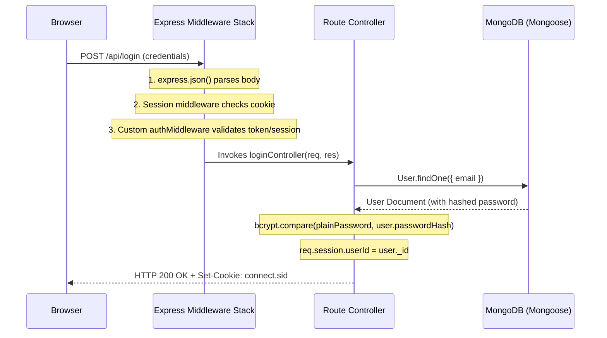

> [!info] Document Metadata
> - **Course:** `=this.course`
> - **Topic:** `=this.topic`
> - **Status:** `=this.status`

**Tags:** #[[Computer Science]] #[[CCAPDEV]] #[[Web Development]] #[[NodeJS]] #[[MongoDB]] #[[Reviewer]] #[[Finals]]

---

# CCAPDEV Comprehensive Finals Reviewer

## Overview

This reviewer consolidates Web Application Development (CCAPDEV). Subjects span semantic HTML5, modern CSS (Flexbox, CSS Grid, specificity hierarchy), client-side JavaScript (DOM manipulation, asynchronous fetch, event loop), Node.js server architecture, Express middleware pipelines, RESTful API design, template engines (Handlebars), MongoDB NoSQL database modeling via Mongoose, and session authentication and security practices (cookies, `express-session`, bcrypt password hashing, input sanitization).

```mermaid
flowchart LR
    Client["Client Browser<br/>• HTML5 / CSS3 / JS<br/>• Fetch API / Forms"] -->|HTTP REST Requests (JSON/Form)| Express["Express.js Server<br/>• Router & Controllers<br/>• Middleware Pipeline"]
    Express -->|Sessions / Auth (bcrypt)| SessionStore["Session Store / Cookies"]
    Express -->|Mongoose Schemas / CRUD| Mongo[("MongoDB NoSQL Database")]
```

---

## 1. Full-Stack Architecture & Express Middleware Pipeline



---

## 2. Core Web Technologies Comparison Matrix

| Technology / Component | Role / Layer | Key APIs / Syntax | Best Practices |
| :--- | :--- | :--- | :--- |
| **CSS Specificity** | Styling Layer | `Inline (1000) > ID (100) > Class (10) > Element (1)` | Prefer reusable classes; avoid `!important` |
| **JavaScript Asynchrony** | Client/Server Logic | `Promises`, `async/await`, `fetch()` | Always wrap `await` calls in `try...catch` blocks |
| **Express Middleware** | Server Pipeline | `app.use((req, res, next) => { ... next(); })` | Call `next()` to pass control; return on `res.send()` |
| **Mongoose Models** | Database ODM | `new mongoose.Schema({...})`, `Model.find()`, `create()` | Enforce validation, indexes, and schema constraints |
| **Authentication & Hash** | Security Layer | `bcrypt.hash(password, saltRounds)`, `bcrypt.compare()` | Never store plaintext passwords; use 10+ salt rounds |

---

## 3. High-Yield Exam Checklist

- [ ] Does `bcrypt.hash()` automatically generate and store the salt within the resulting hash string? **YES** (`$2b$10$...` contains algorithm, cost, salt, and hash).
- [ ] In Express, what happens if a middleware does NOT call `next()` or send a response (`res.json`)? The client request hangs indefinitely until timeout!
- [ ] Is `localStorage` safe for storing sensitive session tokens against XSS attacks? **NO**, prefer `HttpOnly` secure cookies.
- [ ] What is the difference between MongoDB `find()` and `findOne()`? `find()` returns an array/cursor of matching documents; `findOne()` returns a single document object (or `null`).
- [ ] Does CSS `display: flex` align items along the cross axis using `align-items` and main axis using `justify-content`? **YES**.

---

## 4. Comprehensive Practice Exam

1. In CSS specificity calculation, which of the following selectors has the highest specificity?
   - A) `div.card p.text`
   - B) `#sidebar ul.nav li`
   - C) `body header nav a`
   - D) `.modal .btn.primary`

2. In an Express.js middleware function, what must be invoked to pass control to the subsequent middleware handler in the stack?
   - A) `res.continue()`
   - B) `next()`
   - C) `return true`
   - D) `app.next()`

3. Why should session identifier cookies always be configured with the `httpOnly: true` attribute?
   - A) To force the cookie to transmit exclusively over HTTPS
   - B) To prevent client-side JavaScript from accessing `document.cookie`, mitigating XSS credential theft
   - C) To automatically delete the cookie when the browser closes
   - D) To compress the cookie header payload

4. What is the return value of `await bcrypt.compare(submittedPassword, storedHash)` when the submitted password matches?
   - A) The decrypted plaintext password
   - B) A new hash string
   - C) A boolean `true`
   - D) The user document `_id`

5. In Mongoose, which method atomically updates an existing document and returns the newly modified document when `{ new: true }` is passed?
   - A) `User.save()`
   - B) `User.findOneAndUpdate()`
   - C) `User.insertMany()`
   - D) `User.replaceOne()`

---

### Answer Key & Explanations

1. **B) `#sidebar ul.nav li`** — Specificity breakdown: 1 ID (`#sidebar` = 100), 1 Class (`.nav` = 10), 2 Elements (`ul`, `li` = 2) $\to$ Total specificity (0, 1, 1, 2) = 112. Option A is (0, 0, 2, 2) = 22; Option C is (0, 0, 0, 4) = 4; Option D is (0, 0, 3, 0) = 30.
2. **B) `next()`** — Express middleware receives `(req, res, next)`. Invoking `next()` informs Express that the current handler has completed its task and yields execution to the next middleware in the queue.
3. **B) To prevent client-side JavaScript from accessing `document.cookie`, mitigating XSS credential theft** — When `httpOnly` is enabled, malicious injected JavaScript cannot read the session cookie via `document.cookie`.
4. **C) A boolean `true`** — `bcrypt.compare()` hashes the plaintext candidate using the salt embedded inside the stored hash and compares the results in constant time, resolving to `true` on match and `false` on mismatch.
5. **B) `User.findOneAndUpdate()`** — `Model.findOneAndUpdate(query, update, { new: true })` finds a matching document, applies updates atomically in MongoDB, and returns the updated document instead of the original pre-update document.


---

## References & Navigation

- **Previous Topic:** [[CCPROG3]]
- **Next Topic:** None
- **Prerequisites:** [[Web Development]], HTML, CSS, JavaScript, Express, MongoDB
- **Cross-Curricular Connections:** [[CCINFOM]]
